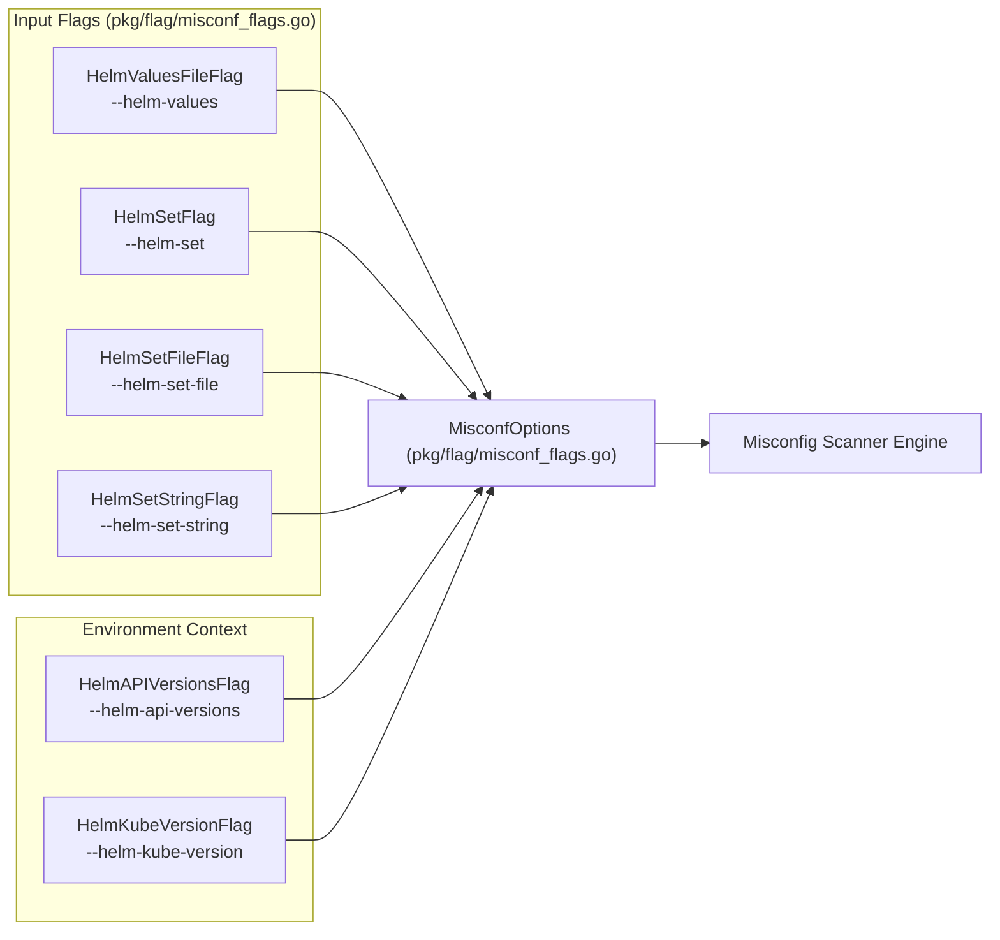

<!-- source: DeepWiki mcp.deepwiki.com · repo aquasecurity/trivy · page 2.3 Misconfiguration Scanning Configuration · fetched 2026-10-30 -->

# Misconfiguration Scanning Configuration

Relevant source files

The following files were used as context for generating this wiki page:

- [pkg/dependency/parser/gradle/lockfile/parse.go](pkg/dependency/parser/gradle/lockfile/parse.go)
- [pkg/dependency/parser/gradle/lockfile/parse_test.go](pkg/dependency/parser/gradle/lockfile/parse_test.go)
- [pkg/dependency/parser/gradle/lockfile/testdata/happy.lockfile](pkg/dependency/parser/gradle/lockfile/testdata/happy.lockfile)
- [pkg/dependency/parser/ruby/gemspec/parse.go](pkg/dependency/parser/ruby/gemspec/parse.go)
- [pkg/fanal/analyzer/language/java/gradle/lockfile.go](pkg/fanal/analyzer/language/java/gradle/lockfile.go)
- [pkg/fanal/analyzer/language/java/gradle/lockfile_test.go](pkg/fanal/analyzer/language/java/gradle/lockfile_test.go)
- [pkg/fanal/analyzer/language/java/gradle/pom.go](pkg/fanal/analyzer/language/java/gradle/pom.go)
- [pkg/fanal/analyzer/language/java/gradle/pom_test.go](pkg/fanal/analyzer/language/java/gradle/pom_test.go)
- [pkg/fanal/analyzer/language/java/gradle/testdata/cache/caches/modules-2/files-2.1/junit/junit/4.13/5c17760663fae422643fc859fd352c68a1d91bfc/junit-4.13.pom](pkg/fanal/analyzer/language/java/gradle/testdata/cache/caches/modules-2/files-2.1/junit/junit/4.13/5c17760663fae422643fc859fd352c68a1d91bfc/junit-4.13.pom)
- [pkg/fanal/analyzer/language/java/gradle/testdata/cache/caches/modules-2/files-2.1/org.hamcrest/hamcrest-core/1.3/872e413497b906e7c9fa85ccc96046c5d1ef7ece/hamcrest-core-1.3.pom](pkg/fanal/analyzer/language/java/gradle/testdata/cache/caches/modules-2/files-2.1/org.hamcrest/hamcrest-core/1.3/872e413497b906e7c9fa85ccc96046c5d1ef7ece/hamcrest-core-1.3.pom)
- [pkg/flag/misconf_flags.go](pkg/flag/misconf_flags.go)
- [pkg/flag/options_test.go](pkg/flag/options_test.go)
- [pkg/flag/report_flags.go](pkg/flag/report_flags.go)
- [pkg/flag/report_flags_test.go](pkg/flag/report_flags_test.go)
- [pkg/flag/scan_flags.go](pkg/flag/scan_flags.go)
- [pkg/flag/scan_flags_test.go](pkg/flag/scan_flags_test.go)
- [pkg/flag/vulnerability_flags.go](pkg/flag/vulnerability_flags.go)
- [pkg/iac/scanners/cloudformation/parser/fn_split.go](pkg/iac/scanners/cloudformation/parser/fn_split.go)
- [pkg/x/strings/strings.go](pkg/x/strings/strings.go)

This document provides a comprehensive reference for Trivy's misconfiguration scanning configuration flags. These flags control how Trivy scans Infrastructure as Code (IaC) files, Kubernetes manifests, and other configuration formats for security issues and misconfigurations.

For information about how misconfiguration scanning is implemented and executed, see [Misconfiguration Scanning](#4.2). For general command structure and global flags, see [Command Structure and Global Flags](#2.1). For specific scan commands that use these flags, see [Scan Commands and Target Options](#2.2).

## Flag Organization and Structure

All misconfiguration-related flags are defined in `MisconfFlagGroup`, which provides a cohesive set of configuration options for IaC scanning. The flag group follows Trivy's standard flag pattern, where each flag is defined with a name, config file key, default value, and usage description.

### Code Entity Mapping: MisconfFlagGroup
The following diagram maps the Natural Language configuration categories to the specific `Flag` entities defined in the `pkg/flag` package.

```mermaid
graph TB
    MisconfFlagGroup["MisconfFlagGroup (pkg/flag/misconf_flags.go)"]
    
    subgraph "Core Scan Options"
        IncludeNonFailures["IncludeNonFailuresFlag<br/>--include-non-failures"]
        ChecksBundle["ChecksBundleRepositoryFlag<br/>--checks-bundle-repository"]
        MisconfigScanners["MisconfigScannersFlag<br/>--misconfig-scanners"]
    end
    
    subgraph "Helm Configuration"
        HelmValues["HelmValuesFileFlag<br/>--helm-values"]
        HelmSet["HelmSetFlag<br/>--helm-set"]
        HelmSetFile["HelmSetFileFlag<br/>--helm-set-file"]
        HelmSetString["HelmSetStringFlag<br/>--helm-set-string"]
        HelmAPIVersions["HelmAPIVersionsFlag<br/>--helm-api-versions"]
        HelmKubeVersion["HelmKubeVersionFlag<br/>--helm-kube-version"]
    end
    
    subgraph "Terraform & CloudFormation"
        TfVars["TfVarsFlag<br/>--tf-vars"]
        TfExcludeDownloaded["TerraformExcludeDownloaded<br/>--tf-exclude-downloaded-modules"]
        CfParams["CfParamsFlag<br/>--cf-params"]
    end
    
    subgraph "Ansible Configuration"
        AnsiblePlaybooks["AnsiblePlaybooks<br/>--ansible-playbook"]
        AnsibleInventories["AnsibleInventories<br/>--ansible-inventory"]
        AnsibleExtraVars["AnsibleExtraVars<br/>--ansible-extra-vars"]
    end
    
    MisconfFlagGroup --> IncludeNonFailures
    MisconfFlagGroup --> ChecksBundle
    MisconfFlagGroup --> MisconfigScanners
    MisconfFlagGroup --> HelmValues
    MisconfFlagGroup --> HelmSet
    MisconfFlagGroup --> HelmSetFile
    MisconfFlagGroup --> HelmSetString
    MisconfFlagGroup --> HelmAPIVersions
    MisconfFlagGroup --> HelmKubeVersion
    MisconfFlagGroup --> TfVars
    MisconfFlagGroup --> TfExcludeDownloaded
    MisconfFlagGroup --> CfParams
    MisconfFlagGroup --> AnsiblePlaybooks
    MisconfFlagGroup --> AnsibleInventories
    MisconfFlagGroup --> AnsibleExtraVars
```

**Sources:** [pkg/flag/misconf_flags.go:147-170](), [pkg/flag/misconf_flags.go:21-143]()

The `MisconfFlagGroup` structure is instantiated via `NewMisconfFlagGroup()` and converted to `MisconfOptions` through the `ToOptions()` method [pkg/flag/misconf_flags.go:251-274](). This conversion transforms string slice flags into strongly-typed enums where appropriate, such as `analyzer.Type` for scanner selection or `types.ConfigType` for rendering options.

## Core Misconfiguration Flags

### Include Non-Failures Flag

**Flag:** `--include-non-failures`  
**Config Key:** `misconfiguration.include-non-failures`  
**Type:** Boolean  
**Default:** `false`

Controls whether to include successful checks in the output. When enabled, Trivy reports not only failed checks but also checks that passed. This is useful for compliance reporting and understanding the full security posture.

**Sources:** [pkg/flag/misconf_flags.go:35-40]()

### Checks Bundle Repository Flag

**Flag:** `--checks-bundle-repository`  
**Config Key:** `misconfiguration.checks-bundle-repository`  
**Type:** String  
**Default:** `ghcr.io/aquasecurity/trivy-checks:<version>`

Specifies the OCI registry URL from which to retrieve the checks bundle containing Rego policies. The default is constructed using `policy.BundleRepository` and `policy.BundleVersion` [pkg/flag/misconf_flags.go:88-100]().

**Aliases:** `--policy-bundle-repository` (deprecated)

### Misconfiguration Scanners Flag

**Flag:** `--misconfig-scanners`  
**Config Key:** `misconfiguration.scanners`  
**Type:** String slice  
**Default:** All config file types except YAML and JSON [pkg/flag/misconf_flags.go:101-109]().

Controls which configuration file types are scanned. Trivy uses the `analyzer.TypeConfigFiles` list but excludes generic formats by default using `lo.Without(analyzer.TypeConfigFiles, analyzer.TypeYAML, analyzer.TypeJSON)` [pkg/flag/misconf_flags.go:104-106]().

## Helm Configuration Flags

Helm charts require specific context to be rendered correctly before scanning. Trivy implements flags that mirror the standard `helm template` command behavior.

### Helm Flag Implementation Data Flow
The following diagram illustrates how Helm-specific flags are processed into the scanning engine.

**Sources:** [pkg/flag/misconf_flags.go:41-70](), [pkg/flag/misconf_flags.go:172-195]()

*   **`--helm-values`**: Paths to override the default `values.yaml` [pkg/flag/misconf_flags.go:41-45]().
*   **`--helm-set`**: Individual values specified as `key1=val1,key2=val2` [pkg/flag/misconf_flags.go:46-50]().
*   **`--helm-set-file`**: Values where the value is the content of a file, specified as `key1=path1` [pkg/flag/misconf_flags.go:51-55]().
*   **`--helm-set-string`**: Forces values to be treated as strings [pkg/flag/misconf_flags.go:56-60]().
*   **`--helm-api-versions`**: Simulates `Capabilities.APIVersions` for conditional template rendering [pkg/flag/misconf_flags.go:61-65]().
*   **`--helm-kube-version`**: Simulates `Capabilities.KubeVersion` [pkg/flag/misconf_flags.go:66-70]().

## Terraform and CloudFormation Flags

### Terraform Variables and Modules
*   **`--tf-vars`**: Paths to override Terraform `.tfvars` files [pkg/flag/misconf_flags.go:71-75]().
*   **`--tf-exclude-downloaded-modules`**: Excludes misconfigurations for modules downloaded into the `.terraform` directory [pkg/flag/misconf_flags.go:82-87]().

### CloudFormation Parameters
*   **`--cf-params`**: Paths to CloudFormation parameter files [pkg/flag/misconf_flags.go:76-81]().

## Ansible Configuration Flags

Trivy supports scanning Ansible playbooks and inventories.

*   **`--ansible-playbook`**: Paths to playbook files [pkg/flag/misconf_flags.go:129-133]().
*   **`--ansible-inventory`**: Host paths or comma-separated host lists [pkg/flag/misconf_flags.go:134-138]().
*   **`--ansible-extra-vars`**: Additional variables specified as `key=value` or `@file` [pkg/flag/misconf_flags.go:139-143]().

## Advanced Scanning Options

### Configuration File Schemas
**Flag:** `--config-file-schemas`  
**Config Key:** `misconfiguration.config-file-schemas`

Specifies paths to JSON configuration file schemas. These schemas allow Trivy to determine if a file matches a specific configuration type and provide type-checking information to Rego checks [pkg/flag/misconf_flags.go:110-114]().

### Render Cause and Raw Scanners
*   **`--render-cause`**: Displays the rendered cause (e.g., evaluated variables) in the table report for specific types like `Terraform` or `Ansible` [pkg/flag/misconf_flags.go:115-121]().
*   **`--raw-config-scanners`**: Scanners that will also process raw (non-adapted) configurations into a shared state, currently supporting `Terraform` [pkg/flag/misconf_flags.go:122-128]().

## Flag-to-Options Conversion Logic

The `ToOptions` method in `pkg/flag/misconf_flags.go` performs the critical task of mapping CLI/Viper inputs into the `MisconfOptions` struct used by the scanner.

| Code Entity | Target Option | Logic |
| :--- | :--- | :--- |
| `MisconfigScannersFlag` | `MisconfigScanners` | Maps string names to `analyzer.Type` [pkg/flag/misconf_flags.go:254-256]() |
| `RenderCauseFlag` | `RenderCause` | Maps strings to `types.ConfigType` [pkg/flag/misconf_flags.go:261-263]() |
| `RawConfigScanners` | `RawConfigScanners` | Maps strings to `types.ConfigType` [pkg/flag/misconf_flags.go:264-266]() |

**Sources:** [pkg/flag/misconf_flags.go:251-274]()

---

