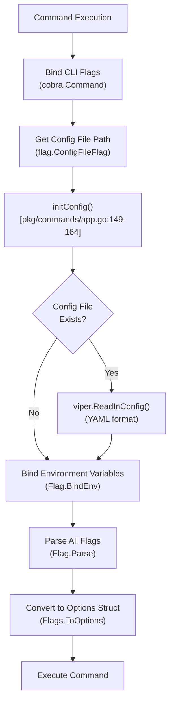
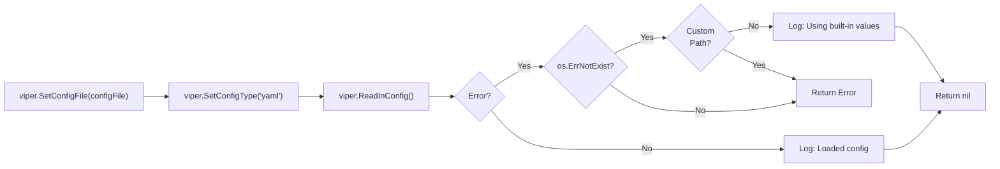
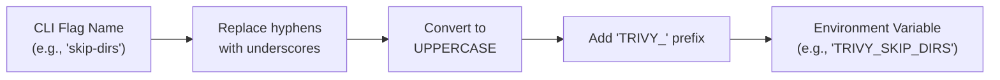
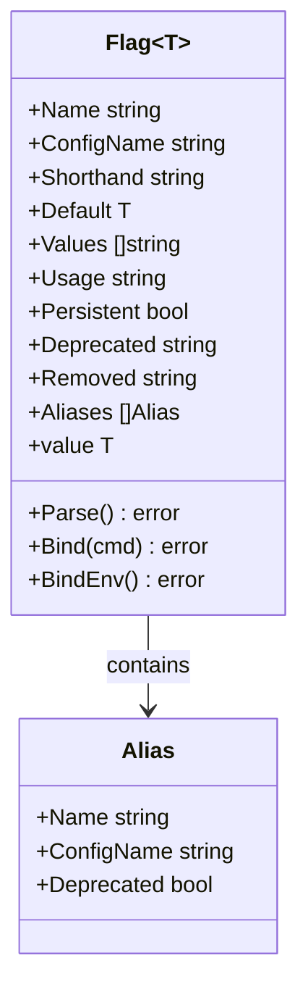
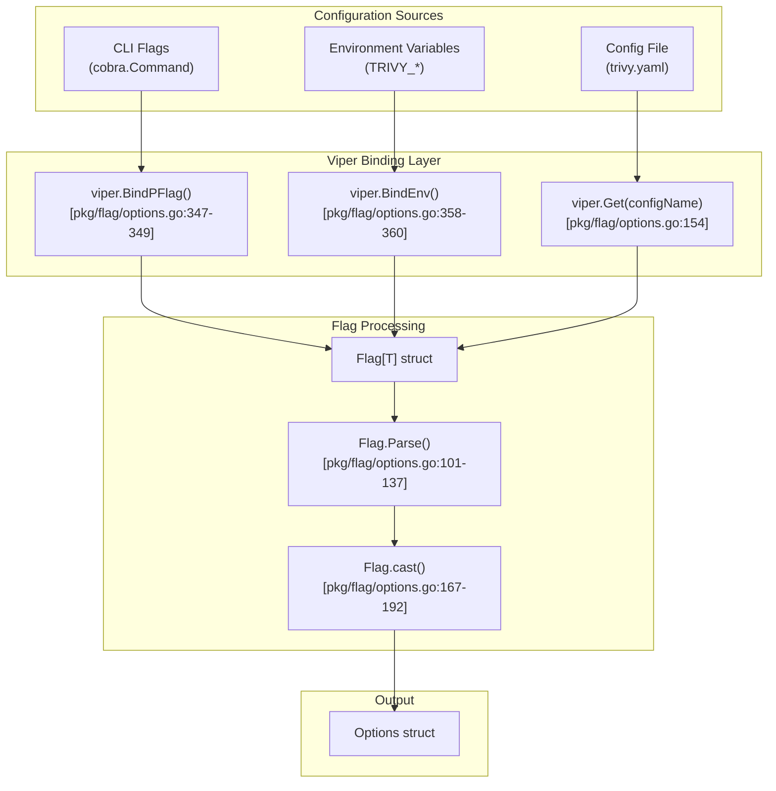

<!-- source: DeepWiki mcp.deepwiki.com · repo aquasecurity/trivy · page 2.4 Configuration Files and Environment Variables · fetched 2026-10-30 -->

# Configuration Files and Environment Variables

<details>
<summary>Relevant source files</summary>

The following files were used as context for generating this wiki page:

- [README.md](README.md)
- [go.mod](go.mod)
- [go.sum](go.sum)
- [mkdocs.yml](mkdocs.yml)
- [pkg/commands/app.go](pkg/commands/app.go)
- [pkg/commands/app_test.go](pkg/commands/app_test.go)
- [pkg/commands/artifact/run.go](pkg/commands/artifact/run.go)
- [pkg/commands/testdata/java-db/metadata.json](pkg/commands/testdata/java-db/metadata.json)
- [pkg/commands/testdata/policy/metadata.json](pkg/commands/testdata/policy/metadata.json)
- [pkg/dependency/parser/gradle/lockfile/parse.go](pkg/dependency/parser/gradle/lockfile/parse.go)
- [pkg/dependency/parser/gradle/lockfile/parse_test.go](pkg/dependency/parser/gradle/lockfile/parse_test.go)
- [pkg/dependency/parser/gradle/lockfile/testdata/happy.lockfile](pkg/dependency/parser/gradle/lockfile/testdata/happy.lockfile)
- [pkg/dependency/parser/ruby/gemspec/parse.go](pkg/dependency/parser/ruby/gemspec/parse.go)
- [pkg/fanal/analyzer/language/java/gradle/lockfile.go](pkg/fanal/analyzer/language/java/gradle/lockfile.go)
- [pkg/fanal/analyzer/language/java/gradle/lockfile_test.go](pkg/fanal/analyzer/language/java/gradle/lockfile_test.go)
- [pkg/fanal/analyzer/language/java/gradle/pom.go](pkg/fanal/analyzer/language/java/gradle/pom.go)
- [pkg/fanal/analyzer/language/java/gradle/pom_test.go](pkg/fanal/analyzer/language/java/gradle/pom_test.go)
- [pkg/fanal/analyzer/language/java/gradle/testdata/cache/caches/modules-2/files-2.1/junit/junit/4.13/5c17760663fae422643fc859fd352c68a1d91bfc/junit-4.13.pom](pkg/fanal/analyzer/language/java/gradle/testdata/cache/caches/modules-2/files-2.1/junit/junit/4.13/5c17760663fae422643fc859fd352c68a1d91bfc/junit-4.13.pom)
- [pkg/fanal/analyzer/language/java/gradle/testdata/cache/caches/modules-2/files-2.1/org.hamcrest/hamcrest-core/1.3/872e413497b906e7c9fa85ccc96046c5d1ef7ece/hamcrest-core-1.3.pom](pkg/fanal/analyzer/language/java/gradle/testdata/cache/caches/modules-2/files-2.1/org.hamcrest/hamcrest-core/1.3/872e413497b906e7c9fa85ccc96046c5d1ef7ece/hamcrest-core-1.3.pom)
- [pkg/flag/options.go](pkg/flag/options.go)
- [pkg/flag/options_test.go](pkg/flag/options_test.go)
- [pkg/flag/report_flags.go](pkg/flag/report_flags.go)
- [pkg/flag/report_flags_test.go](pkg/flag/report_flags_test.go)
- [pkg/flag/scan_flags.go](pkg/flag/scan_flags.go)
- [pkg/flag/scan_flags_test.go](pkg/flag/scan_flags_test.go)
- [pkg/flag/vulnerability_flags.go](pkg/flag/vulnerability_flags.go)
- [pkg/iac/scanners/cloudformation/parser/fn_split.go](pkg/iac/scanners/cloudformation/parser/fn_split.go)
- [pkg/x/strings/strings.go](pkg/x/strings/strings.go)

</details>


## Purpose and Scope

This document explains how to configure Trivy using YAML configuration files and environment variables as alternatives or supplements to command-line flags. Trivy uses the [Viper](https://github.com/spf13/viper) configuration library to provide a flexible, hierarchical configuration system that supports multiple configuration sources with a defined precedence order [go.mod:106]().

For information about available CLI flags and their usage, see **2.1 Command Structure and Global Flags** and **2.2 Scan Commands and Target Options**.

---

## Configuration Sources and Precedence

Trivy accepts configuration from three sources, evaluated in the following precedence order (highest to lowest):

1.  **Command-line flags** - Explicitly passed flags (e.g., `--severity CRITICAL`) [pkg/commands/app.go:191-193]()
2.  **Environment variables** - Variables with the `TRIVY_` prefix [pkg/flag/options.go:355-360]()
3.  **Configuration file** - YAML file specified via `--config` flag or default location [pkg/commands/app.go:149-164]()

When the same option is specified in multiple sources, the higher precedence source takes effect. This allows you to set baseline configurations in a file while overriding specific values via environment variables or flags.

### Configuration Loading Flow



**Sources:** [pkg/commands/app.go:149-164](), [pkg/commands/app.go:184-213](), [pkg/flag/options.go:329-353]()

---

## Configuration File Format

Trivy configuration files use YAML format [pkg/commands/app.go:152]() with a hierarchical structure that mirrors the CLI flag organization. The configuration file is typically named `trivy.yaml` and can be specified explicitly via the `--config` flag.

### File Location and Loading

The default configuration file is loaded from the current working directory if not specified. The loading process is implemented in `initConfig`:



**Sources:** [pkg/commands/app.go:149-164]()

### Hierarchical Structure

Configuration keys use dot notation to represent nested structures. For example, the `--scanners` flag maps to the `scan.scanners` configuration key [pkg/flag/scan_flags.go:35-37]().

| CLI Flag | Config Key | Description |
|----------|-----------|-------------|
| `--severity` | `severity` | Severities to include [pkg/flag/report_flags.go:102-104]() |
| `--skip-dirs` | `scan.skip-dirs` | Directories to skip [pkg/flag/scan_flags.go:18-20]() |
| `--scanners` | `scan.scanners` | Scanners to enable [pkg/flag/scan_flags.go:35-37]() |
| `--ignore-unfixed` | `vulnerability.ignore-unfixed` | Display only fixed vulnerabilities [pkg/flag/vulnerability_flags.go:15-17]() |
| `--format` | `format` | Output format [pkg/flag/report_flags.go:29-31]() |

### Example Configuration File

```yaml
# Scanning configuration
scan:
  severity:
    - CRITICAL
    - HIGH
  skip-dirs:
    - node_modules
    - vendor
  scanners:
    - vuln
    - secret

# Vulnerability specific
vulnerability:
  ignore-unfixed: true

# Report configuration
format: json
output: result.json
```

**Sources:** [pkg/flag/scan_flags.go:18-138](), [pkg/flag/report_flags.go:29-129](), [pkg/flag/vulnerability_flags.go:15-49]()

---

## Environment Variables

Trivy supports environment variables for all configuration options. The naming convention transforms CLI flag names to uppercase with underscores and adds a `TRIVY_` prefix.

### Naming Convention

The transformation follows these rules:



**Implementation:**
The environment variable name is generated by joining the prefix and the flag name transformed to uppercase with underscores [pkg/flag/options.go:355-356]().

**Sources:** [pkg/flag/options.go:355-360]()

### List-Type Values

For flags that accept multiple values (string slices), environment variables use comma-separated values. The `cast` logic handles splitting these strings back into slices [pkg/flag/options.go:182-188]().

```bash
export TRIVY_SEVERITY=CRITICAL,HIGH
export TRIVY_SKIP_DIRS=node_modules,vendor
```

**Sources:** [pkg/flag/options.go:182-189]()

---

## Flag to Configuration Mapping System

Trivy uses a generic `Flag[T]` structure to define all configuration options. Each flag contains metadata about its CLI name, configuration key, and default value [pkg/flag/options.go:36-85]().

### Flag Structure

The `Flag[T]` struct defines how each option is represented across configuration sources:



**Sources:** [pkg/flag/options.go:36-91]()

### Parse Process

When configuration is parsed, Trivy checks multiple sources in a specific order within the `Flag.parse()` method [pkg/flag/options.go:139-164]():

1.  **Check Aliases**: Looks for deprecated configuration keys in the config file [pkg/flag/options.go:143-152]().
2.  **Primary Key**: Retrieves the value using `viper.Get(f.ConfigName)` [pkg/flag/options.go:154]().
3.  **Manual Default**: For config-only flags (no CLI name), manually handles defaults [pkg/flag/options.go:159-161]().

**Sources:** [pkg/flag/options.go:139-164]()

---

## Deprecated and Removed Flags

Trivy maintains backward compatibility while evolving its configuration system by supporting deprecated aliases and marking removed flags.

### Handling Deprecated Options

When a deprecated flag is used, Trivy logs a warning [pkg/flag/options.go:127-129](). If a deprecated configuration key (alias) is used in the config file, a warning is also logged [pkg/flag/options.go:149]().

Example of a deprecated flag with an alias:
```go
ScannersFlag = Flag[[]string]{
    Name:       "scanners",
    ConfigName: "scan.scanners",
    Aliases: []Alias{
        {
            Name:       "security-checks",
            ConfigName: "scan.security-checks",
            Deprecated: true,
        },
    },
}
```
**Sources:** [pkg/flag/scan_flags.go:35-71](), [pkg/flag/options.go:127-129](), [pkg/flag/options.go:149]()

### Removed Flags

Removed flags generate an error and halt execution [pkg/flag/options.go:130-133]().

```go
if f.Removed != "" && f.isSet() {
    log.Errorf(`"--%s" was removed. %s`, f.Name, f.Removed)
    return xerrors.Errorf(`removed flag ("--%s")`, f.Name)
}
```
**Sources:** [pkg/flag/options.go:130-133]()

---

## Configuration Resolution Architecture

The complete binding process connects CLI flags, configuration files, and environment variables through Viper:



**Sources:** [pkg/flag/options.go:101-218](), [pkg/flag/options.go:329-375]()

---

