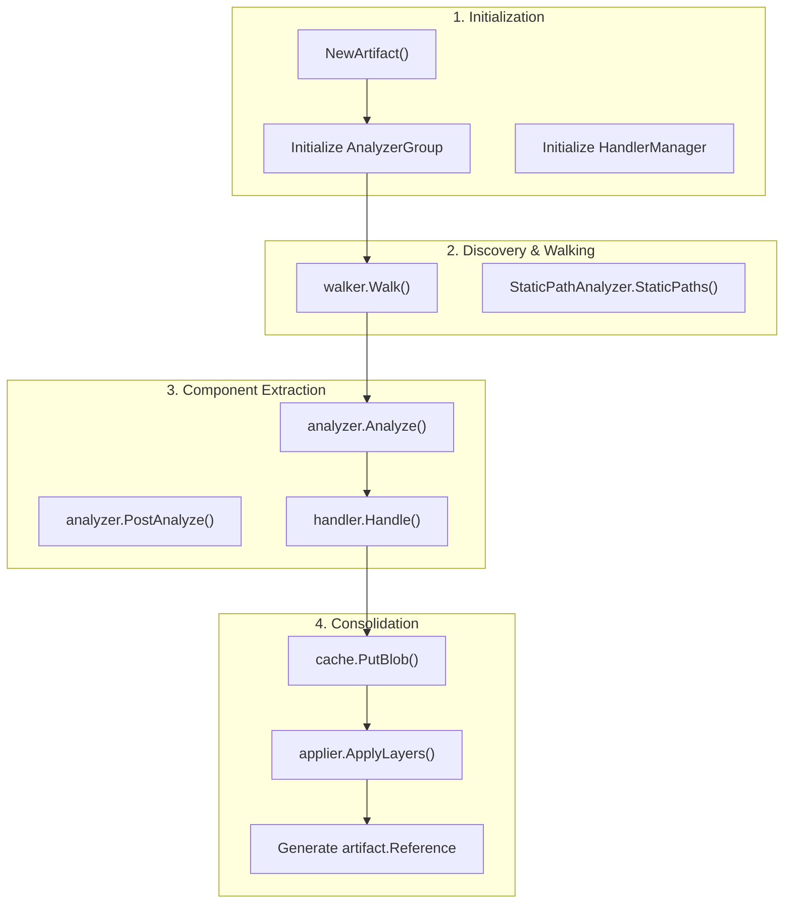

<!-- source: DeepWiki mcp.deepwiki.com · repo aquasecurity/trivy · page 3 Artifact Analysis System · fetched 2026-10-30 -->

# Artifact Analysis System

Relevant source files

The following files were used as context for generating this wiki page:

- [pkg/fanal/analyzer/analyzer.go](pkg/fanal/analyzer/analyzer.go)
- [pkg/fanal/analyzer/analyzer_test.go](pkg/fanal/analyzer/analyzer_test.go)
- [pkg/fanal/analyzer/pkg/apk/apk.go](pkg/fanal/analyzer/pkg/apk/apk.go)
- [pkg/fanal/analyzer/pkg/apk/apk_test.go](pkg/fanal/analyzer/pkg/apk/apk_test.go)
- [pkg/fanal/analyzer/pkg/apk/testdata/apk](pkg/fanal/analyzer/pkg/apk/testdata/apk)
- [pkg/fanal/applier/applier.go](pkg/fanal/applier/applier.go)
- [pkg/fanal/applier/applier_test.go](pkg/fanal/applier/applier_test.go)
- [pkg/fanal/artifact/artifact.go](pkg/fanal/artifact/artifact.go)
- [pkg/fanal/artifact/image/image.go](pkg/fanal/artifact/image/image.go)
- [pkg/fanal/artifact/image/image_test.go](pkg/fanal/artifact/image/image_test.go)
- [pkg/fanal/artifact/local/fs.go](pkg/fanal/artifact/local/fs.go)
- [pkg/fanal/artifact/local/fs_test.go](pkg/fanal/artifact/local/fs_test.go)
- [pkg/fanal/artifact/sbom/sbom_test.go](pkg/fanal/artifact/sbom/sbom_test.go)
- [pkg/fanal/artifact/vm/vm_test.go](pkg/fanal/artifact/vm/vm_test.go)
- [pkg/fanal/test/integration/testdata/goldens/packages/alpine-310.json.golden](pkg/fanal/test/integration/testdata/goldens/packages/alpine-310.json.golden)
- [pkg/fanal/test/integration/testdata/goldens/packages/vulnimage.json.golden](pkg/fanal/test/integration/testdata/goldens/packages/vulnimage.json.golden)
- [pkg/fanal/test/integration/testdata/goldens/vuln-image1.2.3.expectedlibs.golden](pkg/fanal/test/integration/testdata/goldens/vuln-image1.2.3.expectedlibs.golden)
- [pkg/fanal/types/artifact.go](pkg/fanal/types/artifact.go)
- [pkg/fanal/walker/fs.go](pkg/fanal/walker/fs.go)
- [pkg/fanal/walker/fs_test.go](pkg/fanal/walker/fs_test.go)
- [pkg/fanal/walker/tar.go](pkg/fanal/walker/tar.go)
- [pkg/fanal/walker/tar_test.go](pkg/fanal/walker/tar_test.go)
- [pkg/fanal/walker/vm.go](pkg/fanal/walker/vm.go)
- [pkg/fanal/walker/walk.go](pkg/fanal/walker/walk.go)
- [pkg/fanal/walker/walk_test.go](pkg/fanal/walker/walk_test.go)

## Purpose and Scope

The Artifact Analysis System is the core engine responsible for decomposing various artifact types—including container images, local filesystems, virtual machine images, and Git repositories—into a structured inventory of components. It extracts operating system information, installed packages, application dependencies, and configuration metadata. This system provides the foundational data used by the vulnerability, misconfiguration, and secret scanning engines.

For details on specific subsystems, see the following child pages:
- [Layer Processing and Package Extraction](#3.1) — Detailed mechanics of container layer merging and package provenance.
- [Package URL (PURL) System](#3.2) — Standardized identification of components across ecosystems.
- [Analyzer Types and Language Support](#3.3) — Technical details on individual language and OS scanners.

## High-Level Architecture

The analysis process is orchestrated by the `Artifact` interface [pkg/fanal/artifact/artifact.go:84-87](). Depending on the scan target, Trivy instantiates a specific implementation:
- **Container Images**: `image.Artifact` [pkg/fanal/artifact/image/image.go:39-51]()
- **Filesystems/Repositories**: `local.Artifact` [pkg/fanal/artifact/local/fs.go:42-54]()
- **Virtual Machines**: `vm.Artifact` (supporting EBS snapshots and raw disk images) [pkg/fanal/artifact/vm/vm_test.go:19-20]()

### Analysis Workflow

The system follows a standardized execution flow to transform raw bytes into a `Reference` [pkg/fanal/artifact/artifact.go:90-100]():

Sources: [pkg/fanal/artifact/image/image.go:53-87](), [pkg/fanal/artifact/local/fs.go:56-98](), [pkg/fanal/artifact/artifact.go:84-100]()

## Analyzer Subsystem

The `analyzer` package is the heart of the extraction logic. It defines how specific files (like `Gemfile.lock` or `/lib/apk/db/installed`) are parsed.

### Analyzer Interface
Every analyzer must implement the `analyzer` interface [pkg/fanal/analyzer/analyzer.go:75-80](), which defines:
- `Type()`: A unique identifier (e.g., `TypeApk`, `TypePip`) [pkg/fanal/analyzer/const.go:156-274]().
- `Required()`: Logic to determine if a file should be processed by this analyzer based on its path or metadata.
- `Analyze()`: The actual parsing logic that returns an `AnalysisResult`.

### Analyzer Grouping and Dispatch
Trivy uses an `AnalyzerGroup` [pkg/fanal/analyzer/analyzer.go:133-139]() to manage multiple analyzers. To optimize performance, it supports:
- **Parallelism**: Running multiple analyzers concurrently [pkg/fanal/analyzer/analyzer.go:47]().
- **Static Paths**: If an analyzer only looks for specific files (e.g., `/etc/os-release`), Trivy can skip full directory traversal [pkg/fanal/analyzer/analyzer.go:126-129]().

### Analysis Result Structure
The output of the analyzer subsystem is an `AnalysisResult` [pkg/fanal/analyzer/analyzer.go:176-197](), which aggregates:
- **OS**: Detected operating system family and version [pkg/fanal/types/artifact.go:23-30]().
- **PackageInfos**: OS-level packages (apk, dpkg, rpm) [pkg/fanal/types/artifact.go:106-109]().
- **Applications**: Language-specific dependencies (npm, pypi, cargo, etc.) [pkg/fanal/types/artifact.go:111-121]().

Sources: [pkg/fanal/analyzer/analyzer.go:75-139](), [pkg/fanal/analyzer/const.go:156-274](), [pkg/fanal/types/artifact.go:106-121]()

## Artifact Processing Models

Trivy adapts its analysis strategy based on the nature of the artifact:

### Container Images
For images, the `image.Artifact` handles layer-aware analysis. It identifies "diff IDs" for each layer [pkg/fanal/artifact/image/image.go:101](), checks the cache for existing results [pkg/fanal/artifact/image/image.go:135](), and uses the `applier` to merge results from multiple layers into a final view [pkg/fanal/applier/applier_test.go:21-32]().
For details, see [Layer Processing and Package Extraction](#3.1).

### Filesystems and Repositories
The `local.Artifact` processes local directories. If a `.git` directory is found, it extracts `RepoMetadata` (commit hash, branch, tags) [pkg/fanal/artifact/local/fs.go:103-167](). This metadata is used to generate stable cache keys for repositories [pkg/fanal/artifact/local/fs.go:87-92]().

### Virtual Machine Images
The `vm.Artifact` supports scanning disk images and cloud snapshots (EBS). It utilizes specialized walkers to navigate partition tables and filesystems within the disk image [pkg/fanal/artifact/vm/vm_test.go:38-60]().

| Artifact Type | Code Entity | Identification Mechanism |
| :--- | :--- | :--- |
| **Container Image** | `types.TypeContainerImage` | Image ID & Layer Diff IDs |
| **Filesystem** | `types.TypeFilesystem` | File path & directory hash |
| **Repository** | `types.TypeRepository` | Git Commit Hash |
| **VM Image** | `types.TypeVM` | EBS Snapshot ID or File Digest |

Sources: [pkg/fanal/artifact/image/image.go:89-169](), [pkg/fanal/artifact/local/fs.go:103-167](), [pkg/fanal/types/artifact.go:13-21](), [pkg/fanal/artifact/vm/vm_test.go:102-152]()

## Identification and Metadata

Standardization is key to interoperability with vulnerability databases and SBOM formats.

- **PURLs**: Every extracted package is assigned a Package URL (PURL) for cross-ecosystem identification. For details, see [Package URL (PURL) System](#3.2).
- **UIDs**: Trivy generates unique identifiers for packages to track them across layers and different scan targets [pkg/fanal/applier/applier_test.go:147-161]().
- **Licenses**: Analyzers also extract license information from package metadata (e.g., APK `installed` file or `package.json`) [pkg/fanal/artifact/local/fs_test.go:68]().

Sources: [pkg/fanal/applier/applier_test.go:141-214](), [pkg/fanal/artifact/local/fs_test.go:44-92]()

---

