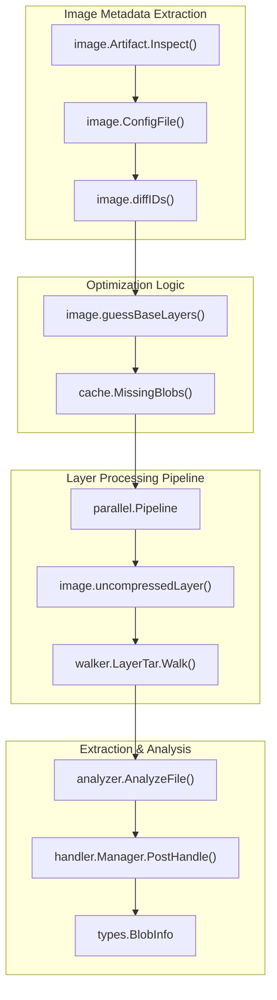
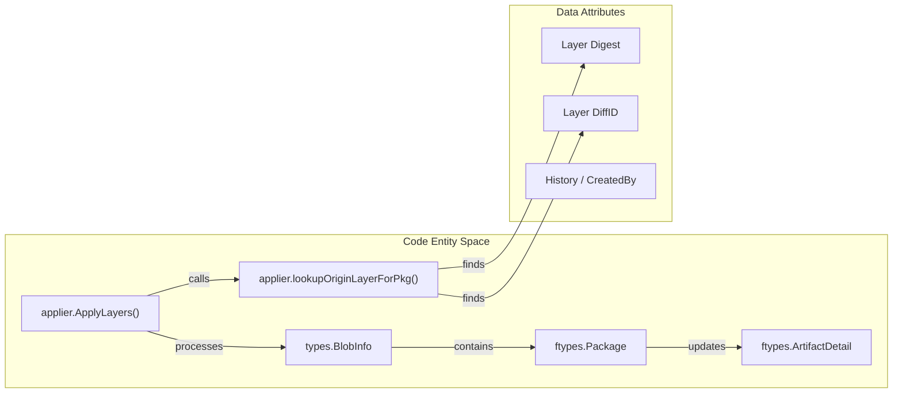

<!-- source: DeepWiki mcp.deepwiki.com · repo aquasecurity/trivy · page 3.1 Layer Processing and Package Extraction · fetched 2026-10-30 -->

# Layer Processing and Package Extraction

Relevant source files

The following files were used as context for generating this wiki page:

- [integration/testdata/conda-cyclonedx.json.golden](integration/testdata/conda-cyclonedx.json.golden)
- [integration/testdata/conda-environment-cyclonedx.json.golden](integration/testdata/conda-environment-cyclonedx.json.golden)
- [integration/testdata/fixtures/sbom/fluentd-multiple-lockfiles-cyclonedx.json](integration/testdata/fixtures/sbom/fluentd-multiple-lockfiles-cyclonedx.json)
- [integration/testdata/fluentd-multiple-lockfiles-short.cdx.json.golden](integration/testdata/fluentd-multiple-lockfiles-short.cdx.json.golden)
- [integration/testdata/fluentd-multiple-lockfiles.cdx.json.golden](integration/testdata/fluentd-multiple-lockfiles.cdx.json.golden)
- [integration/testdata/npm-cyclonedx.json.golden](integration/testdata/npm-cyclonedx.json.golden)
- [integration/testdata/pom-cyclonedx.json.golden](integration/testdata/pom-cyclonedx.json.golden)
- [pkg/fanal/analyzer/analyzer.go](pkg/fanal/analyzer/analyzer.go)
- [pkg/fanal/analyzer/analyzer_test.go](pkg/fanal/analyzer/analyzer_test.go)
- [pkg/fanal/analyzer/pkg/apk/apk.go](pkg/fanal/analyzer/pkg/apk/apk.go)
- [pkg/fanal/analyzer/pkg/apk/apk_test.go](pkg/fanal/analyzer/pkg/apk/apk_test.go)
- [pkg/fanal/analyzer/pkg/apk/testdata/apk](pkg/fanal/analyzer/pkg/apk/testdata/apk)
- [pkg/fanal/analyzer/pkg/dpkg/dpkg.go](pkg/fanal/analyzer/pkg/dpkg/dpkg.go)
- [pkg/fanal/analyzer/pkg/dpkg/dpkg_test.go](pkg/fanal/analyzer/pkg/dpkg/dpkg_test.go)
- [pkg/fanal/analyzer/pkg/dpkg/testdata/corrupsed.txtar](pkg/fanal/analyzer/pkg/dpkg/testdata/corrupsed.txtar)
- [pkg/fanal/analyzer/pkg/dpkg/testdata/digest.txtar](pkg/fanal/analyzer/pkg/dpkg/testdata/digest.txtar)
- [pkg/fanal/analyzer/pkg/dpkg/testdata/md5sums.txtar](pkg/fanal/analyzer/pkg/dpkg/testdata/md5sums.txtar)
- [pkg/fanal/analyzer/pkg/dpkg/testdata/only-apt.txtar](pkg/fanal/analyzer/pkg/dpkg/testdata/only-apt.txtar)
- [pkg/fanal/analyzer/pkg/dpkg/testdata/third-party.txtar](pkg/fanal/analyzer/pkg/dpkg/testdata/third-party.txtar)
- [pkg/fanal/analyzer/pkg/dpkg/testdata/valid.txtar](pkg/fanal/analyzer/pkg/dpkg/testdata/valid.txtar)
- [pkg/fanal/analyzer/pkg/rpm/rpm.go](pkg/fanal/analyzer/pkg/rpm/rpm.go)
- [pkg/fanal/analyzer/pkg/rpm/rpm_test.go](pkg/fanal/analyzer/pkg/rpm/rpm_test.go)
- [pkg/fanal/applier/applier.go](pkg/fanal/applier/applier.go)
- [pkg/fanal/applier/applier_test.go](pkg/fanal/applier/applier_test.go)
- [pkg/fanal/applier/docker.go](pkg/fanal/applier/docker.go)
- [pkg/fanal/applier/docker_test.go](pkg/fanal/applier/docker_test.go)
- [pkg/fanal/artifact/artifact.go](pkg/fanal/artifact/artifact.go)
- [pkg/fanal/artifact/image/image.go](pkg/fanal/artifact/image/image.go)
- [pkg/fanal/artifact/image/image_test.go](pkg/fanal/artifact/image/image_test.go)
- [pkg/fanal/artifact/local/fs.go](pkg/fanal/artifact/local/fs.go)
- [pkg/fanal/artifact/local/fs_test.go](pkg/fanal/artifact/local/fs_test.go)
- [pkg/fanal/artifact/sbom/sbom.go](pkg/fanal/artifact/sbom/sbom.go)
- [pkg/fanal/artifact/sbom/sbom_test.go](pkg/fanal/artifact/sbom/sbom_test.go)
- [pkg/fanal/artifact/vm/vm_test.go](pkg/fanal/artifact/vm/vm_test.go)
- [pkg/fanal/test/integration/testdata/goldens/packages/alpine-310.json.golden](pkg/fanal/test/integration/testdata/goldens/packages/alpine-310.json.golden)
- [pkg/fanal/test/integration/testdata/goldens/packages/vulnimage.json.golden](pkg/fanal/test/integration/testdata/goldens/packages/vulnimage.json.golden)
- [pkg/fanal/test/integration/testdata/goldens/vuln-image1.2.3.expectedlibs.golden](pkg/fanal/test/integration/testdata/goldens/vuln-image1.2.3.expectedlibs.golden)
- [pkg/fanal/types/artifact.go](pkg/fanal/types/artifact.go)
- [pkg/fanal/walker/fs.go](pkg/fanal/walker/fs.go)
- [pkg/fanal/walker/fs_test.go](pkg/fanal/walker/fs_test.go)
- [pkg/fanal/walker/tar.go](pkg/fanal/walker/tar.go)
- [pkg/fanal/walker/tar_test.go](pkg/fanal/walker/tar_test.go)
- [pkg/fanal/walker/vm.go](pkg/fanal/walker/vm.go)
- [pkg/fanal/walker/walk.go](pkg/fanal/walker/walk.go)
- [pkg/fanal/walker/walk_test.go](pkg/fanal/walker/walk_test.go)
- [pkg/sbom/cyclonedx/marshal.go](pkg/sbom/cyclonedx/marshal.go)
- [pkg/sbom/cyclonedx/marshal_test.go](pkg/sbom/cyclonedx/marshal_test.go)
- [pkg/sbom/cyclonedx/testdata/happy/bom.json](pkg/sbom/cyclonedx/testdata/happy/bom.json)
- [pkg/sbom/cyclonedx/testdata/happy/infinite-loop-bom.json](pkg/sbom/cyclonedx/testdata/happy/infinite-loop-bom.json)
- [pkg/sbom/cyclonedx/testdata/happy/third-party-bom-no-os.json](pkg/sbom/cyclonedx/testdata/happy/third-party-bom-no-os.json)
- [pkg/sbom/cyclonedx/testdata/happy/third-party-bom.json](pkg/sbom/cyclonedx/testdata/happy/third-party-bom.json)
- [pkg/sbom/cyclonedx/unmarshal.go](pkg/sbom/cyclonedx/unmarshal.go)
- [pkg/sbom/cyclonedx/unmarshal_test.go](pkg/sbom/cyclonedx/unmarshal_test.go)
- [pkg/sbom/sbom.go](pkg/sbom/sbom.go)
- [pkg/sbom/sbom_test.go](pkg/sbom/sbom_test.go)
- [pkg/x/slices/slices.go](pkg/x/slices/slices.go)

This document details how Trivy processes container image layers, extracts package information, and tracks layer provenance. This system is a core part of the Artifact Analysis pipeline, ensuring that every detected vulnerability or package can be traced back to the specific layer that introduced it.

## Layer Analysis Pipeline

Trivy processes container images by decomposing them into individual layers. Each layer is treated as a discrete "blob" of data that is analyzed independently and cached.

### Container Image Processing Flow

The `image.Artifact` type in `pkg/fanal/artifact/image/image.go` coordinates the inspection of container images. It retrieves the image configuration, identifies layers (diff IDs), and executes a parallel analysis pipeline.

**Key Implementation Details:**
*   **Parallelism**: Trivy uses a parallel pipeline to process multiple layers simultaneously, governed by `artifact.Option.Parallel` [pkg/fanal/artifact/image/image.go:275-296]().
*   **Cache Efficiency**: Before processing, Trivy checks the `ArtifactCache` for existing `BlobInfo` using keys derived from DiffIDs. Only missing layers are extracted and analyzed [pkg/fanal/artifact/image/image.go:135-138]().
*   **Base Layer Detection**: Trivy attempts to identify which layers belong to the base image (e.g., `alpine`, `ubuntu`) to optimize scanning and provide better context [pkg/fanal/artifact/image/image.go:123-124]().

Sources: [pkg/fanal/artifact/image/image.go:89-169](), [pkg/fanal/artifact/image/image.go:275-296]()

## Package Extraction and Provenance

After layers are analyzed individually, the `Applier` merges the results to create a final view of the artifact. During this phase, Trivy performs "Layer Provenance Tracking" to associate packages with their originating layers.

### The Applier Mechanism

The `ApplyLayers` function in `pkg/fanal/applier/docker.go` iterates through all layers (from bottom to top) and calculates the final state of the filesystem, handling file whiteouts and opaque directories [pkg/fanal/applier/docker.go:98-170]().

**Entity Association Diagram**

### Layer Provenance Logic

Trivy tracks where a package came from using the following logic:
1.  **OS Packages**: The `lookupOriginLayerForPkg` function searches through the `BlobInfo` of each layer. It identifies the first layer (bottom-up) where the package appears in the `PackageInfos` [pkg/fanal/applier/docker.go:46-55]().
2.  **Language Dependencies**: For libraries (e.g., npm, PyPI), `lookupOriginLayerForLib` matches the file path and package name across layers to find the origin [pkg/fanal/applier/docker.go:82-94]().
3.  **Metadata Enrichment**:
    *   **Installed Files**: For Debian/Ubuntu, Trivy tracks which layer contains the actual installed files for a package [pkg/fanal/applier/docker.go:226-227]().
    *   **Build Info**: For Red Hat images, Trivy propagates `BuildInfo` (content sets/CPEs) from parent layers to packages [pkg/fanal/applier/docker.go:58-80]().

Sources: [pkg/fanal/applier/docker.go:46-94](), [pkg/fanal/applier/docker.go:214-228]()

## SBOM Processing and Unmarshalling

Trivy can also "process" layers by consuming SBOMs (Software Bill of Materials). When an SBOM is provided as an artifact, Trivy unmarshals it into the same internal structures used during container scanning.

### CycloneDX Unmarshalling

Trivy supports unmarshalling CycloneDX JSON into its core BOM representation.

| Component Type | Trivy Internal Type | Source |
| :--- | :--- | :--- |
| `container` | `TypeContainerImage` | [pkg/sbom/cyclonedx/unmarshal.go:213-214]() |
| `application` | `TypeApplication` | [pkg/sbom/cyclonedx/unmarshal.go:215-216]() |
| `library` / `framework` | `TypeLibrary` | [pkg/sbom/cyclonedx/unmarshal.go:220-221]() |
| `operating-system` | `TypeOS` | [pkg/sbom/cyclonedx/unmarshal.go:222-223]() |

**Dependency Graph Reconstruction:**
Trivy reconstructs the dependency tree by parsing the `Dependencies` section of the CycloneDX BOM and mapping `BOMRef` identifiers to internal `Component` objects [pkg/sbom/cyclonedx/unmarshal.go:78-98]().

Sources: [pkg/sbom/cyclonedx/unmarshal.go:38-63](), [pkg/sbom/cyclonedx/unmarshal.go:172-208]()

## Data Structures

The primary data structures involved in layer processing are defined in `pkg/fanal/types/artifact.go`.

### BlobInfo
`BlobInfo` represents the result of analyzing a single layer. It is the unit of caching.
*   **OS**: Detected Operating System in this layer.
*   **PackageInfos**: OS packages found in this layer.
*   **Applications**: Language-specific files (lockfiles, binaries).
*   **OpaqueDirs/WhiteoutFiles**: Metadata for reconstructing the stacked filesystem.

### ArtifactDetail
`ArtifactDetail` represents the final, merged result after all layers have been applied.
*   **Packages**: Flattened list of all OS packages with layer provenance attached.
*   **Applications**: Consolidated list of all language-specific dependencies.

Sources: [pkg/fanal/types/artifact.go:168-196](), [pkg/fanal/types/artifact.go:208-225]()

---

