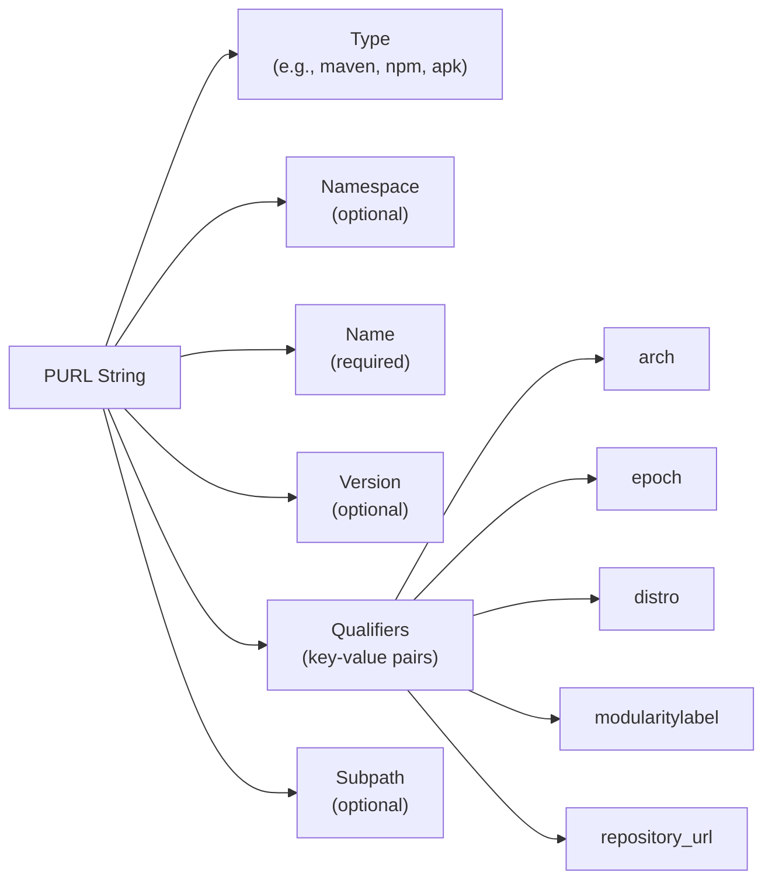
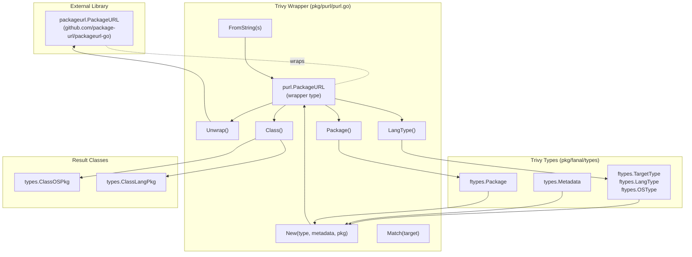
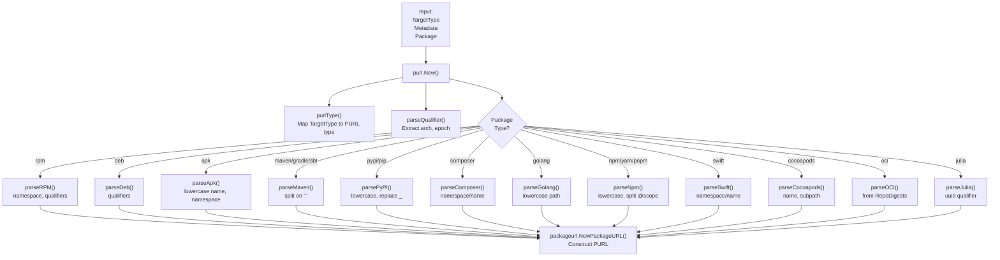
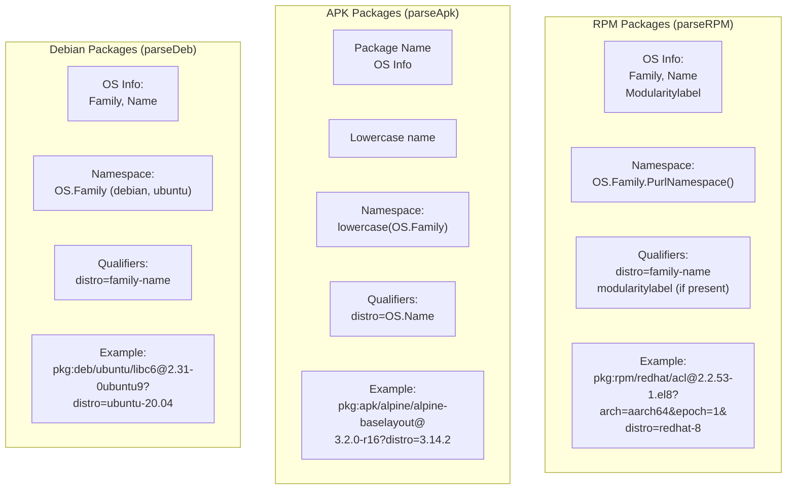
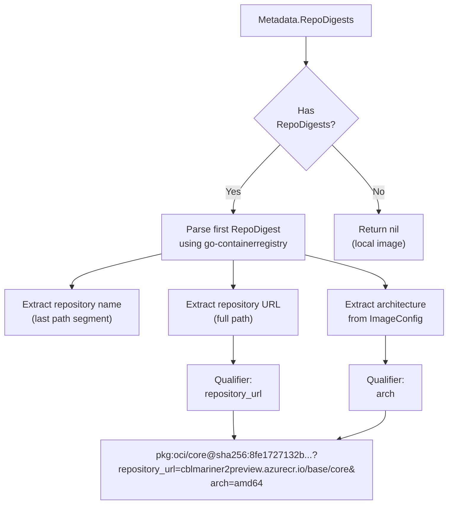
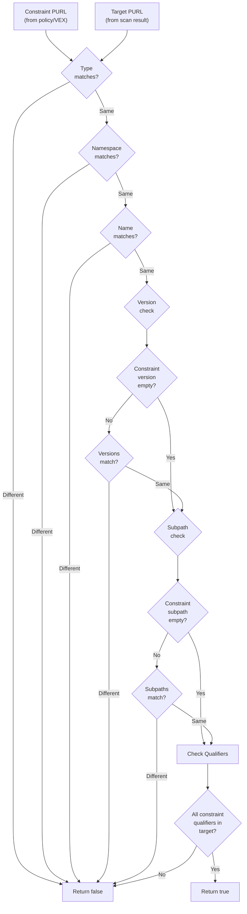
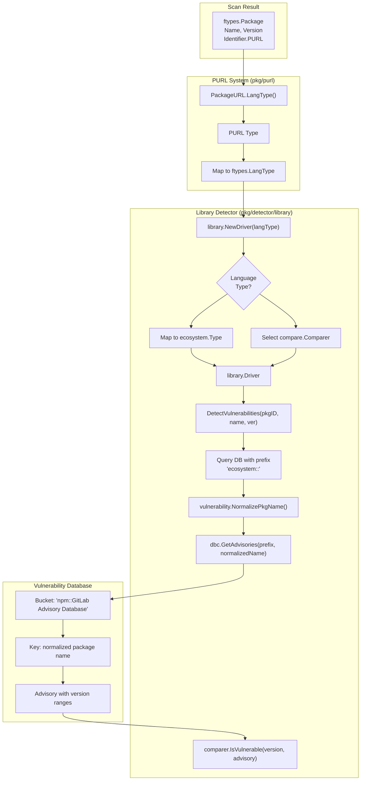

<!-- source: DeepWiki mcp.deepwiki.com · repo aquasecurity/trivy · page 3.2 Package URL (PURL) System · fetched 2026-10-30 -->

# Package URL (PURL) System

<details>
<summary>Relevant source files</summary>

The following files were used as context for generating this wiki page:

- [pkg/detector/library/driver.go](pkg/detector/library/driver.go)
- [pkg/detector/library/driver_test.go](pkg/detector/library/driver_test.go)
- [pkg/detector/library/testdata/fixtures/data-source.yaml](pkg/detector/library/testdata/fixtures/data-source.yaml)
- [pkg/detector/library/testdata/fixtures/go.yaml](pkg/detector/library/testdata/fixtures/go.yaml)
- [pkg/fanal/analyzer/all/import.go](pkg/fanal/analyzer/all/import.go)
- [pkg/fanal/analyzer/const.go](pkg/fanal/analyzer/const.go)
- [pkg/fanal/types/const.go](pkg/fanal/types/const.go)
- [pkg/purl/purl.go](pkg/purl/purl.go)
- [pkg/purl/purl_test.go](pkg/purl/purl_test.go)

</details>


## Purpose and Scope

The Package URL (PURL) System provides standardized package identification across all supported ecosystems in Trivy. PURLs serve as a universal identifier format that allows consistent package representation regardless of whether the package comes from OS repositories, language-specific package managers, or container registries. This system is central to vulnerability matching, SBOM generation, VEX statement application, and policy enforcement.

This document covers PURL creation, conversion, matching, and ecosystem-specific handling.

## PURL Structure and Components

PURLs follow the specification defined by the Package URL project. Each PURL consists of standardized components that uniquely identify a software package:

Title: PURL Component Hierarchy


**PURL Component Examples:**

| Component | Example | Description |
|-----------|---------|-------------|
| Type | `maven`, `npm`, `rpm`, `apk` | Package ecosystem identifier |
| Namespace | `org.springframework`, `@angular` | Package grouping (org, scope) |
| Name | `spring-core`, `express` | Package identifier within namespace |
| Version | `5.3.14`, `1.2.0-r16` | Package version (optional for constraints) |
| Qualifiers | `?arch=amd64&distro=debian-11` | Additional metadata |
| Subpath | `#Analytics` | Component subpath (e.g., CocoaPods subspecs) |

Sources: [pkg/purl/purl.go:20-49](), [pkg/purl/purl_test.go:17-542]()

## PackageURL Type and Core Operations

Trivy wraps the standard `packageurl.PackageURL` type to provide ecosystem-specific functionality and integration with Trivy's internal types:

Title: PackageURL Type Architecture


**Core Type Definition:**

The wrapper type at [pkg/purl/purl.go:51]() is a simple type alias that provides Trivy-specific methods:

```go
type PackageURL packageurl.PackageURL
```

Sources: [pkg/purl/purl.go:51-64](), [pkg/purl/purl.go:137-146]()

## Creating PURLs from Packages

The `New()` function at [pkg/purl/purl.go:67-135]() orchestrates PURL creation by dispatching to ecosystem-specific parsers based on the target type:

Title: PURL Generation Flow


**Type Mapping:**

The `purlType()` function at [pkg/purl/purl.go:454-501]() maps Trivy's internal types to PURL types:

| Trivy Type | PURL Type | Notes |
|------------|-----------|-------|
| `ftypes.Jar`, `ftypes.Pom`, `ftypes.Gradle`, `ftypes.Sbt` | `packageurl.TypeMaven` | Java packages use Maven PURL type |
| `ftypes.Npm`, `ftypes.Yarn`, `ftypes.Pnpm`, `ftypes.Bun` | `packageurl.TypeNPM` | All Node.js package managers |
| `ftypes.Alpine`, `ftypes.Chainguard`, `ftypes.Wolfi` | `packageurl.TypeApk` | Alpine-based distributions |
| `ftypes.Debian`, `ftypes.Ubuntu` | `packageurl.TypeDebian` | Debian-based distributions |
| `ftypes.RedHat`, `ftypes.CentOS`, `ftypes.Rocky`, etc. | `packageurl.TypeRPM` | RPM-based distributions |
| `ftypes.Bottlerocket` | `packageurlTypeBottlerocket` | Custom type (not yet in purl-spec) |

Sources: [pkg/purl/purl.go:67-135](), [pkg/purl/purl.go:454-501]()

## Ecosystem-Specific PURL Generation

Different package ecosystems have unique naming conventions and metadata requirements. Trivy implements specialized parsing for each:

### OS Package PURLs

Title: OS Ecosystem Mapping to PURL


The `PurlNamespace()` method at [pkg/fanal/types/const.go:67-77]() normalizes OS family names for PURL namespaces:

- SLES and SLE Micro → `"suse"`
- OpenSUSE variants → `"opensuse"`
- All others → string value of `OSType`

**Qualifiers for OS Packages:**

At [pkg/purl/purl.go:503-519](), base qualifiers are extracted:
- `arch`: Package architecture (e.g., `x86_64`, `arm64`)
- `epoch`: RPM epoch value (if non-zero)

At [pkg/purl/purl.go:78-103](), OS-specific qualifiers are added:
- `distro`: Distribution identifier (e.g., `redhat-8`, `debian-11`)
- `modularitylabel`: RPM modularity metadata (e.g., `nodejs:10:8020020200707141642:6a468ee4`)

Sources: [pkg/purl/purl.go:372-391](), [pkg/purl/purl.go:335-353](), [pkg/purl/purl.go:356-369](), [pkg/fanal/types/const.go:63-77]()

### Language Package PURLs

Title: Language Package PURL Parsing
```mermaid
graph TB
    subgraph "Maven/Gradle/SBT (parseMaven)"
        MavenInput["Name:<br/>'org.springframework:spring-core'"]
        MavenSplit["Split on ':'"]
        MavenNamespace["Namespace: 'org.springframework'"]
        MavenName["Name: 'spring-core'"]
        MavenOutput["pkg:maven/org.springframework/<br/>spring-core@5.3.14"]
    end
    
    subgraph "NPM/Yarn/Pnpm (parseNpm)"
        NPMInput["Name: '@angular/core'<br/>or 'lodash'"]
        NPMLower["Lowercase name"]
        NPMSplit["Split on last '/'"]
        NPMNamespace["Namespace: '@angular'<br/>or empty"]
        NPMName["Name: 'core' or 'lodash'"]
        NPMOutput["pkg:npm/%40angular/core@12.0.0<br/>or pkg:npm/lodash@4.17.21"]
    end
    
    subgraph "PyPI (parsePyPI)"
        PyPIInput["Name: 'Django_test'"]
        PyPILower["Lowercase"]
        PyPIReplace["Replace _ with -"]
        PyPIOutput["pkg:pypi/django-test@1.2.0"]
    end
    
    subgraph "Golang (parseGolang)"
        GoInput["Name: 'github.com/aquasecurity/trivy'"]
        GoLower["Lowercase"]
        GoCheck{"Local<br/>path?"}
        GoSplit["Split on last '/'"]
        GoNamespace["Namespace: 'github.com/aquasecurity'"]
        GoName["Name: 'trivy'"]
        GoOutput["pkg:golang/github.com/aquasecurity/<br/>trivy@v0.49.0"]
        GoSkip["Return nil<br/>(skip local paths)"]
        
        GoInput --> GoLower
        GoLower --> GoCheck
        GoCheck -->|"./" or "../"| GoSkip
        GoCheck -->|else| GoSplit
    end
    
    subgraph "CocoaPods (parseCocoapods)"
        CocoaInput["Name: 'GoogleUtilities/NSData+zlib'"]
        CocoaSplit["Split on '/'"]
        CocoaName["Name: 'GoogleUtilities'"]
        CocoaSubpath["Subpath: 'NSData+zlib'"]
        CocoaOutput["pkg:cocoapods/GoogleUtilities@7.5.2<br/>#NSData+zlib"]
    end
    
    subgraph "Julia (parseJulia)"
        JuliaInput["Name: 'Dates'<br/>ID (UUID): 'ade2ca70-...'"]
        JuliaQualifiers["Qualifiers:<br/>uuid=ade2ca70-..."]
        JuliaOutput["pkg:julia/Dates@1.9.0?<br/>uuid=ade2ca70-3891-5945-98fb-dc099432e06a"]
    end
```

Sources: [pkg/purl/purl.go:393-398](), [pkg/purl/purl.go:434-439](), [pkg/purl/purl.go:410-415](), [pkg/purl/purl.go:400-408](), [pkg/purl/purl.go:427-432](), [pkg/purl/purl.go:442-451]()

### Container Image PURLs

The `parseOCI()` function at [pkg/purl/purl.go:301-332]() creates OCI-type PURLs from container metadata:

Title: OCI PURL Extraction


**OCI PURL Structure:**
- **Type:** `oci`
- **Name:** Last segment of repository path (lowercased)
- **Version:** Full SHA256 digest (e.g., `sha256:8fe1727132b...`)
- **Qualifiers:**
  - `repository_url`: Full repository path
  - `arch`: Image architecture

Sources: [pkg/purl/purl.go:301-332](), [pkg/purl/purl_test.go:346-422]()

## Converting PURLs to Packages

The `Package()` method at [pkg/purl/purl.go:215-264]() reconstructs `ftypes.Package` from a PURL:

Title: PURL to Package Reconstruction
```mermaid
graph TB
    PURL["PackageURL"]
    
    CheckClass{Class()}
    
    ReconstructName["Reconstruct Name"]
    NamespaceLogic{Has<br/>Namespace?}
    OSPkg["OS Package:<br/>name only"]
    MavenPkg["Maven/Gradle:<br/>namespace:name"]
    OtherPkg["Other Lang:<br/>namespace/name"]
    CocoaPods["CocoaPods:<br/>name/subpath"]
    
    ExtractQualifiers["Extract Qualifiers"]
    ArchQual["arch qualifier → Package.Arch"]
    EpochQual["epoch qualifier → Package.Epoch"]
    ModQual["modularitylabel → Package.Modularitylabel"]
    
    RPMVersion{Type ==<br/>RPM?}
    SplitVersion["Split version into<br/>Version + Release"]
    KeepVersion["Keep version as-is"]
    
    CreateID["Generate Package.ID<br/>dependency.ID(LangType, name, version)"]
    
    Output["ftypes.Package<br/>with PURL in Identifier"]
    
    PURL --> CheckClass
    CheckClass --> ReconstructName
    
    ReconstructName --> NamespaceLogic
    NamespaceLogic -->|ClassOSPkg| OSPkg
    NamespaceLogic -->|Maven| MavenPkg
    NamespaceLogic -->|Other| OtherPkg
    ReconstructName -->|CocoaPods| CocoaPods
    
    OSPkg --> ExtractQualifiers
    MavenPkg --> ExtractQualifiers
    OtherPkg --> ExtractQualifiers
    CocoaPods --> ExtractQualifiers
    
    ExtractQualifiers --> ArchQual
    ExtractQualifiers --> EpochQual
    ExtractQualifiers --> ModQual
    
    ArchQual --> RPMVersion
    EpochQual --> RPMVersion
    ModQual --> RPMVersion
    
    RPMVersion -->|Yes| SplitVersion
    RPMVersion -->|No| KeepVersion
    
    SplitVersion --> CreateID
    KeepVersion --> CreateID
    
    CreateID --> Output
```

**Name Reconstruction Logic:**

At [pkg/purl/purl.go:216-233](), package names are reconstructed based on ecosystem conventions:

| Ecosystem | Namespace Present? | Reconstructed Name |
|-----------|-------------------|-------------------|
| OS Packages | Any | `name` (namespace ignored) |
| Maven/Gradle | Yes | `namespace:name` |
| Other Languages | Yes | `namespace/name` |
| CocoaPods | Subpath present | `name/subpath` |

**RPM Version Splitting:**

At [pkg/purl/purl.go:257-261](), RPM packages require special handling:
- PURL version contains combined `version-release`
- Must split using `version.NewVersion()` from `github.com/knqyf263/go-rpm-version`
- Separate into `Package.Version` and `Package.Release` fields

Sources: [pkg/purl/purl.go:215-264](), [pkg/purl/purl_test.go:662-926]()

## PURL Matching and Comparison

The `Match()` method at [pkg/purl/purl.go:269-294]() implements constraint-based matching for VEX statements and ignore policies:

Title: PURL Matching Logic


**Matching Rules:**

1. **Type, Namespace, Name:** Must match exactly
2. **Version:** 
   - If constraint has empty version → matches any target version (wildcard)
   - If constraint has version → must match target version exactly
3. **Subpath:**
   - If constraint has empty subpath → matches any target subpath
   - If constraint has subpath → must match target subpath exactly
4. **Qualifiers:**
   - All qualifiers in constraint must be present in target with same values
   - Target may have additional qualifiers not in constraint

Sources: [pkg/purl/purl.go:266-294](), [pkg/purl/purl_test.go:972-1039]()

## Integration with Vulnerability Detection

The PURL system integrates with vulnerability detection through language type mapping and normalized package names:

Title: PURL Integration in Scanning Pipeline


**LangType Mapping:**

The `LangType()` method at [pkg/purl/purl.go:150-199]() maps PURL types back to Trivy's language types:

| PURL Type | Trivy LangType | Used For |
|-----------|----------------|----------|
| `maven` | `ftypes.Jar` | Maven packages in JARs |
| `npm` | `ftypes.NodePkg` | Node.js packages |
| `pypi` | `ftypes.PythonPkg` | Python packages |
| `golang` | `ftypes.GoBinary` | Go binaries |
| `gem` | `ftypes.GemSpec` | Ruby gems |
| `cargo` | `ftypes.Cargo` | Rust crates |
| `composer` | `ftypes.Composer` | PHP packages |
| `nuget` | `ftypes.NuGet` | .NET packages |
| `k8s` (with namespace) | `ftypes.EKS`, `ftypes.GKE`, `ftypes.AKS`, `ftypes.OCP` | Kubernetes components |
| `k8s` (no namespace) | `ftypes.K8sUpstream` | Upstream K8s |

**Ecosystem-Based Detection:**

At [pkg/detector/library/driver.go:26-98](), the driver maps language types to ecosystems:

```go
// Example mappings from NewDriver()
case ftypes.Npm, ftypes.Yarn, ftypes.Pnpm, ftypes.Bun, ftypes.NodePkg:
    eco = ecosystem.Npm
case ftypes.Pip, ftypes.Pipenv, ftypes.Poetry, ftypes.PythonPkg:
    eco = ecosystem.Pip
case ftypes.GoBinary, ftypes.GoModule:
    eco = ecosystem.Go
```

At [pkg/detector/library/driver.go:116-144](), vulnerability detection queries the database using ecosystem prefixes (e.g., `pip::`, `npm::`).

Sources: [pkg/purl/purl.go:148-213](), [pkg/detector/library/driver.go:26-98](), [pkg/detector/library/driver.go:112-167]()

## Custom PURL Types

Trivy defines custom PURL types not yet standardized in the purl-spec:

### TypeK8s

At [pkg/purl/purl.go:23-42](), Trivy defines `TypeK8s` for Kubernetes components:

**Structure:**
- **Type:** `k8s`
- **Namespace:** Service provider (empty for upstream, `eks`, `aks`, `gke`, `rke`, `ocp`)
- **Name:** Component name (e.g., `k8s.io%2Fapiserver`)
- **Version:** Combined version and release (e.g., `1.24.1`)

### TypeBottlerocket

At [pkg/purl/purl.go:48](), the constant `packageurlTypeBottlerocket` provides support for Bottlerocket OS packages:

**Structure:**
- **Type:** `bottlerocket` 
- **Qualifiers:** `distro=bottlerocket-<OS.Name>`

Sources: [pkg/purl/purl.go:20-49](), [pkg/purl/purl_test.go:456-491]()

## String Parsing and Serialization

### FromString()

The `FromString()` function at [pkg/purl/purl.go:53-64]() parses PURL strings and normalizes empty qualifiers to `nil`.

### String()

The `String()` method at [pkg/purl/purl.go:296-298]() serializes PURLs by delegating to the underlying `packageurl.PackageURL.String()` method.

Sources: [pkg/purl/purl.go:53-64](), [pkg/purl/purl.go:296-298](), [pkg/purl/purl_test.go:544-660]()

## PURL Type Constants and Mapping

The complete type mapping is implemented in `purlType()` at [pkg/purl/purl.go:454-501]():

| Trivy Types | PURL Type |
|-------------|-----------|
| `Jar`, `Pom`, `Gradle`, `Sbt` | `maven` |
| `Bundler`, `GemSpec` | `gem` |
| `NuGet`, `DotNetCore`, `PackagesProps` | `nuget` |
| `Composer`, `ComposerVendor` | `composer` |
| `PythonPkg`, `Pip`, `Pipenv`, `Poetry`, `Uv` | `pypi` |
| `GoBinary`, `GoModule` | `golang` |
| `Npm`, `NodePkg`, `Yarn`, `Pnpm`, `Bun` | `npm` |
| `Julia` | `julia` |

Sources: [pkg/purl/purl.go:454-501](), [pkg/fanal/types/const.go:23-136]()

---

