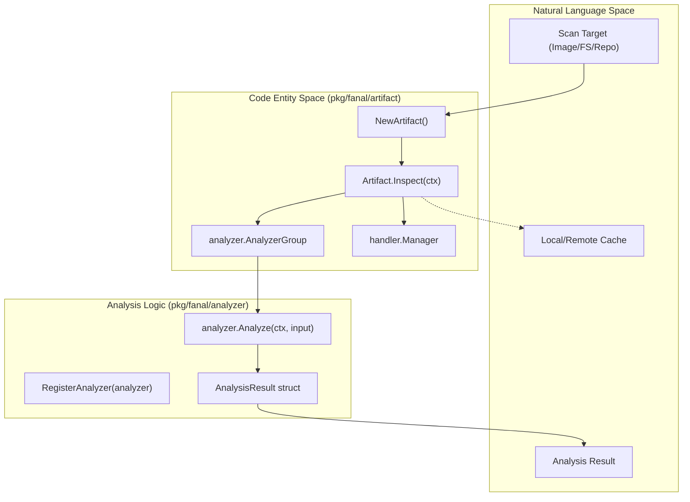
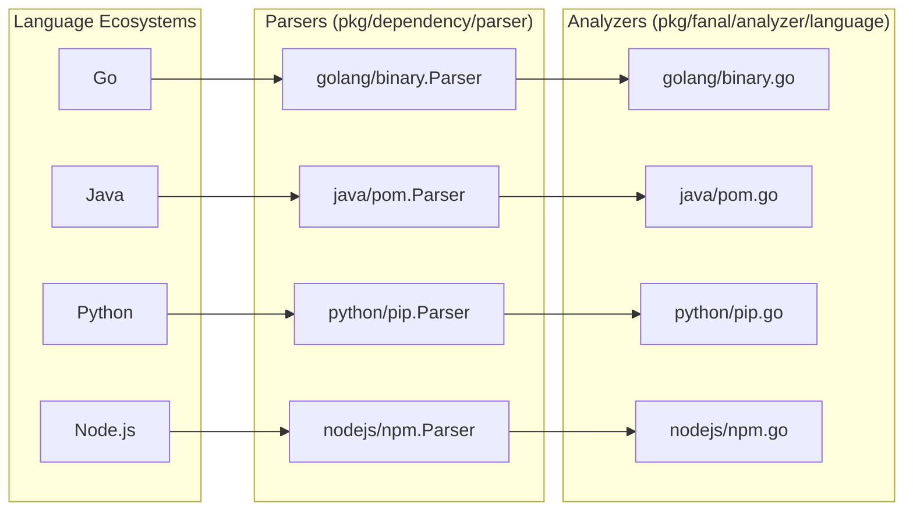

<!-- source: DeepWiki mcp.deepwiki.com · repo aquasecurity/trivy · page 3.3 Analyzer Types and Language Support · fetched 2026-10-30 -->

# Analyzer Types and Language Support

<details>
<summary>Relevant source files</summary>

The following files were used as context for generating this wiki page:

- [docs/guide/coverage/language/golang.md](docs/guide/coverage/language/golang.md)
- [docs/guide/coverage/language/nodejs.md](docs/guide/coverage/language/nodejs.md)
- [pkg/dependency/parser/golang/binary/elf.go](pkg/dependency/parser/golang/binary/elf.go)
- [pkg/dependency/parser/golang/binary/export_test.go](pkg/dependency/parser/golang/binary/export_test.go)
- [pkg/dependency/parser/golang/binary/parse.go](pkg/dependency/parser/golang/binary/parse.go)
- [pkg/dependency/parser/golang/binary/parse_internal_test.go](pkg/dependency/parser/golang/binary/parse_internal_test.go)
- [pkg/dependency/parser/golang/binary/parse_test.go](pkg/dependency/parser/golang/binary/parse_test.go)
- [pkg/dependency/parser/golang/binary/testdata/goexperiment](pkg/dependency/parser/golang/binary/testdata/goexperiment)
- [pkg/dependency/parser/golang/binary/testdata/main-version-via-ldflags.elf](pkg/dependency/parser/golang/binary/testdata/main-version-via-ldflags.elf)
- [pkg/dependency/parser/golang/binary/testdata/semver-main-module-version.macho](pkg/dependency/parser/golang/binary/testdata/semver-main-module-version.macho)
- [pkg/dependency/parser/golang/mod/testdata/replaced-with-local-path-and-version-mismatch/go.sum](pkg/dependency/parser/golang/mod/testdata/replaced-with-local-path-and-version-mismatch/go.sum)
- [pkg/dependency/parser/java/pom/artifact.go](pkg/dependency/parser/java/pom/artifact.go)
- [pkg/dependency/parser/java/pom/parse.go](pkg/dependency/parser/java/pom/parse.go)
- [pkg/dependency/parser/java/pom/parse_test.go](pkg/dependency/parser/java/pom/parse_test.go)
- [pkg/dependency/parser/java/pom/pom.go](pkg/dependency/parser/java/pom/pom.go)
- [pkg/dependency/parser/java/pom/repository.go](pkg/dependency/parser/java/pom/repository.go)
- [pkg/dependency/parser/java/pom/settings.go](pkg/dependency/parser/java/pom/settings.go)
- [pkg/dependency/parser/java/pom/settings_test.go](pkg/dependency/parser/java/pom/settings_test.go)
- [pkg/dependency/parser/java/pom/testdata/exclusions-parent-dependency-management/child/pom.xml](pkg/dependency/parser/java/pom/testdata/exclusions-parent-dependency-management/child/pom.xml)
- [pkg/dependency/parser/java/pom/testdata/exclusions-parent-dependency-management/pom.xml](pkg/dependency/parser/java/pom/testdata/exclusions-parent-dependency-management/pom.xml)
- [pkg/dependency/parser/java/pom/testdata/happy/pom.xml](pkg/dependency/parser/java/pom/testdata/happy/pom.xml)
- [pkg/dependency/parser/java/pom/testdata/repository-for-settings-repo/org/example/example-api/1.7.30/example-api-1.7.30.pom](pkg/dependency/parser/java/pom/testdata/repository-for-settings-repo/org/example/example-api/1.7.30/example-api-1.7.30.pom)
- [pkg/dependency/parser/java/pom/testdata/repository/org/example/example-exclusions/3.0.0/example-exclusions-3.0.0.pom](pkg/dependency/parser/java/pom/testdata/repository/org/example/example-exclusions/3.0.0/example-exclusions-3.0.0.pom)
- [pkg/dependency/parser/java/pom/testdata/repository/org/example/example-nested/3.3.5/example-nested-3.3.5.pom](pkg/dependency/parser/java/pom/testdata/repository/org/example/example-nested/3.3.5/example-nested-3.3.5.pom)
- [pkg/dependency/parser/java/pom/testdata/settings/global-with-proxy/conf/settings.xml](pkg/dependency/parser/java/pom/testdata/settings/global-with-proxy/conf/settings.xml)
- [pkg/dependency/parser/java/pom/testdata/settings/global/conf/settings.xml](pkg/dependency/parser/java/pom/testdata/settings/global/conf/settings.xml)
- [pkg/dependency/parser/java/pom/testdata/settings/user-settings-with-env-placeholders/.m2/settings.xml](pkg/dependency/parser/java/pom/testdata/settings/user-settings-with-env-placeholders/.m2/settings.xml)
- [pkg/dependency/parser/java/pom/testdata/settings/user-with-proxy/.m2/settings.xml](pkg/dependency/parser/java/pom/testdata/settings/user-with-proxy/.m2/settings.xml)
- [pkg/dependency/parser/java/pom/testdata/settings/user/.m2/settings.xml](pkg/dependency/parser/java/pom/testdata/settings/user/.m2/settings.xml)
- [pkg/dependency/parser/nodejs/npm/parse.go](pkg/dependency/parser/nodejs/npm/parse.go)
- [pkg/dependency/parser/nodejs/npm/parse_test.go](pkg/dependency/parser/nodejs/npm/parse_test.go)
- [pkg/dependency/parser/nodejs/npm/parse_testcase.go](pkg/dependency/parser/nodejs/npm/parse_testcase.go)
- [pkg/dependency/parser/nodejs/npm/testdata/package-lock_v3_broken_link.json](pkg/dependency/parser/nodejs/npm/testdata/package-lock_v3_broken_link.json)
- [pkg/dependency/parser/nodejs/npm/testdata/package-lock_v3_with-same-dev-and-non-dev.json](pkg/dependency/parser/nodejs/npm/testdata/package-lock_v3_with-same-dev-and-non-dev.json)
- [pkg/dependency/parser/nodejs/npm/testdata/package-lock_v3_with_peer.json](pkg/dependency/parser/nodejs/npm/testdata/package-lock_v3_with_peer.json)
- [pkg/dependency/parser/nodejs/npm/testdata/package-lock_v3_with_workspace_as_object.json](pkg/dependency/parser/nodejs/npm/testdata/package-lock_v3_with_workspace_as_object.json)
- [pkg/dependency/parser/nodejs/packagejson/parse.go](pkg/dependency/parser/nodejs/packagejson/parse.go)
- [pkg/dependency/parser/nodejs/packagejson/parse_test.go](pkg/dependency/parser/nodejs/packagejson/parse_test.go)
- [pkg/dependency/parser/nodejs/packagejson/testdata/invalid_name.json](pkg/dependency/parser/nodejs/packagejson/testdata/invalid_name.json)
- [pkg/dependency/parser/nodejs/packagejson/testdata/workspace_as_map_package.json](pkg/dependency/parser/nodejs/packagejson/testdata/workspace_as_map_package.json)
- [pkg/dependency/parser/nuget/lock/parse_test.go](pkg/dependency/parser/nuget/lock/parse_test.go)
- [pkg/dependency/parser/python/pip/parse.go](pkg/dependency/parser/python/pip/parse.go)
- [pkg/dependency/parser/python/pip/parse_test.go](pkg/dependency/parser/python/pip/parse_test.go)
- [pkg/dependency/parser/python/pip/parse_testcase.go](pkg/dependency/parser/python/pip/parse_testcase.go)
- [pkg/dependency/parser/python/pip/testdata/requirements_compatible.txt](pkg/dependency/parser/python/pip/testdata/requirements_compatible.txt)
- [pkg/dependency/parser/python/pip/testdata/requirements_no_version.txt](pkg/dependency/parser/python/pip/testdata/requirements_no_version.txt)
- [pkg/dependency/parser/python/pip/testdata/requirements_operator.txt](pkg/dependency/parser/python/pip/testdata/requirements_operator.txt)
- [pkg/dependency/parser/python/pip/testdata/requirements_with_templating_engine.txt](pkg/dependency/parser/python/pip/testdata/requirements_with_templating_engine.txt)
- [pkg/dependency/parser/python/poetry/parse.go](pkg/dependency/parser/python/poetry/parse.go)
- [pkg/dependency/parser/python/pyproject/pyproject.go](pkg/dependency/parser/python/pyproject/pyproject.go)
- [pkg/dependency/parser/python/pyproject/pyproject_test.go](pkg/dependency/parser/python/pyproject/pyproject_test.go)
- [pkg/dependency/parser/python/pyproject/testdata/happy_with_optional_only.toml](pkg/dependency/parser/python/pyproject/testdata/happy_with_optional_only.toml)
- [pkg/dependency/parser/python/python.go](pkg/dependency/parser/python/python.go)
- [pkg/dependency/parser/python/python_test.go](pkg/dependency/parser/python/python_test.go)
- [pkg/detector/ospkg/seal/provider.go](pkg/detector/ospkg/seal/provider.go)
- [pkg/detector/ospkg/seal/provider_test.go](pkg/detector/ospkg/seal/provider_test.go)
- [pkg/detector/ospkg/version/compare.go](pkg/detector/ospkg/version/compare.go)
- [pkg/fanal/analyzer/analyzer.go](pkg/fanal/analyzer/analyzer.go)
- [pkg/fanal/analyzer/analyzer_test.go](pkg/fanal/analyzer/analyzer_test.go)
- [pkg/fanal/analyzer/language/golang/binary/binary_test.go](pkg/fanal/analyzer/language/golang/binary/binary_test.go)
- [pkg/fanal/analyzer/language/java/pom/pom_test.go](pkg/fanal/analyzer/language/java/pom/pom_test.go)
- [pkg/fanal/analyzer/language/nodejs/npm/npm.go](pkg/fanal/analyzer/language/nodejs/npm/npm.go)
- [pkg/fanal/analyzer/language/nodejs/npm/npm_test.go](pkg/fanal/analyzer/language/nodejs/npm/npm_test.go)
- [pkg/fanal/analyzer/language/nodejs/npm/testdata/happy/node_modules/@babel/parser/package.json](pkg/fanal/analyzer/language/nodejs/npm/testdata/happy/node_modules/@babel/parser/package.json)
- [pkg/fanal/analyzer/language/nodejs/npm/testdata/happy/package-lock.json](pkg/fanal/analyzer/language/nodejs/npm/testdata/happy/package-lock.json)
- [pkg/fanal/analyzer/language/python/packaging/egg_test.go](pkg/fanal/analyzer/language/python/packaging/egg_test.go)
- [pkg/fanal/analyzer/language/python/packaging/packaging.go](pkg/fanal/analyzer/language/python/packaging/packaging.go)
- [pkg/fanal/analyzer/language/python/packaging/packaging_test.go](pkg/fanal/analyzer/language/python/packaging/packaging_test.go)
- [pkg/fanal/analyzer/language/python/pip/pip.go](pkg/fanal/analyzer/language/python/pip/pip.go)
- [pkg/fanal/analyzer/language/python/pip/pip_test.go](pkg/fanal/analyzer/language/python/pip/pip_test.go)
- [pkg/fanal/analyzer/language/python/pip/testdata/happy/requirements.txt](pkg/fanal/analyzer/language/python/pip/testdata/happy/requirements.txt)
- [pkg/fanal/analyzer/language/python/pip/testdata/libs/common-dir/lib/site-packages/annotated_types-0.7.0.dist-info/METADATA](pkg/fanal/analyzer/language/python/pip/testdata/libs/common-dir/lib/site-packages/annotated_types-0.7.0.dist-info/METADATA)
- [pkg/fanal/analyzer/language/python/pip/testdata/libs/python-dir/lib/python3.10/site-packages/annotated_types-0.7.0.dist-info/METADATA](pkg/fanal/analyzer/language/python/pip/testdata/libs/python-dir/lib/python3.10/site-packages/annotated_types-0.7.0.dist-info/METADATA)
- [pkg/fanal/analyzer/language/python/poetry/poetry.go](pkg/fanal/analyzer/language/python/poetry/poetry.go)
- [pkg/fanal/analyzer/language/python/poetry/poetry_test.go](pkg/fanal/analyzer/language/python/poetry/poetry_test.go)
- [pkg/fanal/analyzer/language/python/poetry/testdata/happy/poetry.lock](pkg/fanal/analyzer/language/python/poetry/testdata/happy/poetry.lock)
- [pkg/fanal/analyzer/language/python/poetry/testdata/happy/pyproject.toml](pkg/fanal/analyzer/language/python/poetry/testdata/happy/pyproject.toml)
- [pkg/fanal/analyzer/language/python/poetry/testdata/no-pyproject/poetry.lock](pkg/fanal/analyzer/language/python/poetry/testdata/no-pyproject/poetry.lock)
- [pkg/fanal/analyzer/language/python/poetry/testdata/optional-groups/poetry.lock](pkg/fanal/analyzer/language/python/poetry/testdata/optional-groups/poetry.lock)
- [pkg/fanal/analyzer/language/python/poetry/testdata/optional-groups/pyproject.toml](pkg/fanal/analyzer/language/python/poetry/testdata/optional-groups/pyproject.toml)
- [pkg/fanal/analyzer/language/rust/cargo/cargo.go](pkg/fanal/analyzer/language/rust/cargo/cargo.go)
- [pkg/fanal/analyzer/language/rust/cargo/cargo_test.go](pkg/fanal/analyzer/language/rust/cargo/cargo_test.go)
- [pkg/fanal/analyzer/pkg/apk/apk.go](pkg/fanal/analyzer/pkg/apk/apk.go)
- [pkg/fanal/analyzer/pkg/apk/apk_test.go](pkg/fanal/analyzer/pkg/apk/apk_test.go)
- [pkg/fanal/analyzer/pkg/apk/testdata/apk](pkg/fanal/analyzer/pkg/apk/testdata/apk)
- [pkg/fanal/applier/applier.go](pkg/fanal/applier/applier.go)
- [pkg/fanal/applier/applier_test.go](pkg/fanal/applier/applier_test.go)
- [pkg/fanal/artifact/artifact.go](pkg/fanal/artifact/artifact.go)
- [pkg/fanal/artifact/image/image.go](pkg/fanal/artifact/image/image.go)
- [pkg/fanal/artifact/image/image_test.go](pkg/fanal/artifact/image/image_test.go)
- [pkg/fanal/artifact/local/fs.go](pkg/fanal/artifact/local/fs.go)
- [pkg/fanal/artifact/local/fs_test.go](pkg/fanal/artifact/local/fs_test.go)
- [pkg/fanal/artifact/sbom/sbom_test.go](pkg/fanal/artifact/sbom/sbom_test.go)
- [pkg/fanal/artifact/vm/vm_test.go](pkg/fanal/artifact/vm/vm_test.go)
- [pkg/fanal/test/integration/testdata/goldens/packages/alpine-310.json.golden](pkg/fanal/test/integration/testdata/goldens/packages/alpine-310.json.golden)
- [pkg/fanal/test/integration/testdata/goldens/packages/vulnimage.json.golden](pkg/fanal/test/integration/testdata/goldens/packages/vulnimage.json.golden)
- [pkg/fanal/test/integration/testdata/goldens/vuln-image1.2.3.expectedlibs.golden](pkg/fanal/test/integration/testdata/goldens/vuln-image1.2.3.expectedlibs.golden)
- [pkg/fanal/types/artifact.go](pkg/fanal/types/artifact.go)
- [pkg/x/http/transport.go](pkg/x/http/transport.go)
- [pkg/x/path/path.go](pkg/x/path/path.go)
- [pkg/x/path/path_test.go](pkg/x/path/path_test.go)

</details>


## Purpose and Scope

This page documents Trivy's analyzer system, which extracts packages, dependencies, and metadata from various artifact types. Analyzers are specialized components that understand specific file formats, package managers, and operating systems. This page covers the different analyzer categories, supported languages and ecosystems, and how analyzers map to vulnerability detection systems.

For information about how analyzers process container layers and extract packages, see [3.1 Layer Processing and Package Extraction](). For details on how extracted packages are standardized using PURLs, see [3.2 Package URL (PURL) System]().

## Analyzer Architecture

Trivy's analyzer system is organized into distinct categories based on what they analyze. Each analyzer is registered globally and activated based on the scan target and enabled scanners. The analyzer type (`analyzer.Type`) serves as a unique identifier for each analyzer and determines its behavior during artifact scanning.

### Core Data Flow and Entity Mapping

The following diagram bridges the gap between the conceptual scanning process and the specific code entities that handle artifact analysis.

**Title: Analyzer Orchestration and Result Flow**

Sources: [pkg/fanal/artifact/image/image.go:53-87](), [pkg/fanal/artifact/local/fs.go:56-99](), [pkg/fanal/analyzer/analyzer.go:176-197]()

## Analyzer Type Hierarchy

Trivy defines analyzer types as constants that identify specific analyzers. These types are organized into logical groupings for different purposes.

### OS Package Analyzers

OS analyzers detect and extract information about operating system packages and distributions. The analysis typically involves parsing package manager databases like `apk` (Alpine), `dpkg` (Debian/Ubuntu), or `rpm` (RHEL/CentOS).

| Analyzer Type | Implementation File | Purpose | Target Files |
|--------------|---------------------|---------|--------------|
| `TypeApk` | `pkg/fanal/analyzer/pkg/apk/apk.go` | Alpine package manager | `lib/apk/db/installed` |
| `TypeDpkg` | `pkg/fanal/analyzer/pkg/dpkg/dpkg.go` | Debian package manager | `var/lib/dpkg/status` |
| `TypeRpm` | `pkg/fanal/analyzer/pkg/rpm/rpm.go` | Red Hat package manager | RPM database |
| `TypeAlpine` | `pkg/fanal/analyzer/os/alpine/alpine.go` | Detects Alpine OS version | `/etc/alpine-release` |

Sources: [pkg/fanal/artifact/local/fs_test.go:60-77](), [pkg/fanal/analyzer/pkg/apk/apk.go:1-50]()

### Language-Specific Analyzers

Language analyzers extract dependency information from various programming language ecosystems. They are split into two main categories: **Lockfile Analyzers** (source code) and **Installed Package Analyzers** (binaries/runtimes).

**Title: Language Support and Parser Mapping**

Sources: [pkg/dependency/parser/golang/binary/parse.go:47-55](), [pkg/dependency/parser/java/pom/parse.go:74-83](), [pkg/fanal/analyzer/language/python/pip/pip.go:1-30]()

#### Key Language Implementation Details

*   **Go Binary Analysis**: Extracts standard library and module versions directly from compiled ELF, PE, or Mach-O binaries using `debug/buildinfo`. It prioritizes real SemVer versions over pseudo-versions or `(devel)` stamps.
    *   Sources: [pkg/dependency/parser/golang/binary/parse.go:71-149](), [pkg/dependency/parser/golang/binary/parse.go:173-184]()
*   **Java (Maven) Analysis**: Parses `pom.xml` files. It supports parent POM inheritance, property evaluation, and remote repository resolution (e.g., Maven Central) to build a complete dependency graph.
    *   Sources: [pkg/dependency/parser/java/pom/parse.go:149-175](), [pkg/dependency/parser/java/pom/pom.go:29-47]()
*   **Python Analysis**: Supports `requirements.txt`, `Pipfile.lock`, `poetry.lock`, and `uv.lock`. It uses PEP 440 compliant version comparers.
    *   Sources: [pkg/fanal/analyzer/language/python/poetry/poetry.go:1-40](), [pkg/fanal/artifact/local/fs_test.go:152-170]()

## Analyzer Groups and Activation

Trivy organizes analyzers into logical groups for selective activation and disabling during scans.

| Target Type | Logic |
|-------------|-------|
| **Container Image** | Uses `Image.Inspect()`. It prioritizes installed packages (`TypeIndividualPkgs`) over lockfiles, as images represent a runtime state. |
| **Filesystem** | Uses `local.Artifact.Inspect()`. It can use `StaticPathAnalyzer` to skip full directory traversal if only specific files (like `pom.xml` or `go.mod`) are relevant. |
| **Repository** | Detects Git metadata (commit hash, branch) and focuses on source-level lockfiles. |

Sources: [pkg/fanal/artifact/image/image.go:89-169](), [pkg/fanal/artifact/local/fs.go:169-215](), [pkg/fanal/artifact/local/fs.go:83-96]()

## Special-Purpose Analyzers

### Secret and License Scanning
*   **Secret Analyzer**: Scans file content for sensitive patterns (API keys, tokens).
*   **License Analyzer**: Classifies licenses found in packages or standalone license files.
Sources: [pkg/fanal/analyzer/analyzer.go:56-64](), [pkg/fanal/artifact/local/fs_test.go:24-25]()

### Config and Misconfiguration Analyzers
These analyzers process IaC files (Terraform, Dockerfile, Kubernetes YAML) and are managed via `analyzer.ConfigAnalyzerGroup`.
Sources: [pkg/fanal/artifact/image/image.go:45-68]()

## Implementation of Analysis Results

The `AnalysisResult` struct is the primary data structure returned by all analyzers. It aggregates detected OS, packages, applications, and security findings.

```go
type AnalysisResult struct {
	m                    sync.Mutex
	OS                   types.OS
	Repository           *types.Repository
	PackageInfos         []types.PackageInfo
	Applications         []types.Application
	Misconfigurations    []types.Misconfiguration
	Secrets              []types.Secret
	Licenses             []types.LicenseFile
	SystemInstalledFiles []string 
    // ...
}
```
Sources: [pkg/fanal/analyzer/analyzer.go:176-197]()

### Result Merging and Normalization
Trivy implements logic to merge results from multiple layers or files. For example, if an OS is detected as `RedHat` in one layer but `Oracle` in another (due to file overlaps), the more specific detection wins.
Sources: [pkg/fanal/types/artifact.go:51-82](), [pkg/fanal/analyzer/analyzer_test.go:35-157]()

## Summary of Language Support Matrix

| Ecosystem | Analyzer Type | Primary Parser | Key Implementation |
|-----------|---------------|----------------|-------------------|
| **Go** | `TypeGoBinary` | `golang/binary` | Extracts from ELF/PE/Mach-O |
| **Java** | `TypePom` | `java/pom` | Resolves inheritance/properties |
| **Python** | `TypePoetry` | `python/poetry` | Parses `poetry.lock` |
| **Node.js** | `TypeNpmPkgLock` | `nodejs/npm` | Parses `package-lock.json` |
| **Rust** | `TypeCargo` | `rust/cargo` | Parses `Cargo.lock` |

Sources: [pkg/dependency/parser/golang/binary/parse.go:1-50](), [pkg/dependency/parser/java/pom/parse.go:1-50](), [pkg/fanal/analyzer/language/python/poetry/poetry.go:1-20](), [pkg/fanal/analyzer/language/nodejs/npm/npm.go:1-20]()

---

