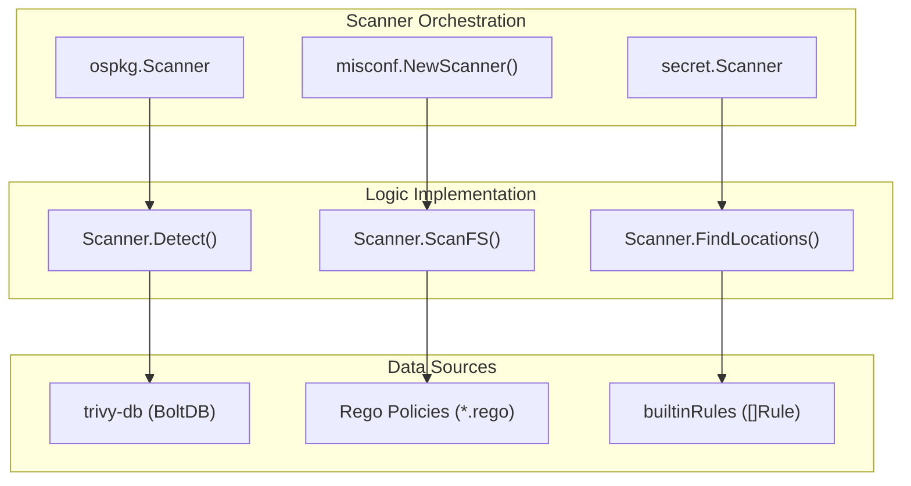
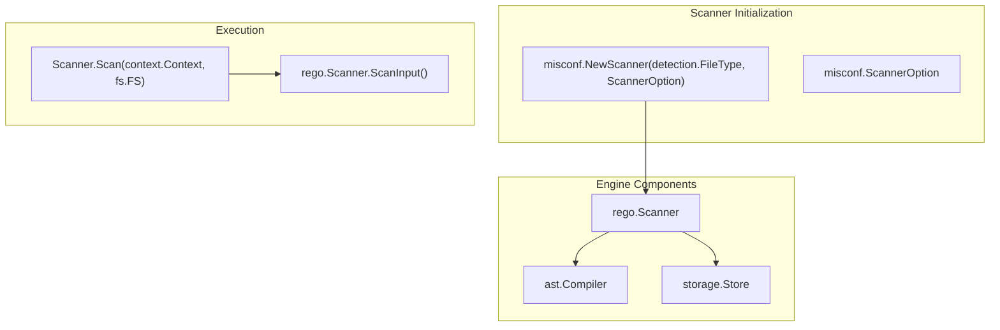

<!-- source: DeepWiki mcp.deepwiki.com · repo aquasecurity/trivy · page 4 Scanning Capabilities · fetched 2026-10-30 -->

# Scanning Capabilities

Relevant source files

The following files were used as context for generating this wiki page:

- [docs/guide/coverage/os/photon.md](docs/guide/coverage/os/photon.md)
- [docs/guide/scanner/vulnerability.md](docs/guide/scanner/vulnerability.md)
- [integration/testdata/fixtures/db/data-source.yaml](integration/testdata/fixtures/db/data-source.yaml)
- [integration/testdata/fixtures/db/go.yaml](integration/testdata/fixtures/db/go.yaml)
- [integration/testdata/fixtures/db/oracle.yaml](integration/testdata/fixtures/db/oracle.yaml)
- [integration/testdata/fixtures/db/redhat.yaml](integration/testdata/fixtures/db/redhat.yaml)
- [pkg/dependency/parser/java/pom/var.go](pkg/dependency/parser/java/pom/var.go)
- [pkg/detector/ospkg/alpine/alpine.go](pkg/detector/ospkg/alpine/alpine.go)
- [pkg/detector/ospkg/alpine/alpine_test.go](pkg/detector/ospkg/alpine/alpine_test.go)
- [pkg/detector/ospkg/alpine/testdata/fixtures/alpine.yaml](pkg/detector/ospkg/alpine/testdata/fixtures/alpine.yaml)
- [pkg/detector/ospkg/amazon/amazon.go](pkg/detector/ospkg/amazon/amazon.go)
- [pkg/detector/ospkg/amazon/amazon_test.go](pkg/detector/ospkg/amazon/amazon_test.go)
- [pkg/detector/ospkg/debian/debian.go](pkg/detector/ospkg/debian/debian.go)
- [pkg/detector/ospkg/debian/debian_test.go](pkg/detector/ospkg/debian/debian_test.go)
- [pkg/detector/ospkg/detect_test.go](pkg/detector/ospkg/detect_test.go)
- [pkg/detector/ospkg/export_test.go](pkg/detector/ospkg/export_test.go)
- [pkg/detector/ospkg/oracle/oracle.go](pkg/detector/ospkg/oracle/oracle.go)
- [pkg/detector/ospkg/oracle/oracle_test.go](pkg/detector/ospkg/oracle/oracle_test.go)
- [pkg/detector/ospkg/oracle/testdata/fixtures/invalid-type.yaml](pkg/detector/ospkg/oracle/testdata/fixtures/invalid-type.yaml)
- [pkg/detector/ospkg/oracle/testdata/fixtures/oracle7.yaml](pkg/detector/ospkg/oracle/testdata/fixtures/oracle7.yaml)
- [pkg/detector/ospkg/photon/photon.go](pkg/detector/ospkg/photon/photon.go)
- [pkg/detector/ospkg/photon/photon_test.go](pkg/detector/ospkg/photon/photon_test.go)
- [pkg/detector/ospkg/photon/testdata/fixtures/data-source.yaml](pkg/detector/ospkg/photon/testdata/fixtures/data-source.yaml)
- [pkg/detector/ospkg/redhat/redhat.go](pkg/detector/ospkg/redhat/redhat.go)
- [pkg/detector/ospkg/redhat/redhat_test.go](pkg/detector/ospkg/redhat/redhat_test.go)
- [pkg/detector/ospkg/redhat/testdata/fixtures/redhat.yaml](pkg/detector/ospkg/redhat/testdata/fixtures/redhat.yaml)
- [pkg/detector/ospkg/suse/suse.go](pkg/detector/ospkg/suse/suse.go)
- [pkg/detector/ospkg/suse/suse_test.go](pkg/detector/ospkg/suse/suse_test.go)
- [pkg/detector/ospkg/ubuntu/ubuntu.go](pkg/detector/ospkg/ubuntu/ubuntu.go)
- [pkg/detector/ospkg/ubuntu/ubuntu_test.go](pkg/detector/ospkg/ubuntu/ubuntu_test.go)
- [pkg/fanal/analyzer/imgconf/apk/apk.go](pkg/fanal/analyzer/imgconf/apk/apk.go)
- [pkg/fanal/analyzer/imgconf/secret/secret.go](pkg/fanal/analyzer/imgconf/secret/secret.go)
- [pkg/fanal/analyzer/imgconf/secret/secret_test.go](pkg/fanal/analyzer/imgconf/secret/secret_test.go)
- [pkg/fanal/analyzer/language/analyze.go](pkg/fanal/analyzer/language/analyze.go)
- [pkg/fanal/analyzer/licensing/license.go](pkg/fanal/analyzer/licensing/license.go)
- [pkg/fanal/analyzer/pkg/dpkg/copyright.go](pkg/fanal/analyzer/pkg/dpkg/copyright.go)
- [pkg/fanal/analyzer/secret/secret.go](pkg/fanal/analyzer/secret/secret.go)
- [pkg/fanal/analyzer/secret/secret_test.go](pkg/fanal/analyzer/secret/secret_test.go)
- [pkg/fanal/secret/builtin-rules.go](pkg/fanal/secret/builtin-rules.go)
- [pkg/fanal/secret/scanner.go](pkg/fanal/secret/scanner.go)
- [pkg/fanal/secret/scanner_test.go](pkg/fanal/secret/scanner_test.go)
- [pkg/fanal/secret/testdata/alibaba-access-key-id.txt](pkg/fanal/secret/testdata/alibaba-access-key-id.txt)
- [pkg/fanal/secret/testdata/asymmetric-private-key.txt](pkg/fanal/secret/testdata/asymmetric-private-key.txt)
- [pkg/fanal/secret/testdata/aws-secrets.txt](pkg/fanal/secret/testdata/aws-secrets.txt)
- [pkg/fanal/secret/testdata/crlf-line-endings.txt](pkg/fanal/secret/testdata/crlf-line-endings.txt)
- [pkg/fanal/secret/testdata/github-token.txt](pkg/fanal/secret/testdata/github-token.txt)
- [pkg/fanal/secret/testdata/grafana-env.txt](pkg/fanal/secret/testdata/grafana-env.txt)
- [pkg/fanal/secret/testdata/hugging-face-secret.txt](pkg/fanal/secret/testdata/hugging-face-secret.txt)
- [pkg/fanal/secret/testdata/invalid-utf8.txt](pkg/fanal/secret/testdata/invalid-utf8.txt)
- [pkg/fanal/secret/testdata/jwt-secret.txt](pkg/fanal/secret/testdata/jwt-secret.txt)
- [pkg/fanal/secret/testdata/private-packagist.txt](pkg/fanal/secret/testdata/private-packagist.txt)
- [pkg/fanal/secret/testdata/symfony-secret.yaml](pkg/fanal/secret/testdata/symfony-secret.yaml)
- [pkg/iac/rego/build.go](pkg/iac/rego/build.go)
- [pkg/iac/rego/custom.go](pkg/iac/rego/custom.go)
- [pkg/iac/rego/embed.go](pkg/iac/rego/embed.go)
- [pkg/iac/rego/embed_test.go](pkg/iac/rego/embed_test.go)
- [pkg/iac/rego/load.go](pkg/iac/rego/load.go)
- [pkg/iac/rego/load_test.go](pkg/iac/rego/load_test.go)
- [pkg/iac/rego/metadata.go](pkg/iac/rego/metadata.go)
- [pkg/iac/rego/metadata_test.go](pkg/iac/rego/metadata_test.go)
- [pkg/iac/rego/options.go](pkg/iac/rego/options.go)
- [pkg/iac/rego/result.go](pkg/iac/rego/result.go)
- [pkg/iac/rego/runtime.go](pkg/iac/rego/runtime.go)
- [pkg/iac/rego/scanner.go](pkg/iac/rego/scanner.go)
- [pkg/iac/rego/scanner_test.go](pkg/iac/rego/scanner_test.go)
- [pkg/iac/rego/store.go](pkg/iac/rego/store.go)
- [pkg/iac/rego/store_test.go](pkg/iac/rego/store_test.go)
- [pkg/iac/scan/rule.go](pkg/iac/scan/rule.go)
- [pkg/iac/scanners/cloudformation/scanner_test.go](pkg/iac/scanners/cloudformation/scanner_test.go)
- [pkg/iac/scanners/dockerfile/scanner_test.go](pkg/iac/scanners/dockerfile/scanner_test.go)
- [pkg/iac/scanners/generic/scanner_test.go](pkg/iac/scanners/generic/scanner_test.go)
- [pkg/iac/scanners/terraform/scanner_test.go](pkg/iac/scanners/terraform/scanner_test.go)
- [pkg/iac/scanners/terraform/setup_test.go](pkg/iac/scanners/terraform/setup_test.go)
- [pkg/iac/scanners/terraformplan/snapshot/scanner_test.go](pkg/iac/scanners/terraformplan/snapshot/scanner_test.go)
- [pkg/licensing/classifier.go](pkg/licensing/classifier.go)
- [pkg/licensing/classifier_test.go](pkg/licensing/classifier_test.go)
- [pkg/licensing/expression/expression.go](pkg/licensing/expression/expression.go)
- [pkg/licensing/expression/expression_test.go](pkg/licensing/expression/expression_test.go)
- [pkg/licensing/expression/types.go](pkg/licensing/expression/types.go)
- [pkg/licensing/normalize.go](pkg/licensing/normalize.go)
- [pkg/licensing/normalize_test.go](pkg/licensing/normalize_test.go)
- [pkg/licensing/scanner.go](pkg/licensing/scanner.go)
- [pkg/licensing/scanner_test.go](pkg/licensing/scanner_test.go)
- [pkg/log/logger.go](pkg/log/logger.go)
- [pkg/misconf/scanner.go](pkg/misconf/scanner.go)
- [pkg/scan/ospkg/scan.go](pkg/scan/ospkg/scan.go)

This page describes Trivy's core scanning capabilities: vulnerability detection, misconfiguration scanning, secret detection, and license scanning. It covers how these scanners are orchestrated, configured, and integrated into the scanning pipeline.

For information about specific scan targets (container images, filesystems, etc.), see [Target Types and Scanning Workflows](#5).

## Overview

Trivy provides four specialized security scanners that can be enabled individually or in combination. The scanner selection is controlled via the `--scanners` flag or `scanners` configuration option, which accepts a comma-separated list of scanner types.

| Scanner Type | Purpose | Key Implementation |
|-------------|---------|-----------------|
| Vulnerability Scanner | Detects known CVEs in OS packages and application dependencies | `ospkg.Scanner`, `library.Driver` |
| Misconfiguration Scanner | Identifies security misconfigurations in IaC files and Kubernetes manifests | `misconf.Scanner`, `rego.Scanner` |
| Secret Scanner | Finds hardcoded secrets, API keys, and credentials | `secret.Scanner` |
| License Scanner | Detects and classifies software licenses | `licensing.Scanner` |

Sources: [pkg/misconf/scanner.go:99-104](), [pkg/fanal/secret/scanner.go:45-50](), [pkg/detector/ospkg/ubuntu/ubuntu.go:84-87]()

## Scanner Pipeline Architecture

All scanners are orchestrated through a unified pipeline. For a detailed breakdown of how vulnerability detection is implemented for different ecosystems, see [Vulnerability Detection](#4.1).

### Scanning Orchestration
The following diagram bridges the high-level scanning logic to the specific code entities responsible for execution.

**Figure 1: Mapping Scanning Logic to Code Entities**

Sources: [pkg/misconf/scanner.go:106-146](), [pkg/fanal/secret/scanner.go:130-154](), [pkg/detector/ospkg/ubuntu/ubuntu.go:103-155]()

## Vulnerability Detection

The vulnerability scanner detects known CVEs in OS packages (e.g., Ubuntu, Alpine, RHEL) and application dependencies (e.g., Maven, NPM, Pip).

Trivy uses specialized detectors for different OS families to handle specific advisory formats and versioning schemes:
- **Ubuntu**: Uses `ubuntu.VulnSrc` and handles ESM (Extended Security Maintenance) versions [pkg/detector/ospkg/ubuntu/ubuntu.go:84-100]().
- **Alpine**: Handles version streams including `edge` and handles repository-specific releases [pkg/detector/ospkg/alpine/alpine.go:70-85]().
- **Red Hat/CentOS**: Uses OVAL v2 data and handles modular namespaces and content sets [pkg/detector/ospkg/redhat/redhat.go:77-112]().
- **SUSE**: Supports Enterprise Linux, OpenSUSE, and Tumbleweed using CVRF data [pkg/detector/ospkg/suse/suse.go:93-118]().

For details on ecosystem-specific comparers and the driver system, see [Vulnerability Detection](#4.1).

Sources: [pkg/detector/ospkg/ubuntu/ubuntu.go:22-71](), [pkg/detector/ospkg/alpine/alpine.go:21-55](), [pkg/detector/ospkg/redhat/redhat.go:25-62](), [pkg/detector/ospkg/suse/suse.go:20-77]()

## Misconfiguration Scanning

The misconfiguration scanner analyzes Infrastructure-as-Code (IaC) files and Kubernetes manifests using Rego-based policies.

### Misconfiguration Scanner Architecture

**Figure 2: Misconfiguration Scanning Code Flow**

The scanner supports multiple file types defined in `detection.FileType` including `Terraform`, `CloudFormation`, `Dockerfile`, `Kubernetes`, `Ansible`, and `Helm` [pkg/misconf/scanner.go:44-56](). It uses an OPA/Rego engine to evaluate policies against parsed configurations. For detail on Rego evaluation and policy bundles, see [Misconfiguration Scanning](#4.2).

Sources: [pkg/misconf/scanner.go:106-146](), [pkg/iac/rego/scanner.go:50-80](), [pkg/iac/rego/load.go:80-142]()

## Secret Detection

The secret scanner identifies sensitive information like API keys and passwords using regex patterns and keyword filtering.

Trivy includes a comprehensive set of `builtinRules` for various services:
- **Cloud Providers**: AWS Access Keys, Google Cloud API Keys [pkg/fanal/secret/builtin-rules.go:102-120]().
- **VCS**: GitHub PATs (Personal Access Tokens), GitLab tokens [pkg/fanal/secret/builtin-rules.go:122-156]().
- **Generic**: Asymmetric Private Keys, Slack Webhooks, etc [pkg/fanal/secret/builtin-rules.go:15-25]().

The scanner uses a `SecretGroupName` (often named "secret") to extract the specific sensitive part of a regex match [pkg/fanal/secret/scanner.go:156-176](). For details on how Trivy detects secrets and sensitive information, see [Secret Detection](#4.3).

Sources: [pkg/fanal/secret/builtin-rules.go:12-74](), [pkg/fanal/secret/scanner.go:116-128]()

## License Scanning and Classification

The license scanner identifies software licenses and classifies them based on their legal implications.

- **Normalization**: Trivy maps various license strings (e.g., "ASL-2.0", "APACHE-2") to standardized SPDX identifiers like `Apache-2.0` [pkg/licensing/normalize.go:17-66]().
- **Classification**: Licenses are categorized into groups such as `Forbidden`, `Restricted`, or `Permissive` to help organizations enforce compliance policies.

For details on license detection and SPDX identifier handling, see [License Scanning and Classification](#4.4).

Sources: [pkg/licensing/normalize.go:1-15]()

---

