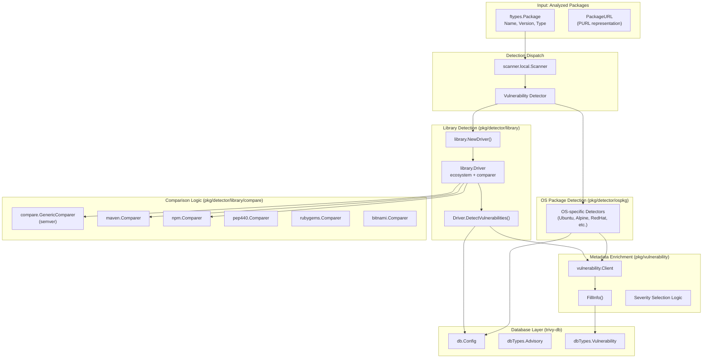
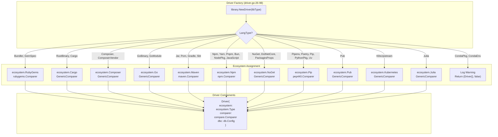
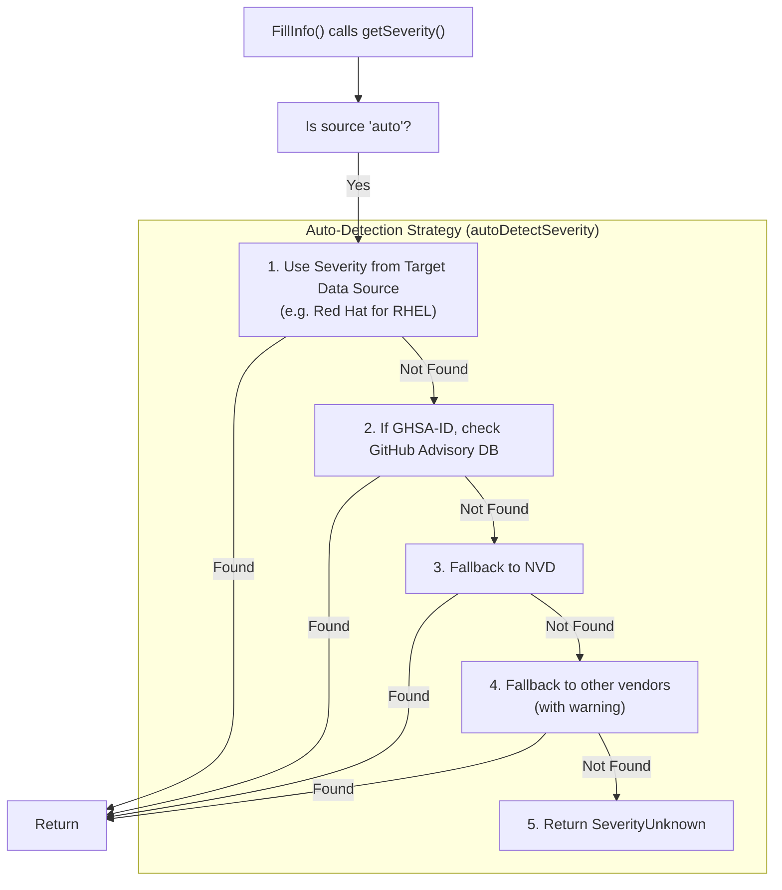
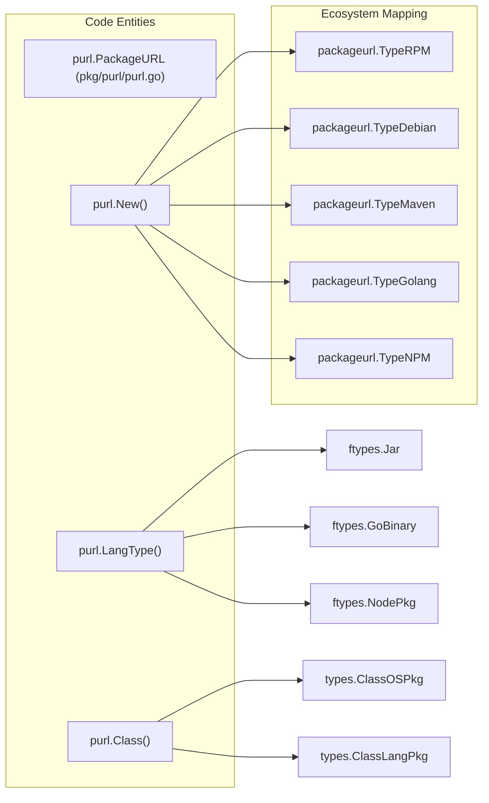

<!-- source: DeepWiki mcp.deepwiki.com · repo aquasecurity/trivy · page 4.1 Vulnerability Detection · fetched 2026-10-30 -->

# Vulnerability Detection

Relevant source files

The following files were used as context for generating this wiki page:

- [docs/guide/configuration/cache.md](docs/guide/configuration/cache.md)
- [docs/guide/coverage/os/photon.md](docs/guide/coverage/os/photon.md)
- [docs/guide/scanner/vulnerability.md](docs/guide/scanner/vulnerability.md)
- [integration/testdata/fixtures/db/data-source.yaml](integration/testdata/fixtures/db/data-source.yaml)
- [integration/testdata/fixtures/db/go.yaml](integration/testdata/fixtures/db/go.yaml)
- [integration/testdata/fixtures/db/oracle.yaml](integration/testdata/fixtures/db/oracle.yaml)
- [integration/testdata/fixtures/db/redhat.yaml](integration/testdata/fixtures/db/redhat.yaml)
- [pkg/commands/run.go](pkg/commands/run.go)
- [pkg/detector/library/driver.go](pkg/detector/library/driver.go)
- [pkg/detector/library/driver_test.go](pkg/detector/library/driver_test.go)
- [pkg/detector/library/testdata/fixtures/data-source.yaml](pkg/detector/library/testdata/fixtures/data-source.yaml)
- [pkg/detector/library/testdata/fixtures/go.yaml](pkg/detector/library/testdata/fixtures/go.yaml)
- [pkg/detector/ospkg/alma/alma.go](pkg/detector/ospkg/alma/alma.go)
- [pkg/detector/ospkg/alma/alma_test.go](pkg/detector/ospkg/alma/alma_test.go)
- [pkg/detector/ospkg/alma/testdata/fixtures/modular.yaml](pkg/detector/ospkg/alma/testdata/fixtures/modular.yaml)
- [pkg/detector/ospkg/alpine/alpine.go](pkg/detector/ospkg/alpine/alpine.go)
- [pkg/detector/ospkg/alpine/alpine_test.go](pkg/detector/ospkg/alpine/alpine_test.go)
- [pkg/detector/ospkg/alpine/testdata/fixtures/alpine.yaml](pkg/detector/ospkg/alpine/testdata/fixtures/alpine.yaml)
- [pkg/detector/ospkg/amazon/amazon.go](pkg/detector/ospkg/amazon/amazon.go)
- [pkg/detector/ospkg/amazon/amazon_test.go](pkg/detector/ospkg/amazon/amazon_test.go)
- [pkg/detector/ospkg/debian/debian.go](pkg/detector/ospkg/debian/debian.go)
- [pkg/detector/ospkg/debian/debian_test.go](pkg/detector/ospkg/debian/debian_test.go)
- [pkg/detector/ospkg/detect_test.go](pkg/detector/ospkg/detect_test.go)
- [pkg/detector/ospkg/export_test.go](pkg/detector/ospkg/export_test.go)
- [pkg/detector/ospkg/oracle/oracle.go](pkg/detector/ospkg/oracle/oracle.go)
- [pkg/detector/ospkg/oracle/oracle_test.go](pkg/detector/ospkg/oracle/oracle_test.go)
- [pkg/detector/ospkg/oracle/testdata/fixtures/invalid-type.yaml](pkg/detector/ospkg/oracle/testdata/fixtures/invalid-type.yaml)
- [pkg/detector/ospkg/oracle/testdata/fixtures/oracle7.yaml](pkg/detector/ospkg/oracle/testdata/fixtures/oracle7.yaml)
- [pkg/detector/ospkg/photon/photon.go](pkg/detector/ospkg/photon/photon.go)
- [pkg/detector/ospkg/photon/photon_test.go](pkg/detector/ospkg/photon/photon_test.go)
- [pkg/detector/ospkg/photon/testdata/fixtures/data-source.yaml](pkg/detector/ospkg/photon/testdata/fixtures/data-source.yaml)
- [pkg/detector/ospkg/redhat/redhat.go](pkg/detector/ospkg/redhat/redhat.go)
- [pkg/detector/ospkg/redhat/redhat_test.go](pkg/detector/ospkg/redhat/redhat_test.go)
- [pkg/detector/ospkg/redhat/testdata/fixtures/redhat.yaml](pkg/detector/ospkg/redhat/testdata/fixtures/redhat.yaml)
- [pkg/detector/ospkg/rocky/rocky.go](pkg/detector/ospkg/rocky/rocky.go)
- [pkg/detector/ospkg/rocky/rocky_test.go](pkg/detector/ospkg/rocky/rocky_test.go)
- [pkg/detector/ospkg/rocky/testdata/fixtures/modular.yaml](pkg/detector/ospkg/rocky/testdata/fixtures/modular.yaml)
- [pkg/detector/ospkg/rootio/export_test.go](pkg/detector/ospkg/rootio/export_test.go)
- [pkg/detector/ospkg/rootio/rootio.go](pkg/detector/ospkg/rootio/rootio.go)
- [pkg/detector/ospkg/rootio/rootio_test.go](pkg/detector/ospkg/rootio/rootio_test.go)
- [pkg/detector/ospkg/rootio/testdata/fixtures/data-source.yaml](pkg/detector/ospkg/rootio/testdata/fixtures/data-source.yaml)
- [pkg/detector/ospkg/rootio/testdata/fixtures/rootio.yaml](pkg/detector/ospkg/rootio/testdata/fixtures/rootio.yaml)
- [pkg/detector/ospkg/suse/suse.go](pkg/detector/ospkg/suse/suse.go)
- [pkg/detector/ospkg/suse/suse_test.go](pkg/detector/ospkg/suse/suse_test.go)
- [pkg/detector/ospkg/ubuntu/ubuntu.go](pkg/detector/ospkg/ubuntu/ubuntu.go)
- [pkg/detector/ospkg/ubuntu/ubuntu_test.go](pkg/detector/ospkg/ubuntu/ubuntu_test.go)
- [pkg/fanal/analyzer/all/import.go](pkg/fanal/analyzer/all/import.go)
- [pkg/fanal/analyzer/const.go](pkg/fanal/analyzer/const.go)
- [pkg/fanal/analyzer/language/conda/environment/environment.go](pkg/fanal/analyzer/language/conda/environment/environment.go)
- [pkg/fanal/image/daemon/context_unix_test.go](pkg/fanal/image/daemon/context_unix_test.go)
- [pkg/fanal/image/daemon/context_windows_test.go](pkg/fanal/image/daemon/context_windows_test.go)
- [pkg/fanal/image/daemon/export_test.go](pkg/fanal/image/daemon/export_test.go)
- [pkg/fanal/types/const.go](pkg/fanal/types/const.go)
- [pkg/fanal/types/misconf.go](pkg/fanal/types/misconf.go)
- [pkg/purl/purl.go](pkg/purl/purl.go)
- [pkg/purl/purl_test.go](pkg/purl/purl_test.go)
- [pkg/result/filter.go](pkg/result/filter.go)
- [pkg/result/filter_test.go](pkg/result/filter_test.go)
- [pkg/result/ignore.go](pkg/result/ignore.go)
- [pkg/result/ignore_test.go](pkg/result/ignore_test.go)
- [pkg/result/testdata/.trivyignore](pkg/result/testdata/.trivyignore)
- [pkg/result/testdata/.trivyignore.yaml](pkg/result/testdata/.trivyignore.yaml)
- [pkg/result/testdata/test-ignore-policy-licenses-and-secrets.rego](pkg/result/testdata/test-ignore-policy-licenses-and-secrets.rego)
- [pkg/scan/ospkg/scan.go](pkg/scan/ospkg/scan.go)
- [pkg/types/misconfiguration.go](pkg/types/misconfiguration.go)
- [pkg/types/vulnerability.go](pkg/types/vulnerability.go)
- [pkg/version/doc/doc.go](pkg/version/doc/doc.go)
- [pkg/version/doc/doc_test.go](pkg/version/doc/doc_test.go)
- [pkg/vulnerability/testdata/fixtures/vulnerability.yaml](pkg/vulnerability/testdata/fixtures/vulnerability.yaml)
- [pkg/vulnerability/vulnerability.go](pkg/vulnerability/vulnerability.go)
- [pkg/vulnerability/vulnerability_test.go](pkg/vulnerability/vulnerability_test.go)

## Purpose and Scope

This document explains how Trivy detects vulnerabilities in packages and libraries. The vulnerability detection system operates on two primary tracks: **library/application dependencies** (npm, pip, maven, etc.) and **OS-level packages** (apk, dpkg, rpm). This page focuses on the architecture and mechanisms for vulnerability detection, particularly the driver system, ecosystem-specific comparers, and the logic for filling vulnerability metadata.

For information about how packages are initially identified and extracted from artifacts, see [Artifact Analysis System](#3). For details on the vulnerability database management and updates, see [Database and Resource Management](#1.3).

## Architecture Overview

The vulnerability detection system consists of several key components that work together to identify security vulnerabilities:

**Vulnerability Detection Architecture**

Sources: [pkg/detector/library/driver.go:1-105](), [pkg/vulnerability/vulnerability.go:54-61]()

## Library Detection Driver System

### Driver Architecture

The library detection system uses a factory pattern with ecosystem-specific drivers. The `NewDriver` function creates a `Driver` instance configured for a specific language ecosystem based on the `LangType`.

**Driver Creation and Ecosystem Mapping**

Sources: [pkg/detector/library/driver.go:26-98](), [pkg/fanal/types/const.go:93-137]()

### Version Comparison System

Each ecosystem uses a specific `compare.Comparer` implementation to determine if an installed package version is vulnerable according to advisory constraints.

| Language/Package Manager | Trivy LangType | DB Ecosystem | Comparer |
|--------------------------|----------------|--------------|----------|
| Ruby (Bundler, Gemspec) | `Bundler`, `GemSpec` | `rubygems` | `rubygems.Comparer` |
| Rust (Cargo) | `RustBinary`, `Cargo` | `cargo` | `GenericComparer` |
| PHP (Composer) | `Composer`, `ComposerVendor` | `composer` | `GenericComparer` |
| Go | `GoBinary`, `GoModule` | `go` | `GenericComparer` |
| Java/JVM | `Jar`, `Pom`, `Gradle`, `Sbt` | `maven` | `maven.Comparer` |
| JavaScript/Node.js | `Npm`, `Yarn`, `Pnpm`, `Bun`, `NodePkg`, `JavaScript` | `npm` | `npm.Comparer` |
| .NET | `NuGet`, `DotNetCore`, `PackagesProps` | `nuget` | `GenericComparer` |
| Python | `Pipenv`, `Poetry`, `Pip`, `PythonPkg`, `Uv` | `pip` | `pep440.Comparer` |
| Dart/Flutter | `Pub` | `pub` | `GenericComparer` |
| Elixir | `Hex` | `erlang` | `GenericComparer` |
| C/C++ (Conan) | `Conan` | `conan` | `GenericComparer` |
| Swift | `Swift` | `swift` | `GenericComparer` |
| CocoaPods | `Cocoapods` | `cocoapods` | `rubygems.Comparer` |
| Bitnami | `Bitnami` | `bitnami` | `bitnami.Comparer` |
| Kubernetes | `K8sUpstream` | `kubernetes` | `GenericComparer` |
| Julia | `Julia` | `julia` | `GenericComparer` |

Sources: [pkg/detector/library/driver.go:30-92]()

## OS Package Detection

OS detection is handled by distribution-specific scanners that implement a common `Detect` method.

### Distribution Scanners

#### Ubuntu
The Ubuntu scanner uses `eolDates` to verify if a version is still supported and maps `ESM` (Extended Security Maintenance) versions back to base versions if they are not yet outdated [pkg/detector/ospkg/ubuntu/ubuntu.go:22-71, 164-179](). It retrieves advisories using `PkgName: pkg.SrcName` [pkg/detector/ospkg/ubuntu/ubuntu.go:110-113]().

#### Alpine
The Alpine scanner prefers the repository release over the OS version when they differ [pkg/detector/ospkg/alpine/alpine.go:78-85](). It handles both fixed and unfixed vulnerabilities (though the public Trivy DB primarily contains fixed advisories to reduce false positives) [pkg/detector/ospkg/alpine/alpine.go:127-160]().

#### Red Hat / CentOS
The Red Hat scanner cleans "content sets" from generic build suffixes (e.g., `repo__8` -> `repo`) before querying advisories [pkg/detector/ospkg/redhat/redhat.go:107, 193-207](). It also handles modular package namespaces [pkg/detector/ospkg/redhat/redhat.go:175-187]().

#### SUSE
The SUSE scanner handles SLES, SLE Micro, and openSUSE (including rolling release Tumbleweed) [pkg/detector/ospkg/suse/suse.go:82-90]().

Sources: [pkg/detector/ospkg/ubuntu/ubuntu.go:103-155](), [pkg/detector/ospkg/alpine/alpine.go:70-125](), [pkg/detector/ospkg/redhat/redhat.go:77-163](), [pkg/detector/ospkg/suse/suse.go:121-156]()

## Metadata Enrichment (FillInfo)

After initial detection, Trivy enriches the results with detailed vulnerability information from the database using `vulnerability.Client.FillInfo` [pkg/vulnerability/vulnerability.go:64-124]().

### Severity Selection Logic

Trivy follows a prioritized logic to determine which severity to display when multiple sources provide conflicting data.

**Severity Auto-Detection Flow**

Sources: [pkg/vulnerability/vulnerability.go:126-171]()

### Primary URL Determination

Trivy identifies a "Primary URL" for each vulnerability based on the ID prefix or the data source [pkg/vulnerability/vulnerability.go:173-194]().

| ID Prefix | Primary URL Source |
|-----------|--------------------|
| `CVE-` | Aqua Vulnerability Database (AVD) |
| `RUSTSEC-` | OSV.dev |
| `GHSA-` | GitHub Advisories |
| `TEMP-` | Debian Security Tracker |

Sources: [pkg/vulnerability/vulnerability.go:173-194]()

## Package URL (PURL) Integration

Trivy uses PURLs to standardize package identification across different ecosystems. This is critical for vulnerability matching and SBOM generation.

**PURL Code Entity Mapping**

Sources: [pkg/purl/purl.go:67-135](), [pkg/purl/purl.go:150-199](), [pkg/purl/purl.go:201-213]()

## Filtering Results

Vulnerabilities can be filtered out post-detection based on user configuration, including severities, statuses, and ignore files.

- **Status Filtering**: Filters by `FixedVersion` (Fixed) or `Affected` [pkg/vulnerability/vulnerability.go:70-74]().
- **Ignore Files**: Uses `.trivyignore` or VEX (Vulnerability Exploitability eXchange) documents to suppress specific findings [pkg/result/filter.go:22-60]().
- **Duplicate Handling**: If a vulnerability is detected multiple times (e.g., in different layers or via different paths), `filterVulnerabilities` ensures only the most relevant instance is kept based on a unique key: `VulnerabilityID/PkgID/PkgName/InstalledVersion/PkgPath` [pkg/result/filter.go:107-111]().

Sources: [pkg/result/filter.go:83-119]()

---

