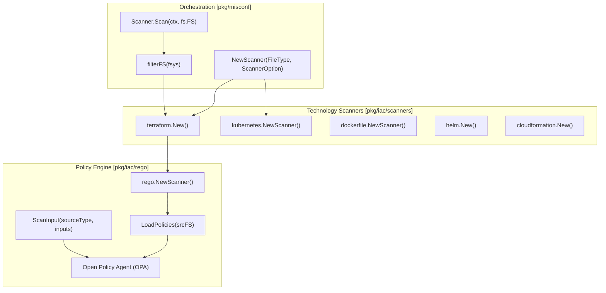
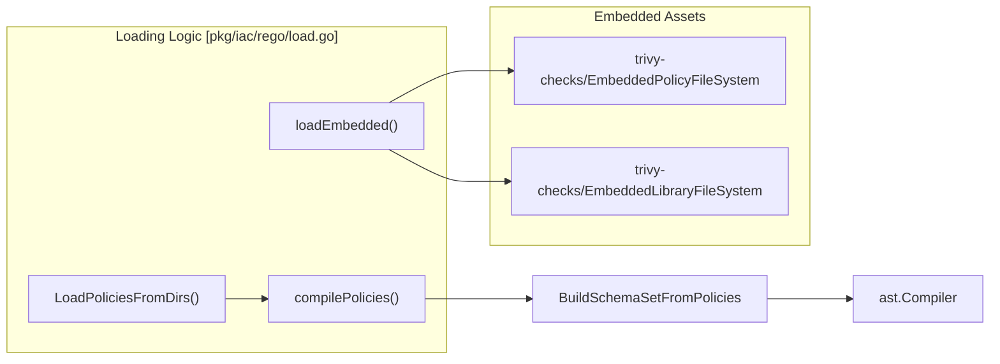
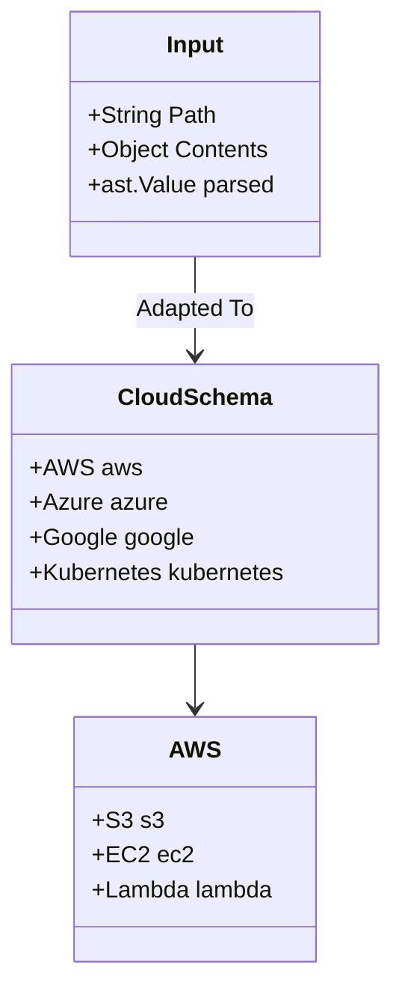

<!-- source: DeepWiki mcp.deepwiki.com · repo aquasecurity/trivy · page 4.2 Misconfiguration Scanning · fetched 2026-10-30 -->

# Misconfiguration Scanning

<details>
<summary>Relevant source files</summary>

The following files were used as context for generating this wiki page:

- [docs/guide/coverage/iac/ansible.md](docs/guide/coverage/iac/ansible.md)
- [docs/guide/coverage/iac/index.md](docs/guide/coverage/iac/index.md)
- [internal/testutil/error.go](internal/testutil/error.go)
- [pkg/dependency/parser/c/conan/parse.go](pkg/dependency/parser/c/conan/parse.go)
- [pkg/fanal/analyzer/config/all/import.go](pkg/fanal/analyzer/config/all/import.go)
- [pkg/fanal/analyzer/config/azurearm/azurearm.go](pkg/fanal/analyzer/config/azurearm/azurearm.go)
- [pkg/fanal/analyzer/config/azurearm/azurearm_test.go](pkg/fanal/analyzer/config/azurearm/azurearm_test.go)
- [pkg/fanal/analyzer/config/cloudformation/cloudformation.go](pkg/fanal/analyzer/config/cloudformation/cloudformation.go)
- [pkg/fanal/analyzer/config/k8s/k8s.go](pkg/fanal/analyzer/config/k8s/k8s.go)
- [pkg/iac/adapters/arm/appservice/adapt.go](pkg/iac/adapters/arm/appservice/adapt.go)
- [pkg/iac/adapters/arm/appservice/adapt_test.go](pkg/iac/adapters/arm/appservice/adapt_test.go)
- [pkg/iac/adapters/terraform/azure/appservice/adapt.go](pkg/iac/adapters/terraform/azure/appservice/adapt.go)
- [pkg/iac/adapters/terraform/azure/appservice/adapt_test.go](pkg/iac/adapters/terraform/azure/appservice/adapt_test.go)
- [pkg/iac/adapters/terraform/azure/container/adapt.go](pkg/iac/adapters/terraform/azure/container/adapt.go)
- [pkg/iac/adapters/terraform/azure/container/adapt_test.go](pkg/iac/adapters/terraform/azure/container/adapt_test.go)
- [pkg/iac/detection/detect.go](pkg/iac/detection/detect.go)
- [pkg/iac/detection/detect_test.go](pkg/iac/detection/detect_test.go)
- [pkg/iac/providers/azure/appservice/appservice.go](pkg/iac/providers/azure/appservice/appservice.go)
- [pkg/iac/providers/azure/container/container.go](pkg/iac/providers/azure/container/container.go)
- [pkg/iac/rego/build.go](pkg/iac/rego/build.go)
- [pkg/iac/rego/custom.go](pkg/iac/rego/custom.go)
- [pkg/iac/rego/embed.go](pkg/iac/rego/embed.go)
- [pkg/iac/rego/embed_test.go](pkg/iac/rego/embed_test.go)
- [pkg/iac/rego/load.go](pkg/iac/rego/load.go)
- [pkg/iac/rego/load_test.go](pkg/iac/rego/load_test.go)
- [pkg/iac/rego/metadata.go](pkg/iac/rego/metadata.go)
- [pkg/iac/rego/metadata_test.go](pkg/iac/rego/metadata_test.go)
- [pkg/iac/rego/options.go](pkg/iac/rego/options.go)
- [pkg/iac/rego/result.go](pkg/iac/rego/result.go)
- [pkg/iac/rego/runtime.go](pkg/iac/rego/runtime.go)
- [pkg/iac/rego/scanner.go](pkg/iac/rego/scanner.go)
- [pkg/iac/rego/scanner_test.go](pkg/iac/rego/scanner_test.go)
- [pkg/iac/rego/schemas/cloud.json](pkg/iac/rego/schemas/cloud.json)
- [pkg/iac/scan/rule.go](pkg/iac/scan/rule.go)
- [pkg/iac/scanners/azure/arm/parser/parser.go](pkg/iac/scanners/azure/arm/parser/parser.go)
- [pkg/iac/scanners/azure/arm/parser/parser_test.go](pkg/iac/scanners/azure/arm/parser/parser_test.go)
- [pkg/iac/scanners/azure/arm/parser/template.go](pkg/iac/scanners/azure/arm/parser/template.go)
- [pkg/iac/scanners/azure/arm/parser/template_test.go](pkg/iac/scanners/azure/arm/parser/template_test.go)
- [pkg/iac/scanners/azure/value.go](pkg/iac/scanners/azure/value.go)
- [pkg/iac/scanners/azure/value_test.go](pkg/iac/scanners/azure/value_test.go)
- [pkg/iac/scanners/cloudformation/scanner_test.go](pkg/iac/scanners/cloudformation/scanner_test.go)
- [pkg/iac/scanners/dockerfile/scanner_test.go](pkg/iac/scanners/dockerfile/scanner_test.go)
- [pkg/iac/scanners/generic/scanner_test.go](pkg/iac/scanners/generic/scanner_test.go)
- [pkg/iac/scanners/terraform/scanner_test.go](pkg/iac/scanners/terraform/scanner_test.go)
- [pkg/iac/scanners/terraform/setup_test.go](pkg/iac/scanners/terraform/setup_test.go)
- [pkg/iac/scanners/terraformplan/snapshot/scanner_test.go](pkg/iac/scanners/terraformplan/snapshot/scanner_test.go)
- [pkg/mapfs/file.go](pkg/mapfs/file.go)
- [pkg/mapfs/fs.go](pkg/mapfs/fs.go)
- [pkg/mapfs/fs_test.go](pkg/mapfs/fs_test.go)
- [pkg/mapfs/testdata/subdir/..foo.txt](pkg/mapfs/testdata/subdir/..foo.txt)
- [pkg/mapfs/testdata/subdir/foo.txt](pkg/mapfs/testdata/subdir/foo.txt)
- [pkg/misconf/scanner.go](pkg/misconf/scanner.go)
- [pkg/misconf/scanner_test.go](pkg/misconf/scanner_test.go)
- [pkg/module/memfs.go](pkg/module/memfs.go)
- [pkg/module/memfs_test.go](pkg/module/memfs_test.go)
- [pkg/x/json/json.go](pkg/x/json/json.go)
- [pkg/x/json/json_test.go](pkg/x/json/json_test.go)

</details>


## Purpose and Scope

This document details Trivy's misconfiguration scanning system, which detects security issues and policy violations in Infrastructure as Code (IaC) configurations. The system parses configuration files (Terraform, CloudFormation, Kubernetes YAML, Helm, Ansible, etc.), evaluates them with user-provided values, and applies Rego-based policies to identify misconfigurations.

The misconfiguration scanner is built on a modular architecture where specific scanners for different technologies (e.g., Terraform, Dockerfile) are orchestrated by a central `Scanner` that manages filesystem filtering and results aggregation.

Sources: [pkg/misconf/scanner.go:1-56](), [pkg/iac/rego/scanner.go:50-80]()

---

## Core Scanning Architecture

The misconfiguration scanning process follows a pipeline from file detection to policy evaluation.



**Misconfiguration Scanning Pipeline**: Orchestration of technology-specific scanners and the Rego engine.

Sources: [pkg/misconf/scanner.go:106-146](), [pkg/misconf/scanner.go:148-180](), [pkg/iac/rego/scanner.go:101-124]()

### File Detection and Filtering
Trivy uses a detection system to identify relevant files before passing them to specific scanners. The `filterFS` function uses `detection.IsType` to ensure only files matching the expected `FileType` are processed.

| FileType | Detection Logic | Code Reference |
| :--- | :--- | :--- |
| `terraform` | Matches `.tf`, `.tf.json`, `.tfvars` | [pkg/iac/detection/detect.go:100-102]() |
| `cloudformation` | Sniffs for `Resources` key in YAML/JSON | [pkg/iac/detection/detect.go:131-156]() |
| `dockerfile` | Matches `Dockerfile`, `Containerfile` or `.Dockerfile` ext | [pkg/iac/detection/detect.go:203-216]() |
| `kubernetes` | Checks for `apiVersion`, `kind`, `metadata` | [pkg/iac/detection/detect.go:218-282]() |
| `azure-arm` | Validates `$schema` prefix and `resources` | [pkg/iac/detection/detect.go:158-201]() |

Sources: [pkg/iac/detection/detect.go:39-52](), [pkg/misconf/scanner.go:182-225]()

---

## Rego Policy Engine

The heart of the misconfiguration system is the Rego scanner, which evaluates parsed configuration data against OPA policies.

### Policy Loading and Compilation
The `rego.Scanner` loads policies from multiple sources, including embedded policies (from `aquasecurity/trivy-checks`), local directories, and OPA bundles.



**Policy Loading Workflow**: How Rego modules are gathered and prepared for evaluation.

Sources: [pkg/iac/rego/load.go:62-78](), [pkg/iac/rego/load.go:80-142](), [pkg/iac/rego/embed.go:71-77]()

### Metadata and Annotations
Trivy uses OPA annotations to define rule metadata (ID, Title, Severity). The `StaticMetadata` struct captures these attributes from Rego `# METADATA` blocks.

| Attribute | Description | Code Reference |
| :--- | :--- | :--- |
| `id` | Unique check identifier (e.g., AVD-AWS-0001) | [pkg/iac/rego/metadata.go:76]() |
| `severity` | Critical, High, Medium, Low | [pkg/iac/rego/metadata.go:99-101]() |
| `frameworks` | Mapping to compliance frameworks (CIS, NSA) | [pkg/iac/rego/metadata.go:143-173]() |
| `input` | Selectors to filter which checks apply to which data | [pkg/iac/rego/metadata.go:253-270]() |

Sources: [pkg/iac/rego/metadata.go:25-49](), [pkg/iac/rego/metadata.go:196-218]()

---

## Data Flow: Configuration to Rego Input

Configuration data is adapted into a standard JSON structure before being passed to OPA as `input`.

### Cloud Provider Schema
For cloud-based IaC (Terraform, CloudFormation), Trivy maps resources to a unified provider schema defined in `cloud.json`.



**Data Adaptation**: Mapping heterogeneous IaC formats to a unified Rego input schema.

Sources: [pkg/iac/rego/schemas/cloud.json:1-44](), [pkg/iac/rego/scanner.go:164-171]()

### Rule Evaluation Process
The `ScanInput` function iterates through loaded policies and applies rules to the provided inputs.

1.  **Filter**: Checks if the policy is applicable to the `sourceType` and `input` using metadata selectors [pkg/iac/rego/scanner.go:226-228]().
2.  **Query**: Executes Rego queries (usually `deny` or `allow`) [pkg/iac/rego/scanner.go:239-251]().
3.  **Result Embellishment**: Combines OPA output with static metadata to create `scan.Results` [pkg/iac/rego/scanner.go:250]().

Sources: [pkg/iac/rego/scanner.go:181-257]()

---

## Advanced Rego Features

### Schema Validation
Trivy supports type-checking Rego policies using JSON schemas. This prevents policies from referencing non-existent fields in the input data.

Sources: [pkg/iac/rego/load.go:247-255](), [pkg/iac/rego/load_test.go:55-71]()

### Runtime Values
The scanner provides runtime information to Rego policies via `opa.runtime()`, including environment variables prefixed with `DEFSEC_`.

Sources: [pkg/iac/rego/scanner.go:134](), [pkg/iac/rego/scanner_test.go:159-184]()

### Fallback Mechanism
If a user-provided policy fails to compile (e.g., due to syntax changes in newer OPA versions), Trivy can fallback to an embedded version of the check if the namespace or ID matches.

Sources: [pkg/iac/rego/load.go:144-190](), [pkg/iac/rego/load_test.go:112-134]()

---

## Implementation Details: Technology Specifics

### Terraform Scanning
Terraform scanning involves complex HCL evaluation before Rego analysis.
- **Plan Scanning**: Supports both JSON plan files (`terraformplan-json`) and binary snapshots (`terraformplan-snapshot`).
- **Module Support**: Resolves and evaluates remote and local modules.

Sources: [pkg/iac/detection/detect.go:104-129](), [pkg/iac/scanners/terraform/scanner_test.go:19-52]()

### Kubernetes and Helm
- **Helm**: Renders templates using provided value files before scanning the resulting manifests.
- **RBAC**: Specialized detection for Role-Based Access Control misconfigurations.

Sources: [pkg/iac/detection/detect.go:78-93](), [pkg/iac/detection/detect.go:218-282]()

### Misconfiguration Results Structure
Results are categorized into `Successes`, `Warnings`, and `Failures`.

```go
type Misconfiguration struct {
    FileType   ConfigType
    Scanner    string
    Successes  MisconfResults
    Warnings   MisconfResults
    Failures   MisconfResults
}
```

Sources: [pkg/misconf/scanner.go:169-177](), [pkg/iac/rego/result.go:1-20]()

---

