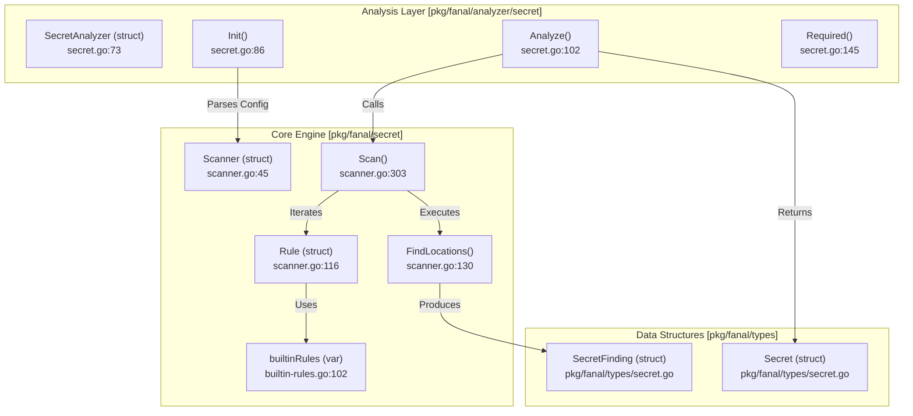
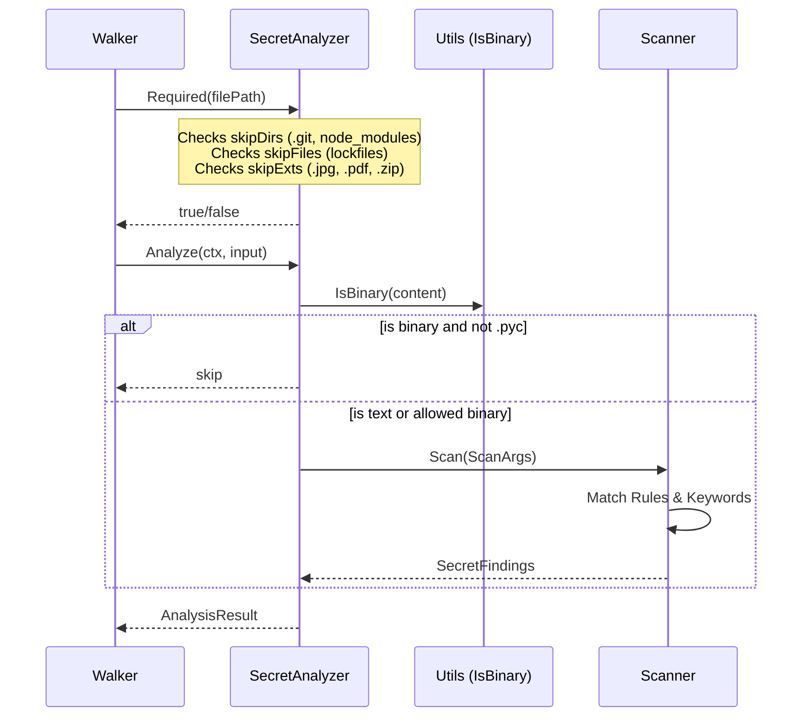

<!-- source: DeepWiki mcp.deepwiki.com · repo aquasecurity/trivy · page 4.3 Secret Detection · fetched 2026-10-30 -->

# Secret Detection

<details>
<summary>Relevant source files</summary>

The following files were used as context for generating this wiki page:

- [pkg/fanal/analyzer/imgconf/secret/secret.go](pkg/fanal/analyzer/imgconf/secret/secret.go)
- [pkg/fanal/analyzer/imgconf/secret/secret_test.go](pkg/fanal/analyzer/imgconf/secret/secret_test.go)
- [pkg/fanal/analyzer/secret/secret.go](pkg/fanal/analyzer/secret/secret.go)
- [pkg/fanal/analyzer/secret/secret_test.go](pkg/fanal/analyzer/secret/secret_test.go)
- [pkg/fanal/secret/builtin-rules.go](pkg/fanal/secret/builtin-rules.go)
- [pkg/fanal/secret/scanner.go](pkg/fanal/secret/scanner.go)
- [pkg/fanal/secret/scanner_test.go](pkg/fanal/secret/scanner_test.go)
- [pkg/fanal/secret/testdata/alibaba-access-key-id.txt](pkg/fanal/secret/testdata/alibaba-access-key-id.txt)
- [pkg/fanal/secret/testdata/asymmetric-private-key.txt](pkg/fanal/secret/testdata/asymmetric-private-key.txt)
- [pkg/fanal/secret/testdata/aws-secrets.txt](pkg/fanal/secret/testdata/aws-secrets.txt)
- [pkg/fanal/secret/testdata/crlf-line-endings.txt](pkg/fanal/secret/testdata/crlf-line-endings.txt)
- [pkg/fanal/secret/testdata/github-token.txt](pkg/fanal/secret/testdata/github-token.txt)
- [pkg/fanal/secret/testdata/grafana-env.txt](pkg/fanal/secret/testdata/grafana-env.txt)
- [pkg/fanal/secret/testdata/hugging-face-secret.txt](pkg/fanal/secret/testdata/hugging-face-secret.txt)
- [pkg/fanal/secret/testdata/invalid-utf8.txt](pkg/fanal/secret/testdata/invalid-utf8.txt)
- [pkg/fanal/secret/testdata/jwt-secret.txt](pkg/fanal/secret/testdata/jwt-secret.txt)
- [pkg/fanal/secret/testdata/private-packagist.txt](pkg/fanal/secret/testdata/private-packagist.txt)
- [pkg/fanal/secret/testdata/symfony-secret.yaml](pkg/fanal/secret/testdata/symfony-secret.yaml)
- [pkg/fanal/types/misconf.go](pkg/fanal/types/misconf.go)
- [pkg/result/filter.go](pkg/result/filter.go)
- [pkg/result/filter_test.go](pkg/result/filter_test.go)
- [pkg/result/ignore.go](pkg/result/ignore.go)
- [pkg/result/ignore_test.go](pkg/result/ignore_test.go)
- [pkg/result/testdata/.trivyignore](pkg/result/testdata/.trivyignore)
- [pkg/result/testdata/.trivyignore.yaml](pkg/result/testdata/.trivyignore.yaml)
- [pkg/result/testdata/test-ignore-policy-licenses-and-secrets.rego](pkg/result/testdata/test-ignore-policy-licenses-and-secrets.rego)
- [pkg/types/misconfiguration.go](pkg/types/misconfiguration.go)
- [pkg/types/vulnerability.go](pkg/types/vulnerability.go)

</details>


This page explains Trivy's secret detection system, which identifies sensitive information and credentials embedded in code, configuration files, and container images. Secret detection uses pattern-based matching to find API keys, passwords, tokens, private keys, and other sensitive data.

For vulnerability detection, see [4.1](). For misconfiguration scanning, see [4.2](). For license scanning, see [4.4]().

## Overview

Secret detection in Trivy is implemented as a specialized analyzer within the `fanal` library. It operates during the artifact analysis phase by scanning file contents against a set of rules defined by regular expressions and keywords. Unlike vulnerability detection, secret scanning is entirely signature-based and does not require an external vulnerability database.

The system supports:
- **Built-in Rules**: Over 70 categories of secrets including AWS, GitHub, Slack, and Stripe [pkg/fanal/secret/builtin-rules.go:11-74]().
- **Custom Rules**: User-defined patterns via configuration files [pkg/fanal/secret/scanner.go:63]().
- **Allow Rules**: Mechanisms to whitelist specific patterns or file paths [pkg/fanal/secret/scanner.go:224-231]().
- **Binary Filtering**: Intelligent skipping of non-text files while allowing specific binary formats like `.pyc` [pkg/fanal/analyzer/secret/secret.go:41-60]().

Sources: [pkg/fanal/secret/builtin-rules.go:11-100](), [pkg/fanal/analyzer/secret/secret.go:102-143]()

## Secret Detection Architecture

The following diagram maps the natural language concepts of "Scanning" and "Detection" to the specific code entities in the `pkg/fanal/secret` and `pkg/fanal/analyzer/secret` packages.

### Code Entity Map: Detection Pipeline



Sources: [pkg/fanal/analyzer/secret/secret.go:73-143](), [pkg/fanal/secret/scanner.go:45-154](), [pkg/fanal/secret/builtin-rules.go:102]()

## Implementation Details

### The Scanning Engine
The `Scanner` struct [pkg/fanal/secret/scanner.go:45]() is the heart of the detection logic. It processes content in chunks to balance memory usage and performance.

- **Buffering**: Uses a `DefaultBufferSize` of 64KB [pkg/fanal/secret/scanner.go:36]().
- **Overlap**: Implements a `DefaultOverlap` of 4KB [pkg/fanal/secret/scanner.go:42]() to ensure secrets spanning across buffer boundaries (like long RSA keys) are not missed.
- **Keyword Pre-filtering**: To optimize performance, rules can define `Keywords` [pkg/fanal/secret/scanner.go:122](). The scanner first checks if a line contains these keywords before executing expensive regex matching [pkg/fanal/secret/scanner.go:202-214]().

### Rule Definition
A `Rule` [pkg/fanal/secret/scanner.go:116]() consists of:
- **Regex**: The pattern to match.
- **SecretGroupName**: If the regex contains multiple capture groups, this specifies which group contains the actual secret [pkg/fanal/secret/scanner.go:126]().
- **Severity**: The impact level (e.g., CRITICAL, HIGH).
- **AllowRules**: Rule-specific exclusions [pkg/fanal/secret/scanner.go:124]().

### Built-in Rules Examples
| ID | Category | Keywords | Regex Source |
|----|----------|----------|--------------|
| `aws-access-key-id` | AWS | `AKIA`, `AGPA`, etc. | [pkg/fanal/secret/builtin-rules.go:104-111]() |
| `github-pat` | GitHub | `ghp_` | [pkg/fanal/secret/builtin-rules.go:122-129]() |
| `slack-access-token` | Slack | `xoxp-` | [pkg/fanal/secret/builtin-rules.go:245-252]() |

Sources: [pkg/fanal/secret/scanner.go:31-43](), [pkg/fanal/secret/scanner.go:116-128](), [pkg/fanal/secret/builtin-rules.go:102-252]()

## Analysis Workflow

The `SecretAnalyzer` determines which files to scan and how to handle their content.



### File Filtering Logic
The `Required()` function [pkg/fanal/analyzer/secret/secret.go:145]() optimizes the scan by skipping:
- **Small files**: Files smaller than 10 bytes [pkg/fanal/analyzer/secret/secret.go:147]().
- **Dependency lockfiles**: `go.sum`, `package-lock.json`, etc. [pkg/fanal/analyzer/secret/secret.go:28-36]().
- **SCM directories**: `.git` [pkg/fanal/analyzer/secret/secret.go:38]().
- **Media/Binaries**: `.jpg`, `.pdf`, `.zip`, `.deb` [pkg/fanal/analyzer/secret/secret.go:41-56]().

Sources: [pkg/fanal/analyzer/secret/secret.go:28-61](), [pkg/fanal/analyzer/secret/secret.go:145-183]()

## Result Filtering and Exclusions

Once secrets are detected, they pass through a filtering layer in `pkg/result/filter.go`.

### Global and Local Ignores
1. **.trivyignore**: Users can suppress specific findings by Rule ID [pkg/result/filter.go:165-174]().
2. **Inline Allow Rules**: The `Scanner` config allows defining `AllowRules` based on regex or path [pkg/fanal/secret/scanner.go:224-231]().
3. **Exclude Blocks**: Allows excluding specific blocks of text from scanning [pkg/fanal/secret/scanner.go:251-254]().

### Filtering Logic
The `filterSecrets` function [pkg/result/filter.go:159]() performs the following:
- **Severity Filtering**: Removes findings that don't match the user-requested severity levels [pkg/result/filter.go:162-164]().
- **Ignore File Matching**: Checks findings against `.trivyignore` entries [pkg/result/filter.go:165-170]().

Sources: [pkg/result/filter.go:159-174](), [pkg/fanal/secret/scanner.go:224-254](), [pkg/result/ignore.go:143-150]()

## Configuration

Secret scanning can be customized via a YAML configuration file.

```yaml
# Example Secret Config
enable-builtin-rules:
  - aws-access-key-id
disable-rules:
  - generic-unwanted-rule
rules:
  - id: custom-api-key
    title: My Custom API Key
    regex: 'my-key-[a-z0-9]{32}'
    severity: CRITICAL
allow-rules:
  - id: sample-data
    regex: 'AKIAEXAMPLE123456789'
```

The `Config` struct [pkg/fanal/secret/scanner.go:52-66]() maps these fields:
- `EnableBuiltinRuleIDs`: Whitelist of built-in rules [pkg/fanal/secret/scanner.go:55]().
- `CustomRules`: List of user-defined `Rule` objects [pkg/fanal/secret/scanner.go:63]().
- `CustomAllowRules`: Global exclusions for the scanner [pkg/fanal/secret/scanner.go:64]().

Sources: [pkg/fanal/secret/scanner.go:52-72]()

---

