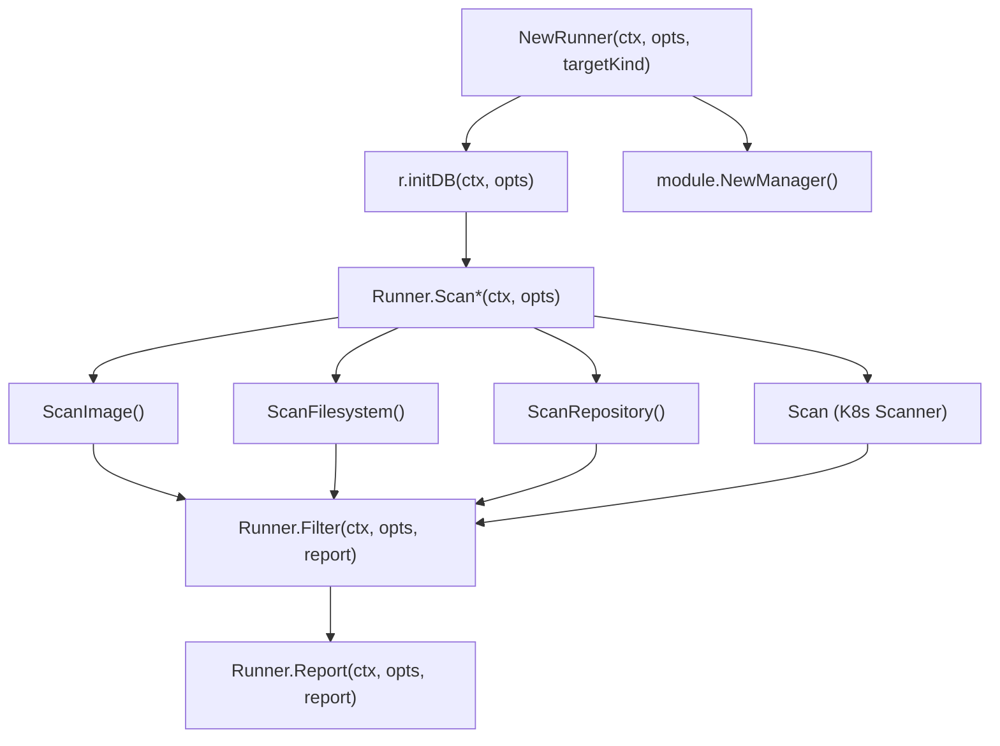
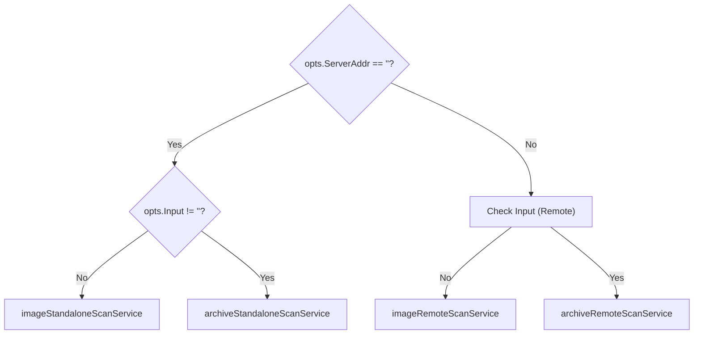

<!-- source: DeepWiki mcp.deepwiki.com · repo aquasecurity/trivy · page 5 Target Types and Scanning Workflows · fetched 2026-10-30 -->

# Target Types and Scanning Workflows

Relevant source files

The following files were used as context for generating this wiki page:

- [README.md](README.md)
- [go.mod](go.mod)
- [go.sum](go.sum)
- [mkdocs.yml](mkdocs.yml)
- [pkg/commands/app.go](pkg/commands/app.go)
- [pkg/commands/app_test.go](pkg/commands/app_test.go)
- [pkg/commands/artifact/run.go](pkg/commands/artifact/run.go)
- [pkg/commands/testdata/java-db/metadata.json](pkg/commands/testdata/java-db/metadata.json)
- [pkg/commands/testdata/policy/metadata.json](pkg/commands/testdata/policy/metadata.json)
- [pkg/fanal/analyzer/analyzer.go](pkg/fanal/analyzer/analyzer.go)
- [pkg/fanal/analyzer/analyzer_test.go](pkg/fanal/analyzer/analyzer_test.go)
- [pkg/fanal/analyzer/pkg/apk/apk.go](pkg/fanal/analyzer/pkg/apk/apk.go)
- [pkg/fanal/analyzer/pkg/apk/apk_test.go](pkg/fanal/analyzer/pkg/apk/apk_test.go)
- [pkg/fanal/analyzer/pkg/apk/testdata/apk](pkg/fanal/analyzer/pkg/apk/testdata/apk)
- [pkg/fanal/applier/applier.go](pkg/fanal/applier/applier.go)
- [pkg/fanal/applier/applier_test.go](pkg/fanal/applier/applier_test.go)
- [pkg/fanal/artifact/artifact.go](pkg/fanal/artifact/artifact.go)
- [pkg/fanal/artifact/image/image.go](pkg/fanal/artifact/image/image.go)
- [pkg/fanal/artifact/image/image_test.go](pkg/fanal/artifact/image/image_test.go)
- [pkg/fanal/artifact/local/fs.go](pkg/fanal/artifact/local/fs.go)
- [pkg/fanal/artifact/local/fs_test.go](pkg/fanal/artifact/local/fs_test.go)
- [pkg/fanal/artifact/sbom/sbom_test.go](pkg/fanal/artifact/sbom/sbom_test.go)
- [pkg/fanal/artifact/vm/vm_test.go](pkg/fanal/artifact/vm/vm_test.go)
- [pkg/fanal/test/integration/testdata/goldens/packages/alpine-310.json.golden](pkg/fanal/test/integration/testdata/goldens/packages/alpine-310.json.golden)
- [pkg/fanal/test/integration/testdata/goldens/packages/vulnimage.json.golden](pkg/fanal/test/integration/testdata/goldens/packages/vulnimage.json.golden)
- [pkg/fanal/test/integration/testdata/goldens/vuln-image1.2.3.expectedlibs.golden](pkg/fanal/test/integration/testdata/goldens/vuln-image1.2.3.expectedlibs.golden)
- [pkg/fanal/types/artifact.go](pkg/fanal/types/artifact.go)
- [pkg/flag/kubernetes_flags.go](pkg/flag/kubernetes_flags.go)
- [pkg/flag/options.go](pkg/flag/options.go)
- [pkg/k8s/commands/cluster.go](pkg/k8s/commands/cluster.go)
- [pkg/k8s/commands/run.go](pkg/k8s/commands/run.go)
- [pkg/k8s/report/report.go](pkg/k8s/report/report.go)
- [pkg/k8s/report/report_test.go](pkg/k8s/report/report_test.go)
- [pkg/k8s/report/summary.go](pkg/k8s/report/summary.go)
- [pkg/k8s/report/summary_test.go](pkg/k8s/report/summary_test.go)
- [pkg/k8s/report/table.go](pkg/k8s/report/table.go)
- [pkg/k8s/scanner/scanner.go](pkg/k8s/scanner/scanner.go)
- [pkg/k8s/writer_test.go](pkg/k8s/writer_test.go)

## Purpose and Scope

This document explains how Trivy scans different artifact types using target-specific workflows. Each target type (container image, filesystem, repository, Kubernetes, etc.) follows a distinct processing path optimized for its characteristics. The page covers:

- Target type constants and their CLI command mappings.
- How the `Runner` interface orchestrates the scanning pipeline in [pkg/commands/artifact/run.go:79-98]().
- Target-specific analyzer configurations and service initialization.
- Processing differences between standalone and client/server modes.
- Kubernetes-specific scanning workflows and resource collection.

For details about individual scanning capabilities, see page 4. For deployment architecture patterns, see page 8.

Sources: [pkg/commands/artifact/run.go:1-100](), [pkg/commands/app.go:88-102]()

## Scanning Workflow Overview

### High-Level Scanning Pipeline

All target types flow through a unified scanning pipeline orchestrated by the `Runner` in [pkg/commands/artifact/run.go:79-98](). The pipeline consists of three main phases:

1.  **Runner Initialization**: Performed by `NewRunner` in [pkg/commands/artifact/run.go:121-174](). This handles DB initialization via `r.initDB`, VEX repository downloads, and WASM module loading via `module.NewManager`.
2.  **Target Scanning**: Execution of target-specific methods like `ScanImage`, `ScanFilesystem`, or `ScanK8sVulns`.
3.  **Output Generation**: Result filtering via `runner.Filter` and report writing via `runner.Report`.

**Workflow: Runner Orchestration Flow**

Sources: [pkg/commands/artifact/run.go:121-174](), [pkg/commands/artifact/run.go:199-296](), [pkg/k8s/scanner/scanner.go:55-148]()

### Target Type Constants and Command Mapping

Trivy defines `TargetKind` constants in [pkg/commands/artifact/run.go:49-57]() to route CLI commands to the correct scanning logic.

| CLI Command | TargetKind Constant | Runner Method |
| :--- | :--- | :--- |
| `trivy image` | `TargetContainerImage` | `ScanImage()` |
| `trivy fs` | `TargetFilesystem` | `ScanFilesystem()` |
| `trivy rootfs` | `TargetRootfs` | `ScanRootfs()` |
| `trivy repo` | `TargetRepository` | `ScanRepository()` |
| `trivy sbom` | `TargetSBOM` | `ScanSBOM()` |
| `trivy vm` | `TargetVM` | `ScanVM()` |
| `trivy k8s` | `TargetK8s` | `k8s/scanner.Scan()` |

Sources: [pkg/commands/artifact/run.go:49-57](), [pkg/commands/app.go:88-106]()

## Scan Service Initialization

### Standalone vs Client/Server Mode

Each target type selects an appropriate `InitializeScanService` based on the presence of a server address or input flags.

**Service Selection Logic (Image Example)**

Sources: [pkg/commands/artifact/run.go:204-217]()

### InitializeScanService Function Signature

All scan services implement the `InitializeScanService` function type defined in [pkg/commands/artifact/run.go:62]():

`type InitializeScanService func(context.Context, ScannerConfig) (scan.Service, func(), error)`

The `ScannerConfig` in [pkg/commands/artifact/run.go:64-77]() encapsulates target identifiers, cache options, and artifact options used to configure the underlying `fanal` analyzers.

## Target-Specific Workflows

### Container Image Scanning
Detailed in **[Container Image Scanning](#5.1)**.
- **Analyzers**: Disables `analyzer.TypeLockfiles` [pkg/commands/artifact/run.go:201]() as images are scanned via layer analysis.
- **Workflow**: Processes image IDs and diff IDs to calculate cache keys in [pkg/fanal/artifact/image/image.go:127]().

### Filesystem and Rootfs Scanning
Detailed in **[Filesystem and Rootfs Scanning](#5.2)**.
- **Filesystem**: Disables `analyzer.TypeIndividualPkgs` and `analyzer.TypeSBOM` [pkg/commands/artifact/run.go:224-225]() to focus on source code dependencies.
- **Rootfs**: Disables `analyzer.TypeLockfiles` [pkg/commands/artifact/run.go:232]() to treat the directory like an unpacked container.

### Repository Scanning
Detailed in **[Repository and SBOM Scanning](#5.4)**.
- **Logic**: Specifically sets `PkgTypes` to `PkgTypeLibrary` [pkg/commands/artifact/run.go:252]() and disables OS analyzers [pkg/commands/artifact/run.go:255]().
- **Git Integration**: Automatically detects Git metadata (commit hash, branch) to use as cache keys in [pkg/fanal/artifact/local/fs.go:84-92]().

### Kubernetes Scanning
Detailed in **[Kubernetes Cluster Scanning](#5.3)**.
- **Workflow**: Uses `trivy-kubernetes` to list artifacts [pkg/k8s/commands/run.go:10-11]().
- **Parallelism**: Scans images within the cluster in parallel using `parallel.NewPipeline` [pkg/k8s/scanner/scanner.go:129]().
- **Core Components**: Separates "Resource" artifacts from "Core" components (e.g., etcd, apiserver) to apply specific vulnerability checks [pkg/k8s/scanner/scanner.go:74-82]().

### Infrastructure as Code (IaC) Scanning
Detailed in **[Infrastructure as Code Scanning](#5.5)**.
- **Integration**: Handled primarily through the `ScanFilesystem` workflow when misconfiguration scanners are enabled.
- **Policy**: Utilizes Rego-based checks and specific analyzers for Terraform, CloudFormation, and Helm.

Sources: [pkg/commands/artifact/run.go:200-296](), [pkg/k8s/scanner/scanner.go:74-133](), [pkg/fanal/artifact/local/fs.go:84-92]()

## Result Processing and Filtering

Regardless of the target, all results are filtered through `Runner.Filter` [pkg/commands/artifact/run.go:93](). This applies:
1.  **Severity Filtering**: Based on `--severity` flags.
2.  **Vulnerability Status**: Ignoring unfixed issues via `--ignore-unfixed`.
3.  **VEX**: Applying Vulnerability Exploitability eXchange data.
4.  **Policy**: Custom Rego policies for ignoring specific findings.

Sources: [pkg/commands/artifact/run.go:310-323](), [pkg/k8s/scanner/scanner.go:225]()

---

