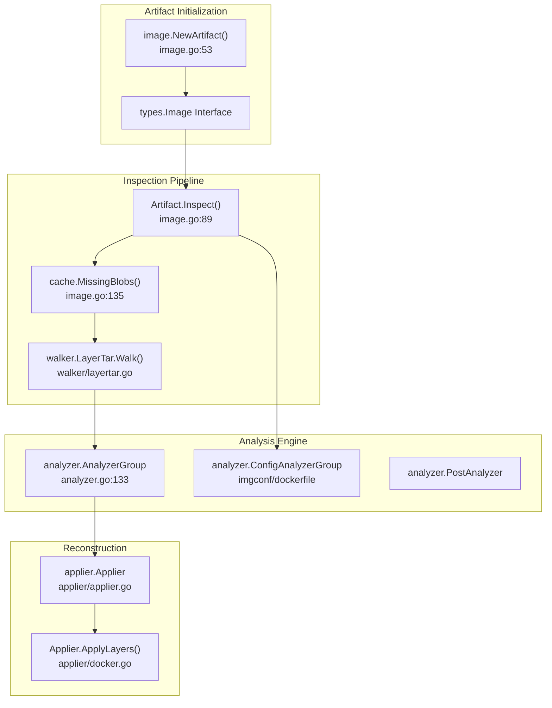
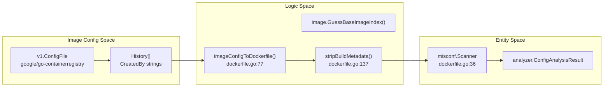

<!-- source: DeepWiki mcp.deepwiki.com · repo aquasecurity/trivy · page 5.1 Container Image Scanning · fetched 2026-10-30 -->

# Container Image Scanning

Relevant source files

The following files were used as context for generating this wiki page:

- [internal/testutil/docker.go](internal/testutil/docker.go)
- [pkg/fanal/analyzer/analyzer.go](pkg/fanal/analyzer/analyzer.go)
- [pkg/fanal/analyzer/analyzer_test.go](pkg/fanal/analyzer/analyzer_test.go)
- [pkg/fanal/analyzer/imgconf/dockerfile/dockerfile.go](pkg/fanal/analyzer/imgconf/dockerfile/dockerfile.go)
- [pkg/fanal/analyzer/imgconf/dockerfile/dockerfile_test.go](pkg/fanal/analyzer/imgconf/dockerfile/dockerfile_test.go)
- [pkg/fanal/analyzer/pkg/apk/apk.go](pkg/fanal/analyzer/pkg/apk/apk.go)
- [pkg/fanal/analyzer/pkg/apk/apk_test.go](pkg/fanal/analyzer/pkg/apk/apk_test.go)
- [pkg/fanal/analyzer/pkg/apk/testdata/apk](pkg/fanal/analyzer/pkg/apk/testdata/apk)
- [pkg/fanal/applier/applier.go](pkg/fanal/applier/applier.go)
- [pkg/fanal/applier/applier_test.go](pkg/fanal/applier/applier_test.go)
- [pkg/fanal/artifact/artifact.go](pkg/fanal/artifact/artifact.go)
- [pkg/fanal/artifact/image/image.go](pkg/fanal/artifact/image/image.go)
- [pkg/fanal/artifact/image/image_test.go](pkg/fanal/artifact/image/image_test.go)
- [pkg/fanal/artifact/local/fs.go](pkg/fanal/artifact/local/fs.go)
- [pkg/fanal/artifact/local/fs_test.go](pkg/fanal/artifact/local/fs_test.go)
- [pkg/fanal/artifact/sbom/sbom_test.go](pkg/fanal/artifact/sbom/sbom_test.go)
- [pkg/fanal/artifact/vm/vm_test.go](pkg/fanal/artifact/vm/vm_test.go)
- [pkg/fanal/image/daemon/containerd.go](pkg/fanal/image/daemon/containerd.go)
- [pkg/fanal/image/daemon/context_test.go](pkg/fanal/image/daemon/context_test.go)
- [pkg/fanal/image/daemon/docker.go](pkg/fanal/image/daemon/docker.go)
- [pkg/fanal/image/daemon/image.go](pkg/fanal/image/daemon/image.go)
- [pkg/fanal/image/daemon/image_test.go](pkg/fanal/image/daemon/image_test.go)
- [pkg/fanal/image/daemon/podman.go](pkg/fanal/image/daemon/podman.go)
- [pkg/fanal/image/daemon/podman_test.go](pkg/fanal/image/daemon/podman_test.go)
- [pkg/fanal/image/image_test.go](pkg/fanal/image/image_test.go)
- [pkg/fanal/image/registry/azure/azure.go](pkg/fanal/image/registry/azure/azure.go)
- [pkg/fanal/image/registry/azure/azure_test.go](pkg/fanal/image/registry/azure/azure_test.go)
- [pkg/fanal/image/registry/ecr/ecr.go](pkg/fanal/image/registry/ecr/ecr.go)
- [pkg/fanal/image/registry/ecr/ecr_test.go](pkg/fanal/image/registry/ecr/ecr_test.go)
- [pkg/fanal/image/registry/google/google.go](pkg/fanal/image/registry/google/google.go)
- [pkg/fanal/image/registry/google/google_test.go](pkg/fanal/image/registry/google/google_test.go)
- [pkg/fanal/image/registry/intf/registry.go](pkg/fanal/image/registry/intf/registry.go)
- [pkg/fanal/image/registry/token.go](pkg/fanal/image/registry/token.go)
- [pkg/fanal/test/integration/containerd_test.go](pkg/fanal/test/integration/containerd_test.go)
- [pkg/fanal/test/integration/docker/docker.go](pkg/fanal/test/integration/docker/docker.go)
- [pkg/fanal/test/integration/library_test.go](pkg/fanal/test/integration/library_test.go)
- [pkg/fanal/test/integration/registry_test.go](pkg/fanal/test/integration/registry_test.go)
- [pkg/fanal/test/integration/testdata/goldens/packages/alpine-310.json.golden](pkg/fanal/test/integration/testdata/goldens/packages/alpine-310.json.golden)
- [pkg/fanal/test/integration/testdata/goldens/packages/vulnimage.json.golden](pkg/fanal/test/integration/testdata/goldens/packages/vulnimage.json.golden)
- [pkg/fanal/test/integration/testdata/goldens/vuln-image1.2.3.expectedlibs.golden](pkg/fanal/test/integration/testdata/goldens/vuln-image1.2.3.expectedlibs.golden)
- [pkg/fanal/types/artifact.go](pkg/fanal/types/artifact.go)
- [pkg/vex/repo/manager.go](pkg/vex/repo/manager.go)

## Purpose and Scope

Container image scanning is a core capability of Trivy, enabling the analysis of OCI-compliant container images to identify security vulnerabilities, misconfigurations, and secrets. This process involves deep inspection of image layers, detection of the operating system, and extraction of application-level dependencies from package manager artifacts.

This page details the technical implementation of image scanning, from artifact initialization to layer merging and package extraction.

## Overview

Trivy analyzes container images by processing individual layers as blobs and then applying them in sequence to reconstruct the final filesystem state. The scanning pipeline supports images from various sources:
- Local Docker/Podman daemons
- Remote container registries
- Containerd/CRI-O runtimes
- Exported tar archives

**Sources:** [pkg/fanal/artifact/image/image.go:53-87](), [pkg/fanal/types/artifact.go:14-21]()

## Core Architecture

The image scanning workflow is orchestrated by the `Artifact` struct, which coordinates image metadata retrieval, layer walking, and analysis.

**Sources:** [pkg/fanal/artifact/image/image.go:39-87](), [pkg/fanal/artifact/image/image.go:89-169](), [pkg/fanal/analyzer/analyzer.go:133-140]()

## Layer Analysis and OS Detection

Trivy processes each layer independently. During the `Inspect` phase, it calculates cache keys based on layer DiffIDs to avoid redundant analysis of shared layers.

### Operating System Detection
OS detection occurs within specific analyzers (e.g., `alpine`, `debian`, `redhat`) that look for release files like `/etc/os-release` or `/etc/alpine-release`. 

- **Merging Logic:** Since images are layered, OS information can span multiple layers. The `OS.Merge` function handles conflicts, such as when an image contains both `/etc/redhat-release` and `/etc/oracle-release`, prioritizing the more specific distribution [pkg/fanal/types/artifact.go:52-82]().
- **Extended Security:** Trivy detects if an OS version is under extended support (e.g., Ubuntu ESM) via the `Extended` field [pkg/fanal/types/artifact.go:23-30]().

### Package Extraction
Analyzers extract packages from two primary sources:
1. **OS Package Databases:** Files like `/lib/apk/db/installed` (Alpine), `/var/lib/dpkg/status` (Debian), or RPM databases [pkg/fanal/artifact/local/fs_test.go:58-81]().
2. **Application Dependencies:** Language-specific lockfiles (e.g., `Gemfile.lock`, `package-lock.json`, `requirements.txt`) [pkg/fanal/artifact/local/fs_test.go:152-171]().

**Sources:** [pkg/fanal/artifact/image/image.go:127-149](), [pkg/fanal/types/artifact.go:52-82](), [pkg/fanal/analyzer/imgconf/dockerfile/dockerfile.go:35-47]()

## Image Configuration Analysis

Beyond the filesystem, Trivy analyzes the container image configuration (JSON metadata). The `historyAnalyzer` reconstructs a "virtual" Dockerfile from the image's history to check for misconfigurations.

**Key Implementation Details:**
- **Base Image Guessing:** Trivy attempts to identify where the base image ends and user layers begin using `image.GuessBaseImageIndex` [pkg/fanal/analyzer/imgconf/dockerfile/dockerfile.go:79]().
- **Instruction Reconstruction:** It normalizes `CreatedBy` strings from history, handling differences between legacy Docker, BuildKit, and Buildah [pkg/fanal/analyzer/imgconf/dockerfile/dockerfile.go:80-119]().
- **Security Checks:** The reconstructed Dockerfile is passed to the `misconf.Scanner` to detect issues like `ADD` instead of `COPY` or running as `root` [pkg/fanal/analyzer/imgconf/dockerfile/dockerfile_test.go:94-136]().

**Sources:** [pkg/fanal/analyzer/imgconf/dockerfile/dockerfile.go:49-75](), [pkg/fanal/analyzer/imgconf/dockerfile/dockerfile.go:77-128]()

## Layer Merging (Applier)

After individual layers are analyzed and stored in the cache as `BlobInfo`, the `Applier` component merges them into a final `ArtifactDetail`.

| Concept | Description | Code Reference |
| :--- | :--- | :--- |
| **Whiteout Files** | Files starting with `.wh.` that indicate a file was deleted in a subsequent layer. | [pkg/fanal/types/artifact.go:177]() |
| **Opaque Dirs** | Directories containing a `.wh..wh..opq` marker, indicating the entire directory from lower layers should be hidden. | [pkg/fanal/types/artifact.go:176]() |
| **Layer Provenance** | Tracking which specific layer (Digest/DiffID) introduced a package. | [pkg/fanal/types/artifact.go:89-94]() |

**Sources:** [pkg/fanal/applier/applier.go:20-21](), [pkg/fanal/types/artifact.go:168-196]()

## Integration and Data Flow

The following sequence describes the end-to-end data flow for a container image scan:

1.  **Artifact Initialization:** `NewArtifact` is called with a `types.Image` implementation (e.g., Docker, Containerd, or Archive) [pkg/fanal/artifact/image/image.go:53]().
2.  **Metadata Extraction:** The scanner retrieves the Image ID and Config File [pkg/fanal/artifact/image/image.go:89-99]().
3.  **Cache Lookup:** Missing layers are identified via `a.cache.MissingBlobs` [pkg/fanal/artifact/image/image.go:135]().
4.  **Parallel Analysis:** New layers are walked and analyzed in parallel using `errgroup` and semaphores to limit concurrency [pkg/fanal/artifact/local/fs.go:198-204]().
5.  **Result Aggregation:** `AnalysisResult.Merge` combines findings from different layers, ensuring OS and Package information is correctly consolidated [pkg/fanal/analyzer/analyzer_test.go:35-157]().
6.  **Final Application:** The `Applier` merges the `BlobInfo` into a single `ArtifactDetail` containing the flattened package list and vulnerabilities [pkg/fanal/test/integration/library_test.go:216-222]().

**Sources:** [pkg/fanal/artifact/image/image.go:89-169](), [pkg/fanal/analyzer/analyzer.go:176-197](), [pkg/fanal/test/integration/library_test.go:216-222]()

---

