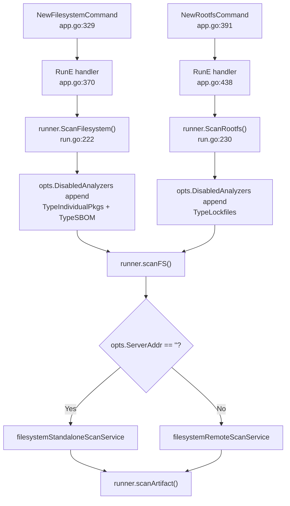
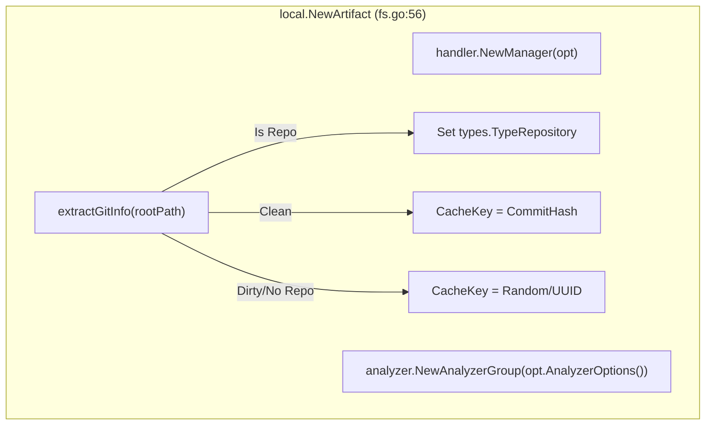
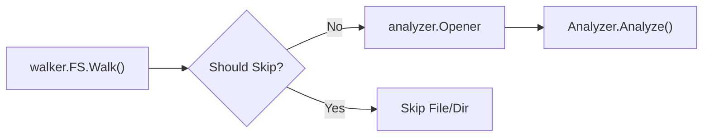

<!-- source: DeepWiki mcp.deepwiki.com · repo aquasecurity/trivy · page 5.2 Filesystem and Rootfs Scanning · fetched 2026-10-30 -->

# Filesystem and Rootfs Scanning

<details>
<summary>Relevant source files</summary>

The following files were used as context for generating this wiki page:

- [pkg/fanal/analyzer/analyzer.go](pkg/fanal/analyzer/analyzer.go)
- [pkg/fanal/analyzer/analyzer_test.go](pkg/fanal/analyzer/analyzer_test.go)
- [pkg/fanal/analyzer/language/c/conan/conan.go](pkg/fanal/analyzer/language/c/conan/conan.go)
- [pkg/fanal/analyzer/language/c/conan/conan_test.go](pkg/fanal/analyzer/language/c/conan/conan_test.go)
- [pkg/fanal/analyzer/language/c/conan/testdata/cacheDir/.conan/data/openssl/3.0.5/_/_/export/conanfile.py](pkg/fanal/analyzer/language/c/conan/testdata/cacheDir/.conan/data/openssl/3.0.5/_/_/export/conanfile.py)
- [pkg/fanal/analyzer/language/c/conan/testdata/cacheDir/.conan/data/zlib/1.2.13/_/_/export/conanfile.py](pkg/fanal/analyzer/language/c/conan/testdata/cacheDir/.conan/data/zlib/1.2.13/_/_/export/conanfile.py)
- [pkg/fanal/analyzer/language/c/conan/testdata/cacheDir_v2/p/opens464b5c427ce9d/e/conanfile.py](pkg/fanal/analyzer/language/c/conan/testdata/cacheDir_v2/p/opens464b5c427ce9d/e/conanfile.py)
- [pkg/fanal/analyzer/language/c/conan/testdata/cacheDir_v2/p/zlib41bd3946e7341/e/conanfile.py](pkg/fanal/analyzer/language/c/conan/testdata/cacheDir_v2/p/zlib41bd3946e7341/e/conanfile.py)
- [pkg/fanal/analyzer/language/c/conan/testdata/empty/conan.lock](pkg/fanal/analyzer/language/c/conan/testdata/empty/conan.lock)
- [pkg/fanal/analyzer/language/c/conan/testdata/happy/conan.lock](pkg/fanal/analyzer/language/c/conan/testdata/happy/conan.lock)
- [pkg/fanal/analyzer/language/c/conan/testdata/happy_v2/release.lock](pkg/fanal/analyzer/language/c/conan/testdata/happy_v2/release.lock)
- [pkg/fanal/analyzer/pkg/apk/apk.go](pkg/fanal/analyzer/pkg/apk/apk.go)
- [pkg/fanal/analyzer/pkg/apk/apk_test.go](pkg/fanal/analyzer/pkg/apk/apk_test.go)
- [pkg/fanal/analyzer/pkg/apk/testdata/apk](pkg/fanal/analyzer/pkg/apk/testdata/apk)
- [pkg/fanal/applier/applier.go](pkg/fanal/applier/applier.go)
- [pkg/fanal/applier/applier_test.go](pkg/fanal/applier/applier_test.go)
- [pkg/fanal/artifact/artifact.go](pkg/fanal/artifact/artifact.go)
- [pkg/fanal/artifact/image/image.go](pkg/fanal/artifact/image/image.go)
- [pkg/fanal/artifact/image/image_test.go](pkg/fanal/artifact/image/image_test.go)
- [pkg/fanal/artifact/local/fs.go](pkg/fanal/artifact/local/fs.go)
- [pkg/fanal/artifact/local/fs_test.go](pkg/fanal/artifact/local/fs_test.go)
- [pkg/fanal/artifact/sbom/sbom_test.go](pkg/fanal/artifact/sbom/sbom_test.go)
- [pkg/fanal/artifact/vm/vm_test.go](pkg/fanal/artifact/vm/vm_test.go)
- [pkg/fanal/test/integration/testdata/goldens/packages/alpine-310.json.golden](pkg/fanal/test/integration/testdata/goldens/packages/alpine-310.json.golden)
- [pkg/fanal/test/integration/testdata/goldens/packages/vulnimage.json.golden](pkg/fanal/test/integration/testdata/goldens/packages/vulnimage.json.golden)
- [pkg/fanal/test/integration/testdata/goldens/vuln-image1.2.3.expectedlibs.golden](pkg/fanal/test/integration/testdata/goldens/vuln-image1.2.3.expectedlibs.golden)
- [pkg/fanal/types/artifact.go](pkg/fanal/types/artifact.go)
- [pkg/fanal/walker/fs.go](pkg/fanal/walker/fs.go)
- [pkg/fanal/walker/fs_test.go](pkg/fanal/walker/fs_test.go)
- [pkg/fanal/walker/tar.go](pkg/fanal/walker/tar.go)
- [pkg/fanal/walker/tar_test.go](pkg/fanal/walker/tar_test.go)
- [pkg/fanal/walker/vm.go](pkg/fanal/walker/vm.go)
- [pkg/fanal/walker/walk.go](pkg/fanal/walker/walk.go)
- [pkg/fanal/walker/walk_test.go](pkg/fanal/walker/walk_test.go)

</details>


Trivy provides two distinct modes for scanning local filesystem structures: `filesystem` (or `fs`) and `rootfs`. While both analyze local directories, they differ in their intended use cases and analyzer configurations.

- **Filesystem (`fs`)**: Designed for scanning project directories, application code, and individual files. Focuses on language-specific dependencies and configurations.
- **Rootfs**: Designed for scanning unpacked root filesystems, such as extracted container images or VM filesystems. Focuses on OS packages and system-level analysis.

This page explains both modes, their differences, and the underlying technical implementation.

## Command Interface

Trivy provides two commands for local filesystem scanning, both defined in `pkg/commands/app.go`.

### Filesystem Command

The `filesystem` command (alias `fs`) scans project directories and individual files:

```bash
# Scan a project directory
trivy fs /path/to/your_project

# Scan a single file
trivy fs ./trivy-ci-test/Pipfile.lock
```

The `NewFilesystemCommand` function at [pkg/commands/app.go:329-389]() creates this command with specific characteristics:

- Memory cache is the default backend (`cache.TypeMemory`) - see [pkg/commands/app.go:331]()
- Individual package analyzers (`analyzer.TypeIndividualPkgs`) and SBOM analyzer (`analyzer.TypeSBOM`) are disabled.
- Both standalone and client/server modes are supported via `filesystemStandaloneScanService` and `filesystemRemoteScanService`.

### Rootfs Command

The `rootfs` command scans unpacked root filesystem structures:

```bash
# Export and scan a container filesystem
docker export $(docker create alpine:3.10.2) | tar -C /tmp/rootfs -xvf -
trivy rootfs /tmp/rootfs
```

The `NewRootfsCommand` function at [pkg/commands/app.go:391-456]() creates this command with these characteristics:

- Lock file analyzers (`analyzer.TypeLockfiles`) are disabled to match image scanning behavior [pkg/commands/app.go:397]().
- Compliance flags and report format flags are restricted or disabled [pkg/commands/app.go:394-395]().

**Sources:** [pkg/commands/app.go:329-456]()

## Scanning Process Architecture

Both filesystem and rootfs scanning share a common pipeline but configure analyzers differently based on their target use case.

### Unified Scanning Pipeline



### Analyzer Selection Logic

The core difference between the two modes is the exclusion of specific analyzers.

| Mode | Disabled Analyzers | Reason |
| :--- | :--- | :--- |
| **Filesystem** | `TypeIndividualPkgs`, `TypeSBOM` | Focuses on source code and project lockfiles rather than installed artifacts. |
| **Rootfs** | `TypeLockfiles` | Focuses on OS-level packages (dpkg, rpm, apk) rather than application-level source dependencies. |

**Sources:** [pkg/fanal/artifact/local/fs.go:56-99](), [pkg/fanal/artifact/artifact.go:18-53]()

## Technical Implementation: `local.Artifact`

The `local.Artifact` struct handles the actual inspection of files on disk.

### Artifact Initialization
When `local.NewArtifact` is called, it initializes an `AnalyzerGroup` and a `handler.Manager` based on the provided options [pkg/fanal/artifact/local/fs.go:56-65]().

### Git Repository Detection
Trivy automatically detects if the target directory is a Git repository. If it is a clean repository, Trivy uses the latest commit hash to calculate the cache key, significantly improving performance for repeated scans [pkg/fanal/artifact/local/fs.go:84-92]().



### The `Inspect` Workflow
The `Inspect` function [pkg/fanal/artifact/local/fs.go:169-254]() follows these steps:
1. **Cache Key Calculation**: Based on Git status or random generation [pkg/fanal/artifact/local/fs.go:171]().
2. **Cache Lookup**: If the repository is clean, it checks the `ArtifactCache` for existing results [pkg/fanal/artifact/local/fs.go:177-183]().
3. **Filesystem Traversal**: 
    - If analyzers support `StaticPathAnalyzer`, Trivy only reads specific files [pkg/fanal/artifact/local/fs.go:215-220]().
    - Otherwise, it performs a full walk using `walker.FS` [pkg/fanal/artifact/local/fs.go:222-225]().
4. **Analysis**: Files are passed to the `AnalyzerGroup`. Each analyzer checks if it is `Required` for a given path [pkg/fanal/analyzer/analyzer.go:79]().

**Sources:** [pkg/fanal/artifact/local/fs.go:169-254](), [pkg/fanal/analyzer/analyzer.go:75-80]()

## Analyzer Processing Pipeline

The `AnalyzerGroup` coordinates multiple specialized analyzers.

### Analysis Result Merging
As files are processed, results are collected into an `AnalysisResult` struct [pkg/fanal/analyzer/analyzer.go:176-197](). Results from different layers or files are merged using the `Merge` logic, which handles OS family normalization (e.g., ensuring Oracle Linux overrides RedHat detection if both release files are present) [pkg/fanal/types/artifact.go:52-82]().

### Result Sorting
To ensure deterministic output, results are sorted by file path and package name before being returned [pkg/fanal/analyzer/analyzer.go:210-250]().

| Entity | Code Reference | Purpose |
| :--- | :--- | :--- |
| `AnalysisInput` | [pkg/fanal/analyzer/analyzer.go:145-152]() | Data passed to each analyzer (Content, Path, Info). |
| `AnalysisResult` | [pkg/fanal/analyzer/analyzer.go:176-197]() | Container for OS, Packages, Apps, Secrets, and Licenses. |
| `StaticPathAnalyzer` | [pkg/fanal/analyzer/analyzer.go:126-129]() | Optimization for analyzers that know exactly which files they need. |

**Sources:** [pkg/fanal/analyzer/analyzer.go:176-250](), [pkg/fanal/types/artifact.go:52-82](), [pkg/fanal/artifact/local/fs.go:215-220]()

## File Discovery and Discovery (Walker)

Trivy uses a `Walker` interface to abstract filesystem traversal.

- **`walker.FS`**: Used for standard local directories [pkg/fanal/walker/fs.go]().
- **Filtering**: The walker respects `SkipFiles` and `SkipDirs` options [pkg/fanal/walker/walk.go:18-21](). By default, it skips directories like `.git`, `proc`, `sys`, and `dev` [pkg/fanal/walker/walk.go:11-16]().



**Sources:** [pkg/fanal/walker/walk.go:11-21](), [pkg/fanal/artifact/local/fs.go:38-40]()

## Differences from Image Scanning

While `rootfs` scanning is similar to container image scanning, the implementation differs in how data is accessed:

1. **Image Scanning**: Uses `walker.LayerTar` to process OCI/Docker layers [pkg/fanal/artifact/image/image.go:79](). It must handle whiteout files and opaque directories to reconstruct the final state [pkg/fanal/types/artifact.go:176-177]().
2. **Rootfs/FS Scanning**: Uses `walker.FS` to read directly from the host filesystem [pkg/fanal/artifact/local/fs.go:74](). It does not need to handle layer merging or whiteouts because the filesystem is already "flattened."

**Sources:** [pkg/fanal/artifact/image/image.go:75-87](), [pkg/fanal/artifact/local/fs.go:70-78](), [pkg/fanal/types/artifact.go:168-196]()

---

