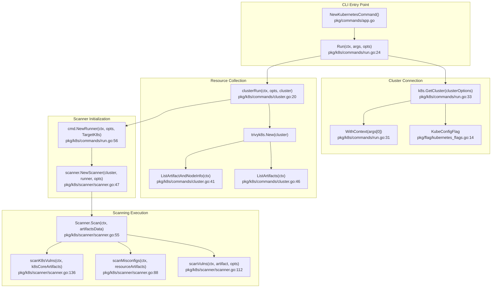
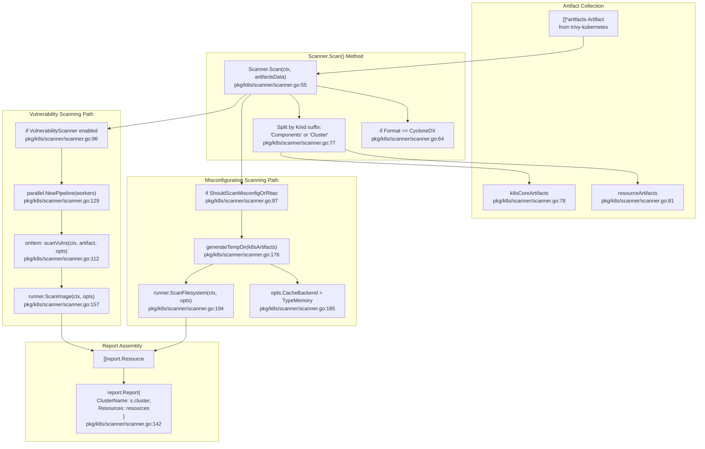

<!-- source: DeepWiki mcp.deepwiki.com · repo aquasecurity/trivy · page 5.3 Kubernetes Cluster Scanning · fetched 2026-10-30 -->

# Kubernetes Cluster Scanning

<details>
<summary>Relevant source files</summary>

The following files were used as context for generating this wiki page:

- [pkg/fanal/analyzer/imgconf/dockerfile/dockerfile.go](pkg/fanal/analyzer/imgconf/dockerfile/dockerfile.go)
- [pkg/fanal/analyzer/imgconf/dockerfile/dockerfile_test.go](pkg/fanal/analyzer/imgconf/dockerfile/dockerfile_test.go)
- [pkg/flag/kubernetes_flags.go](pkg/flag/kubernetes_flags.go)
- [pkg/k8s/commands/cluster.go](pkg/k8s/commands/cluster.go)
- [pkg/k8s/commands/run.go](pkg/k8s/commands/run.go)
- [pkg/k8s/report/report.go](pkg/k8s/report/report.go)
- [pkg/k8s/report/report_test.go](pkg/k8s/report/report_test.go)
- [pkg/k8s/report/summary.go](pkg/k8s/report/summary.go)
- [pkg/k8s/report/summary_test.go](pkg/k8s/report/summary_test.go)
- [pkg/k8s/report/table.go](pkg/k8s/report/table.go)
- [pkg/k8s/scanner/scanner.go](pkg/k8s/scanner/scanner.go)
- [pkg/k8s/writer_test.go](pkg/k8s/writer_test.go)
- [pkg/vex/repo/manager.go](pkg/vex/repo/manager.go)

</details>


Trivy scans live Kubernetes clusters for security issues including vulnerabilities in container images and core components, misconfigurations in resource manifests, exposed secrets, and RBAC policy issues. The system connects to a Kubernetes cluster via its API server and performs comprehensive security analysis of both workload resources (pods, deployments, services) and infrastructure components (control plane, nodes).

This page documents the cluster scanning functionality. For scanning Kubernetes manifest files (IaC), see Infrastructure as Code Scanning (5.5). For general container image scanning, see Container Image Scanning (5.1).

## System Architecture

Kubernetes cluster scanning is invoked via the `trivy kubernetes` command and flows through several layers: command execution, cluster resource collection, scanning, and report generation.

### Command and Scanning Flow



The command flow begins at `NewKubernetesCommand()` in `pkg/commands/app.go`, which creates a Cobra command that invokes `commands.Run()` from [pkg/k8s/commands/run.go:24](). This function establishes the cluster connection using `k8s.GetCluster()` [pkg/k8s/commands/run.go:33]() with options from flags like `--kubeconfig` [pkg/flag/kubernetes_flags.go:14]() and context arguments.

The `clusterRun()` function in [pkg/k8s/commands/cluster.go:20]() orchestrates resource collection and scanning. It uses the `trivy-kubernetes` library to enumerate cluster resources based on format and filter options. The scanner is initialized via `cmd.NewRunner()` which creates an artifact runner with the `TargetK8s` type [pkg/k8s/commands/run.go:56]().

Sources: [pkg/k8s/commands/run.go:24-41](), [pkg/k8s/commands/cluster.go:20-61](), [pkg/k8s/scanner/scanner.go:41-53](), [pkg/flag/kubernetes_flags.go:14-18]()

### Artifact Processing and Scanning Data Flow



The `Scanner.Scan()` method in [pkg/k8s/scanner/scanner.go:55-148]() implements the core scanning logic. It first splits artifacts based on their `Kind` field—artifacts ending with "Components" or "Cluster" are treated as core infrastructure components, while others are workload resources [pkg/k8s/scanner/scanner.go:76-82]().

For workload resources with images, scanning uses `parallel.NewPipeline()` to process multiple artifacts concurrently [pkg/k8s/scanner/scanner.go:129](). The `workers` parameter is set to `opts.Parallel` unless `CacheBackend` is `TypeFS`, in which case it is limited to 1 to avoid bbolt lock contention [pkg/k8s/scanner/scanner.go:124-127]().

Misconfiguration scanning uses `generateTempDir()` to create temporary YAML files from artifact manifests [pkg/k8s/scanner/scanner.go:176](), then scans them as a filesystem. The cache backend is explicitly set to `TypeMemory` [pkg/k8s/scanner/scanner.go:185]() for this phase.

Sources: [pkg/k8s/scanner/scanner.go:55-148](), [pkg/k8s/scanner/scanner.go:150-173](), [pkg/k8s/scanner/scanner.go:175-221]()

## Core Components

### Scanner Type

The `scanner.Scanner` type in [pkg/k8s/scanner/scanner.go:41-45]() orchestrates Kubernetes cluster scanning:

```go
type Scanner struct {
	cluster string
	runner  cmd.Runner
	opts    flag.Options
}
```

The scanner is initialized via `NewScanner(cluster, runner, opts)` [pkg/k8s/scanner/scanner.go:47-53]() which stores the cluster name, a pre-configured artifact runner, and scanning options.

### Resource Collection System

Resource collection is handled by the `trivy-kubernetes` library through the `trivyk8s` package in `clusterRun` [pkg/k8s/commands/cluster.go:20]():

| Method | Purpose | Format Trigger |
|--------|---------|----------------|
| `ListClusterBomInfo(ctx)` | Collect resources for SBOM/BOM generation | `FormatCycloneDX` [pkg/k8s/commands/cluster.go:28]() |
| `ListArtifactAndNodeInfo(ctx)` | Collect workloads + deploy node-collector for infra scanning | `FormatJSON`/`Table` + Misconfig enabled [pkg/k8s/commands/cluster.go:41]() |
| `ListArtifacts(ctx)` | Collect workload resources without node-collector | Default fallback [pkg/k8s/commands/cluster.go:46]() |

Resource filtering is controlled through `K8sOptions` configured via CLI flags in `pkg/flag/kubernetes_flags.go`:
- `WithExcludeNamespaces(opts.ExcludeNamespaces)` [pkg/k8s/commands/cluster.go:34]()
- `WithIncludeNamespaces(opts.IncludeNamespaces)` [pkg/k8s/commands/cluster.go:35]()
- `WithExcludeKinds(opts.ExcludeKinds)` [pkg/k8s/commands/cluster.go:36]()
- `WithExcludeOwned(opts.ExcludeOwned)` [pkg/k8s/commands/cluster.go:38]()

Sources: [pkg/k8s/commands/cluster.go:20-61](), [pkg/flag/kubernetes_flags.go:46-81]()

### Scanning Workflows

#### Image Vulnerability Scanning

The `scanVulns()` method in [pkg/k8s/scanner/scanner.go:150-173]() scans container images found in Kubernetes resources:

1. **Image Extraction**: Iterates through `artifact.Images` slice.
2. **Registry Credentials**: Detects private registry credentials from workload `imagePullSecrets` or `serviceAccount` [pkg/k8s/scanner/scanner.go:101-111]().
3. **Image Scanning**: Calls `runner.ScanImage(ctx, opts)` for each image [pkg/k8s/scanner/scanner.go:157]().
4. **Result Transformation**: Converts the `types.Report` into a `report.Resource` via `report.CreateResource()` [pkg/k8s/scanner/scanner.go:160]().

#### Misconfiguration Scanning  

The `scanMisconfigs()` method in [pkg/k8s/scanner/scanner.go:175-221]() analyzes Kubernetes manifests:

1. **Temp Dir Creation**: `generateTempDir(k8sArtifacts)` creates temporary YAML files [pkg/k8s/scanner/scanner.go:176]().
2. **In-Memory Cache**: Temporarily sets `opts.CacheBackend = cache.TypeMemory` [pkg/k8s/scanner/scanner.go:185]().
3. **Filesystem Scan**: Calls `runner.ScanFilesystem(ctx, s.opts)` on the temporary directory [pkg/k8s/scanner/scanner.go:194]().
4. **Mapping**: Maps filesystem results back to original Kubernetes artifacts via `artifactsByFilename` [pkg/k8s/scanner/scanner.go:202]().

Sources: [pkg/k8s/scanner/scanner.go:150-173](), [pkg/k8s/scanner/scanner.go:175-221]()

## Configuration

Kubernetes scanning is configured through flags defined in [pkg/flag/kubernetes_flags.go]() and the `K8sFlagGroup` struct [pkg/flag/kubernetes_flags.go:96-112]().

### Connection and Performance Flags

| Flag | Config Name | Default | Description |
|------|-------------|---------|-------------|
| `--kubeconfig` | `kubernetes.kubeconfig` | (none) | Path to kubeconfig file [pkg/flag/kubernetes_flags.go:14]() |
| `--qps` | `kubernetes.qps` | `5.0` | Max QPS to API server [pkg/flag/kubernetes_flags.go:82]() |
| `--burst` | `kubernetes.burst` | `10` | Max burst for throttle [pkg/flag/kubernetes_flags.go:88]() |

### Node Collector Configuration

| Flag | Config Name | Default | Description |
|------|-------------|---------|-------------|
| `--disable-node-collector` | `kubernetes.disableNodeCollector` | `false` | Skip misconfig findings on node [pkg/flag/kubernetes_flags.go:29]() |
| `--node-collector-namespace` | `kubernetes.node-collector.namespace` | `trivy-temp` | Namespace for collector job [pkg/flag/kubernetes_flags.go:34]() |
| `--node-collector-imageref` | `kubernetes.node-collector.imageref` | `ghcr.io/aquasecurity/node-collector:0.3.1` | Collector image [pkg/flag/kubernetes_flags.go:40]() |
| `--tolerations` | `kubernetes.tolerations` | (none) | Node-collector job tolerations [pkg/flag/kubernetes_flags.go:24]() |

Sources: [pkg/flag/kubernetes_flags.go:14-94]()

## Report Generation

### Report Structure

The Kubernetes scanning system generates a `report.Report` [pkg/k8s/report/report.go:40-46]() containing multiple `Resource` entries:

```go
type Resource struct {
	Namespace string `json:",omitempty"`
	Kind      string
	Name      string
	Metadata  []types.Metadata `json:",omitempty"`
	Results   types.Results    `json:",omitempty"`
	Error     string           `json:",omitempty"`
}
```

### Report Separation

The `SeparateMisconfigReports` function [pkg/k8s/report/report.go:145-208]() categorizes findings into three assessment types:
1. **Workload Assessment**: General workload vulnerabilities and misconfigurations.
2. **Infra Assessment**: Infrastructure components and `kube-system` resources [pkg/k8s/report/report.go:221]().
3. **RBAC Assessment**: Specifically targets `Role`, `RoleBinding`, `ClusterRole`, and `ClusterRoleBinding` [pkg/k8s/report/report.go:210-217]().

### Table Output and Summary

The `TableWriter` [pkg/k8s/report/table.go:16-23]() supports two modes:
- `summary`: Uses `SummaryWriter` [pkg/k8s/report/summary.go:19-24]() to provide a high-level overview of vulnerabilities, misconfigurations, and secrets across namespaces.
- `all`: Outputs detailed tables for every resource found [pkg/k8s/report/table.go:56]().

The `SummaryWriter.Write()` method [pkg/k8s/report/summary.go:66-126]() aggregates severity counts for each finding using `accumulateSeverityCounts()` [pkg/k8s/report/summary.go:164-183]().

Sources: [pkg/k8s/report/report.go:40-66](), [pkg/k8s/report/report.go:145-208](), [pkg/k8s/report/table.go:54-82](), [pkg/k8s/report/summary.go:66-126]()

---

