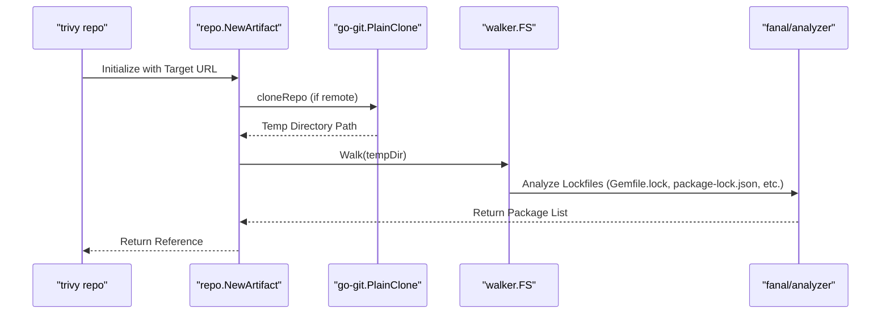
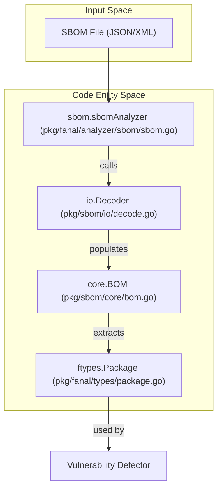
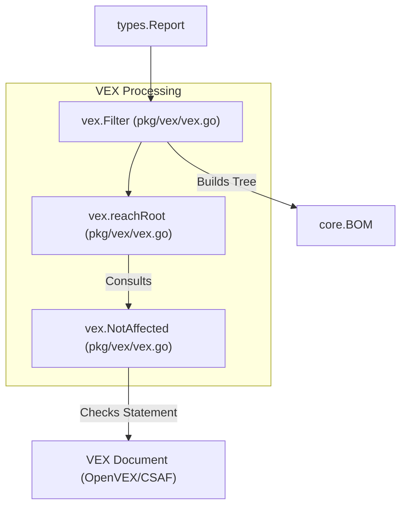

<!-- source: DeepWiki mcp.deepwiki.com · repo aquasecurity/trivy · page 5.4 Repository and SBOM Scanning · fetched 2026-10-30 -->

# Repository and SBOM Scanning

Relevant source files

The following files were used as context for generating this wiki page:

- [integration/testdata/fixtures/sbom/minikube-kbom.json](integration/testdata/fixtures/sbom/minikube-kbom.json)
- [internal/gittest/server.go](internal/gittest/server.go)
- [internal/gittest/testdata/fixture.go](internal/gittest/testdata/fixture.go)
- [pkg/cache/client.go](pkg/cache/client.go)
- [pkg/cache/client_test.go](pkg/cache/client_test.go)
- [pkg/cache/dir.go](pkg/cache/dir.go)
- [pkg/downloader/downloader_test.go](pkg/downloader/downloader_test.go)
- [pkg/fanal/analyzer/sbom/sbom.go](pkg/fanal/analyzer/sbom/sbom.go)
- [pkg/fanal/analyzer/sbom/sbom_test.go](pkg/fanal/analyzer/sbom/sbom_test.go)
- [pkg/fanal/analyzer/sbom/testdata/ca-certificates.spdx.json](pkg/fanal/analyzer/sbom/testdata/ca-certificates.spdx.json)
- [pkg/fanal/analyzer/sbom/testdata/sbom-without-app-component.spdx.json](pkg/fanal/analyzer/sbom/testdata/sbom-without-app-component.spdx.json)
- [pkg/fanal/artifact/repo/git.go](pkg/fanal/artifact/repo/git.go)
- [pkg/fanal/artifact/repo/git_test.go](pkg/fanal/artifact/repo/git_test.go)
- [pkg/fanal/handler/unpackaged/unpackaged.go](pkg/fanal/handler/unpackaged/unpackaged.go)
- [pkg/k8s/k8s.go](pkg/k8s/k8s.go)
- [pkg/k8s/scanner/scanner_test.go](pkg/k8s/scanner/scanner_test.go)
- [pkg/plugin/index_test.go](pkg/plugin/index_test.go)
- [pkg/plugin/manager.go](pkg/plugin/manager.go)
- [pkg/plugin/manager_unix_test.go](pkg/plugin/manager_unix_test.go)
- [pkg/result/testdata/openvex.json](pkg/result/testdata/openvex.json)
- [pkg/sbom/core/bom.go](pkg/sbom/core/bom.go)
- [pkg/sbom/cyclonedx/testdata/happy/kbom.json](pkg/sbom/cyclonedx/testdata/happy/kbom.json)
- [pkg/sbom/cyclonedx/testdata/happy/nested-packages-bom.json](pkg/sbom/cyclonedx/testdata/happy/nested-packages-bom.json)
- [pkg/sbom/io/decode.go](pkg/sbom/io/decode.go)
- [pkg/sbom/io/decode_test.go](pkg/sbom/io/decode_test.go)
- [pkg/sbom/io/encode.go](pkg/sbom/io/encode.go)
- [pkg/sbom/io/encode_test.go](pkg/sbom/io/encode_test.go)
- [pkg/vex/csaf.go](pkg/vex/csaf.go)
- [pkg/vex/cyclonedx.go](pkg/vex/cyclonedx.go)
- [pkg/vex/openvex.go](pkg/vex/openvex.go)
- [pkg/vex/testdata/openvex-multiple.json](pkg/vex/testdata/openvex-multiple.json)
- [pkg/vex/testdata/openvex-oci.json](pkg/vex/testdata/openvex-oci.json)
- [pkg/vex/testdata/openvex.json](pkg/vex/testdata/openvex.json)
- [pkg/vex/testdata/unknown.json](pkg/vex/testdata/unknown.json)
- [pkg/vex/vex.go](pkg/vex/vex.go)
- [pkg/vex/vex_test.go](pkg/vex/vex_test.go)

This page describes how Trivy scans Git repositories and consumes SBOM (Software Bill of Materials) files for vulnerability analysis. Repository scanning analyzes source code for language-specific dependencies, while SBOM scanning imports existing documents (CycloneDX or SPDX) to perform vulnerability detection on the components they describe.

---

## Repository Scanning

### Overview
Repository scanning targets Git repositories (local or remote) to identify security issues in application dependencies. Unlike filesystem scanning, repository scanning focuses on application-level packages (libraries) found in lockfiles and manifests.

Trivy supports scanning remote repositories by cloning them to a temporary directory before analysis.

**Sources:** [pkg/fanal/artifact/repo/git.go:27-49](), [pkg/fanal/artifact/repo/git.go:63-85]()

### Git Repository Handling
Trivy uses the `go-git` library to handle repository operations. It supports various authentication methods and specific reference checkouts.

| Feature | Implementation Detail |
| :--- | :--- |
| **Remote Cloning** | Clones to a temporary directory using `xos.MkdirTemp`. |
| **Authentication** | Supports `GITHUB_TOKEN` and `GITLAB_TOKEN` environment variables via `BasicAuth`. |
| **References** | Can checkout specific branches (`--repo-branch`), tags (`--repo-tag`), or commit hashes (`--repo-commit`). |
| **Local Scanning** | If the target is a local path, Trivy skips cloning and uses the filesystem directly. |

**Sources:** [pkg/fanal/artifact/repo/git.go:87-139](), [pkg/fanal/artifact/repo/git.go:157-183](), [pkg/fanal/artifact/repo/git.go:51-61]()

### Repository Scan Workflow

**Sources:** [pkg/fanal/artifact/repo/git.go:27-49](), [pkg/fanal/artifact/repo/git.go:87-139](), [pkg/fanal/artifact/repo/git_test.go:183-199]()

---

## SBOM Scanning

### Overview
SBOM scanning allows Trivy to consume existing SBOM files. This is used to re-scan components for new vulnerabilities or to convert between SBOM formats. Trivy acts as a "consumer" by decoding the SBOM into an internal representation.

**Sources:** [pkg/sbom/io/decode.go:51-86](), [pkg/fanal/analyzer/sbom/sbom.go:33-44]()

### The SBOM Analyzer
Trivy includes a dedicated `sbomAnalyzer` that automatically detects the format of an SBOM file (CycloneDX or SPDX) and decodes it.

- **Format Detection:** Uses `sbom.DetectFormat` on the file content.
- **Path Normalization:** To prevent overwriting packages when merging results, Trivy joins the SBOM internal package paths with the actual SBOM file path.
- **Bitnami Support:** Special handling is included for Bitnami-style SPDX files found in `/opt/bitnami/`.

**Sources:** [pkg/fanal/analyzer/sbom/sbom.go:33-58](), [pkg/fanal/analyzer/sbom/sbom.go:102-120]()

### Internal Data Flow: Decode to Core BOM
The `Decoder` class converts various SBOM formats into a unified `core.BOM` structure, which is then used for vulnerability matching.

**Sources:** [pkg/fanal/analyzer/sbom/sbom.go:33-44](), [pkg/sbom/io/decode.go:42-49](), [pkg/sbom/io/decode.go:123-156]()

### Dependency Graph Reconstruction
During decoding, Trivy reconstructs the dependency tree using PURLs and internal IDs.

1. **decodeComponents:** Iterates through all components in the SBOM.
2. **decodePackage:** Converts components to `ftypes.Package`, extracting PURLs and licenses.
3. **buildDependencyGraph:** Uses the relationships defined in the SBOM to populate the `DependsOn` field in the package structure.

**Sources:** [pkg/sbom/io/decode.go:118-156](), [pkg/sbom/io/decode.go:159-174]()

---

## VEX (Vulnerability Exploitability eXchange)
Trivy supports filtering scan results using VEX documents (OpenVEX, CSAF, or CycloneDX VEX). This allows users to suppress vulnerabilities that are not exploitable in their specific context.

### VEX Filtering Logic
When a VEX source is provided, Trivy performs the following:
1. **Encoding:** Encodes the current scan report into a `core.BOM` to build a parent-child relationship map.
2. **Filtering:** Iterates through detected vulnerabilities.
3. **Reachability Check:** Uses a Depth-First Search (`reachRoot`) to determine if a vulnerability statement in the VEX applies to the component path from the root.

**Sources:** [pkg/vex/vex.go:69-91](), [pkg/vex/vex.go:148-175](), [pkg/vex/vex.go:178-219]()

### Supported VEX Sources
Trivy can retrieve VEX information from:
- **Local Files:** `--vex testdata/openvex.json`
- **OCI Registries:** Attached as OCI artifacts.
- **Git Repositories:** Remote VEX repositories.
- **SBOM References:** External references embedded within the scanned SBOM.

**Sources:** [pkg/vex/vex.go:18-23](), [pkg/vex/vex.go:93-137]()

---

## Technical Reference: Component Properties
When encoding or decoding SBOMs, Trivy uses standardized properties to preserve metadata.

| Property Name | Purpose |
| :--- | :--- |
| `ImageID` | The SHA256 ID of the container image. |
| `PkgID` | Unique identifier for a package (e.g., `name@version`). |
| `PkgType` | The ecosystem (e.g., `npm`, `maven`, `gobinary`). |
| `FilePath` | Location of the package or manifest within the artifact. |
| `LayerDiffID` | The specific image layer containing the package. |

**Sources:** [pkg/sbom/core/bom.go:26-56](), [pkg/sbom/io/encode.go:91-140]()

---

