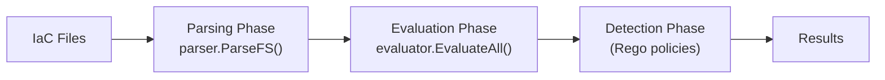
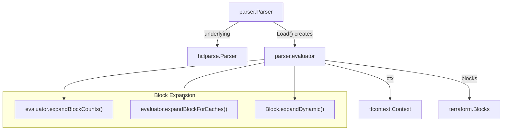
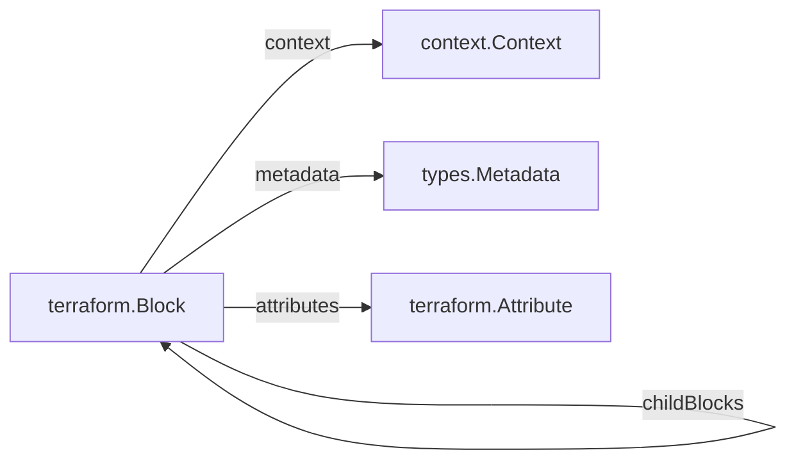
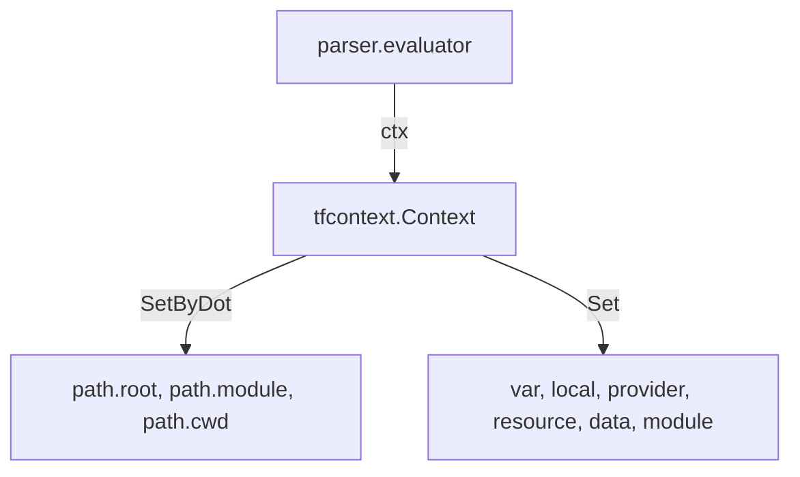
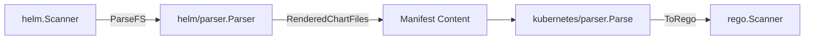

<!-- source: DeepWiki mcp.deepwiki.com · repo aquasecurity/trivy · page 5.5 Infrastructure as Code Scanning · fetched 2026-10-30 -->

# Infrastructure as Code Scanning

Relevant source files

The following files were used as context for generating this wiki page:

- [internal/testutil/util.go](internal/testutil/util.go)
- [pkg/iac/adapters/cloudformation/aws/s3/bucket.go](pkg/iac/adapters/cloudformation/aws/s3/bucket.go)
- [pkg/iac/adapters/cloudformation/aws/s3/s3_test.go](pkg/iac/adapters/cloudformation/aws/s3/s3_test.go)
- [pkg/iac/adapters/terraform/aws/codebuild/adapt.go](pkg/iac/adapters/terraform/aws/codebuild/adapt.go)
- [pkg/iac/adapters/terraform/aws/ec2/adapt.go](pkg/iac/adapters/terraform/aws/ec2/adapt.go)
- [pkg/iac/adapters/terraform/aws/ec2/ami.go](pkg/iac/adapters/terraform/aws/ec2/ami.go)
- [pkg/iac/adapters/terraform/aws/ec2/ami_test.go](pkg/iac/adapters/terraform/aws/ec2/ami_test.go)
- [pkg/iac/adapters/terraform/aws/ec2/autoscaling.go](pkg/iac/adapters/terraform/aws/ec2/autoscaling.go)
- [pkg/iac/adapters/terraform/aws/ecr/adapt_test.go](pkg/iac/adapters/terraform/aws/ecr/adapt_test.go)
- [pkg/iac/adapters/terraform/aws/iam/convert.go](pkg/iac/adapters/terraform/aws/iam/convert.go)
- [pkg/iac/adapters/terraform/aws/iam/policies.go](pkg/iac/adapters/terraform/aws/iam/policies.go)
- [pkg/iac/adapters/terraform/aws/iam/policies_test.go](pkg/iac/adapters/terraform/aws/iam/policies_test.go)
- [pkg/iac/adapters/terraform/aws/iam/roles_test.go](pkg/iac/adapters/terraform/aws/iam/roles_test.go)
- [pkg/iac/adapters/terraform/aws/lambda/adapt.go](pkg/iac/adapters/terraform/aws/lambda/adapt.go)
- [pkg/iac/adapters/terraform/aws/s3/adapt_test.go](pkg/iac/adapters/terraform/aws/s3/adapt_test.go)
- [pkg/iac/adapters/terraform/aws/s3/bucket.go](pkg/iac/adapters/terraform/aws/s3/bucket.go)
- [pkg/iac/adapters/terraform/aws/sqs/adapt_test.go](pkg/iac/adapters/terraform/aws/sqs/adapt_test.go)
- [pkg/iac/adapters/terraform/tftestutil/testutil.go](pkg/iac/adapters/terraform/tftestutil/testutil.go)
- [pkg/iac/providers/aws/ec2/ami.go](pkg/iac/providers/aws/ec2/ami.go)
- [pkg/iac/providers/aws/ec2/ec2.go](pkg/iac/providers/aws/ec2/ec2.go)
- [pkg/iac/scanners/azure/arm/scanner.go](pkg/iac/scanners/azure/arm/scanner.go)
- [pkg/iac/scanners/azure/functions/intersection.go](pkg/iac/scanners/azure/functions/intersection.go)
- [pkg/iac/scanners/cloudformation/cftypes/types.go](pkg/iac/scanners/cloudformation/cftypes/types.go)
- [pkg/iac/scanners/cloudformation/parser/file_context.go](pkg/iac/scanners/cloudformation/parser/file_context.go)
- [pkg/iac/scanners/cloudformation/parser/fn_find_in_map.go](pkg/iac/scanners/cloudformation/parser/fn_find_in_map.go)
- [pkg/iac/scanners/cloudformation/parser/fn_find_in_map_test.go](pkg/iac/scanners/cloudformation/parser/fn_find_in_map_test.go)
- [pkg/iac/scanners/cloudformation/parser/fn_ref.go](pkg/iac/scanners/cloudformation/parser/fn_ref.go)
- [pkg/iac/scanners/cloudformation/parser/intrinsics.go](pkg/iac/scanners/cloudformation/parser/intrinsics.go)
- [pkg/iac/scanners/cloudformation/parser/parameter.go](pkg/iac/scanners/cloudformation/parser/parameter.go)
- [pkg/iac/scanners/cloudformation/parser/parser.go](pkg/iac/scanners/cloudformation/parser/parser.go)
- [pkg/iac/scanners/cloudformation/parser/parser_test.go](pkg/iac/scanners/cloudformation/parser/parser_test.go)
- [pkg/iac/scanners/cloudformation/parser/property.go](pkg/iac/scanners/cloudformation/parser/property.go)
- [pkg/iac/scanners/cloudformation/parser/resource.go](pkg/iac/scanners/cloudformation/parser/resource.go)
- [pkg/iac/scanners/cloudformation/parser/util.go](pkg/iac/scanners/cloudformation/parser/util.go)
- [pkg/iac/scanners/cloudformation/scanner.go](pkg/iac/scanners/cloudformation/scanner.go)
- [pkg/iac/scanners/dockerfile/parser/parser.go](pkg/iac/scanners/dockerfile/parser/parser.go)
- [pkg/iac/scanners/dockerfile/parser/parser_test.go](pkg/iac/scanners/dockerfile/parser/parser_test.go)
- [pkg/iac/scanners/dockerfile/scanner.go](pkg/iac/scanners/dockerfile/scanner.go)
- [pkg/iac/scanners/generic/scanner.go](pkg/iac/scanners/generic/scanner.go)
- [pkg/iac/scanners/helm/scanner.go](pkg/iac/scanners/helm/scanner.go)
- [pkg/iac/scanners/helm/test/option_test.go](pkg/iac/scanners/helm/test/option_test.go)
- [pkg/iac/scanners/helm/test/scanner_test.go](pkg/iac/scanners/helm/test/scanner_test.go)
- [pkg/iac/scanners/kubernetes/parser/manifest.go](pkg/iac/scanners/kubernetes/parser/manifest.go)
- [pkg/iac/scanners/kubernetes/parser/manifest_node.go](pkg/iac/scanners/kubernetes/parser/manifest_node.go)
- [pkg/iac/scanners/kubernetes/parser/manifest_test.go](pkg/iac/scanners/kubernetes/parser/manifest_test.go)
- [pkg/iac/scanners/kubernetes/parser/parser.go](pkg/iac/scanners/kubernetes/parser/parser.go)
- [pkg/iac/scanners/kubernetes/parser/parser_test.go](pkg/iac/scanners/kubernetes/parser/parser_test.go)
- [pkg/iac/scanners/kubernetes/scanner.go](pkg/iac/scanners/kubernetes/scanner.go)
- [pkg/iac/scanners/kubernetes/scanner_test.go](pkg/iac/scanners/kubernetes/scanner_test.go)
- [pkg/iac/scanners/terraform/count_test.go](pkg/iac/scanners/terraform/count_test.go)
- [pkg/iac/scanners/terraform/deterministic_test.go](pkg/iac/scanners/terraform/deterministic_test.go)
- [pkg/iac/scanners/terraform/executor/executor.go](pkg/iac/scanners/terraform/executor/executor.go)
- [pkg/iac/scanners/terraform/executor/option.go](pkg/iac/scanners/terraform/executor/option.go)
- [pkg/iac/scanners/terraform/ignore_test.go](pkg/iac/scanners/terraform/ignore_test.go)
- [pkg/iac/scanners/terraform/json_test.go](pkg/iac/scanners/terraform/json_test.go)
- [pkg/iac/scanners/terraform/module_test.go](pkg/iac/scanners/terraform/module_test.go)
- [pkg/iac/scanners/terraform/options.go](pkg/iac/scanners/terraform/options.go)
- [pkg/iac/scanners/terraform/parser/ctylist.go](pkg/iac/scanners/terraform/parser/ctylist.go)
- [pkg/iac/scanners/terraform/parser/ctylist_test.go](pkg/iac/scanners/terraform/parser/ctylist_test.go)
- [pkg/iac/scanners/terraform/parser/evaluator.go](pkg/iac/scanners/terraform/parser/evaluator.go)
- [pkg/iac/scanners/terraform/parser/load_module.go](pkg/iac/scanners/terraform/parser/load_module.go)
- [pkg/iac/scanners/terraform/parser/module_retrieval.go](pkg/iac/scanners/terraform/parser/module_retrieval.go)
- [pkg/iac/scanners/terraform/parser/option.go](pkg/iac/scanners/terraform/parser/option.go)
- [pkg/iac/scanners/terraform/parser/parser.go](pkg/iac/scanners/terraform/parser/parser.go)
- [pkg/iac/scanners/terraform/parser/parser_test.go](pkg/iac/scanners/terraform/parser/parser_test.go)
- [pkg/iac/scanners/terraform/parser/resolvers/cache.go](pkg/iac/scanners/terraform/parser/resolvers/cache.go)
- [pkg/iac/scanners/terraform/parser/resolvers/local.go](pkg/iac/scanners/terraform/parser/resolvers/local.go)
- [pkg/iac/scanners/terraform/parser/resolvers/options.go](pkg/iac/scanners/terraform/parser/resolvers/options.go)
- [pkg/iac/scanners/terraform/parser/resolvers/registry.go](pkg/iac/scanners/terraform/parser/resolvers/registry.go)
- [pkg/iac/scanners/terraform/parser/resolvers/registry_test.go](pkg/iac/scanners/terraform/parser/resolvers/registry_test.go)
- [pkg/iac/scanners/terraform/parser/resolvers/remote.go](pkg/iac/scanners/terraform/parser/resolvers/remote.go)
- [pkg/iac/scanners/terraform/parser/resolvers/source.go](pkg/iac/scanners/terraform/parser/resolvers/source.go)
- [pkg/iac/scanners/terraform/parser/resolvers/source_test.go](pkg/iac/scanners/terraform/parser/resolvers/source_test.go)
- [pkg/iac/scanners/terraform/parser/resolvers/testdata/terraform-aws-s3-bucket/README.md](pkg/iac/scanners/terraform/parser/resolvers/testdata/terraform-aws-s3-bucket/README.md)
- [pkg/iac/scanners/terraform/parser/resolvers/testdata/terraform-aws-s3-bucket/modules/notification/README.md](pkg/iac/scanners/terraform/parser/resolvers/testdata/terraform-aws-s3-bucket/modules/notification/README.md)
- [pkg/iac/scanners/terraform/parser/resolvers/testdata/terraform-aws-s3-bucket/modules/object/README.md](pkg/iac/scanners/terraform/parser/resolvers/testdata/terraform-aws-s3-bucket/modules/object/README.md)
- [pkg/iac/scanners/terraform/scanner.go](pkg/iac/scanners/terraform/scanner.go)
- [pkg/iac/scanners/terraformplan/tfjson/parser/block.go](pkg/iac/scanners/terraformplan/tfjson/parser/block.go)
- [pkg/iac/scanners/terraformplan/tfjson/parser/block_test.go](pkg/iac/scanners/terraformplan/tfjson/parser/block_test.go)
- [pkg/iac/scanners/terraformplan/tfjson/parser/parser.go](pkg/iac/scanners/terraformplan/tfjson/parser/parser.go)
- [pkg/iac/scanners/terraformplan/tfjson/parser/parser_test.go](pkg/iac/scanners/terraformplan/tfjson/parser/parser_test.go)
- [pkg/iac/scanners/terraformplan/tfjson/parser/plan_file.go](pkg/iac/scanners/terraformplan/tfjson/parser/plan_file.go)
- [pkg/iac/scanners/terraformplan/tfjson/scanner.go](pkg/iac/scanners/terraformplan/tfjson/scanner.go)
- [pkg/iac/scanners/terraformplan/tfjson/scanner_test.go](pkg/iac/scanners/terraformplan/tfjson/scanner_test.go)
- [pkg/iac/scanners/terraformplan/tfjson/testdata/arbitrary_name.json](pkg/iac/scanners/terraformplan/tfjson/testdata/arbitrary_name.json)
- [pkg/iac/scanners/terraformplan/tfjson/testdata/module_call.json](pkg/iac/scanners/terraformplan/tfjson/testdata/module_call.json)
- [pkg/iac/terraform/attribute.go](pkg/iac/terraform/attribute.go)
- [pkg/iac/terraform/attribute_test.go](pkg/iac/terraform/attribute_test.go)
- [pkg/iac/terraform/block.go](pkg/iac/terraform/block.go)
- [pkg/iac/terraform/context/context.go](pkg/iac/terraform/context/context.go)
- [pkg/iac/terraform/context/context_test.go](pkg/iac/terraform/context/context_test.go)
- [pkg/iac/terraform/module.go](pkg/iac/terraform/module.go)
- [pkg/iac/terraform/schema.go](pkg/iac/terraform/schema.go)

## Purpose and Scope

This page documents Trivy's standalone Infrastructure as Code (IaC) scanning capabilities, focusing on how Trivy parses, analyzes, and evaluates IaC configuration files. The primary focus is on Terraform/OpenTofu parsing and evaluation, which represents the most complex IaC scanning implementation.

For information about misconfiguration detection using policy engines, see [Misconfiguration Scanning](#4.2). For scanning IaC files as part of filesystem or repository scans, see [Filesystem and Rootfs Scanning](#5.2) and [Repository and SBOM Scanning](#5.4). For Kubernetes cluster analysis, see [Kubernetes Cluster Scanning](#5.3).

## Overview

Infrastructure as Code scanning in Trivy analyzes configuration files to identify security issues, compliance violations, and best practice deviations before infrastructure is deployed. The scanner supports multiple IaC formats, each with varying levels of parsing sophistication:

### Supported IaC Formats

| Format | File Extensions | Parsing Approach |
|--------|----------------|------------------|
| **Terraform/OpenTofu** | `.tf`, `.tf.json`, `.tofu`, `.tofu.json` | Full HCL parsing with module resolution, variable evaluation, and dynamic block expansion |
| **CloudFormation** | `.yaml`, `.yml`, `.json` (templates) | YAML/JSON parsing with parameter substitution via `--cf-params` |
| **Kubernetes Manifests** | `.yaml`, `.yml` | YAML parsing for resource definitions |
| **Helm Charts** | `Chart.yaml`, `values.yaml`, templates | Template rendering with `--helm-values`, `--helm-set` overrides |
| **Ansible Playbooks** | `.yaml`, `.yml` (playbooks) | YAML parsing with inventory and variable support via `--ansible-playbook`, `--ansible-inventory` |
| **Dockerfiles** | `Dockerfile`, `*.dockerfile` | Dockerfile instruction parsing |
| **Azure ARM Templates** | `.json` (ARM templates) | JSON template parsing |

### IaC Scanning Pipeline

The IaC scanning system operates in three main phases:

1. **Parsing Phase**: Reads configuration files from filesystem, parses syntax into blocks and attributes.
2. **Evaluation Phase**: Resolves variables, expands meta-arguments (`count`, `for_each`, `dynamic`), evaluates expressions, and loads child modules.
3. **Detection Phase**: Applies Rego policies to evaluated configuration (see [Misconfiguration Scanning](#4.2)).

Sources: [pkg/iac/scanners/terraform/parser/parser.go:156-210](), [pkg/iac/scanners/terraform/parser/evaluator.go:127-163](), [pkg/iac/scanners/terraform/executor/executor.go:41-105]()

## Terraform Parser Architecture

The Terraform parser is the core component responsible for parsing HCL (HashiCorp Configuration Language) and evaluating Terraform configurations.

### Parser Structure

The `parser.Parser` struct coordinates the overall parsing process:
- Uses `Parser.underlying` (`*hclparse.Parser`) for HCL syntax analysis [pkg/iac/scanners/terraform/parser/parser.go:46]().
- Creates `parser.evaluator` for semantic evaluation via `Parser.Load()` [pkg/iac/scanners/terraform/parser/parser.go:254-284]().
- Manages child modules in `Parser.children` [pkg/iac/scanners/terraform/parser/parser.go:47]().

Sources: [pkg/iac/scanners/terraform/parser/parser.go:34-58](), [pkg/iac/scanners/terraform/parser/evaluator.go:28-42]()

## File Parsing Workflow

### ParseFS: Directory Scanning

The `Parser.ParseFS()` method implements directory scanning:
1. Reads directory entries via `fs.ReadDir(p.moduleFS, dir)` [pkg/iac/scanners/terraform/parser/parser.go:170]().
2. Filters files by extension and skips directories [pkg/iac/scanners/terraform/parser/parser.go:176-180]().
3. Applies skip patterns via `utils.SkipPath` [pkg/iac/scanners/terraform/parser/parser.go:181-184]().
4. Invokes `Parser.ParseFile()` for each file [pkg/iac/scanners/terraform/parser/parser.go:190]().

Sources: [pkg/iac/scanners/terraform/parser/parser.go:156-210]()

### ParseFile: Individual File Parsing

The `Parser.ParseFile()` method processes individual Terraform files:
- Validates extensions (`.tf`, `.tf.json`, `.tofu`, `.tofu.json`) [pkg/iac/scanners/terraform/parser/parser.go:111-115]().
- Uses `p.underlying.ParseHCL` or `p.underlying.ParseJSON` [pkg/iac/scanners/terraform/parser/parser.go:139-142]().
- Appends successful results to `p.files` [pkg/iac/scanners/terraform/parser/parser.go:146-149]().

Sources: [pkg/iac/scanners/terraform/parser/parser.go:109-153]()

## Block and Attribute Representation

### Block Structure

The `Block` type represents a Terraform block with full context and metadata.

Each block maintains its own evaluation context [pkg/iac/terraform/block.go:25](), metadata for location tracking [pkg/iac/terraform/block.go:32](), and a list of attributes [pkg/iac/terraform/block.go:31]().

Sources: [pkg/iac/terraform/block.go:22-36](), [pkg/iac/terraform/block.go:38-126]()

### Attribute Evaluation

Attributes wrap HCL expressions and provide methods to resolve values into Go types or `cty.Value`.

| Method | Return Type | Purpose |
|--------|-------------|---------|
| `Value()` | `cty.Value` | Evaluates the HCL expression in the block's context |
| `AsStringValueOrDefault()` | `types.StringValue` | Returns value as string or a default if nil/unresolvable |
| `AsBoolValueOrDefault()` | `types.BoolValue` | Returns value as boolean or a default |
| `IsLiteral()` | `bool` | Returns true if the expression contains no variables |

Sources: [pkg/iac/terraform/attribute.go:23-29](), [pkg/iac/terraform/attribute.go:132-143](), [pkg/iac/terraform/attribute.go:163-174](), [pkg/iac/terraform/attribute.go:190-195]()

## Module Resolution

### Module Loading Process

The evaluator loads modules defined in `module` blocks:
1. **Source Extraction**: Retrieves the `source` attribute [pkg/iac/scanners/terraform/parser/load_module.go:66-74]().
2. **Cache Check**: Attempts to resolve from `.terraform/modules/modules.json` if metadata is available [pkg/iac/scanners/terraform/parser/load_module.go:76-89]().
3. **External Resolution**: Uses `resolveModule` to download or locate modules from registry/git/local paths [pkg/iac/scanners/terraform/parser/load_module.go:131-152]().
4. **Parser Creation**: Creates a `newModuleParser` for the child module [pkg/iac/scanners/terraform/parser/load_module.go:160]().

Sources: [pkg/iac/scanners/terraform/parser/load_module.go:36-58](), [pkg/iac/scanners/terraform/parser/load_module.go:61-93]()

## Evaluation System

### Evaluation Context

The `evaluator` manages a `tfcontext.Context` which stores all variables, locals, and resources.

The context is initialized with special variables like `path.module` and `path.root` [pkg/iac/scanners/terraform/parser/evaluator.go:68-70](). During `evaluateStep()`, it populates variables, locals, and resources into the context [pkg/iac/scanners/terraform/parser/evaluator.go:94-107]().

Sources: [pkg/iac/scanners/terraform/parser/evaluator.go:44-92](), [pkg/iac/scanners/terraform/parser/evaluator.go:94-107]()

### Iterative Evaluation

Evaluation is performed iteratively until values stabilize or `maxContextIterations` (32) is reached [pkg/iac/scanners/terraform/parser/evaluator.go:25]().

1. **Initial Evaluation**: Iteratively calls `evaluateStep()` [pkg/iac/scanners/terraform/parser/evaluator.go:136]().
2. **Expansion**: Expands `count`, `for_each`, and `dynamic` blocks [pkg/iac/scanners/terraform/parser/evaluator.go:142-143]().
3. **Submodule Evaluation**: Recursively evaluates child modules [pkg/iac/scanners/terraform/parser/evaluator.go:156]().
4. **Post-Evaluation**: Final evaluation pass to propagate module outputs [pkg/iac/scanners/terraform/parser/evaluator.go:159]().

Sources: [pkg/iac/scanners/terraform/parser/evaluator.go:127-163](), [pkg/iac/scanners/terraform/parser/evaluator.go:174-183]()

## Helm Chart Scanning

The Helm scanner renders charts into Kubernetes manifests before scanning them with the Rego engine.

1. **Rendering**: `helmParser.RenderedChartFiles()` renders templates using provided values [pkg/iac/scanners/helm/scanner.go:109]().
2. **K8s Parsing**: Rendered manifests are parsed into `Manifest` objects [pkg/iac/scanners/helm/scanner.go:127]().
3. **Rego Scan**: Manifests are converted to Rego-compatible maps via `ToRego()` and scanned [pkg/iac/scanners/helm/scanner.go:141-145]().

Sources: [pkg/iac/scanners/helm/scanner.go:58-97](), [pkg/iac/scanners/helm/scanner.go:99-157](), [pkg/iac/scanners/kubernetes/parser/manifest_node.go:40-69]()

## Result Generation and Filtering

The `Executor` runs the final scan and applies filters/ignores.

- **Adaptation**: Terraform modules are adapted into a state representation for Rego [pkg/iac/scanners/terraform/executor/executor.go:44]().
- **Ignore Rules**: `results.Ignore(ignores, ignorers)` applies inline `#trivy:ignore` or `tfsec:ignore` rules [pkg/iac/scanners/terraform/executor/executor.go:84]().
- **Rendered Cause**: For failed results, `renderCause` extracts the relevant HCL snippet for the report [pkg/iac/scanners/terraform/executor/executor.go:100]().

Sources: [pkg/iac/scanners/terraform/executor/executor.go:41-105](), [pkg/iac/scanners/terraform/executor/executor.go:107-127]()

---

