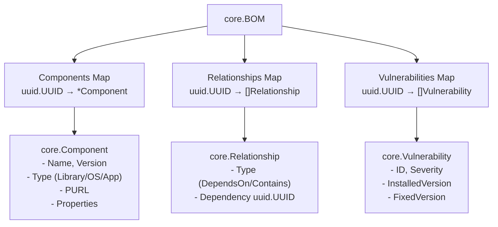

<!-- source: DeepWiki mcp.deepwiki.com · repo aquasecurity/trivy · page 6 SBOM Generation and Consumption · fetched 2026-10-30 -->

# SBOM Generation and Consumption

Relevant source files

The following files were used as context for generating this wiki page:

- [integration/testdata/conda-cyclonedx.json.golden](integration/testdata/conda-cyclonedx.json.golden)
- [integration/testdata/conda-environment-cyclonedx.json.golden](integration/testdata/conda-environment-cyclonedx.json.golden)
- [integration/testdata/conda-spdx.json.golden](integration/testdata/conda-spdx.json.golden)
- [integration/testdata/fixtures/sbom/fluentd-multiple-lockfiles-cyclonedx.json](integration/testdata/fixtures/sbom/fluentd-multiple-lockfiles-cyclonedx.json)
- [integration/testdata/fixtures/sbom/minikube-kbom.json](integration/testdata/fixtures/sbom/minikube-kbom.json)
- [integration/testdata/fluentd-multiple-lockfiles-short.cdx.json.golden](integration/testdata/fluentd-multiple-lockfiles-short.cdx.json.golden)
- [integration/testdata/fluentd-multiple-lockfiles.cdx.json.golden](integration/testdata/fluentd-multiple-lockfiles.cdx.json.golden)
- [integration/testdata/julia-spdx.json.golden](integration/testdata/julia-spdx.json.golden)
- [integration/testdata/npm-cyclonedx.json.golden](integration/testdata/npm-cyclonedx.json.golden)
- [integration/testdata/pom-cyclonedx.json.golden](integration/testdata/pom-cyclonedx.json.golden)
- [pkg/fanal/analyzer/language/dart/pub/pubspec.go](pkg/fanal/analyzer/language/dart/pub/pubspec.go)
- [pkg/fanal/analyzer/language/julia/pkg/pkg.go](pkg/fanal/analyzer/language/julia/pkg/pkg.go)
- [pkg/fanal/analyzer/language/julia/pkg/pkg_test.go](pkg/fanal/analyzer/language/julia/pkg/pkg_test.go)
- [pkg/fanal/applier/docker.go](pkg/fanal/applier/docker.go)
- [pkg/fanal/applier/docker_test.go](pkg/fanal/applier/docker_test.go)
- [pkg/fanal/artifact/sbom/sbom.go](pkg/fanal/artifact/sbom/sbom.go)
- [pkg/k8s/scanner/scanner_test.go](pkg/k8s/scanner/scanner_test.go)
- [pkg/report/spdx/spdx.go](pkg/report/spdx/spdx.go)
- [pkg/result/testdata/openvex.json](pkg/result/testdata/openvex.json)
- [pkg/sbom/core/bom.go](pkg/sbom/core/bom.go)
- [pkg/sbom/cyclonedx/marshal.go](pkg/sbom/cyclonedx/marshal.go)
- [pkg/sbom/cyclonedx/marshal_test.go](pkg/sbom/cyclonedx/marshal_test.go)
- [pkg/sbom/cyclonedx/testdata/happy/bom.json](pkg/sbom/cyclonedx/testdata/happy/bom.json)
- [pkg/sbom/cyclonedx/testdata/happy/infinite-loop-bom.json](pkg/sbom/cyclonedx/testdata/happy/infinite-loop-bom.json)
- [pkg/sbom/cyclonedx/testdata/happy/kbom.json](pkg/sbom/cyclonedx/testdata/happy/kbom.json)
- [pkg/sbom/cyclonedx/testdata/happy/third-party-bom-no-os.json](pkg/sbom/cyclonedx/testdata/happy/third-party-bom-no-os.json)
- [pkg/sbom/cyclonedx/testdata/happy/third-party-bom.json](pkg/sbom/cyclonedx/testdata/happy/third-party-bom.json)
- [pkg/sbom/cyclonedx/unmarshal.go](pkg/sbom/cyclonedx/unmarshal.go)
- [pkg/sbom/cyclonedx/unmarshal_test.go](pkg/sbom/cyclonedx/unmarshal_test.go)
- [pkg/sbom/io/encode.go](pkg/sbom/io/encode.go)
- [pkg/sbom/io/encode_test.go](pkg/sbom/io/encode_test.go)
- [pkg/sbom/sbom.go](pkg/sbom/sbom.go)
- [pkg/sbom/sbom_test.go](pkg/sbom/sbom_test.go)
- [pkg/sbom/spdx/marshal.go](pkg/sbom/spdx/marshal.go)
- [pkg/sbom/spdx/marshal_test.go](pkg/sbom/spdx/marshal_test.go)
- [pkg/sbom/spdx/testdata/happy/with-file-as-relationship-parent.json](pkg/sbom/spdx/testdata/happy/with-file-as-relationship-parent.json)
- [pkg/sbom/spdx/unmarshal.go](pkg/sbom/spdx/unmarshal.go)
- [pkg/sbom/spdx/unmarshal_test.go](pkg/sbom/spdx/unmarshal_test.go)
- [pkg/vex/csaf.go](pkg/vex/csaf.go)
- [pkg/vex/cyclonedx.go](pkg/vex/cyclonedx.go)
- [pkg/vex/openvex.go](pkg/vex/openvex.go)
- [pkg/vex/testdata/openvex-multiple.json](pkg/vex/testdata/openvex-multiple.json)
- [pkg/vex/testdata/openvex-oci.json](pkg/vex/testdata/openvex-oci.json)
- [pkg/vex/testdata/openvex.json](pkg/vex/testdata/openvex.json)
- [pkg/vex/testdata/unknown.json](pkg/vex/testdata/unknown.json)
- [pkg/vex/vex.go](pkg/vex/vex.go)
- [pkg/vex/vex_test.go](pkg/vex/vex_test.go)
- [pkg/x/slices/slices.go](pkg/x/slices/slices.go)

This page explains how Trivy generates and consumes Software Bill of Materials (SBOM) documents. Trivy supports both generating SBOMs from scan results and consuming external SBOMs for vulnerability scanning.

For information about scanning specific targets like container images or filesystems, see [Target Types and Scanning Workflows](#5). For details about vulnerability detection after SBOM consumption, see [Vulnerability Detection](#4.1).

## Overview

Trivy implements bidirectional SBOM functionality:

- **Generation**: Converts scan results into standardized SBOM formats (CycloneDX, SPDX).
- **Consumption**: Reads external SBOMs and performs vulnerability scanning on the components.

All SBOM operations use an internal canonical representation (`core.BOM`) as an intermediate format, which provides a consistent data model regardless of the external format.

**Key Components:**
- `pkg/sbom/core/bom.go` — Canonical SBOM representation [pkg/sbom/core/bom.go:1-122]().
- `pkg/sbom/io/encode.go` — Report to `core.BOM` encoder [pkg/sbom/io/encode.go:45-57]().
- `pkg/sbom/cyclonedx/marshal.go` — CycloneDX marshaler [pkg/sbom/cyclonedx/marshal.go:42-55]().
- `pkg/sbom/cyclonedx/unmarshal.go` — CycloneDX unmarshaler [pkg/sbom/cyclonedx/unmarshal.go:25-27]().
- `pkg/sbom/spdx/marshal.go` — SPDX marshaler [pkg/sbom/spdx/marshal.go:102-115]().

## SBOM Generation and Consumption Flow

The following diagram illustrates the lifecycle of an SBOM within Trivy, showing the transformation from a scan report to standardized output and vice versa.

### Data Transformation Pipeline

```mermaid
graph TB
    subgraph "Generation Path"
        ScanResult["types.Report<br/>(Scan Results)"]
        Encoder["sbomio.Encoder.Encode()"]
        CoreBOM1["core.BOM<br/>(Canonical)"]
        Marshaler["Format Marshaler<br/>(CycloneDX/SPDX)"]
        OutputSBOM["External SBOM<br/>(JSON/XML)"]
        
        ScanResult --> Encoder
        Encoder --> CoreBOM1
        CoreBOM1 --> Marshaler
        Marshaler --> OutputSBOM
    end
    
    subgraph "Consumption Path"
        InputSBOM["External SBOM<br/>(JSON/XML)"]
        Unmarshaler["Format Unmarshaler<br/>(CycloneDX/SPDX)"]
        CoreBOM2["core.BOM<br/>(Canonical)"]
        TrivySBOM["types.SBOM"]
        VulnScan["Vulnerability Scanner"]
        
        InputSBOM --> Unmarshaler
        Unmarshaler --> CoreBOM2
        CoreBOM2 --> TrivySBOM
        TrivySBOM --> VulnScan
    end
```

**Sources:** [pkg/sbom/cyclonedx/marshal.go:58-90](), [pkg/sbom/cyclonedx/unmarshal.go:38-63](), [pkg/sbom/spdx/marshal.go:117-125]()

## Canonical BOM Representation

The `core.BOM` structure serves as the internal canonical format. This abstraction allows Trivy to support multiple SBOM formats without duplicating logic.

### Core BOM Structure

**Sources:** [pkg/sbom/core/bom.go:1-122](), [pkg/sbom/io/encode.go:232-234]()

## Generation Process

### From Scan Results to SBOM

The generation process converts a `types.Report` into an SBOM. The `sbomio.Encoder` extracts metadata, packages, and vulnerabilities into the `core.BOM` structure [pkg/sbom/io/encode.go:59-89]().

**Encoder Steps:**
1. **Create Root Component**: Maps `ArtifactType` to `core.ComponentType` (e.g., `ftypes.TypeContainerImage` to `core.TypeContainerImage`) [pkg/sbom/io/encode.go:91-140]().
2. **Process Results**: Iterates through `report.Results` to encode OS and Language packages [pkg/sbom/io/encode.go:182-219]().
3. **Build Relationships**: Establishes dependency links between the root component, application components, and individual packages [pkg/sbom/io/encode.go:221-250]().

**Sources:** [pkg/sbom/io/encode.go:59-250]()

### CycloneDX Marshaler

The `cyclonedx.Marshaler` converts the `core.BOM` into a CycloneDX compliant document. It handles the mapping of Trivy-specific attributes to CycloneDX properties using the `aquasecurity:trivy:` namespace [pkg/sbom/cyclonedx/marshal.go:69-90]().

For details, see [CycloneDX Format](#6.1).

### SPDX Marshaler

The `spdx.Marshaler` generates SPDX 2.3 documents. It maps Trivy artifacts to SPDX Packages and Files, using `NOASSERTION` for unknown licenses [pkg/sbom/spdx/marshal.go:127-202]().

For details, see [SPDX Format](#6.2).

## Consumption Process

### From SBOM to Scan Results

Trivy can consume external SBOMs for vulnerability scanning. The process involves unmarshaling the external format into `core.BOM` and then converting it into a format suitable for the scanner.

**Unmarshal Steps:**
1. **Parse BOM**: Decodes JSON/XML into format-specific structures (e.g., `cdx.BOM`) [pkg/sbom/cyclonedx/unmarshal.go:29-36]().
2. **Identify Origin**: `IsTrivySBOM()` checks if the document was generated by Trivy to ensure metadata completeness [pkg/sbom/cyclonedx/unmarshal.go:311-330]().
3. **Map Components**: Converts external components to `core.Component`, parsing PURLs and licenses [pkg/sbom/cyclonedx/unmarshal.go:172-208]().

**Sources:** [pkg/sbom/cyclonedx/unmarshal.go:38-105](), [pkg/sbom/cyclonedx/unmarshal.go:153-170]()

### Third-Party SBOM Detection

If a third-party SBOM is detected (one not containing Trivy's tool metadata), Trivy issues a warning as vulnerability detection may be less accurate without Trivy's internal identifiers [pkg/sbom/cyclonedx/unmarshal.go:49-52]().

## Package URL (PURL) Handling

PURLs are used as stable identifiers throughout the SBOM lifecycle.

### PURL Generation

During scanning, PURLs are generated for each package based on its ecosystem. In container images, `applier.ApplyLayers` ensures packages have correct layer metadata before PURL generation [pkg/fanal/applier/docker.go:214-225]().

**PURL as BOMRef:**
In CycloneDX output, the `bom-ref` (BOM reference) typically uses the PURL string for components with valid PURLs to ensure interoperability [pkg/sbom/cyclonedx/marshal.go:131-137]().

**Sources:** [pkg/fanal/applier/docker.go:214-229](), [pkg/sbom/cyclonedx/marshal.go:131-137]()

## Dependency Relationships

### Relationship Types

The `core.BOM` supports different relationship types defined in `pkg/sbom/core/bom.go`:

| Relationship | Description |
|--------------|-------------|
| `RelationshipContains` | Parent contains child (e.g., Image contains OS) [pkg/sbom/spdx/marshal.go:57](). |
| `RelationshipDependsOn` | Component depends on another (e.g., Library A depends on B) [pkg/sbom/spdx/marshal.go:59](). |
| `RelationshipDescribe` | Document describes the root component [pkg/sbom/spdx/marshal.go:58](). |

**Sources:** [pkg/sbom/spdx/marshal.go:57-59](), [pkg/sbom/cyclonedx/marshal.go:167-185]()

## VEX (Vulnerability Exploitability eXchange)

Trivy supports VEX to filter vulnerabilities based on exploitability statements. VEX information can be embedded in SBOMs or provided as external files (OpenVEX, CSAF, CycloneDX VEX) [pkg/vex/vex.go:34-45]().

**VEX Filtering Flow:**
- `vex.Filter()` uses VEX sources to modify the `types.Report` [pkg/vex/vex_test.go:184-210]().
- Vulnerabilities are moved to `ModifiedFindings` if a VEX statement indicates they are not affected [pkg/vex/vex_test.go:221-226]().

**Sources:** [pkg/vex/vex.go](), [pkg/vex/vex_test.go:221-226]()

---

