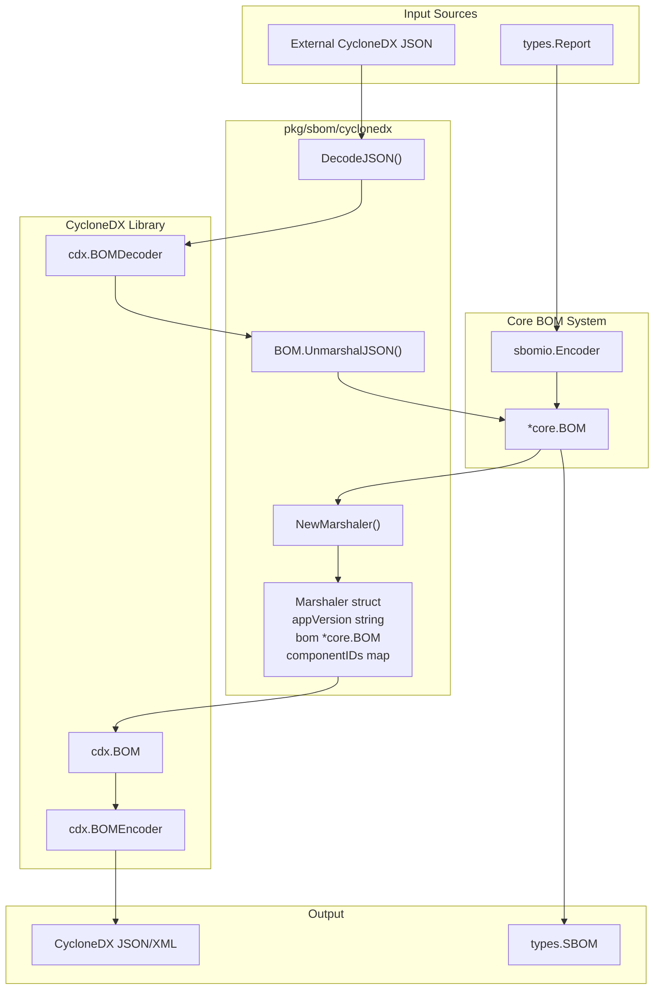
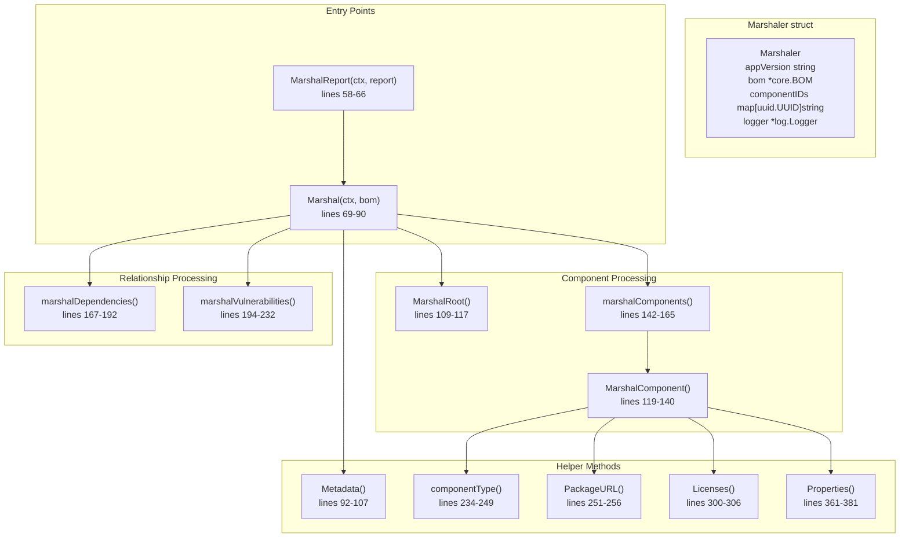
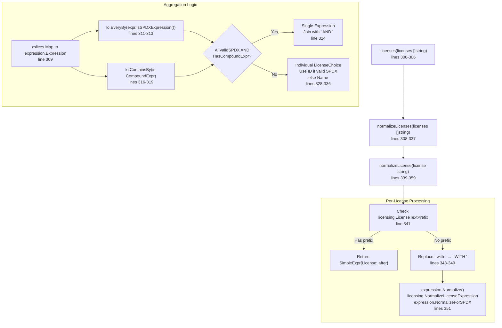
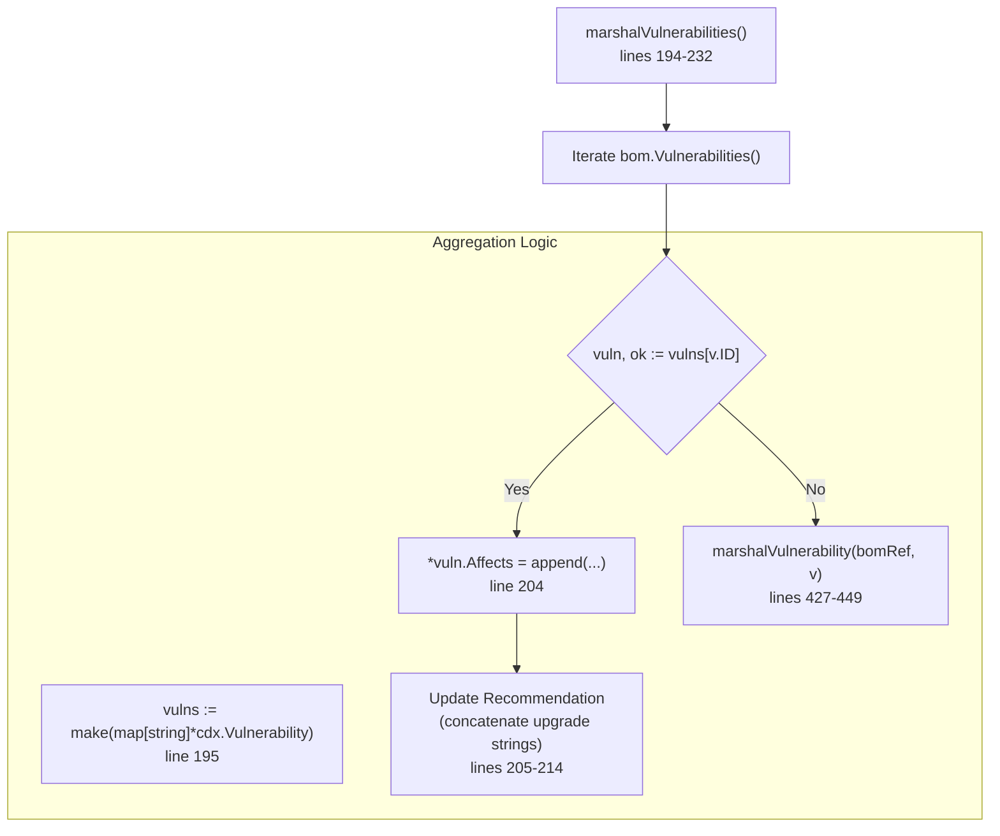
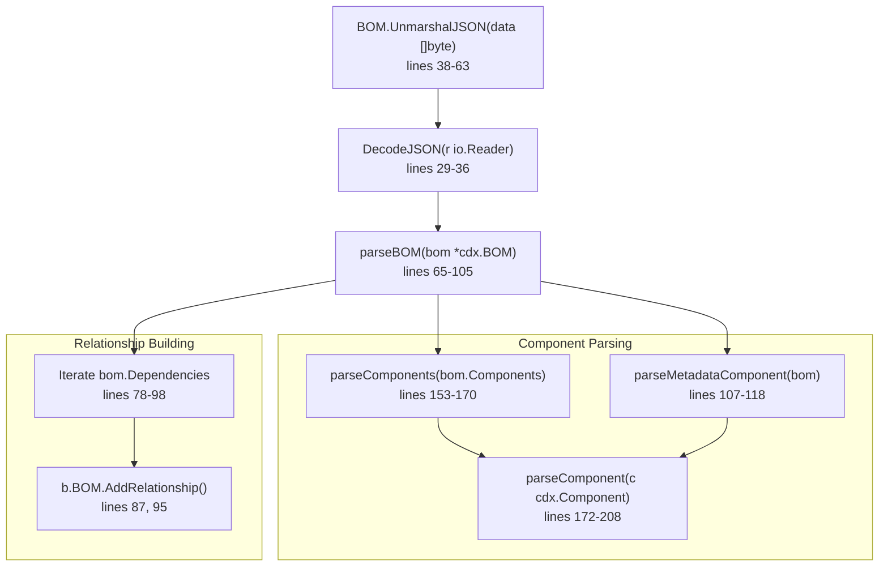
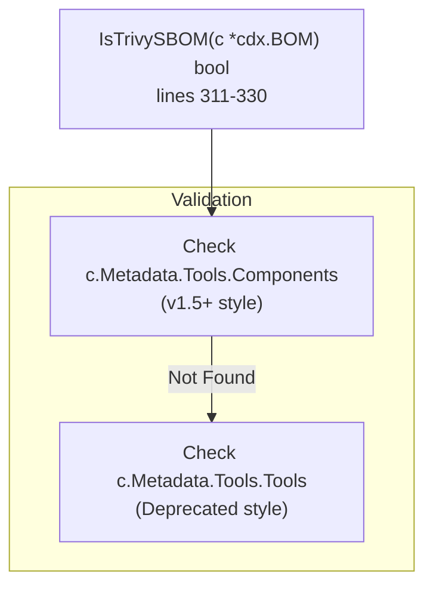

<!-- source: DeepWiki mcp.deepwiki.com · repo aquasecurity/trivy · page 6.1 CycloneDX Format · fetched 2026-10-30 -->

# CycloneDX Format

Relevant source files

The following files were used as context for generating this wiki page:

- [integration/testdata/conda-cyclonedx.json.golden](integration/testdata/conda-cyclonedx.json.golden)
- [integration/testdata/conda-environment-cyclonedx.json.golden](integration/testdata/conda-environment-cyclonedx.json.golden)
- [integration/testdata/fixtures/sbom/fluentd-multiple-lockfiles-cyclonedx.json](integration/testdata/fixtures/sbom/fluentd-multiple-lockfiles-cyclonedx.json)
- [integration/testdata/fixtures/sbom/minikube-kbom.json](integration/testdata/fixtures/sbom/minikube-kbom.json)
- [integration/testdata/fluentd-multiple-lockfiles-short.cdx.json.golden](integration/testdata/fluentd-multiple-lockfiles-short.cdx.json.golden)
- [integration/testdata/fluentd-multiple-lockfiles.cdx.json.golden](integration/testdata/fluentd-multiple-lockfiles.cdx.json.golden)
- [integration/testdata/npm-cyclonedx.json.golden](integration/testdata/npm-cyclonedx.json.golden)
- [integration/testdata/pom-cyclonedx.json.golden](integration/testdata/pom-cyclonedx.json.golden)
- [pkg/fanal/applier/docker.go](pkg/fanal/applier/docker.go)
- [pkg/fanal/applier/docker_test.go](pkg/fanal/applier/docker_test.go)
- [pkg/fanal/artifact/sbom/sbom.go](pkg/fanal/artifact/sbom/sbom.go)
- [pkg/k8s/report/cyclonedx.go](pkg/k8s/report/cyclonedx.go)
- [pkg/k8s/scanner/scanner_test.go](pkg/k8s/scanner/scanner_test.go)
- [pkg/report/cyclonedx/cyclonedx.go](pkg/report/cyclonedx/cyclonedx.go)
- [pkg/result/testdata/openvex.json](pkg/result/testdata/openvex.json)
- [pkg/sbom/core/bom.go](pkg/sbom/core/bom.go)
- [pkg/sbom/cyclonedx/marshal.go](pkg/sbom/cyclonedx/marshal.go)
- [pkg/sbom/cyclonedx/marshal_test.go](pkg/sbom/cyclonedx/marshal_test.go)
- [pkg/sbom/cyclonedx/testdata/happy/bom.json](pkg/sbom/cyclonedx/testdata/happy/bom.json)
- [pkg/sbom/cyclonedx/testdata/happy/infinite-loop-bom.json](pkg/sbom/cyclonedx/testdata/happy/infinite-loop-bom.json)
- [pkg/sbom/cyclonedx/testdata/happy/kbom.json](pkg/sbom/cyclonedx/testdata/happy/kbom.json)
- [pkg/sbom/cyclonedx/testdata/happy/third-party-bom-no-os.json](pkg/sbom/cyclonedx/testdata/happy/third-party-bom-no-os.json)
- [pkg/sbom/cyclonedx/testdata/happy/third-party-bom.json](pkg/sbom/cyclonedx/testdata/happy/third-party-bom.json)
- [pkg/sbom/cyclonedx/unmarshal.go](pkg/sbom/cyclonedx/unmarshal.go)
- [pkg/sbom/cyclonedx/unmarshal_test.go](pkg/sbom/cyclonedx/unmarshal_test.go)
- [pkg/sbom/io/encode.go](pkg/sbom/io/encode.go)
- [pkg/sbom/io/encode_test.go](pkg/sbom/io/encode_test.go)
- [pkg/sbom/sbom.go](pkg/sbom/sbom.go)
- [pkg/sbom/sbom_test.go](pkg/sbom/sbom_test.go)
- [pkg/vex/csaf.go](pkg/vex/csaf.go)
- [pkg/vex/cyclonedx.go](pkg/vex/cyclonedx.go)
- [pkg/vex/openvex.go](pkg/vex/openvex.go)
- [pkg/vex/testdata/openvex-multiple.json](pkg/vex/testdata/openvex-multiple.json)
- [pkg/vex/testdata/openvex-oci.json](pkg/vex/testdata/openvex-oci.json)
- [pkg/vex/testdata/openvex.json](pkg/vex/testdata/openvex.json)
- [pkg/vex/testdata/unknown.json](pkg/vex/testdata/unknown.json)
- [pkg/vex/vex.go](pkg/vex/vex.go)
- [pkg/vex/vex_test.go](pkg/vex/vex_test.go)
- [pkg/x/slices/slices.go](pkg/x/slices/slices.go)

## Purpose and Scope

This document describes Trivy's implementation of the CycloneDX SBOM format for both generation and consumption. CycloneDX is a standardized format for Software Bill of Materials (SBOM) that enables vulnerability tracking, license compliance, and dependency management across the software supply chain. Trivy supports the CycloneDX version 1.6 specification.

For information about SPDX format (the alternative SBOM format), see [SPDX Format](6.2). For general SBOM generation and consumption workflows, see [SBOM Generation and Consumption](6).

## Architecture Overview

Trivy's CycloneDX implementation consists of two primary components: marshaling (generating CycloneDX from scan results) and unmarshaling (consuming external CycloneDX SBOMs).

Trivy uses an intermediate representation `*core.BOM` [pkg/sbom/core/bom.go]() to bridge between the internal `types.Report` and the final `cdx.BOM` structure provided by the `github.com/CycloneDX/cyclonedx-go` library.

Title: CycloneDX Data Flow

Sources: [pkg/sbom/cyclonedx/marshal.go:42-90](), [pkg/sbom/cyclonedx/unmarshal.go:29-63](), [pkg/sbom/io/encode.go:59-89]()

## Marshaling Process

### Core Marshaling Flow

The `Marshaler` struct converts Trivy's internal representation to CycloneDX format. It maintains a `componentIDs` map to track `uuid.UUID` to `BOM-Ref` mappings for dependency graph consistency.

Title: Marshaler Logic Space

Sources: [pkg/sbom/cyclonedx/marshal.go:42-381]()

### Component Type Mapping

Trivy's internal `core.ComponentType` is mapped to CycloneDX `cdx.ComponentType` via the `componentType()` function:

| Core Component Type | CycloneDX Type |
|---------------------|----------------|
| `core.TypeContainerImage` | `cdx.ComponentTypeContainer` |
| `core.TypeVM` | `cdx.ComponentTypeContainer` |
| `core.TypeApplication` | `cdx.ComponentTypeApplication` |
| `core.TypeFilesystem` | `cdx.ComponentTypeApplication` |
| `core.TypeRepository` | `cdx.ComponentTypeApplication` |
| `core.TypeLibrary` | `cdx.ComponentTypeLibrary` |
| `core.TypeOS` | `cdx.ComponentTypeOS` |
| `core.TypePlatform` | `cdx.ComponentTypePlatform` |

Sources: [pkg/sbom/cyclonedx/marshal.go:234-249]()

### Metadata Generation

The `Metadata()` method populates the CycloneDX metadata block, identifying Trivy as the generating tool. It uses constants defined in [pkg/sbom/cyclonedx/marshal.go:32-37]():
- `ToolVendor`: "aquasecurity"
- `ToolName`: "trivy"
- `ToolManufacturer`: "Aqua Security Software Ltd."

Sources: [pkg/sbom/cyclonedx/marshal.go:92-107]()

### License Normalization

Trivy normalizes license strings into CycloneDX `LicenseChoice` objects. It handles both individual SPDX identifiers and complex compound expressions.

Title: License Processing Pipeline

Sources: [pkg/sbom/cyclonedx/marshal.go:300-359]()

### Vulnerability Aggregation

Trivy aggregates vulnerabilities by ID. If multiple components (packages) are affected by the same CVE, they are grouped under a single `cdx.Vulnerability` entry using the `Affects` field.

Title: Vulnerability Aggregation Flow

Sources: [pkg/sbom/cyclonedx/marshal.go:194-232](), [pkg/sbom/cyclonedx/marshal.go:427-449]()

## Unmarshaling Process

### Decoding and Parsing Flow

Unmarshaling converts CycloneDX JSON back into Trivy's `core.BOM`. This is used when scanning an existing SBOM file for vulnerabilities.

Title: Unmarshaler Code Entity Space

Sources: [pkg/sbom/cyclonedx/unmarshal.go:29-105]()

### Third-Party SBOM Detection

Trivy checks the metadata tools section to see if the SBOM was generated by Trivy. If not, it logs a warning that detection might be less accurate.

Title: IsTrivySBOM Validation

Sources: [pkg/sbom/cyclonedx/unmarshal.go:311-330]()

## Property Handling

Trivy uses CycloneDX properties to store additional metadata (e.g., Image ID, Layer DiffID). Properties are namespaced with `aquasecurity:trivy:` to avoid collisions with other tools.

- **Marshaling**: Prepends the namespace to internal property names unless `External` is true [pkg/sbom/cyclonedx/marshal.go:361-381]().
- **Unmarshaling**: Strips the namespace if present to restore the internal name and sets `External: false` [pkg/sbom/cyclonedx/unmarshal.go:289-309]().

Sources: [pkg/sbom/cyclonedx/marshal.go:36-37](), [pkg/sbom/cyclonedx/marshal.go:361-381](), [pkg/sbom/cyclonedx/unmarshal.go:289-309]()

## Dependency Graph

CycloneDX uses a separate `dependencies` array where each element contains a `ref` (pointing to a component's `bom-ref`) and a list of `dependsOn` refs.

- **Marshaling**: `marshalDependencies()` iterates over `bom.Relationships()` and maps internal IDs to `bom-ref` strings [pkg/sbom/cyclonedx/marshal.go:167-192]().
- **Unmarshaling**: `parseBOM()` iterates over the `Dependencies` array. If a component has an empty `dependsOn` list, Trivy creates a relationship to `nil` to explicitly mark it as having no dependencies [pkg/sbom/cyclonedx/unmarshal.go:78-98]().

Sources: [pkg/sbom/cyclonedx/marshal.go:167-192](), [pkg/sbom/cyclonedx/unmarshal.go:78-98]()

---

