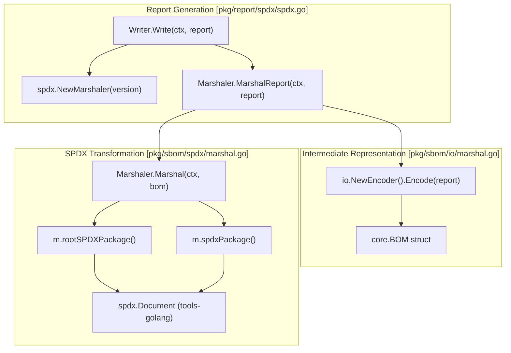
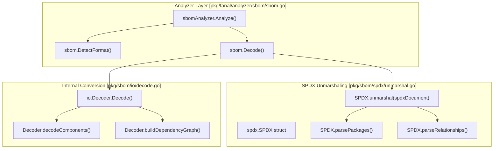

<!-- source: DeepWiki mcp.deepwiki.com · repo aquasecurity/trivy · page 6.2 SPDX Format · fetched 2026-10-30 -->

# SPDX Format

<details>
<summary>Relevant source files</summary>

The following files were used as context for generating this wiki page:

- [integration/testdata/conda-spdx.json.golden](integration/testdata/conda-spdx.json.golden)
- [integration/testdata/julia-spdx.json.golden](integration/testdata/julia-spdx.json.golden)
- [pkg/fanal/analyzer/language/dart/pub/pubspec.go](pkg/fanal/analyzer/language/dart/pub/pubspec.go)
- [pkg/fanal/analyzer/language/julia/pkg/pkg.go](pkg/fanal/analyzer/language/julia/pkg/pkg.go)
- [pkg/fanal/analyzer/language/julia/pkg/pkg_test.go](pkg/fanal/analyzer/language/julia/pkg/pkg_test.go)
- [pkg/fanal/analyzer/sbom/sbom.go](pkg/fanal/analyzer/sbom/sbom.go)
- [pkg/fanal/analyzer/sbom/sbom_test.go](pkg/fanal/analyzer/sbom/sbom_test.go)
- [pkg/fanal/analyzer/sbom/testdata/ca-certificates.spdx.json](pkg/fanal/analyzer/sbom/testdata/ca-certificates.spdx.json)
- [pkg/fanal/analyzer/sbom/testdata/sbom-without-app-component.spdx.json](pkg/fanal/analyzer/sbom/testdata/sbom-without-app-component.spdx.json)
- [pkg/fanal/handler/unpackaged/unpackaged.go](pkg/fanal/handler/unpackaged/unpackaged.go)
- [pkg/report/spdx/spdx.go](pkg/report/spdx/spdx.go)
- [pkg/sbom/cyclonedx/testdata/happy/nested-packages-bom.json](pkg/sbom/cyclonedx/testdata/happy/nested-packages-bom.json)
- [pkg/sbom/io/decode.go](pkg/sbom/io/decode.go)
- [pkg/sbom/io/decode_test.go](pkg/sbom/io/decode_test.go)
- [pkg/sbom/spdx/marshal.go](pkg/sbom/spdx/marshal.go)
- [pkg/sbom/spdx/marshal_test.go](pkg/sbom/spdx/marshal_test.go)
- [pkg/sbom/spdx/testdata/happy/with-file-as-relationship-parent.json](pkg/sbom/spdx/testdata/happy/with-file-as-relationship-parent.json)
- [pkg/sbom/spdx/unmarshal.go](pkg/sbom/spdx/unmarshal.go)
- [pkg/sbom/spdx/unmarshal_test.go](pkg/sbom/spdx/unmarshal_test.go)

</details>


## Purpose and Scope

This document details Trivy's SPDX (Software Package Data Exchange) format support for SBOM generation and consumption. SPDX is an ISO/IEC standard format for communicating software bill of materials and associated information. For information about CycloneDX SBOM format, see [CycloneDX Format](6.1). For the overall report generation system, see [Report Generation and Output](7).

Trivy supports SPDX as both an **output** format for generating SBOMs and an **input** format for vulnerability scanning. It supports SPDX 2.3 in both JSON and Tag-Value serializations.

---

## SPDX in the Report Writer System

The SPDX writer is integrated into Trivy's report generation pipeline. It transforms a `types.Report` into an SPDX document by first encoding it into an intermediate `core.BOM` representation.

### Format Selection and Generation Flow



**Sources:** [pkg/report/spdx/spdx.go:32-49](), [pkg/sbom/spdx/marshal.go:117-125](), [pkg/sbom/spdx/marshal.go:127-152]()

---

## SPDX Consumption (Decoding)

Trivy can consume SPDX files to perform vulnerability scans on the components listed within them. This is handled by the `sbomAnalyzer` which detects the format and uses the SPDX decoder.

### SPDX Decoding Architecture

The decoding process converts an SPDX document back into Trivy's internal `types.SBOM` structure.



**Sources:** [pkg/fanal/analyzer/sbom/sbom.go:33-44](), [pkg/sbom/spdx/unmarshal.go:68-105](), [pkg/sbom/io/decode.go:51-86]()

### Package Identification and Metadata
During unmarshaling, Trivy maps SPDX fields to its internal component model:
- **PURL**: Extracted from `ExternalRef` with category `PACKAGE-MANAGER` and type `purl` [pkg/sbom/spdx/unmarshal.go:171-173]().
- **Properties**: Recovered from SPDX `Annotations` or `AttributionTexts` to maintain backward compatibility [pkg/sbom/spdx/unmarshal.go:202-220]().
- **Relationships**: Maps `CONTAINS` and `DEPENDS_ON` to build the internal dependency graph [pkg/sbom/spdx/unmarshal.go:85-102]().

---

## Data Mapping and Constants

Trivy uses specific constants to ensure consistency when generating SPDX documents.

| SPDX Field | Trivy Constant / Source | Value / Description |
|-----------|-------------------------|---------------------|
| `DocumentNamespace` | `DocumentNamespace` | `http://trivy.dev` [pkg/sbom/spdx/marshal.go:34]() |
| `Creator Organization`| `CreatorOrganization` | `aquasecurity` [pkg/sbom/spdx/marshal.go:35]() |
| `Creator Tool` | `CreatorTool` | `trivy` [pkg/sbom/spdx/marshal.go:36]() |
| `Package Purpose` | `PackagePurposeOS` | `OPERATING-SYSTEM` [pkg/sbom/spdx/marshal.go:46]() |
| `Package Purpose` | `PackagePurposeLibrary` | `LIBRARY` [pkg/sbom/spdx/marshal.go:50]() |
| `Relationship` | `RelationShipContains` | `CONTAINS` [pkg/sbom/spdx/marshal.go:57]() |

**Sources:** [pkg/sbom/spdx/marshal.go:32-67]()

---

## Implementation Details

### Marshaling Packages
The `Marshaler` iterates through components in a `core.BOM` to create `spdx.Package` entries. It includes:
1. **Vulnerability Advisories**: If vulnerabilities are present in the BOM, they are added as `PackageExternalReferences` using the primary URL [pkg/sbom/spdx/marshal.go:166-170]().
2. **License Handling**: Both `PackageLicenseConcluded` and `PackageLicenseDeclared` are populated from the component's license data [pkg/sbom/spdx/marshal.go:176-180]().
3. **Verification Codes**: For packages with files, Trivy calculates an SPDX Verification Code [pkg/sbom/spdx/marshal.go:196-201]().

### Unmarshaling Logic
The `SPDX` struct in `pkg/sbom/spdx/unmarshal.go` handles the conversion from the `tools-golang` document model to Trivy's `core.BOM`.
- **Root Identification**: It identifies the root package by looking for the `DESCRIBES` relationship from the `DOCUMENT` identifier [pkg/sbom/spdx/unmarshal.go:137-143]().
- **File Paths**: It tracks file-to-package associations via `CONTAINS` relationships to populate component file paths [pkg/sbom/spdx/unmarshal.go:108-133]().

---

## Comparison of Formats

Trivy supports two SPDX output variants:

| Format | Writer Logic | Serialization |
|--------|--------------|---------------|
| `spdx-json` | `writeSPDXJson` | `json.MarshalIndent` [pkg/report/spdx/spdx.go:53-65]() |
| `spdx` | `tagvalue.Write` | SPDX Tag-Value format [pkg/report/spdx/spdx.go:43-45]() |

---

## CLI Usage

### Generating SPDX SBOMs
```bash
# Generate SPDX JSON
trivy image --format spdx-json --output result.spdx.json alpine:latest

# Generate SPDX Tag-Value
trivy image --format spdx --output result.spdx alpine:latest
```

### Scanning SPDX SBOMs
```bash
# Scan an existing SPDX file for vulnerabilities
trivy sbom result.spdx.json
```

When scanning an SBOM, the `sbomAnalyzer` automatically detects if the file is SPDX or CycloneDX based on the content [pkg/fanal/analyzer/sbom/sbom.go:35]().

**Sources:** [pkg/fanal/analyzer/sbom/sbom.go:18-30](), [pkg/report/spdx/spdx.go:23-30]()

---

