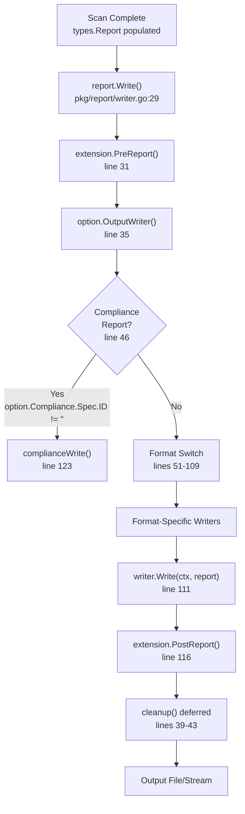
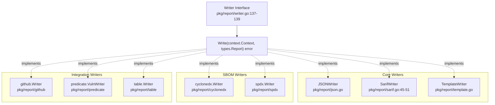
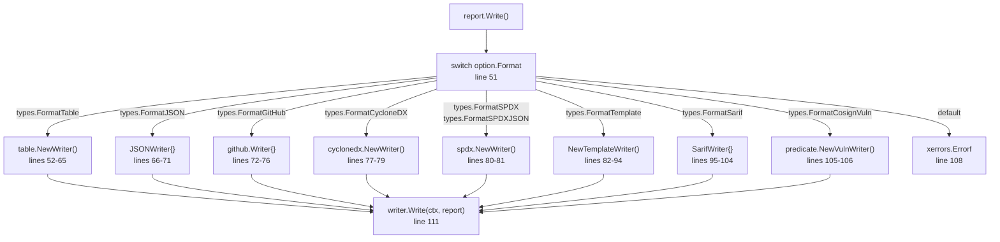

<!-- source: DeepWiki mcp.deepwiki.com · repo aquasecurity/trivy · page 7 Report Generation and Output · fetched 2026-10-30 -->

# Report Generation and Output

Relevant source files

The following files were used as context for generating this wiki page:

- [contrib/junit.tpl](contrib/junit.tpl)
- [integration/testdata/alpine-310.junit.golden](integration/testdata/alpine-310.junit.golden)
- [integration/testdata/alpine-310.sarif.golden](integration/testdata/alpine-310.sarif.golden)
- [integration/testdata/dockerfile-custom-policies.json.golden](integration/testdata/dockerfile-custom-policies.json.golden)
- [integration/testdata/dockerfile.json.golden](integration/testdata/dockerfile.json.golden)
- [integration/testdata/dockerfile_file_pattern.json.golden](integration/testdata/dockerfile_file_pattern.json.golden)
- [integration/testdata/helm.json.golden](integration/testdata/helm.json.golden)
- [integration/testdata/helm_testchart.json.golden](integration/testdata/helm_testchart.json.golden)
- [integration/testdata/helm_testchart.overridden.json.golden](integration/testdata/helm_testchart.overridden.json.golden)
- [integration/testdata/secrets.json.golden](integration/testdata/secrets.json.golden)
- [pkg/commands/convert/run.go](pkg/commands/convert/run.go)
- [pkg/fanal/types/package.go](pkg/fanal/types/package.go)
- [pkg/fanal/types/secret.go](pkg/fanal/types/secret.go)
- [pkg/report/export_test.go](pkg/report/export_test.go)
- [pkg/report/json.go](pkg/report/json.go)
- [pkg/report/json_test.go](pkg/report/json_test.go)
- [pkg/report/sarif.go](pkg/report/sarif.go)
- [pkg/report/sarif_test.go](pkg/report/sarif_test.go)
- [pkg/report/table/licensing.go](pkg/report/table/licensing.go)
- [pkg/report/table/misconfig.go](pkg/report/table/misconfig.go)
- [pkg/report/table/misconfig_test.go](pkg/report/table/misconfig_test.go)
- [pkg/report/table/secret.go](pkg/report/table/secret.go)
- [pkg/report/table/secret_test.go](pkg/report/table/secret_test.go)
- [pkg/report/table/table.go](pkg/report/table/table.go)
- [pkg/report/table/table_test.go](pkg/report/table/table_test.go)
- [pkg/report/table/vulnerability.go](pkg/report/table/vulnerability.go)
- [pkg/report/table/vulnerability_test.go](pkg/report/table/vulnerability_test.go)
- [pkg/report/template.go](pkg/report/template.go)
- [pkg/report/template_test.go](pkg/report/template_test.go)
- [pkg/report/writer.go](pkg/report/writer.go)
- [pkg/report/writer_test.go](pkg/report/writer_test.go)
- [pkg/rpc/client/export_test.go](pkg/rpc/client/export_test.go)
- [pkg/scan/service.go](pkg/scan/service.go)
- [pkg/types/report.go](pkg/types/report.go)
- [pkg/types/scan.go](pkg/types/scan.go)
- [pkg/types/version.go](pkg/types/version.go)

Trivy's report generation system transforms scan results from the internal `types.Report` structure into various output formats. The system is built around the `Writer` interface pattern, allowing pluggable output formatters while maintaining a consistent API. The main orchestration happens in [pkg/report/writer.go:29-121]() through the `Write` function, which routes to format-specific writers.

The report generation process occurs after scanning is complete and results are available in the `types.Report` structure. For information about how scan results are generated, see [Scanning Capabilities](#4). For SBOM generation as output, see [SBOM Generation and Consumption](#6).

## Report Generation Pipeline

The report generation pipeline starts after scanning completes and consists of three main phases: pre-processing hooks, format-specific writing, and post-processing hooks.

### Overall Report Generation Flow

**Sources:** [pkg/report/writer.go:29-121]()

### Writer Interface and Implementations

The `Writer` interface defined at [pkg/report/writer.go:137-139]() provides a uniform API for all output formats:

**Sources:** [pkg/report/writer.go:137-139](), [pkg/report/sarif.go:45-51]()

## Format Dispatch Mechanism

The `Write` function at [pkg/report/writer.go:29-121]() implements the format dispatch logic through a switch statement that routes to the appropriate writer based on `option.Format`:

**Sources:** [pkg/report/writer.go:50-109]()

## Supported Output Formats

Trivy supports multiple output formats defined as constants in [pkg/types/report.go:93-102](). Each format is handled by a dedicated writer implementation:

| Format Constant | CLI Flag Value | Writer Implementation | Primary Use Case | Details |
|----------------|----------------|----------------------|------------------|---------|
| `FormatTable` | `table` | `table.Writer` | Human-readable console output | See [Report Writers and Format Selection](#7.1) |
| `FormatJSON` | `json` | `JSONWriter` | Machine processing, API integration | See [Report Writers and Format Selection](#7.1) |
| `FormatSarif` | `sarif` | `SarifWriter` | Security tool integration (GitHub, IDEs) | See [SARIF Output for Security Tools](#7.2) |
| `FormatTemplate` | `template` | `TemplateWriter` | Custom output formats | See [Template-Based Custom Reports](#7.3) |
| `FormatCycloneDX` | `cyclonedx` | `cyclonedx.Writer` | CycloneDX SBOM generation | See [CycloneDX Format](#6.1) |
| `FormatSPDX` | `spdx` | `spdx.Writer` | SPDX SBOM generation | See [SPDX Format](#6.2) |
| `FormatSPDXJSON` | `spdx-json` | `spdx.Writer` | SPDX JSON SBOM generation | See [SPDX Format](#6.2) |
| `FormatGitHub` | `github` | `github.Writer` | GitHub dependency snapshots | See [Report Writers and Format Selection](#7.1) |
| `FormatCosignVuln` | `cosign-vuln` | `predicate.VulnWriter` | Cosign vulnerability attestations | See [Report Writers and Format Selection](#7.1) |

**Sources:** [pkg/types/report.go:93-102](), [pkg/report/writer.go:50-109]()

## Core Report Data Structure

All writers receive the same input: a `types.Report` structure defined at [pkg/types/report.go:20-40](). This structure contains the complete scan results and metadata:

### types.Report Structure

| Field | Type | Description |
|-------|------|-------------|
| `SchemaVersion` | `int` | Report schema version (currently 2) |
| `ArtifactName` | `string` | Name/identifier of scanned artifact |
| `ArtifactType` | `ftypes.ArtifactType` | Type (container image, filesystem, etc.) |
| `Metadata` | `Metadata` | Image metadata (tags, digests, OS info) |
| `Results` | `Results` | Array of scan results by target |
| `BOM` | `*core.BOM` | Software Bill of Materials (if requested) |

### types.Result Structure

Each element in `Results` contains findings for a specific target as defined in [pkg/types/report.go:157-173]():

| Field | Type | Description |
|-------|------|-------------|
| `Target` | `string` | Target identifier (file path, image layer, etc.) |
| `Class` | `ResultClass` | Result class (OS packages, language packages, config, secrets, licenses) |
| `Type` | `ftypes.TargetType` | Specific type (alpine, npm, terraform, etc.) |
| `Vulnerabilities` | `[]DetectedVulnerability` | Detected vulnerabilities |
| `Misconfigurations` | `[]DetectedMisconfiguration` | IaC/config issues |
| `Secrets` | `[]DetectedSecret` | Detected secrets |
| `Licenses` | `[]DetectedLicense` | License findings |
| `Packages` | `[]ftypes.Package` | All packages (if `--list-all-pkgs`) |

**Sources:** [pkg/types/report.go:20-40](), [pkg/types/report.go:157-173]()

## Compliance Reporting

When `option.Compliance.Spec.ID` is set (line 46 in [pkg/report/writer.go:46-48]()), the report generation takes a special path through `complianceWrite()` at [pkg/report/writer.go:123-134](). This function:

1. Calls `cr.BuildComplianceReport()` to transform scan results according to a compliance specification [pkg/report/writer.go:124]().
2. Routes to `cr.Write()` with compliance-specific options [pkg/report/writer.go:128-133]().

Compliance reporting supports multiple standards (e.g., `k8s-nsa-1.0`, `aws-cis-1.4`) defined in [pkg/types/report.go:83-91](). For details, see [Compliance and Summary Reports](#7.4).

**Sources:** [pkg/report/writer.go:46-48](), [pkg/report/writer.go:123-134](), [pkg/types/report.go:83-91]()

## Extension and Customization

The reporting system supports extension through:

1. **Template System**: Custom output formats via Go templates with helper functions and Sprig functions [pkg/report/writer.go:92]().
2. **Hook System**: Pre and post-report processing hooks for custom modifications [pkg/report/writer.go:31-33](), [pkg/report/writer.go:116-118]().
3. **Writer Interface**: New output formats can be added by implementing the `Writer` interface [pkg/report/writer.go:137-139]().

**Sources:** [pkg/report/writer.go:31-33](), [pkg/report/writer.go:92](), [pkg/report/writer.go:116-118](), [pkg/report/writer.go:137-139]()

---

