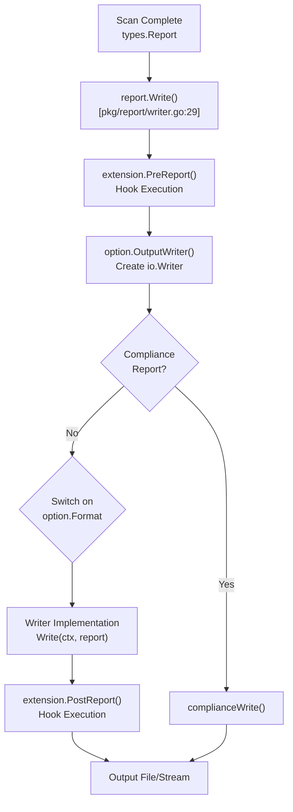
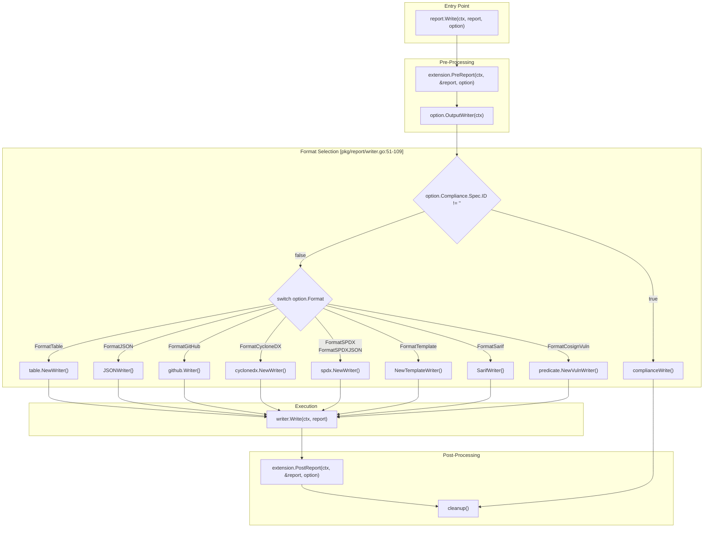
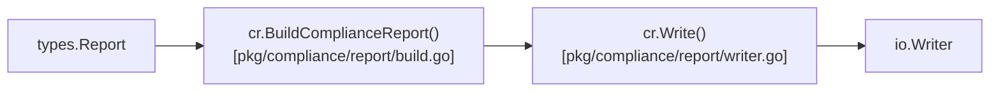

<!-- source: DeepWiki mcp.deepwiki.com · repo aquasecurity/trivy · page 7.1 Report Writers and Format Selection · fetched 2026-10-30 -->

# Report Writers and Format Selection

<details>
<summary>Relevant source files</summary>

The following files were used as context for generating this wiki page:

- [contrib/junit.tpl](contrib/junit.tpl)
- [integration/testdata/alpine-310.junit.golden](integration/testdata/alpine-310.junit.golden)
- [integration/testdata/alpine-310.sarif.golden](integration/testdata/alpine-310.sarif.golden)
- [integration/testdata/dockerfile-custom-policies.json.golden](integration/testdata/dockerfile-custom-policies.json.golden)
- [integration/testdata/dockerfile.json.golden](integration/testdata/dockerfile.json.golden)
- [integration/testdata/dockerfile_file_pattern.json.golden](integration/testdata/dockerfile_file_pattern.json.golden)
- [integration/testdata/helm.json.golden](integration/testdata/helm.json.golden)
- [integration/testdata/helm_testchart.json.golden](integration/testdata/helm_testchart.json.golden)
- [integration/testdata/helm_testchart.overridden.json.golden](integration/testdata/helm_testchart.overridden.json.golden)
- [integration/testdata/secrets.json.golden](integration/testdata/secrets.json.golden)
- [pkg/commands/convert/run.go](pkg/commands/convert/run.go)
- [pkg/fanal/types/misconf.go](pkg/fanal/types/misconf.go)
- [pkg/fanal/types/package.go](pkg/fanal/types/package.go)
- [pkg/fanal/types/secret.go](pkg/fanal/types/secret.go)
- [pkg/report/export_test.go](pkg/report/export_test.go)
- [pkg/report/json.go](pkg/report/json.go)
- [pkg/report/json_test.go](pkg/report/json_test.go)
- [pkg/report/sarif.go](pkg/report/sarif.go)
- [pkg/report/sarif_test.go](pkg/report/sarif_test.go)
- [pkg/report/table/licensing.go](pkg/report/table/licensing.go)
- [pkg/report/table/misconfig.go](pkg/report/table/misconfig.go)
- [pkg/report/table/misconfig_test.go](pkg/report/table/misconfig_test.go)
- [pkg/report/table/secret.go](pkg/report/table/secret.go)
- [pkg/report/table/secret_test.go](pkg/report/table/secret_test.go)
- [pkg/report/table/table.go](pkg/report/table/table.go)
- [pkg/report/table/table_test.go](pkg/report/table/table_test.go)
- [pkg/report/table/vulnerability.go](pkg/report/table/vulnerability.go)
- [pkg/report/table/vulnerability_test.go](pkg/report/table/vulnerability_test.go)
- [pkg/report/template.go](pkg/report/template.go)
- [pkg/report/template_test.go](pkg/report/template_test.go)
- [pkg/report/writer.go](pkg/report/writer.go)
- [pkg/report/writer_test.go](pkg/report/writer_test.go)
- [pkg/result/filter.go](pkg/result/filter.go)
- [pkg/result/filter_test.go](pkg/result/filter_test.go)
- [pkg/result/ignore.go](pkg/result/ignore.go)
- [pkg/result/ignore_test.go](pkg/result/ignore_test.go)
- [pkg/result/testdata/.trivyignore](pkg/result/testdata/.trivyignore)
- [pkg/result/testdata/.trivyignore.yaml](pkg/result/testdata/.trivyignore.yaml)
- [pkg/result/testdata/test-ignore-policy-licenses-and-secrets.rego](pkg/result/testdata/test-ignore-policy-licenses-and-secrets.rego)
- [pkg/rpc/client/export_test.go](pkg/rpc/client/export_test.go)
- [pkg/scan/service.go](pkg/scan/service.go)
- [pkg/types/misconfiguration.go](pkg/types/misconfiguration.go)
- [pkg/types/report.go](pkg/types/report.go)
- [pkg/types/scan.go](pkg/types/scan.go)
- [pkg/types/version.go](pkg/types/version.go)
- [pkg/types/vulnerability.go](pkg/types/vulnerability.go)

</details>


## Purpose and Scope

This document explains Trivy's report generation system, specifically the `Writer` interface pattern and the format dispatch mechanism that routes scan results to different output formats. It covers how the `Write` function in `pkg/report/writer.go` selects and instantiates format-specific writers based on user configuration and the internal filtering pipeline that prepares results for output.

For details on specific output formats, see:
- SARIF format implementation → [7.2 SARIF Output for Security Tools]()
- Custom template-based reports → [7.3 Template-Based Custom Reports]()
- Compliance and summary reports → [7.4 Compliance and Summary Reports]()

For information about SBOM output formats, see [6.1 CycloneDX Format]() and [6.2 SPDX Format]().

---

## Report Generation Architecture

The report generation system in Trivy follows a strategy pattern where a central `Write` function dispatches to format-specific writer implementations. All writers implement a common `Writer` interface, enabling polymorphic handling of different output formats.

### High-Level Flow


**Sources:** [pkg/report/writer.go:29-121]()

---

## The Writer Interface

All format-specific writers implement the `Writer` interface, which defines a single method:

```go
type Writer interface {
	Write(context.Context, types.Report) error
}
```
**Sources:** [pkg/report/writer.go:137-139]()

### Writer Interface Implementations

| Writer Type | Package | Description |
|------------|---------|-------------|
| `JSONWriter` | `pkg/report` | Outputs JSON format with optional package listing |
| `SarifWriter` | `pkg/report` | Generates SARIF 2.1.0 format for security tools |
| `TemplateWriter` | `pkg/report` | User-defined templates with Sprig functions |
| `table.Writer` | `pkg/report/table` | Human-readable table output with tree view |
| `github.Writer` | `pkg/report/github` | GitHub Dependency Snapshot format |
| `cyclonedx.Writer` | `pkg/report/cyclonedx` | CycloneDX SBOM format |
| `spdx.Writer` | `pkg/report/spdx` | SPDX SBOM format (JSON or Tag-Value) |
| `predicate.VulnWriter` | `pkg/report/predicate` | Cosign vulnerability attestation format |

**Sources:** [pkg/report/writer.go:50-109](), [pkg/report/json.go:15-20](), [pkg/report/sarif.go:45-51](), [pkg/report/template.go:25-29]()

---

## Result Filtering Pipeline

Before results are passed to the `Writer`, they are processed through a filtering pipeline in `pkg/result/filter.go`. This system removes findings based on severity, status, and ignore rules.

### Filtering Logic
The `Filter` function orchestrates several specialized filters:
1.  **Severity Filter:** Compares finding severity against `opt.Severities` [pkg/result/filter.go:92-93]().
2.  **Status Filter:** For vulnerabilities, checks `ignoreStatuses` [pkg/result/filter.go:95-96]().
3.  **Ignore File (.trivyignore):** Matches findings against patterns in ignore files [pkg/result/filter.go:100-104]().
4.  **VEX Filter:** Applies Vulnerability Exploitability eXchange (VEX) data to suppress or modify findings [pkg/result/filter.go:52-57]().
5.  **Policy Filter:** Applies OPA Rego policies to the results if a policy file is provided [pkg/result/filter.go:72-77]().

### Modified Findings
When a finding is filtered out (ignored), it is often moved to `ModifiedFindings` rather than being deleted entirely, allowing the report to track what was suppressed and why [pkg/result/filter.go:100-104]().

**Sources:** [pkg/result/filter.go:39-81](), [pkg/result/filter.go:83-119](), [pkg/types/report.go:169-173]()

---

## Format Dispatch Mechanism

The `Write` function at [pkg/report/writer.go:29-121]() orchestrates the entire report generation process.

### Dispatch Flow Diagram


**Sources:** [pkg/report/writer.go:29-121]()

### Stage Breakdown

1.  **Pre-Report Hook:** `extension.PreReport` is called, allowing external modules to modify the report object before formatting [pkg/report/writer.go:31-33]().
2.  **Output Writer:** `option.OutputWriter` is invoked to create the target `io.Writer` (e.g., a file or stdout) [pkg/report/writer.go:35-38]().
3.  **Compliance Check:** If a compliance ID is set, the flow redirects to `complianceWrite` which builds a specialized `ComplianceReport` [pkg/report/writer.go:46-48](), [pkg/report/writer.go:123-134]().
4.  **Format Switch:** The core logic selects a `Writer` implementation based on the `types.Format` enum [pkg/report/writer.go:51-109]().
5.  **Execution:** The selected writer's `Write` method is called [pkg/report/writer.go:111-113]().
6.  **Post-Report Hook:** `extension.PostReport` is called after writing [pkg/report/writer.go:116-118]().

---

## Writer Implementations

### JSONWriter
The `JSONWriter` serializes the `types.Report` structure into JSON. It supports pretty-printing and can optionally include all discovered packages (even those without vulnerabilities) [pkg/report/json.go:15-20]().

**Instantiation:** [pkg/report/writer.go:66-71]()

### SarifWriter
The `SarifWriter` converts findings into the Static Analysis Results Interchange Format (SARIF). It maps Trivy findings to SARIF `rules` and `results` [pkg/report/sarif.go:45-51]().

*   **Rule Mapping:** Vulnerabilities are categorized as `OsPackageVulnerability` or `LanguageSpecificPackageVulnerability` [pkg/report/sarif.go:22-23]().
*   **Location Handling:** For filesystem scans, it uses the target path to calculate `ROOTPATH` in the SARIF output [pkg/report/writer.go:97-104]().
*   **Severity Mapping:** Trivy severities (CRITICAL, HIGH, etc.) are converted to SARIF levels (error, warning, note) [pkg/report/sarif.go:311-322]().

**Sources:** [pkg/report/sarif.go:128-212](), [pkg/report/writer.go:95-104]()

### TemplateWriter
The `TemplateWriter` uses Go's `text/template` engine. It provides custom functions like `escapeXML`, `sourceID`, and `appVersion` to assist in generating various text-based formats (e.g., JUnit, HTML) [pkg/report/template.go:25-29](), [pkg/report/template.go:40-64]().

**Sources:** [pkg/report/template.go:72-84](), [pkg/report/writer.go:82-94]()

---

## Data Structures and Types

The reporting system relies on the `types.Report` struct which aggregates all scan findings.

| Entity | Code Identifier | Description |
| :--- | :--- | :--- |
| **Root Report** | `types.Report` | Contains metadata and a list of `Results` [pkg/types/report.go:20-40]() |
| **Scan Result** | `types.Result` | Findings for a specific target (e.g., a file or image layer) [pkg/types/report.go:157-173]() |
| **Vulnerability** | `types.DetectedVulnerability` | Details of a detected CVE [pkg/types/vulnerability.go:11-47]() |
| **Misconfiguration** | `types.DetectedMisconfiguration` | Details of a failed policy check [pkg/types/misconfiguration.go:34-63]() |
| **Secret** | `types.DetectedSecret` | Details of a detected sensitive string [pkg/fanal/types/secret.go:12-21]() |

**Sources:** [pkg/types/report.go:1-173](), [pkg/types/vulnerability.go:11-47]()

---

## Implementation Details: Compliance Writing

When compliance mode is active, the system uses `complianceWrite`. This function bridges the standard `types.Report` to the compliance reporting system.


**Sources:** [pkg/report/writer.go:123-134]()

The `complianceWrite` function:
1.  Extracts results from the report.
2.  Calls `cr.BuildComplianceReport` with the specified compliance options [pkg/report/writer.go:124]().
3.  Calls the compliance-specific `Write` function to output the final report in the requested format (Table, JSON, etc.) [pkg/report/writer.go:128-133]().

---

