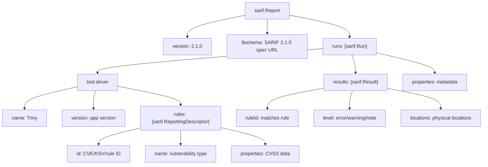
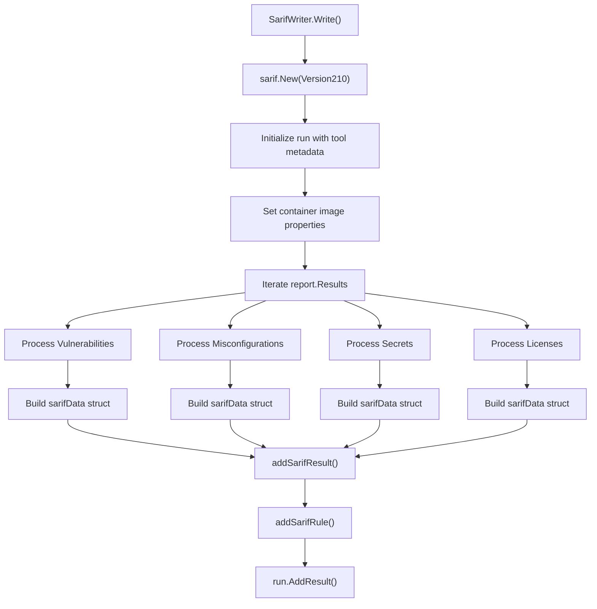
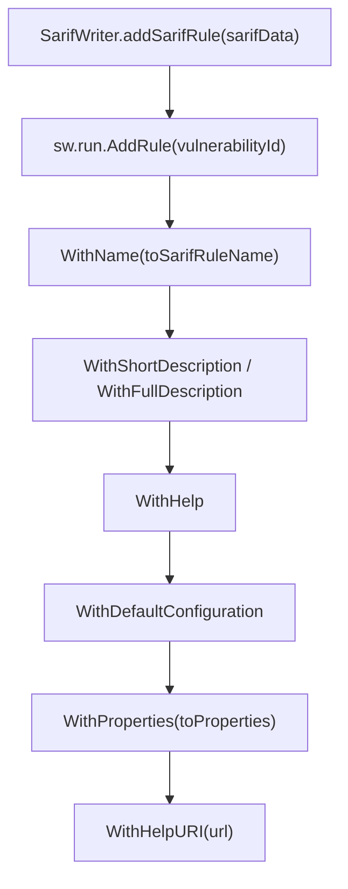
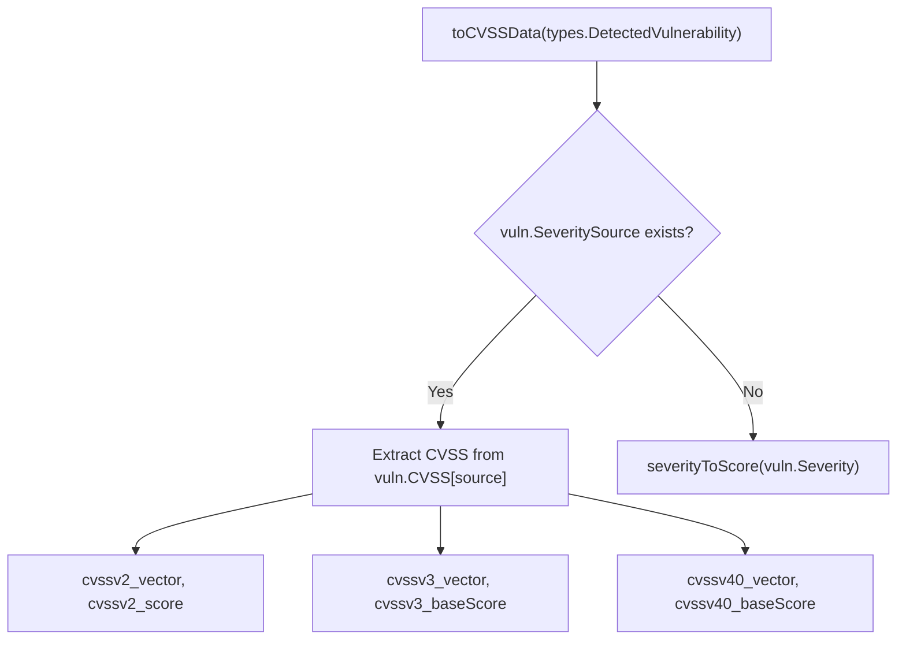
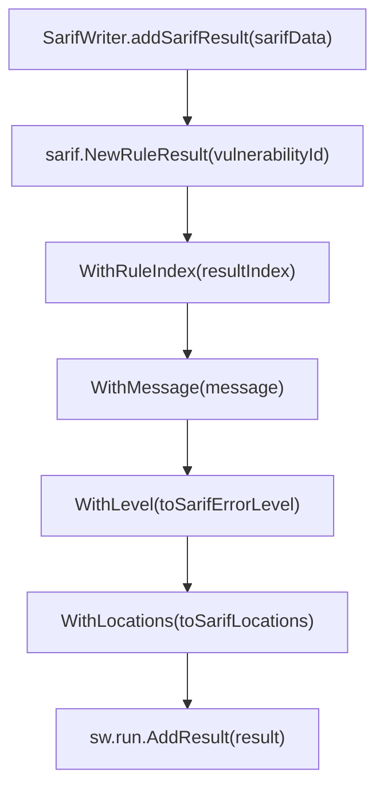
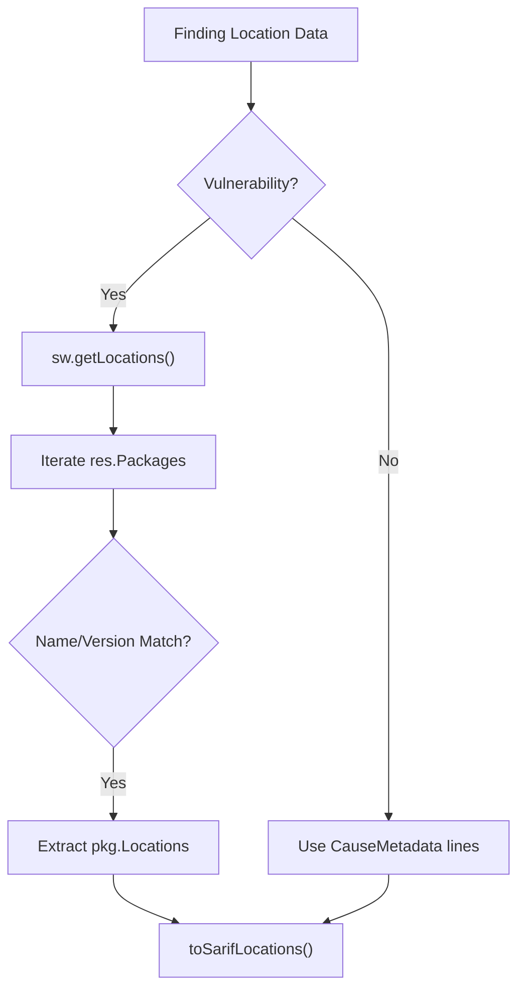
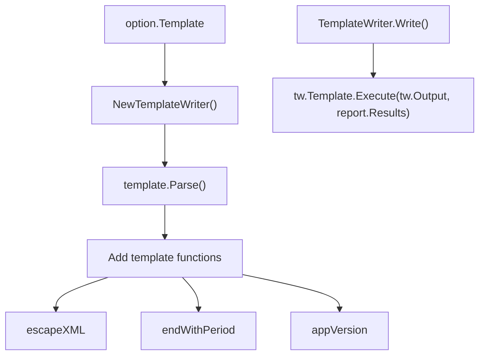

<!-- source: DeepWiki mcp.deepwiki.com · repo aquasecurity/trivy · page 7.2 SARIF Output for Security Tools · fetched 2026-10-30 -->

# SARIF Output for Security Tools

<details>
<summary>Relevant source files</summary>

The following files were used as context for generating this wiki page:

- [contrib/asff.tpl](contrib/asff.tpl)
- [contrib/junit.tpl](contrib/junit.tpl)
- [integration/testdata/alpine-310.asff.golden](integration/testdata/alpine-310.asff.golden)
- [integration/testdata/alpine-310.junit.golden](integration/testdata/alpine-310.junit.golden)
- [integration/testdata/alpine-310.sarif.golden](integration/testdata/alpine-310.sarif.golden)
- [integration/testdata/secrets.asff.golden](integration/testdata/secrets.asff.golden)
- [pkg/commands/convert/run.go](pkg/commands/convert/run.go)
- [pkg/fanal/types/package.go](pkg/fanal/types/package.go)
- [pkg/report/export_test.go](pkg/report/export_test.go)
- [pkg/report/json.go](pkg/report/json.go)
- [pkg/report/json_test.go](pkg/report/json_test.go)
- [pkg/report/sarif.go](pkg/report/sarif.go)
- [pkg/report/sarif_test.go](pkg/report/sarif_test.go)
- [pkg/report/template.go](pkg/report/template.go)
- [pkg/report/template_test.go](pkg/report/template_test.go)
- [pkg/report/writer.go](pkg/report/writer.go)
- [pkg/report/writer_test.go](pkg/report/writer_test.go)

</details>


SARIF (Static Analysis Results Interchange Format) version 2.1.0 is an industry-standard format for representing static analysis results. Trivy generates SARIF reports to enable integration with security-focused IDEs, CI/CD systems like GitHub Advanced Security, and compliance platforms. The SARIF format provides a structured representation of vulnerabilities, misconfigurations, secrets, and license issues with precise location information and severity metadata.

## SARIF Report Structure

Trivy generates SARIF reports conforming to the OASIS SARIF 2.1.0 specification. The report consists of a single run containing tool metadata, rule definitions, and result instances.

**SARIF Report Components**


Sources: [pkg/report/sarif.go:129-144](), [integration/testdata/alpine-310.sarif.golden:1-204]()

The SARIF writer is invoked when `types.FormatSarif` is specified. The format selection occurs in the `Write` function, which instantiates a `SarifWriter` and sets the target for filesystem or repository scans to enable proper URI base paths.

| SARIF Component | Trivy Implementation | Location |
|-----------------|---------------------|----------|
| Schema Version | `sarif.Version210` | [pkg/report/sarif.go:129]() |
| Tool Driver | `"Trivy Vulnerability Scanner"` | [pkg/report/sarif.go:135]() |
| Column Kind | `"utf16CodeUnits"` | [pkg/report/sarif.go:34]() |
| URI Base ID | `"ROOTPATH"` | [pkg/report/sarif.go:283]() |

Sources: [pkg/report/writer.go:95-104](), [pkg/report/sarif.go:129-135]()

## SarifWriter Implementation

The `SarifWriter` struct implements the report `Writer` interface to generate SARIF output. The writer maintains a location cache to optimize repeated package location lookups and tracks rule indexes to deduplicate rules across multiple findings.

**SarifWriter Data Flow**


Sources: [pkg/report/sarif.go:128-262]()

The `SarifWriter` struct is defined in [pkg/report/sarif.go:45-51]():

| Field | Type | Purpose |
|-------|------|---------|
| `Output` | `io.Writer` | Destination for SARIF JSON output |
| `Version` | `string` | Trivy version for tool metadata |
| `run` | `*sarif.Run` | SARIF run object being constructed |
| `locationCache` | `map[string][]location` | Cache of package locations by ID |
| `Target` | `string` | Target path for filesystem scans |

The `sarifData` struct encapsulates all information needed to generate a SARIF rule and result:

```go
type sarifData struct {
	title            string
	vulnerabilityId  string
	shortDescription string
	fullDescription  string
	helpText         string
	helpMarkdown     string
	resourceClass    types.ResultClass
	severity         string
	url              *url.URL
	resultIndex      int
	artifactLocation *url.URL
	locationMessage  string
	message          string
	cvssScore        string
	cvssData         map[string]any
	locations        []location
}
```

Sources: [pkg/report/sarif.go:53-70]()

## Rule Generation

Each unique vulnerability, misconfiguration, secret, or license issue generates a SARIF rule via the `addSarifRule` method. Rules are deduplicated using the `getRuleIndex` function which maintains a map of rule IDs to their array indices.

**Rule Generation Process**


Sources: [pkg/report/sarif.go:77-94](), [pkg/report/sarif.go:107-115]()

### Rule Name Mapping

The `toSarifRuleName` function maps Trivy's result classes to SARIF rule names:

| Result Class | SARIF Rule Name | Description |
|--------------|-----------------|-------------|
| `types.ClassOSPkg` | `OsPackageVulnerability` | Operating system package vulnerabilities |
| `types.ClassLangPkg` | `LanguageSpecificPackageVulnerability` | Language dependency vulnerabilities |
| `types.ClassConfig` | `Misconfiguration` | IaC and configuration issues |
| `types.ClassSecret` | `Secret` | Hardcoded secrets and credentials |
| `types.ClassLicense` | `License` | License compliance issues |

Sources: [pkg/report/sarif.go:21-27](), [pkg/report/sarif.go:294-309]()

### Severity Level Mapping

The `toSarifErrorLevel` function converts Trivy severities to SARIF reporting levels:

| Trivy Severity | SARIF Level | Usage |
|----------------|-------------|-------|
| `CRITICAL`, `HIGH` | `error` | Critical security issues |
| `MEDIUM` | `warning` | Moderate security issues |
| `LOW`, `UNKNOWN` | `note` | Minor issues or informational findings |

Sources: [pkg/report/sarif.go:29-32](), [pkg/report/sarif.go:311-322]()

## CVSS Data Mapping

SARIF rule properties include CVSS data extracted from vulnerability information. The `toCVSSData` function extracts CVSS vectors and scores from the vulnerability's severity source.

**CVSS Data Extraction**


Sources: [pkg/report/sarif.go:412-449]()

The CVSS data is extracted from the vulnerability's `CVSS` map using the `SeveritySource` as the key.

| CVSS Property | Source Field | Type |
|---------------|--------------|------|
| `cvssv2_vector` | `V2Vector` | `string` |
| `cvssv2_score` | `V2Score` | `float64` |
| `cvssv3_vector` | `V3Vector` | `string` |
| `cvssv3_baseScore` | `V3Score` | `float64` |

Sources: [pkg/report/sarif.go:418-426](), [pkg/report/sarif_test.go:84-93]()

### Properties Generation

The `toProperties` function generates the SARIF properties object that includes tags, precision, and security severity.

```go
func toProperties(title, severity, cvssScore string, cvssData map[string]any) sarif.Properties {
	props := sarif.Properties{
		"tags": []string{
			title,
			"security",
			severity,
		},
		"precision":         "very-high",
		"security-severity": cvssScore,
	}
    // ... adds cvssData
}
```

Sources: [pkg/report/sarif.go:451-477]()

## Result Generation

The `addSarifResult` method creates a SARIF result for each finding. Results reference rules by ID and index, include a descriptive message, and specify one or more physical locations.

**Result Generation Components**


Sources: [pkg/report/sarif.go:96-105]()

### Message Formatting

SARIF result messages are formatted based on finding type:

- **Vulnerability messages**: Include package name, installed version, and fixed version [pkg/report/sarif.go:178-179]().
- **Misconfiguration messages**: Include artifact URI, type, and cause message [pkg/report/sarif.go:201-202]().
- **Secret messages**: Include artifact target, secret type, and match details [pkg/report/sarif.go:228-229]().

## Location Mapping

SARIF physical locations map findings to specific line ranges in files or packages.

**Location Processing Flow**


Sources: [pkg/report/sarif.go:170](), [pkg/report/sarif.go:193-198](), [pkg/report/sarif.go:391-410]()

### Package Location Caching

The `getLocations` method maintains a cache of package locations to avoid repeated package list traversals. The cache key is formed as `{path}@{name}@{version}`.

```go
func (sw *SarifWriter) getLocations(name, version, path string, pkgs []ftypes.Package) []location {
	id := fmt.Sprintf("%s@%s@%s", path, name, version)
	locs, ok := sw.locationCache[id]
    // ... lookup in pkgs if not in cache
}
```

Sources: [pkg/report/sarif.go:391-410]()

### Physical Location Structure

The `toSarifLocations` function converts internal location structures to SARIF physical locations:

| SARIF Element | Value |
|---------------|-------|
| `artifactLocation.uri` | File path (URL-encoded) |
| `artifactLocation.uriBaseId` | `"ROOTPATH"` |
| `region.startLine` | Line number |
| `region.endLine` | Line number |

Sources: [pkg/report/sarif.go:264-292]()

## Integration Report Formats

Beyond SARIF, Trivy supports several integration formats via the template system.

### Template-Based Integration

The template system allows custom output formats using Go templates with additional helper functions.

**Template Processing Flow**


Sources: [pkg/report/template.go:32-74](), [pkg/report/template.go:77-83]()

### Supported Template Functions

| Function | Purpose |
|----------|---------|
| `escapeXML` | XML entity escaping for formats like JUnit [pkg/report/template.go:41-48]() |
| `endWithPeriod` | Ensure string ends with period [pkg/report/template.go:49-54]() |
| `escapeString` | HTML entity escaping [pkg/report/template.go:55]() |
| `appVersion` | Get current Trivy version [pkg/report/template.go:59-61]() |

Sources: [pkg/report/template.go:40-62]()

---

