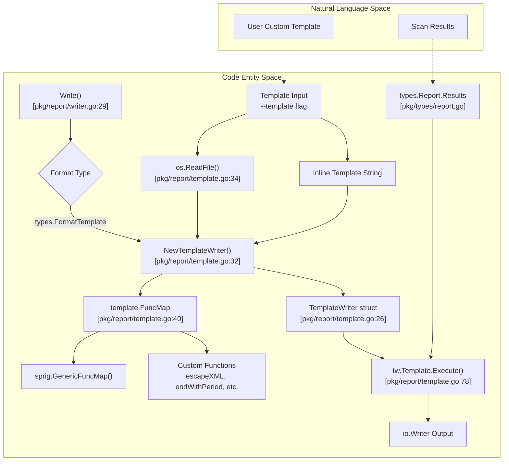
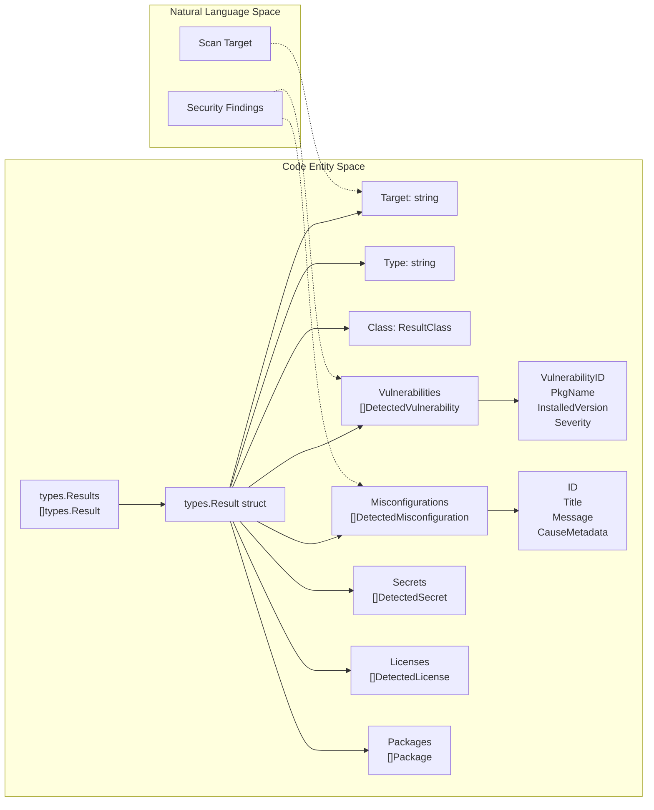
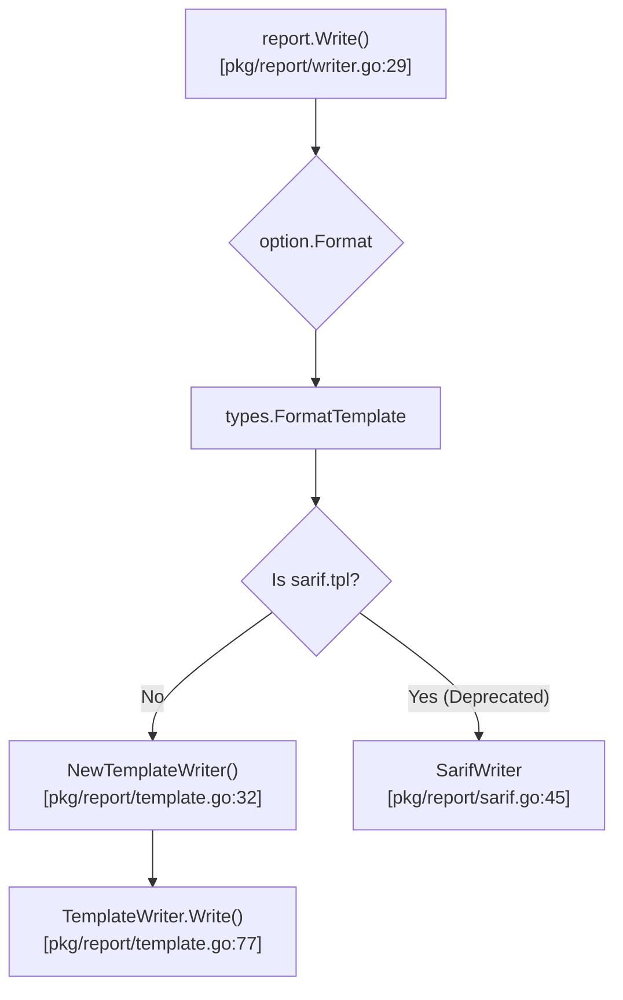

<!-- source: DeepWiki mcp.deepwiki.com · repo aquasecurity/trivy · page 7.3 Template-Based Custom Reports · fetched 2026-10-30 -->

# Template-Based Custom Reports

<details>
<summary>Relevant source files</summary>

The following files were used as context for generating this wiki page:

- [contrib/asff.tpl](contrib/asff.tpl)
- [contrib/gitlab-codequality.tpl](contrib/gitlab-codequality.tpl)
- [contrib/gitlab.tpl](contrib/gitlab.tpl)
- [contrib/junit.tpl](contrib/junit.tpl)
- [docs/imgs/gitlab-codequality.png](docs/imgs/gitlab-codequality.png)
- [integration/testdata/alpine-310.asff.golden](integration/testdata/alpine-310.asff.golden)
- [integration/testdata/alpine-310.gitlab-codequality.golden](integration/testdata/alpine-310.gitlab-codequality.golden)
- [integration/testdata/alpine-310.gitlab.golden](integration/testdata/alpine-310.gitlab.golden)
- [integration/testdata/alpine-310.junit.golden](integration/testdata/alpine-310.junit.golden)
- [integration/testdata/alpine-310.sarif.golden](integration/testdata/alpine-310.sarif.golden)
- [integration/testdata/npm.gitlab.golden](integration/testdata/npm.gitlab.golden)
- [integration/testdata/secrets.asff.golden](integration/testdata/secrets.asff.golden)
- [pkg/commands/convert/run.go](pkg/commands/convert/run.go)
- [pkg/fanal/types/package.go](pkg/fanal/types/package.go)
- [pkg/report/export_test.go](pkg/report/export_test.go)
- [pkg/report/json.go](pkg/report/json.go)
- [pkg/report/json_test.go](pkg/report/json_test.go)
- [pkg/report/sarif.go](pkg/report/sarif.go)
- [pkg/report/sarif_test.go](pkg/report/sarif_test.go)
- [pkg/report/template.go](pkg/report/template.go)
- [pkg/report/template_test.go](pkg/report/template_test.go)
- [pkg/report/writer.go](pkg/report/writer.go)
- [pkg/report/writer_test.go](pkg/report/writer_test.go)

</details>


## Purpose and Scope

This document covers Trivy's template-based report generation system, which allows users to define custom output formats using Go templates. Templates provide flexibility to generate reports in any text-based format (XML, HTML, custom JSON structures, etc.) that is not covered by Trivy's built-in formats.

For built-in report formats like JSON and table output, see [Report Writers and Format Selection](7.1). For SARIF-specific output, see [SARIF Output for Security Tools](7.2).

---

## Template System Overview

The template system in Trivy allows users to specify custom output formats through Go's `text/template` package, enhanced with the Sprig function library. Templates receive scan results and can iterate over vulnerabilities, misconfigurations, secrets, and licenses to produce formatted output.

**Template Writer Architecture**



**Sources:** [pkg/report/writer.go:29-109](), [pkg/report/template.go:26-83]()

---

## Template Specification

### Inline Templates

Templates can be specified directly on the command line using the `--template` flag. The CLI orchestration passes this string to the `NewTemplateWriter`.

```bash
trivy image --format template --template '{{ range . }}{{ .Target }}{{ end }}' alpine:3.14
```

### File-Based Templates

Templates can be loaded from files by prefixing the path with `@`. The `NewTemplateWriter` function handles this by stripping the prefix and reading the file from disk.

```bash
trivy image --format template --template @/path/to/template.tpl alpine:3.14
```

The `@` prefix triggers file reading at [pkg/report/template.go:33-39](), where the template content is loaded using `os.ReadFile()`.

**Sources:** [pkg/report/template.go:32-39]()

---

## Data Model Available to Templates

Templates receive `types.Report.Results` (type `types.Results`), which is a slice of `types.Result` structures. Each result contains scan findings for a specific target.

**Template Data Mapping**



**Sources:** [pkg/report/template.go:77-78](), [pkg/types/report.go](), [pkg/fanal/types/package.go]()

### Result Structure Fields

| Field | Type | Description |
|-------|------|-------------|
| `Target` | `string` | The target being scanned (e.g., image name, file path) [pkg/types/report.go]() |
| `Type` | `string` | Type of target (e.g., "alpine", "terraform") |
| `Class` | `ResultClass` | Classification: OSPkg, LangPkg, Config, Secret, License |
| `Vulnerabilities` | `[]DetectedVulnerability` | List of vulnerabilities found [pkg/types/report.go]() |
| `Misconfigurations` | `[]DetectedMisconfiguration` | List of misconfigurations found |
| `Secrets` | `[]DetectedSecret` | List of secrets found |
| `Licenses` | `[]DetectedLicense` | List of license findings |
| `Packages` | `[]Package` | All packages in the artifact [pkg/fanal/types/package.go]() |

**Sources:** [pkg/report/template.go:77-82](), [pkg/report/writer_test.go:20-93]()

---

## Template Functions

Templates have access to all Sprig functions plus custom Trivy-specific functions defined in the `templateFuncMap`.

### Custom Trivy Functions

| Function | Implementation | Purpose | Definition |
|----------|----------------|---------|------------|
| `escapeXML` | `xml.EscapeText` | Escapes XML special characters | [pkg/report/template.go:41-48]() |
| `endWithPeriod` | `strings.HasSuffix` | Ensures string ends with a period | [pkg/report/template.go:49-54]() |
| `escapeString` | `html.EscapeString` | HTML escapes string | [pkg/report/template.go:55]() |
| `sourceID` | `dbTypes.SourceID` | Casts string to SourceID type | [pkg/report/template.go:56-58]() |
| `appVersion` | `func() string` | Returns Trivy version string | [pkg/report/template.go:59-61]() |

**Sources:** [pkg/report/template.go:40-61]()

---

## Built-in Contrib Templates

Trivy provides several reference templates in the `contrib/` directory that demonstrate advanced usage.

### ASFF (AWS Security Finding Format)
The ASFF template converts Trivy findings into JSON compatible with AWS Security Hub. It uses `regexFind` to truncate image names and `escapeString` for descriptions.
- **Vulnerabilities:** Maps CVEs to `Software and Configuration Checks/Vulnerabilities/CVE`.
- **Misconfigurations:** Maps findings to `Software and Configuration Checks`.
- **Secrets:** Maps to `Sensitive Data Identifications`.

**Sources:** [contrib/asff.tpl:1-161]()

### GitLab Templates
Trivy supports GitLab's security dashboard through custom templates:
- **GitLab Container Scanning:** Maps vulnerabilities to the GitLab schema version 15.0.7 [contrib/gitlab.tpl:1-113]().
- **GitLab Code Quality:** Converts findings into a JSON array of issues with fingerprints [contrib/gitlab-codequality.tpl:1-104]().

### JUnit XML
Used for CI/CD integration, this template creates `<testsuite>` entries for each scan target and `<testcase>` entries for each finding.
- **Vulnerabilities:** [contrib/junit.tpl:11-15]()
- **Misconfigurations:** Includes `CauseMetadata` like line numbers and code snippets [contrib/junit.tpl:29-51]().

---

## Integration and Dispatch

The `report.Write` function acts as the entry point for all report generation.



**Sources:** [pkg/report/writer.go:82-94](), [pkg/report/sarif.go:128-181]()

### Backward Compatibility
Trivy maintains a special check for the legacy `sarif.tpl` template. If a user provides `--template @sarif.tpl`, Trivy logs a warning and redirects execution to the dedicated `SarifWriter` instead of the generic `TemplateWriter`.

**Sources:** [pkg/report/writer.go:84-91]()

---

## Template Execution Flow

1. **Initialization:** `NewTemplateWriter` reads the template source (inline or file) [pkg/report/template.go:32]().
2. **Function Mapping:** Sprig functions and custom functions (`escapeXML`, etc.) are registered [pkg/report/template.go:40-61]().
3. **Parsing:** The template is parsed into a `text/template.Template` object [pkg/report/template.go:66]().
4. **Execution:** The `Write` method executes the template against `report.Results` [pkg/report/template.go:78]().

**Sources:** [pkg/report/template.go:26-83]()

---

