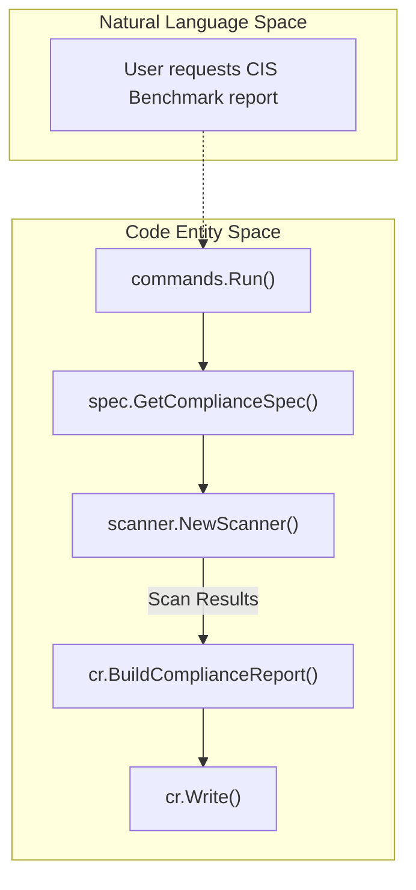
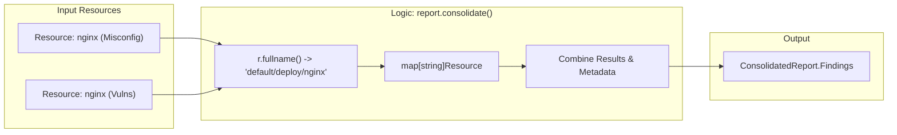

<!-- source: DeepWiki mcp.deepwiki.com · repo aquasecurity/trivy · page 7.4 Compliance and Summary Reports · fetched 2026-10-30 -->

# Compliance and Summary Reports

<details>
<summary>Relevant source files</summary>

The following files were used as context for generating this wiki page:

- [pkg/compliance/report/report_test.go](pkg/compliance/report/report_test.go)
- [pkg/compliance/spec/compliance.go](pkg/compliance/spec/compliance.go)
- [pkg/compliance/spec/compliance_test.go](pkg/compliance/spec/compliance_test.go)
- [pkg/compliance/spec/custom.go](pkg/compliance/spec/custom.go)
- [pkg/compliance/spec/mapper.go](pkg/compliance/spec/mapper.go)
- [pkg/compliance/spec/mapper_test.go](pkg/compliance/spec/mapper_test.go)
- [pkg/compliance/spec/testdata/testcache/policy/content/specs/compliance/invalid.yaml](pkg/compliance/spec/testdata/testcache/policy/content/specs/compliance/invalid.yaml)
- [pkg/compliance/spec/testdata/testcache/policy/content/specs/compliance/testspec.yaml](pkg/compliance/spec/testdata/testcache/policy/content/specs/compliance/testspec.yaml)
- [pkg/compliance/spec/testdata/testcache/policy/metadata.json](pkg/compliance/spec/testdata/testcache/policy/metadata.json)
- [pkg/flag/kubernetes_flags.go](pkg/flag/kubernetes_flags.go)
- [pkg/k8s/commands/cluster.go](pkg/k8s/commands/cluster.go)
- [pkg/k8s/commands/run.go](pkg/k8s/commands/run.go)
- [pkg/k8s/report/report.go](pkg/k8s/report/report.go)
- [pkg/k8s/report/report_test.go](pkg/k8s/report/report_test.go)
- [pkg/k8s/report/summary.go](pkg/k8s/report/summary.go)
- [pkg/k8s/report/summary_test.go](pkg/k8s/report/summary_test.go)
- [pkg/k8s/report/table.go](pkg/k8s/report/table.go)
- [pkg/k8s/scanner/scanner.go](pkg/k8s/scanner/scanner.go)
- [pkg/k8s/writer_test.go](pkg/k8s/writer_test.go)

</details>


## Purpose and Scope

This document covers two specialized reporting mechanisms in Trivy:

1.  **Compliance Reports**: Reports generated against compliance specifications (e.g., CIS benchmarks, NSA guidelines) that map security findings to compliance controls.
2.  **Summary Reports**: Consolidated and simplified views of scan results, particularly for Kubernetes cluster scans that aggregate findings across multiple resources.

For information about basic report formats (JSON, SARIF, table, etc.), see [Report Writers and Format Selection](7.1). For custom template-based reports, see [Template-Based Custom Reports](7.3).

## Compliance Report Generation

### Activation and Dispatch

Compliance reporting is activated when `option.Compliance.Spec.ID` is non-empty. In Kubernetes scans, the `runner.run` function checks if a compliance spec is provided. If so, it extracts the required scanners from the specification and overrides the default scan options [pkg/k8s/commands/run.go:72-78]().

The `runner` then executes the scan and processes the results into a compliance-specific report:

```go
pkg/k8s/commands/run.go:92-106
	if r.flagOpts.Compliance.Spec.ID != "" {
		var scanResults []types.Results
		for _, rss := range rpt.Resources {
			scanResults = append(scanResults, rss.Results)
		}
		complianceReport, err := cr.BuildComplianceReport(scanResults, r.flagOpts.Compliance)
		if err != nil {
			return xerrors.Errorf("compliance report build error: %w", err)
		}
		return cr.Write(ctx, complianceReport, cr.Option{
			Format: r.flagOpts.Format,
			Report: r.flagOpts.ReportFormat,
			Output: output,
		})
	}
```

**Diagram: Compliance Report Flow**



Sources: [pkg/k8s/commands/run.go:72-106](), [pkg/compliance/spec/compliance.go:98-132]()

### Scanner Selection for Compliance

The `ComplianceSpec` determines which scanners are necessary by inspecting the prefixes of the check IDs defined in the controls [pkg/compliance/spec/compliance.go:33-45]().

| Check ID Prefix | Resulting Scanner |
| :--- | :--- |
| `cve-`, `dla-`, `vuln-` | `types.VulnerabilityScanner` |
| `secret-` | `types.SecretScanner` |
| `avd-`, `ksv-`, `kcv-`, `kube-` | `types.MisconfigScanner` |

Sources: [pkg/compliance/spec/compliance.go:59-74](), [pkg/compliance/spec/compliance.go:76-80]()

## Summary Reports for Kubernetes

### Report Types

Kubernetes reports support two primary modes via the `--report` flag [pkg/k8s/report/report.go:21-22]():

| Report Type | Constant | Description |
| :--- | :--- | :--- |
| `summary` | `SummaryReport` | Consolidated table with severity counts per resource. |
| `all` | `AllReport` | Detailed findings for every resource scanned. |

The `TableWriter` dispatches to the appropriate logic based on this selection [pkg/k8s/report/table.go:54-82]().

### Report Consolidation

The `consolidate()` method merges findings from multiple resources with the same namespace, kind, and name. This is essential in Kubernetes where a single workload (e.g., a Deployment) might yield multiple `Resource` objects (one for misconfigurations and one for each container image vulnerability) [pkg/k8s/report/report.go:82-129]().

**Diagram: K8s Report Consolidation Logic**



Sources: [pkg/k8s/report/report.go:82-129](), [pkg/k8s/report/report.go:68-70]()

### Summary Writer Implementation

The `SummaryWriter` generates a table with severity counts. It uses `accumulateSeverityCounts` to traverse the results and tally vulnerabilities, misconfigurations, and secrets by their severity level [pkg/k8s/report/summary.go:164-183]().

The writer configures headers dynamically based on the enabled scanners and required severities [pkg/k8s/report/summary.go:185-213]().

Sources: [pkg/k8s/report/summary.go:19-36](), [pkg/k8s/report/summary.go:66-126]()

## Report Separation by Component Type

Trivy categorizes Kubernetes findings into three distinct assessments to improve readability [pkg/k8s/report/report.go:145-208]():

1.  **Workload Assessment**: General applications and services.
2.  **Infra Assessment**: Core components in the `kube-system` namespace or node-level findings (e.g., `NodeInfo`, `NodeComponents`) [pkg/k8s/report/report.go:219-221]().
3.  **RBAC Assessment**: Security checks for `Role`, `ClusterRole`, and their respective bindings [pkg/k8s/report/report.go:210-217]().

### Column Configuration

Each assessment type uses a specific set of columns for the summary table [pkg/k8s/report/table.go:34-52]():

| Assessment | Columns |
| :--- | :--- |
| Workload | Vulnerabilities, Misconfigurations, Secrets |
| Infra | Vulnerabilities, Misconfigurations, Secrets |
| RBAC | RBAC Assessment |

Sources: [pkg/k8s/report/report.go:145-208](), [pkg/k8s/report/table.go:25-32]()

## Validation and Requirements

### Report Format Validation

To prevent terminal "flooding," Trivy enforces a validation rule: full-cluster scanning with `--format table` requires an explicit `--report all` flag. If not set, it defaults to a warning suggesting the summary report [pkg/k8s/commands/run.go:132-143]().

```go
pkg/k8s/commands/run.go:132-140
func validateReportArguments(opts flag.Options) error {
	if opts.ReportFormat == "all" &&
		!viper.IsSet("report") &&
		opts.Format == "table" {

		m := "All the results in the table format can mess up your terminal. Use \"--report all\" to tell Trivy to output it to your terminal anyway, or consider \"--report summary\" to show the summary output."

		return xerrors.New(m)
	}
```

Sources: [pkg/k8s/commands/run.go:132-143]()

---

