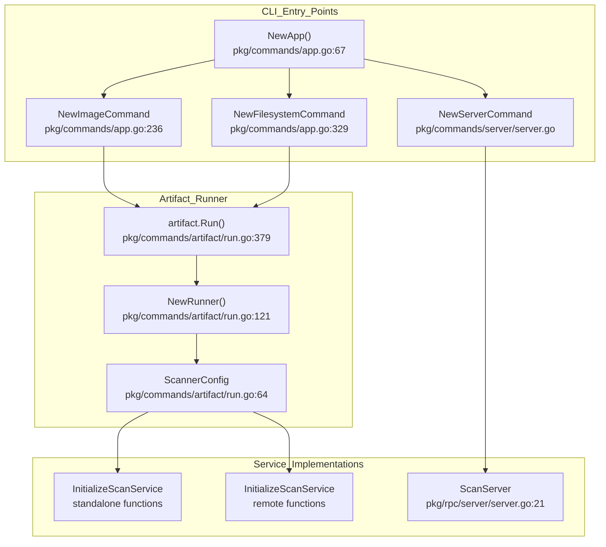
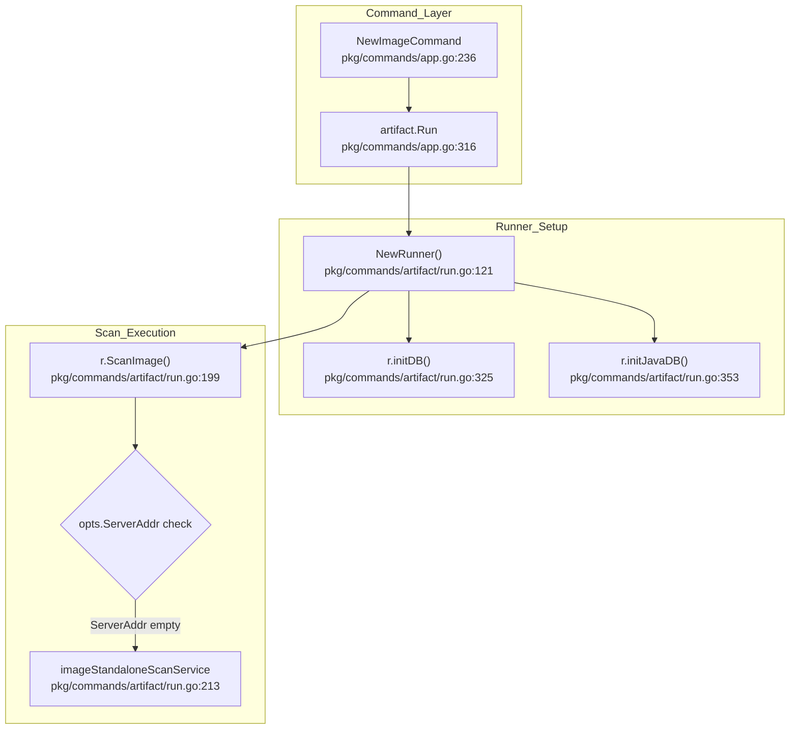
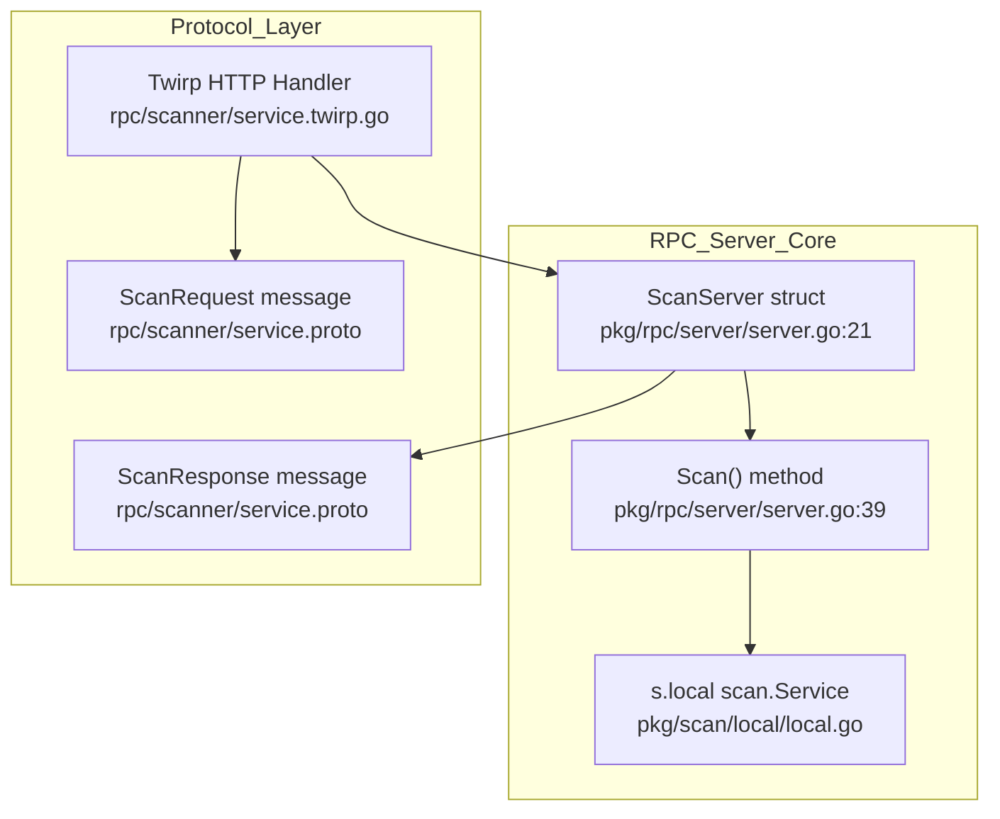
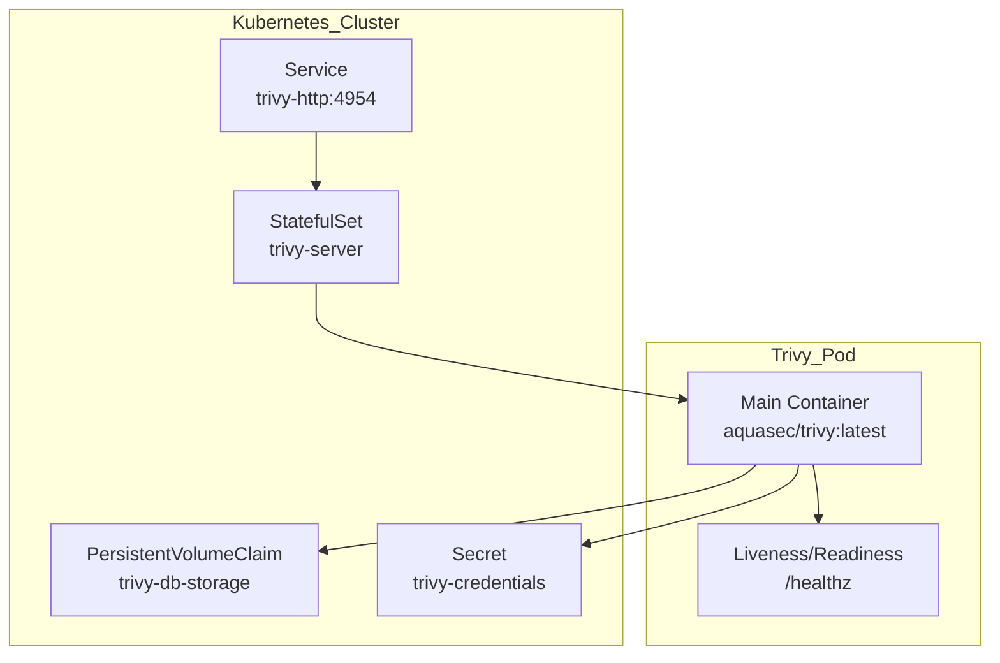

<!-- source: DeepWiki mcp.deepwiki.com · repo aquasecurity/trivy · page 8 Deployment Models · fetched 2026-10-30 -->

# Deployment Models

Relevant source files

The following files were used as context for generating this wiki page:

- [helm/trivy/.helmignore](helm/trivy/.helmignore)
- [helm/trivy/Chart.yaml](helm/trivy/Chart.yaml)
- [helm/trivy/README.md](helm/trivy/README.md)
- [helm/trivy/templates/NOTES.txt](helm/trivy/templates/NOTES.txt)
- [helm/trivy/templates/_helpers.tpl](helm/trivy/templates/_helpers.tpl)
- [helm/trivy/templates/configmap.yaml](helm/trivy/templates/configmap.yaml)
- [helm/trivy/templates/ingress.yaml](helm/trivy/templates/ingress.yaml)
- [helm/trivy/templates/podsecuritypolicy.yaml](helm/trivy/templates/podsecuritypolicy.yaml)
- [helm/trivy/templates/role.yaml](helm/trivy/templates/role.yaml)
- [helm/trivy/templates/rolebinding.yaml](helm/trivy/templates/rolebinding.yaml)
- [helm/trivy/templates/secret.yaml](helm/trivy/templates/secret.yaml)
- [helm/trivy/templates/service.yaml](helm/trivy/templates/service.yaml)
- [helm/trivy/templates/serviceaccount.yaml](helm/trivy/templates/serviceaccount.yaml)
- [helm/trivy/templates/statefulset.yaml](helm/trivy/templates/statefulset.yaml)
- [helm/trivy/values.yaml](helm/trivy/values.yaml)
- [integration/client_server_test.go](integration/client_server_test.go)
- [integration/docker_engine_test.go](integration/docker_engine_test.go)
- [integration/integration_test.go](integration/integration_test.go)
- [integration/registry_test.go](integration/registry_test.go)
- [integration/repo_test.go](integration/repo_test.go)
- [integration/sbom_test.go](integration/sbom_test.go)
- [integration/standalone_tar_test.go](integration/standalone_tar_test.go)
- [integration/testdata/fixtures/db/vulnerability.yaml](integration/testdata/fixtures/db/vulnerability.yaml)
- [integration/testdata/fluentd-multiple-lockfiles.json.golden](integration/testdata/fluentd-multiple-lockfiles.json.golden)
- [pkg/cache/remote.go](pkg/cache/remote.go)
- [pkg/cache/remote_test.go](pkg/cache/remote_test.go)
- [pkg/rpc/client/client.go](pkg/rpc/client/client.go)
- [pkg/rpc/client/client_test.go](pkg/rpc/client/client_test.go)
- [pkg/rpc/convert.go](pkg/rpc/convert.go)
- [pkg/rpc/convert_test.go](pkg/rpc/convert_test.go)
- [pkg/rpc/server/server.go](pkg/rpc/server/server.go)
- [pkg/rpc/server/server_test.go](pkg/rpc/server/server_test.go)
- [rpc/cache/service.pb.go](rpc/cache/service.pb.go)
- [rpc/cache/service.proto](rpc/cache/service.proto)
- [rpc/cache/service.twirp.go](rpc/cache/service.twirp.go)
- [rpc/common/service.pb.go](rpc/common/service.pb.go)
- [rpc/common/service.proto](rpc/common/service.proto)
- [rpc/scanner/service.pb.go](rpc/scanner/service.pb.go)
- [rpc/scanner/service.proto](rpc/scanner/service.proto)
- [rpc/scanner/service.twirp.go](rpc/scanner/service.twirp.go)

This document covers the different ways Trivy can be deployed and operated in various environments. It focuses on the architectural patterns, configuration options, and code structures that enable each deployment model.

For information about specific target types and scanning capabilities, see [Scanning Capabilities](#4). For detailed CLI command reference, see [CLI Reference](#2).

## Overview

Trivy supports multiple deployment models that affect how scanning services are initialized and executed. The deployment model determines whether scanning occurs locally or remotely, how databases are managed, and which service implementations are used.

### Core Service Selection Logic

The deployment model is primarily determined by the `ServerAddr` configuration option, which controls service initialization throughout the scanning pipeline.

**Diagram: Command Flow and Service Selection**

**Sources:** [pkg/commands/app.go:67-115](), [pkg/commands/artifact/run.go:64-77](), [pkg/commands/artifact/run.go:121-174](), [pkg/rpc/server/server.go:21-48]()

### Deployment Mode Detection

The deployment mode is determined by examining the `opts.ServerAddr` and `opts.Listen` fields during service initialization:

| Condition | Service Type | Implementation |
|-----------|-------------|----------------|
| `opts.ServerAddr == ""` | Standalone | Local scanning with embedded database |
| `opts.ServerAddr != ""` | Client | Remote scanning via RPC using `client.Scanner` |
| `opts.Listen != ""` | Server | RPC server hosting scan services via `server.ScanServer` |

**Sources:** [pkg/commands/artifact/run.go:199-220](), [pkg/commands/artifact/run.go:222-248]()

## Standalone Mode

Standalone mode operates as a single binary with embedded scanning services and local database management. It is the default mode of operation where Trivy performs analysis, vulnerability matching, and reporting on the same machine.

For details, see [Standalone Mode](#8.1).

### Service Initialization Architecture

The standalone mode uses target-specific service initializers that embed all scanning functionality, including database initialization through `r.initDB()` [pkg/commands/artifact/run.go:325]().

**Diagram: Standalone Service Initialization Flow**

**Sources:** [pkg/commands/artifact/run.go:121-174](), [pkg/commands/artifact/run.go:199-220](), [pkg/commands/artifact/run.go:325-376]()

## Client-Server Architecture

The client-server model splits scanning into a centralized `ScanServer` and lightweight clients. This model is useful for CI/CD environments where you want to avoid downloading the vulnerability database on every build agent.

For details, see [Client-Server Architecture](#8.2).

### Server Implementation

The server is implemented through the `ScanServer` struct [pkg/rpc/server/server.go:21]() which wraps a local scanning backend and exposes it via RPC. It supports authentication via `serverToken` [helm/trivy/values.yaml:125]().

**Diagram: RPC Server Architecture**

**Sources:** [pkg/rpc/server/server.go:21-56](), [rpc/scanner/service.proto:1-50](), [integration/client_server_test.go:43-100]()

### RPC Protocol Structure

The RPC protocol uses Protocol Buffers (protobuf) for message serialization and Twirp for HTTP-based RPC. The conversion layer in `pkg/rpc/convert.go` translates between internal Trivy types and protobuf messages.

| Internal Type | RPC Message | Conversion Function |
|---------------|-------------|---------------------|
| `ftypes.Package` | `common.Package` | `ConvertToRPCPkgs` [pkg/rpc/convert.go:54]() |
| `ftypes.Secret` | `common.Secret` | `ConvertToRPCSecrets` [pkg/rpc/convert.go:151]() |
| `ftypes.Location` | `common.Location` | `ConvertToRPCLocations` [pkg/rpc/convert.go:101]() |

**Sources:** [pkg/rpc/convert.go:54-160](), [rpc/common/service.proto:33-71]()

## Kubernetes Deployment with Helm

Trivy can be deployed as a managed service within Kubernetes using the official Helm chart. This deployment typically runs Trivy in **Server Mode**.

For details, see [Kubernetes Deployment with Helm](#8.3).

### Helm Chart Resources

The Helm chart [helm/trivy/Chart.yaml]() bootstraps a `StatefulSet` [helm/trivy/templates/statefulset.yaml:2]() to provide persistent storage for the vulnerability database.

**Diagram: Kubernetes Deployment Components**

**Sources:** [helm/trivy/values.yaml:15-59](), [helm/trivy/templates/statefulset.yaml:100-120](), [helm/trivy/templates/service.yaml:1-10]()

### Configuration Parameters

Key configuration options in `values.yaml` include:
* `trivy.cache.redis`: Support for Redis as a distributed caching backend [helm/trivy/values.yaml:113]().
* `persistence.enabled`: Enables `PersistentVolumeClaim` to reduce DB downloads [helm/trivy/values.yaml:16]().
* `podSecurityContext`: Configures non-root execution (default UID 65534) [helm/trivy/values.yaml:34]().

**Sources:** [helm/trivy/values.yaml:15-133](), [helm/trivy/README.md:105-112]()

---

