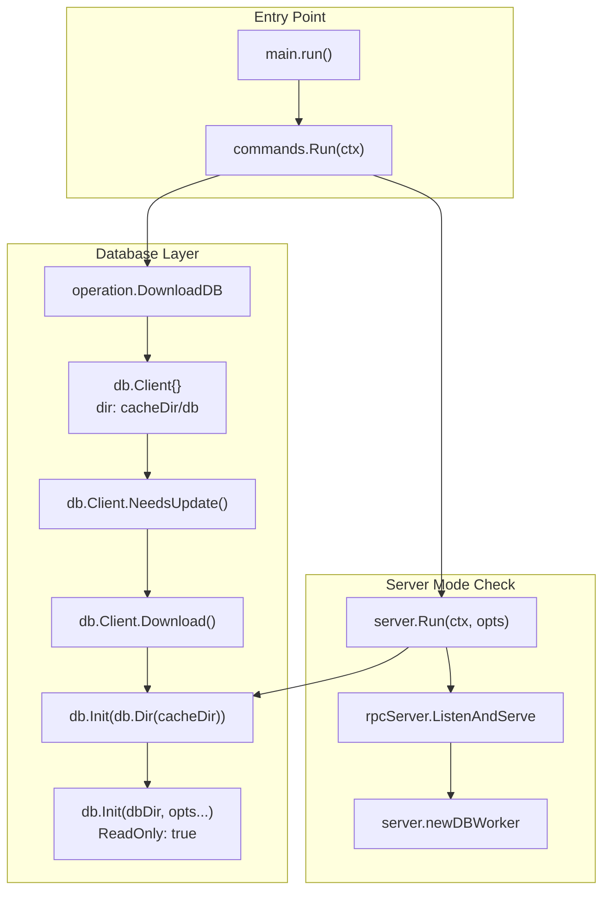
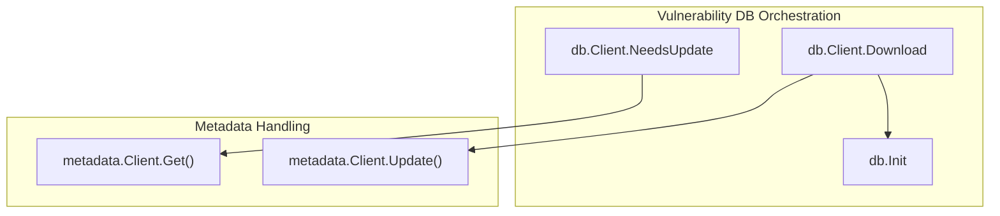
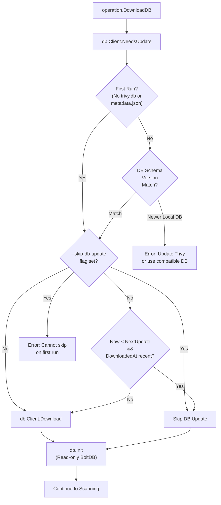
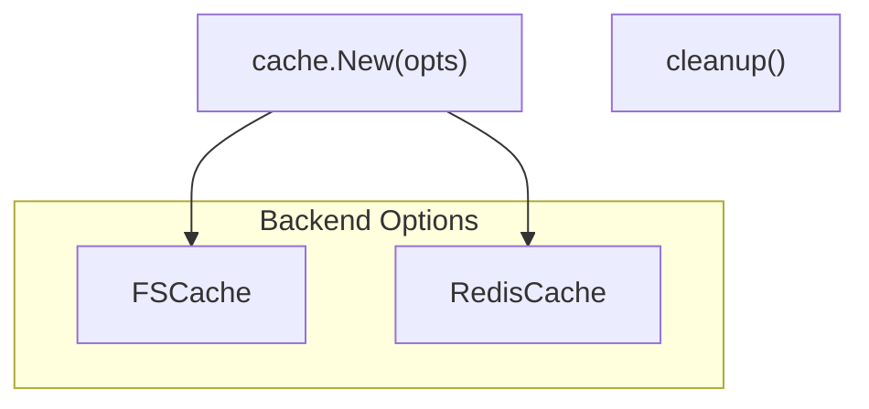
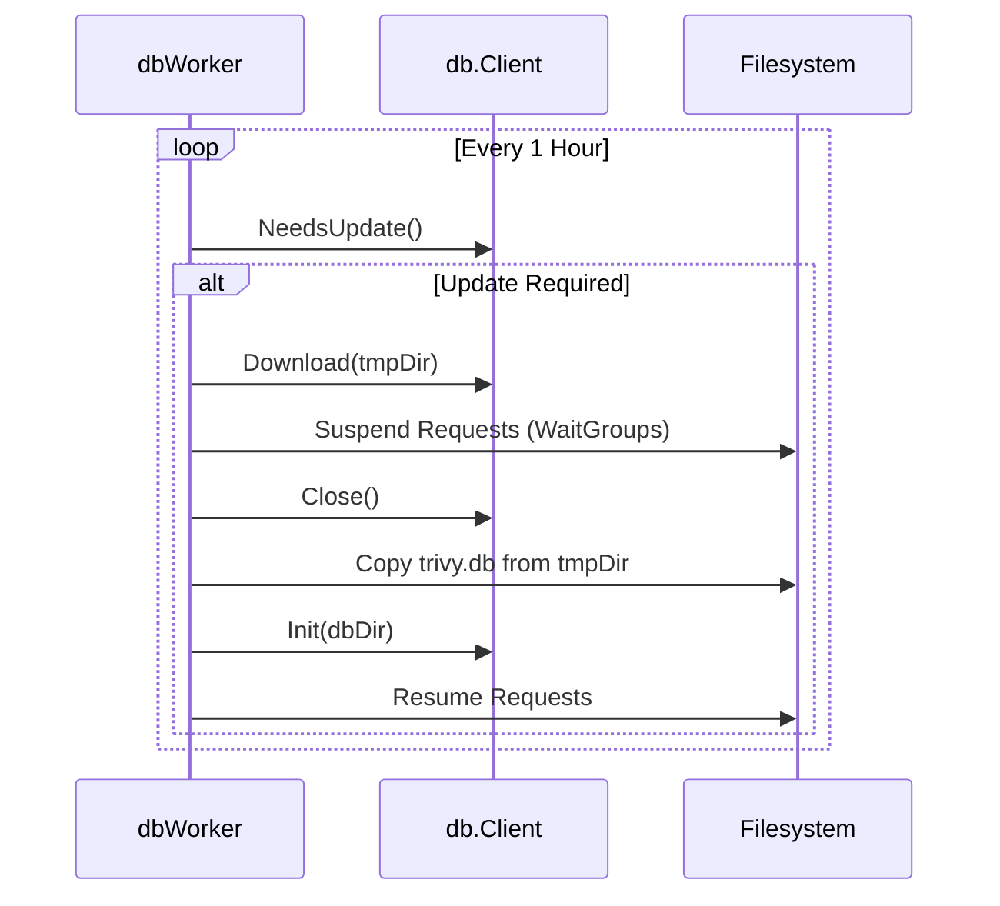

<!-- source: DeepWiki mcp.deepwiki.com · repo aquasecurity/trivy · page 8.1 Standalone Mode · fetched 2026-10-30 -->

# Standalone Mode

<details>
<summary>Relevant source files</summary>

The following files were used as context for generating this wiki page:

- [cmd/trivy/main.go](cmd/trivy/main.go)
- [integration/client_server_test.go](integration/client_server_test.go)
- [integration/docker_engine_test.go](integration/docker_engine_test.go)
- [integration/integration_test.go](integration/integration_test.go)
- [integration/registry_test.go](integration/registry_test.go)
- [integration/repo_test.go](integration/repo_test.go)
- [integration/sbom_test.go](integration/sbom_test.go)
- [integration/standalone_tar_test.go](integration/standalone_tar_test.go)
- [integration/testdata/fixtures/db/vulnerability.yaml](integration/testdata/fixtures/db/vulnerability.yaml)
- [integration/testdata/fluentd-multiple-lockfiles.json.golden](integration/testdata/fluentd-multiple-lockfiles.json.golden)
- [internal/dbtest/db.go](internal/dbtest/db.go)
- [pkg/commands/operation/operation.go](pkg/commands/operation/operation.go)
- [pkg/commands/server/run.go](pkg/commands/server/run.go)
- [pkg/db/db.go](pkg/db/db.go)
- [pkg/db/db_test.go](pkg/db/db_test.go)
- [pkg/policy/policy.go](pkg/policy/policy.go)
- [pkg/policy/policy_test.go](pkg/policy/policy_test.go)
- [pkg/rpc/server/listen.go](pkg/rpc/server/listen.go)
- [pkg/rpc/server/listen_test.go](pkg/rpc/server/listen_test.go)
- [pkg/version/version.go](pkg/version/version.go)
- [pkg/version/version_test.go](pkg/version/version_test.go)

</details>


Standalone mode is Trivy's default deployment model where all scanning operations, vulnerability detection, and analysis occur within a single local process. This page explains how standalone mode operates, including database management, caching mechanisms, and the complete scanning workflow.

For information about distributed scanning using a remote Trivy server, see [Client/Server Architecture](8.2). For Kubernetes deployment with persistent services, see [Kubernetes Deployment with Helm](8.3).

## Overview

Standalone mode is Trivy's default deployment model where a single process executes all scanning operations locally. When `opts.ServerAddr` is empty (no `--server` flag provided), Trivy initializes the vulnerability database, artifact cache, and WASM modules within the local process, performs all analysis, and outputs results.

### Key Characteristics

| Aspect | Implementation |
|--------|---------------|
| **Mode Detection** | `opts.ServerAddr == ""` in service selection logic |
| **Database Location** | `<cacheDir>/db/trivy.db` (typically `~/.cache/trivy/db/`) |
| **Database Format** | BoltDB opened in read-only mode via `db.Init()` |
| **Database Updates** | Checked via `db.Client.NeedsUpdate()`, skipped with `--skip-db-update` |
| **Cache Backend** | `cache.TypeFS` (default), `cache.TypeRedis`, or `cache.TypeMemory` |
| **Process Lifecycle** | Created in `NewRunner()`, closed in `runner.Close()` |
| **Network Dependencies** | OCI registry for DB download, container registry for image pulls |
| **Scanner Execution** | All scanners execute via `local.Scanner` within the process |

Sources: [pkg/db/db.go:42-46](), [pkg/db/db.go:79-81](), [pkg/commands/operation/operation.go:31-33]()

## Architecture

### Standalone Mode Component Initialization

The following diagram shows how standalone mode initializes its components, mapping natural language concepts to actual code entities:



Sources: [cmd/trivy/main.go:34-51](), [pkg/commands/operation/operation.go:25-50](), [pkg/db/db.go:42-46](), [pkg/commands/server/run.go:19-63]()

### Service Selection and Workflow

Trivy uses `db.Client` to manage the local state of the vulnerability database. In standalone mode, this client is responsible for both checking the update status and performing the actual download from OCI registries.



Sources: [pkg/db/db.go:105-117](), [pkg/db/db.go:187-196](), [pkg/db/db.go:205-222]()

## Database Management

### Database Initialization Flow

Standalone mode ensures the vulnerability database is present and up-to-date before any scanning occurs. The logic is centralized in `pkg/db/db.go`.



Sources: [pkg/db/db.go:105-161](), [pkg/commands/operation/operation.go:25-50]()

### Local Database File Structure

Standalone mode stores all databases and caches in the local filesystem at `cacheDir`:

| Path | Purpose | Access Pattern |
|------|---------|---------------|
| `<cacheDir>/db/trivy.db` | Main vulnerability database (BoltDB) | Opened read-only via `db.Init()` |
| `<cacheDir>/db/metadata.json` | DB version, update times, next update schedule | Read by `metadata.NewClient()` |
| `<cacheDir>/fanal/` | Artifact analysis cache (layers, packages, configs) | Managed by cache system |
| `<cacheDir>/policy/` | Rego policy bundles | Managed by `policy.Client` |

Sources: [pkg/db/db.go:79-81](), [pkg/db/db.go:99](), [pkg/db/db.go:42-46](), [pkg/commands/operation/operation.go:31-33]()

### Database Update Logic

The `db.Client.NeedsUpdate` method determines if a database update is required by checking the local `metadata.json` against the expected `SchemaVersion`.

| Condition | Action | Logic Source |
|-----------|--------|--------------|
| `trivy.db` missing | Return `true` | [pkg/db/db.go:107-110]() |
| `metadata.json` missing | Return `true` | [pkg/db/db.go:111-117]() |
| `SchemaVersion` mismatch | Return `true` (if local is old) | [pkg/db/db.go:154-158]() |
| `NextUpdate` not reached | Return `false` | [pkg/db/db.go:173-177]() |
| Downloaded within 1 hour | Return `false` | [pkg/db/db.go:179-183]() |

Sources: [pkg/db/db.go:105-184]()

### Database Download Process

When an update is needed, Trivy downloads the database from OCI registries. The client defaults to GHCR and GCR mirrors.

**Default Repositories:**
- Primary: `mirror.gcr.io/aquasec/trivy-db:2`
- Fallback: `ghcr.io/aquasecurity/trivy-db:2`

Sources: [pkg/db/db.go:31-36](), [pkg/db/db.go:85-90](), [pkg/db/db.go:187-196]()

## Artifact Cache Management

### Cache Initialization

In standalone mode, the cache is initialized during command execution. While the CLI handles the setup, the underlying implementation can be Filesystem, Redis, or Memory based.



Sources: [pkg/commands/server/run.go:30-34](), [pkg/rpc/server/listen.go:63-69]()

## Server Mode DB Maintenance

Even when running as a server (which is technically a long-running standalone-like process for DB management), Trivy performs "hot updates" to ensure the database remains current without interrupting active requests.



Sources: [pkg/rpc/server/listen.go:74-97](), [pkg/rpc/server/listen.go:175-190](), [pkg/rpc/server/listen.go:192-227]()

## Configuration and Usage

### Standalone Command Execution
The main entry point for standalone operations is through the subcommands (image, fs, repo) which eventually call into `operation` and `db` packages.

```go
// Example of DB initialization in standalone/server startup
if err = db.Init(db.Dir(opts.CacheDir)); err != nil {
    return xerrors.Errorf("error in vulnerability DB initialize: %w", err)
}
```
Sources: [pkg/commands/server/run.go:46-48]()

### DB Update Functional Options
The `db.Client` can be configured using functional options to override default repositories or provide a pre-configured OCI artifact.

| Option | Function | Source |
|--------|----------|--------|
| `WithOCIArtifact` | Use a specific OCI artifact for download | [pkg/db/db.go:57-61]() |
| `WithDBRepository` | Override default OCI repositories | [pkg/db/db.go:64-68]() |

Sources: [pkg/db/db.go:53-68]()

---

