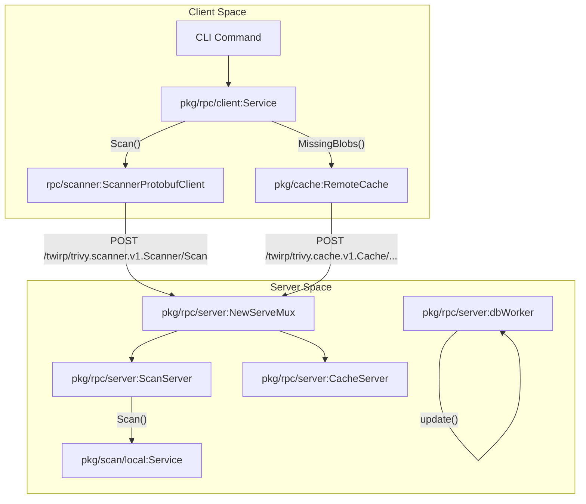
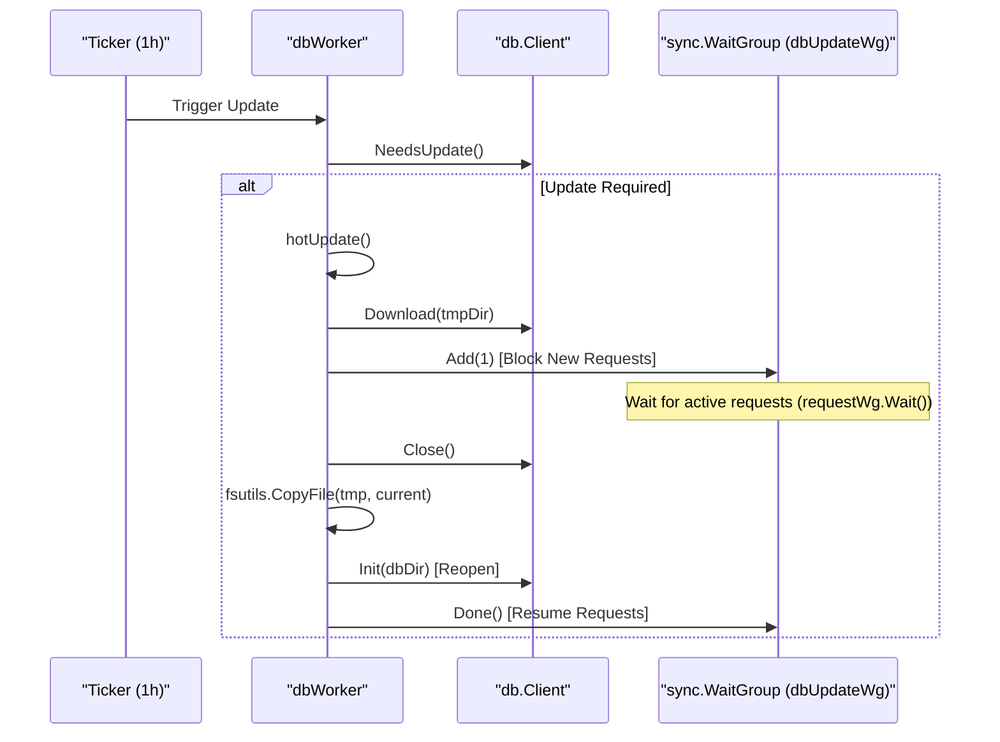
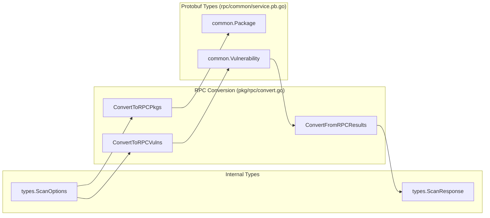

<!-- source: DeepWiki mcp.deepwiki.com · repo aquasecurity/trivy · page 8.2 Client-Server Architecture · fetched 2026-10-30 -->

# Client-Server Architecture

Relevant source files

The following files were used as context for generating this wiki page:

- [integration/client_server_test.go](integration/client_server_test.go)
- [integration/docker_engine_test.go](integration/docker_engine_test.go)
- [integration/integration_test.go](integration/integration_test.go)
- [integration/registry_test.go](integration/registry_test.go)
- [integration/repo_test.go](integration/repo_test.go)
- [integration/sbom_test.go](integration/sbom_test.go)
- [integration/standalone_tar_test.go](integration/standalone_tar_test.go)
- [integration/testdata/fixtures/db/vulnerability.yaml](integration/testdata/fixtures/db/vulnerability.yaml)
- [integration/testdata/fluentd-multiple-lockfiles.json.golden](integration/testdata/fluentd-multiple-lockfiles.json.golden)
- [pkg/cache/remote.go](pkg/cache/remote.go)
- [pkg/cache/remote_test.go](pkg/cache/remote_test.go)
- [pkg/commands/operation/operation.go](pkg/commands/operation/operation.go)
- [pkg/commands/server/run.go](pkg/commands/server/run.go)
- [pkg/policy/policy.go](pkg/policy/policy.go)
- [pkg/policy/policy_test.go](pkg/policy/policy_test.go)
- [pkg/rpc/client/client.go](pkg/rpc/client/client.go)
- [pkg/rpc/client/client_test.go](pkg/rpc/client/client_test.go)
- [pkg/rpc/convert.go](pkg/rpc/convert.go)
- [pkg/rpc/convert_test.go](pkg/rpc/convert_test.go)
- [pkg/rpc/server/listen.go](pkg/rpc/server/listen.go)
- [pkg/rpc/server/listen_test.go](pkg/rpc/server/listen_test.go)
- [pkg/rpc/server/server.go](pkg/rpc/server/server.go)
- [pkg/rpc/server/server_test.go](pkg/rpc/server/server_test.go)
- [pkg/version/version.go](pkg/version/version.go)
- [pkg/version/version_test.go](pkg/version/version_test.go)
- [rpc/cache/service.pb.go](rpc/cache/service.pb.go)
- [rpc/cache/service.proto](rpc/cache/service.proto)
- [rpc/cache/service.twirp.go](rpc/cache/service.twirp.go)
- [rpc/common/service.pb.go](rpc/common/service.pb.go)
- [rpc/common/service.proto](rpc/common/service.proto)
- [rpc/scanner/service.pb.go](rpc/scanner/service.pb.go)
- [rpc/scanner/service.proto](rpc/scanner/service.proto)
- [rpc/scanner/service.twirp.go](rpc/scanner/service.twirp.go)

Trivy supports a client-server deployment model using RPC over HTTP. The server (`pkg/rpc/server`) maintains the vulnerability database and performs scans, while clients (`pkg/rpc/client`) submit scan requests and receive results. This architecture enables centralized database management, shared caching, and reduced client resource usage.

## Architecture Overview

Trivy's client-server mode separates concerns between two components:

**Server Component (`server.Server`)**
- Runs via `trivy server` command.
- Maintains local vulnerability database in `dbDir` [pkg/rpc/server/listen.go:37]().
- Exposes two RPC services: `Scanner` and `Cache` [pkg/rpc/server/listen.go:132-138]().
- Performs hot database updates every hour via `dbWorker` [pkg/rpc/server/listen.go:74-97]().
- Supports filesystem or Redis cache backends.

**Client Component (`client.Service`)**
- Runs via `trivy image --server <url>` or similar commands.
- Sends RPC requests to remote server via a Twirp-generated client [pkg/rpc/client/client.go:54]().
- Receives scan results over HTTP/Protobuf.
- Optionally uses `RemoteCache` for distributed caching [pkg/cache/remote.go:17]().

### Code Entity Map: Client-Server Interaction

The following diagram maps high-level architectural components to their specific implementation classes and functions.

Sources:
- [pkg/rpc/client/client.go:42-65]()
- [pkg/rpc/server/listen.go:32-60]()
- [pkg/rpc/server/server.go:29-48]()
- [pkg/commands/server/run.go:19-63]()

## Server Architecture

### Server Initialization

The server is initialized in `pkg/commands/server/run.go`. The logic involves downloading the DB via `operation.DownloadDB` [pkg/commands/operation/operation.go:25-50]() and initializing the server instance with `server.NewServer` [pkg/rpc/server/listen.go:48-60]().

### Server Struct and HTTP Endpoints

The `Server` struct [pkg/rpc/server/listen.go:32-45]() holds configuration and starts the HTTP server via `ListenAndServe`. It manages a `dbWorker` that triggers updates every `updateInterval` (1 hour) [pkg/rpc/server/listen.go:30]().

The HTTP server exposes multiple endpoints via `NewServeMux` [pkg/rpc/server/listen.go:109-155]():

| Endpoint | Handler | Purpose |
|----------|---------|---------|
| `/twirp/trivy.scanner.v1.Scanner/Scan` | `ScanServer` | Execute scans using `local.Service` |
| `/twirp/trivy.cache.v1.Cache/*` | `CacheServer` | Cache operations (PutArtifact, PutBlob, etc.) |
| `/healthz` | Inline Handler | Returns "ok" [pkg/rpc/server/listen.go:140-144]() |
| `/version` | Inline Handler | Returns `types.VersionInfo` [pkg/rpc/server/listen.go:146-152]() |

### Database Hot Update Worker

The `dbWorker` [pkg/rpc/server/listen.go:167-169]() ensures the server's vulnerability database stays current without downtime.

Sources:
- [pkg/rpc/server/listen.go:62-107]()
- [pkg/rpc/server/listen.go:109-155]()
- [pkg/rpc/server/listen.go:167-230]()
- [pkg/rpc/server/server.go:29-113]()

## Client Architecture

### Client Service Structure

The `client.Service` [pkg/rpc/client/client.go:42-47]() encapsulates the RPC communication. It uses `rpc.Scanner`, which is an interface generated by Twirp [rpc/scanner/service.twirp.go:34-40]().

### Scan Request Flow

When a client initiates a scan, it performs complex type conversion to bridge the internal domain models with the Protobuf definitions.

**Key Steps**:
1. **Option Mapping**: `client.Scan` maps severity sources and relationships [pkg/rpc/client/client.go:73-85]().
2. **RPC Call**: The request is sent via `s.client.Scan(ctx, in)` [pkg/rpc/client/client.go:90]().
3. **Response Processing**: The result is converted back using `rpc.ConvertFromRPCResults` [pkg/rpc/client/client.go:99]().

Sources:
- [pkg/rpc/client/client.go:42-113]()
- [pkg/rpc/convert.go:54-82]()
- [pkg/rpc/convert.go:1017-1041]()

## RPC Protocol and Message Definitions

### Twirp and Protobuf

Trivy uses Protobuf to define its service contracts. The `Scanner` service [rpc/scanner/service.proto:9-11]() and `Cache` service [rpc/cache/service.proto:11-16]() are the primary interfaces.

**Message Structures**:
- **Package**: Includes `id`, `name`, `version`, `purl`, and `locations` [rpc/common/service.proto:33-60]().
- **Vulnerability**: Includes `vulnerability_id`, `severity`, `cvss` maps, and `fixed_version` [rpc/common/service.proto:128-153]().
- **Misconfiguration**: Tracks `successes`, `warnings`, and `failures` with `cause_metadata` [rpc/common/service.proto:79-87]().

Sources:
- [rpc/scanner/service.proto:9-43]()
- [rpc/cache/service.proto:11-75]()
- [rpc/common/service.proto:33-153]()

## Authentication

Authentication is implemented via a shared secret (token) passed in an HTTP header.

### Server-Side Validation
The server uses `withToken` middleware [pkg/rpc/server/listen.go:157-165]() to intercept requests. If a `token` is configured, it compares the value in `r.Header.Get(tokenHeader)` with the expected secret. If they do not match, it returns a `twirp.Unauthenticated` error.

### Client-Side Injection
The client injects the token using `twirp.WithHTTPRequestHeaders` [pkg/rpc/client/client.go:111](). This is managed via `ServiceOption.CustomHeaders` passed during initialization.

Sources:
- [pkg/rpc/server/listen.go:157-165]()
- [pkg/rpc/client/client.go:105-113]()

## Distributed Caching

In client-server mode, the client does not usually store results locally. Instead, it interacts with a `RemoteCache`.

### RemoteCache Operations
The `RemoteCache` [pkg/cache/remote.go:17-21]() delegates calls to the server's `Cache` service:
- **MissingBlobs**: The client sends a list of layer digests to the server to determine which ones need to be uploaded [pkg/cache/remote.go:88-111]().
- **PutBlob**: Uploads analyzed layer information (packages, OS, etc.) to the server [pkg/cache/remote.go:75-86]().

### Server Cache Backend
The `CacheServer` [pkg/rpc/server/server.go:115-121]() stores this data in the server's local cache (either FS-based or Redis). This allows multiple clients to benefit from layers already analyzed by other clients.

Sources:
- [pkg/cache/remote.go:17-141]()
- [pkg/rpc/server/server.go:115-169]()
- [rpc/cache/service.proto:11-16]()

---

