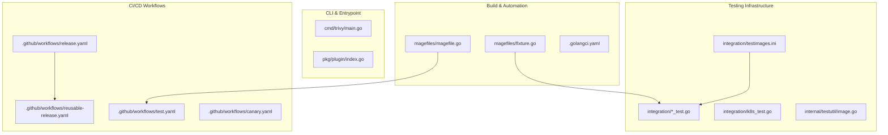
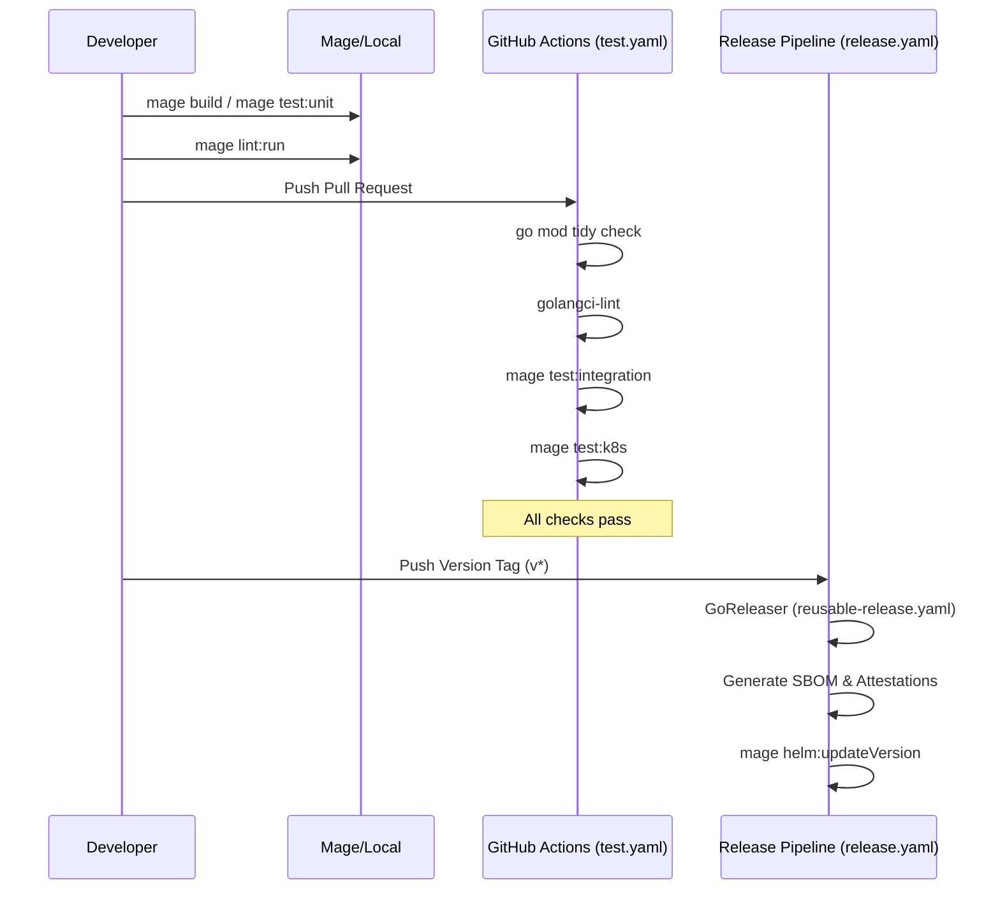

<!-- source: DeepWiki mcp.deepwiki.com · repo aquasecurity/trivy · page 9 Development and Contributing · fetched 2026-10-30 -->

# Development and Contributing

<details>
<summary>Relevant source files</summary>

The following files were used as context for generating this wiki page:

- [.github/DISCUSSION_TEMPLATE/adopters.yml](.github/DISCUSSION_TEMPLATE/adopters.yml)
- [.github/DISCUSSION_TEMPLATE/bugs.yml](.github/DISCUSSION_TEMPLATE/bugs.yml)
- [.github/DISCUSSION_TEMPLATE/documentation.yml](.github/DISCUSSION_TEMPLATE/documentation.yml)
- [.github/DISCUSSION_TEMPLATE/false-detection.yml](.github/DISCUSSION_TEMPLATE/false-detection.yml)
- [.github/DISCUSSION_TEMPLATE/ideas.yml](.github/DISCUSSION_TEMPLATE/ideas.yml)
- [.github/DISCUSSION_TEMPLATE/q-a.yml](.github/DISCUSSION_TEMPLATE/q-a.yml)
- [.github/ISSUE_TEMPLATE/config.yml](.github/ISSUE_TEMPLATE/config.yml)
- [.github/pull_request_template.md](.github/pull_request_template.md)
- [.github/workflows/auto-update-labels.yaml](.github/workflows/auto-update-labels.yaml)
- [.github/workflows/backport.yaml](.github/workflows/backport.yaml)
- [.github/workflows/cache-test-assets.yaml](.github/workflows/cache-test-assets.yaml)
- [.github/workflows/canary.yaml](.github/workflows/canary.yaml)
- [.github/workflows/mkdocs-dev.yaml](.github/workflows/mkdocs-dev.yaml)
- [.github/workflows/mkdocs-latest.yaml](.github/workflows/mkdocs-latest.yaml)
- [.github/workflows/publish-chart.yaml](.github/workflows/publish-chart.yaml)
- [.github/workflows/release.yaml](.github/workflows/release.yaml)
- [.github/workflows/reusable-release.yaml](.github/workflows/reusable-release.yaml)
- [.github/workflows/scan.yaml](.github/workflows/scan.yaml)
- [.github/workflows/spdx-cron.yaml](.github/workflows/spdx-cron.yaml)
- [.github/workflows/stale-issues.yaml](.github/workflows/stale-issues.yaml)
- [.github/workflows/test-docs.yaml](.github/workflows/test-docs.yaml)
- [.github/workflows/test.yaml](.github/workflows/test.yaml)
- [.github/workflows/triage.yaml](.github/workflows/triage.yaml)
- [.golangci.yaml](.golangci.yaml)
- [CONTRIBUTING.md](CONTRIBUTING.md)
- [docs/community/contribute/discussion.md](docs/community/contribute/discussion.md)
- [docs/community/contribute/issue.md](docs/community/contribute/issue.md)
- [docs/community/maintainer/help-wanted.md](docs/community/maintainer/help-wanted.md)
- [docs/guide/configuration/filtering.md](docs/guide/configuration/filtering.md)
- [docs/guide/supply-chain/attestation/rekor.md](docs/guide/supply-chain/attestation/rekor.md)
- [docs/guide/target/container_image.md](docs/guide/target/container_image.md)
- [integration/k8s_test.go](integration/k8s_test.go)
- [integration/testdata/fixtures/k8s/summary-ids.json.golden](integration/testdata/fixtures/k8s/summary-ids.json.golden)
- [integration/testimages.ini](integration/testimages.ini)
- [internal/testutil/image.go](internal/testutil/image.go)
- [magefiles/fixture.go](magefiles/fixture.go)
- [magefiles/magefile.go](magefiles/magefile.go)
- [pkg/attestation/attestation_test.go](pkg/attestation/attestation_test.go)
- [pkg/fanal/artifact/sbom/testdata/sbom.cdx.intoto.jsonl](pkg/fanal/artifact/sbom/testdata/sbom.cdx.intoto.jsonl)
- [pkg/plugin/index.go](pkg/plugin/index.go)

</details>


This page provides an overview of the Trivy development process and guidelines for contributors. It covers the essential information needed to get started with Trivy development, including setup, workflow, and contribution guidelines.

For detailed information on specific topics, refer to the following pages:
- **[Build System and Mage Automation](#9.1)**: Details on the Mage build system, available targets, and local development setup.
- **[Testing Strategy and Infrastructure](#9.2)**: Comprehensive coverage of test types, fixtures, and testing practices.
- **[Release Process and Distribution](#9.3)**: Information on the release workflow, multi-platform builds, and distribution channels.

## Getting Started

### Prerequisites

Trivy development requires the following tools:

| Tool | Purpose | Version | Notes |
|------|---------|---------|-------|
| **Go** | Primary development language | 1.25+ | Required (defined in `go.mod` and CI) |
| **Mage** | Build automation via `magefile.go` | Latest | Installed via `go install tool` |
| **Docker** | Container image testing | v29.2.1+ | Required for integration tests |
| **Git** | Version control | Latest | Required |

Optional tools for specific development tasks:
- **golangci-lint**: Linting via `.golangci.yaml` configuration (v2.10.0) [magefiles/magefile.go:78-78]()
- **buf**: Protocol Buffer code generation for RPC layer [magefiles/magefile.go:120-123]()
- **kind**: Kubernetes cluster for `mage test:k8s` [magefiles/magefile.go:231-231]()
- **python**: Documentation with MkDocs Material theme [docs/build/requirements.txt]()
- **skopeo**: Downloading and inspecting test container images [integration/testimages.ini]()
- **npm**: Installing Sass for documentation styling [magefiles/magefile.go:61-66]()

The `go install tool` command installs all Go-based tools defined in the codebase, including Mage, buf, and golangci-lint. [magefiles/magefile.go:111-114]()

Sources: [.github/workflows/test.yaml:26-31](), [.github/workflows/test.yaml:84-88](), [magefiles/magefile.go:27-35](), [magefiles/magefile.go:78-87](), [magefiles/magefile.go:111-114]()

### Quick Setup

**Clone and Install Tools**

```bash
# Clone the repository
git clone https://github.com/aquasecurity/trivy.git
cd trivy

# Install development tools (requires Go)
go install tool  # Installs mage and other required tools
```

**Build Trivy**

```bash
# Build the binary (output: ./trivy)
mage build

# Install to $GOBIN
mage install
```

The build process uses `ldflags` to inject version information from `git describe` into the application binary. [magefiles/magefile.go:50-56]()

**Run Tests**

```bash
# Run unit tests
mage test:unit

# Run integration tests (requires Docker)
mage test:integration

# Run Kubernetes tests (creates kind cluster)
mage test:k8s
```

Sources: [magefiles/magefile.go:217-231](), [magefiles/magefile.go:377-407](), [.github/workflows/test.yaml:55-56]()

### Repository Structure

**Codebase Mapping: Core Systems**



Sources: [magefiles/magefile.go:1-25](), [.github/workflows/test.yaml:1-15](), [integration/k8s_test.go:1-20](), [integration/testimages.ini]()

## Development Workflow Overview

**Development Lifecycle: From Code to Release**



### CI Job Matrix Strategy

The test workflow uses matrix builds to ensure cross-platform compatibility: [ .github/workflows/test.yaml:18-20 ]()

| Job | Platforms | Purpose |
|-----|-----------|---------|
| `test` | `ubuntu-latest`, `windows-latest`, `macos-latest` | Unit tests and linting. |
| `integration` | `ubuntu-latest` | System tests with Docker v29. [ .github/workflows/test.yaml:70-88 ]() |
| `k8s-integration` | `ubuntu-latest` | Kubernetes cluster scanning via KIND. [ .github/workflows/test.yaml:113-130 ]() |
| `module-test` | `ubuntu-latest` | WASM module integration tests. [ .github/workflows/test.yaml:131-164 ]() |
| `vm-test` | `ubuntu-latest` | Virtual Machine image scanning tests. [ .github/workflows/test.yaml:165-197 ]() |

Sources: [.github/workflows/test.yaml:15-197](), [.github/workflows/reusable-release.yaml:34-44]()

## Common Development Tasks

### Mage Task Reference

Trivy uses Mage for task automation. Key namespaces include:

| Namespace | Task | Description |
|-----------|------|-------------|
| `test` | `unit` | Runs unit tests with `-short` flag and coverage. [magefiles/magefile.go:217-220]() |
| `test` | `integration` | Runs integration tests with `integration` build tag. [magefiles/magefile.go:223-226]() |
| `test` | `k8s` | Creates a KIND cluster and runs K8s tests. [magefiles/magefile.go:229-272]() |
| `test` | `updateGolden` | Updates golden files for integration tests. [magefiles/magefile.go:186-188]() |
| `lint` | `run` | Runs `golangci-lint` and `modernize`. [magefiles/magefile.go:349-355]() |
| `docs` | `generate` | Regenerates CLI reference documentation. [magefiles/magefile.go:467-469]() |
| `protoc` | `generate` | Generates Go code from Protobuf files. [magefiles/magefile.go:119-124]() |

Sources: [magefiles/magefile.go:111-511]()

### Code Quality Standards

Trivy enforces strict linting via `golangci-lint` with a specific set of enabled linters including `gosec`, `revive`, `staticcheck`, and `modernize`. [.golangci.yaml:149-169]()

**Dependency Management Rules**
The project uses `depguard` and `gomodguard` to prevent the use of deprecated or non-standard packages:
- **Block `io/ioutil`**: Recommends `io` or `os` instead. [.golangci.yaml:17-18]()
- **Block `hashicorp/go-version`**: Recommends `aquasecurity/go-version`. [.golangci.yaml:55-58]()
- **Experimental Slices/Maps**: Recommends standard library `slices` and `maps`. [.golangci.yaml:12-16]()

Sources: [.golangci.yaml:1-230](), [magefiles/magefile.go:349-364]()

## Release and Distribution Overview

The release process is automated via GoReleaser and GitHub Actions.

1. **Canary Builds**: Triggered on every push to `main`, producing snapshot binaries and `canary` container images. [.github/workflows/canary.yaml:1-12](), [.github/workflows/reusable-release.yaml:125-137]()
2. **Official Releases**: Triggered by version tags (`v*`). [.github/workflows/release.yaml:1-5]()
3. **Artifacts**: Generates binaries, RPM/Deb packages, SBOMs (CycloneDX), and build provenance attestations. [.github/workflows/reusable-release.yaml:89-93](), [.github/workflows/reusable-release.yaml:138-143]()
4. **Downstream Updates**: Automatically triggers version updates in `trivy-telemetry`, `trivy-downloads`, `trivy-chocolatey`, and `trivy-action`. [.github/workflows/release.yaml:67-120]()

For details, see [Release Process and Distribution](#9.3).

Sources: [.github/workflows/release.yaml:1-120](), [.github/workflows/reusable-release.yaml:1-156](), [.github/workflows/canary.yaml:1-76]()

---

