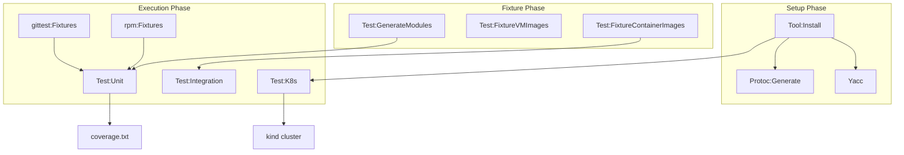

<!-- source: DeepWiki mcp.deepwiki.com · repo aquasecurity/trivy · page 9.1 Build System and Mage Automation · fetched 2026-10-30 -->

# Build System and Mage Automation

Relevant source files

The following files were used as context for generating this wiki page:

- [.gitignore](.gitignore)
- [.golangci.yaml](.golangci.yaml)
- [LICENSE](LICENSE)
- [NOTICE](NOTICE)
- [integration/k8s_test.go](integration/k8s_test.go)
- [integration/testdata/fixtures/k8s/summary-ids.json.golden](integration/testdata/fixtures/k8s/summary-ids.json.golden)
- [integration/testimages.ini](integration/testimages.ini)
- [internal/testutil/image.go](internal/testutil/image.go)
- [magefiles/config_schema.go](magefiles/config_schema.go)
- [magefiles/docs.go](magefiles/docs.go)
- [magefiles/fixture.go](magefiles/fixture.go)
- [magefiles/magefile.go](magefiles/magefile.go)
- [misc/triage/labels.yaml](misc/triage/labels.yaml)
- [pkg/attestation/attestation_test.go](pkg/attestation/attestation_test.go)
- [pkg/fanal/artifact/sbom/testdata/sbom.cdx.intoto.jsonl](pkg/fanal/artifact/sbom/testdata/sbom.cdx.intoto.jsonl)
- [pkg/flag/global_flags.go](pkg/flag/global_flags.go)
- [pkg/plugin/index.go](pkg/plugin/index.go)
- [schema/trivy-config.json](schema/trivy-config.json)

This page documents the Mage-based build system used in Trivy. Mage is a make-like build tool that uses Go, allowing for type-safe and portable automation tasks for building, testing, and code generation.

## Overview

Trivy uses [Mage](https://magefile.org/) to orchestrate complex development workflows. Unlike standard Makefiles, Magefiles are written in Go, which allows the build system to share logic and packages with the main codebase. The primary automation logic resides in the `magefiles/` directory [magefiles/magefile.go:1-25]().

### Environment Configuration
The build system enforces specific Go environment variables to ensure build reproducibility and to enable experimental features:
*   `CGO_ENABLED=0`: Ensures static binaries for maximum portability [magefiles/magefile.go:32]().
*   `GOEXPERIMENT=jsonv2`: Enables the next-generation JSON reflection-free serialization [magefiles/magefile.go:33]().

## Build Targets and Logic

The build system manages versioning by extracting information from Git tags using `git describe --tags --always` [magefiles/magefile.go:42](). This version is then injected into the binary via linker flags (`ldflags`) at `github.com/aquasecurity/trivy/pkg/version/app.ver` [magefiles/magefile.go:55]().

### Automation Namespaces
Mage tasks are organized into namespaces to categorize functionality:

| Namespace | Purpose | Key Functions |
|-----------|---------|---------------|
| `Tool` | Dependency management | `GolangciLint`, `Sass`, `Install` |
| `Protoc` | Protobuf orchestration | `Generate`, `Lint`, `Breaking` |
| `Test` | Test execution and fixtures | `Unit`, `Integration`, `K8s`, `UpdateGolden` |

Sources: [magefiles/magefile.go:58-59](), [magefiles/magefile.go:116](), [magefiles/magefile.go:156]()

## Code Generation and Tooling

Trivy relies on several code generation steps to handle API protocols, licensing expressions, and documentation.

### Protobuf and RPC
The `Protoc` namespace manages the generation of Go code for Trivy's client/server mode using `buf`.
*   **Generate**: Runs `buf generate` to create Twirp and Protobuf bindings [magefiles/magefile.go:123]().
*   **Breaking**: Validates that changes to `.proto` files do not introduce breaking changes against the `main` branch [magefiles/magefile.go:147]().

### Parser Generation
The `Yacc` task handles the generation of the licensing expression parser located in `./pkg/licensing/expression/...` [magefiles/magefile.go:151-154]().

### Documentation Generation
A specialized tool in `magefiles/docs.go` automates the creation of CLI references and configuration schemas.
*   **CLI Reference**: Uses `spf13/cobra/doc` to generate Markdown trees for all commands [magefiles/docs.go:42]().
*   **Config Schema**: Generates `schema/trivy-config.json` by introspecting all defined `FlagGroup` entities [magefiles/docs.go:51](), [magefiles/docs.go:166-198]().

Sources: [magefiles/magefile.go:116-154](), [magefiles/docs.go:29-54]()

## Testing and Fixture Automation

The build system manages the lifecycle of test data, including container images, VM images, and WebAssembly modules.

### Fixture Management
To ensure integration tests are fast and reproducible, Mage provides tasks to pre-download and package image fixtures:
*   **Container Images**: Downloads images defined in `testutil.ImageName` and saves them as `.tar.gz` in `integration/testdata/fixtures/images/` [magefiles/fixture.go:19-42]().
*   **VM Images**: Pulls OCI artifacts containing VM images and extracts layers based on the `org.opencontainers.image.title` annotation [magefiles/fixture.go:68-112]().

### WASM Module Compilation
Trivy supports WASM modules for extensibility. The build system compiles Go-based modules into WASM using the `wasip1` target [magefiles/magefile.go:205-208](). It uses `target.Path` to perform incremental builds, only recompiling if the source `.go` file is newer than the `.wasm` output [magefiles/magefile.go:200-204]().

### Test Execution Flow
The following diagram illustrates the dependency flow for running the full test suite:

Sources: [magefiles/magefile.go:156-231](), [magefiles/fixture.go:1-131]()

## Kubernetes Integration Testing

The `Test:K8s` task automates the creation of a local Kubernetes environment for scanning tests.
1.  **Cluster Creation**: Uses `kind` (Kubernetes in Docker) to spin up a cluster using a specific node image (`kindest/node:v1.27.1`) [magefiles/magefile.go:231]().
2.  **Execution**: Runs tests with the `k8s_integration` build tag [integration/k8s_test.go:1]().
3.  **Cleanup**: Defer-calls `kind delete cluster` to ensure the environment is wiped after tests complete [magefiles/magefile.go:236]().

The `TestK8s` function validates both vulnerability/misconfiguration scanning and KBOM (Kubernetes BOM) generation in CycloneDX format [integration/k8s_test.go:27-149]().

Sources: [magefiles/magefile.go:229-238](), [integration/k8s_test.go:27-202]()

## Linting and Quality Control

Trivy uses `golangci-lint` with a highly customized configuration. The `Tool:GolangciLint` task ensures the correct version (`v2.10.0`) is installed in `GOBIN` [magefiles/magefile.go:77-87]().

### Linter Configuration
The `.golangci.yaml` file defines strict rules, including:
*   **Depguard**: Blocks deprecated packages like `io/ioutil` and enforces the use of internal wrappers like `github.com/aquasecurity/trivy/pkg/mapfs` [ .golangci.yaml:7-65]().
*   **Custom Rules**: Loads site-specific Rego or Go rules from `misc/lint/rules.go` [ .golangci.yaml:48]().
*   **Complexity**: Sets a `gocyclo` threshold of 20 to maintain maintainability [ .golangci.yaml:51]().

Sources: [magefiles/magefile.go:77-109](), [ .golangci.yaml:1-230]()

## Summary of Mage Commands

| Command | Implementation | Description |
|---------|----------------|-------------|
| `mage test:unit` | `(Test) Unit()` | Runs short unit tests with coverage and WASM generation [magefiles/magefile.go:217-220]() |
| `mage test:integration` | `(Test) Integration()` | Runs integration tests requiring container fixtures [magefiles/magefile.go:223-226]() |
| `mage test:k8s` | `(Test) K8s()` | Provisions a Kind cluster and runs K8s-specific tests [magefiles/magefile.go:229-238]() |
| `mage protoc:generate` | `(Protoc) Generate()` | Rebuilds Protobuf and Twirp Go code [magefiles/magefile.go:119-124]() |
| `mage test:updategolden` | `(Test) UpdateGolden()` | Updates integration test golden files [magefiles/magefile.go:186-188]() |

Sources: [magefiles/magefile.go:1-240]()

---

