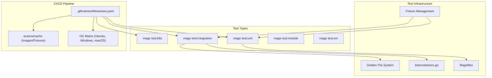
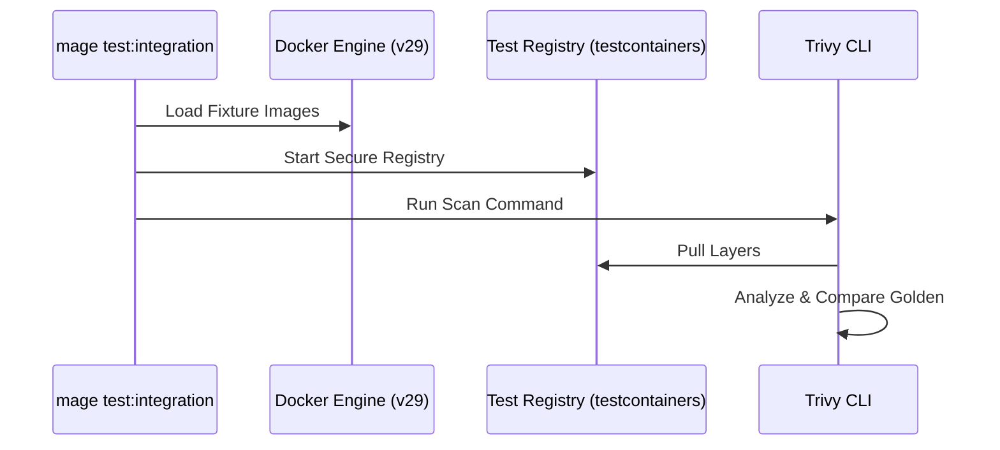

<!-- source: DeepWiki mcp.deepwiki.com · repo aquasecurity/trivy · page 9.2 Testing Strategy and Infrastructure · fetched 2026-10-30 -->

# Testing Strategy and Infrastructure

Relevant source files

The following files were used as context for generating this wiki page:

- [.github/workflows/auto-update-labels.yaml](.github/workflows/auto-update-labels.yaml)
- [.github/workflows/backport.yaml](.github/workflows/backport.yaml)
- [.github/workflows/cache-test-assets.yaml](.github/workflows/cache-test-assets.yaml)
- [.github/workflows/canary.yaml](.github/workflows/canary.yaml)
- [.github/workflows/mkdocs-dev.yaml](.github/workflows/mkdocs-dev.yaml)
- [.github/workflows/mkdocs-latest.yaml](.github/workflows/mkdocs-latest.yaml)
- [.github/workflows/publish-chart.yaml](.github/workflows/publish-chart.yaml)
- [.github/workflows/release.yaml](.github/workflows/release.yaml)
- [.github/workflows/reusable-release.yaml](.github/workflows/reusable-release.yaml)
- [.github/workflows/scan.yaml](.github/workflows/scan.yaml)
- [.github/workflows/spdx-cron.yaml](.github/workflows/spdx-cron.yaml)
- [.github/workflows/stale-issues.yaml](.github/workflows/stale-issues.yaml)
- [.github/workflows/test-docs.yaml](.github/workflows/test-docs.yaml)
- [.github/workflows/test.yaml](.github/workflows/test.yaml)
- [.github/workflows/triage.yaml](.github/workflows/triage.yaml)
- [.golangci.yaml](.golangci.yaml)
- [integration/client_server_test.go](integration/client_server_test.go)
- [integration/docker_engine_test.go](integration/docker_engine_test.go)
- [integration/integration_test.go](integration/integration_test.go)
- [integration/k8s_test.go](integration/k8s_test.go)
- [integration/registry_test.go](integration/registry_test.go)
- [integration/repo_test.go](integration/repo_test.go)
- [integration/sbom_test.go](integration/sbom_test.go)
- [integration/standalone_tar_test.go](integration/standalone_tar_test.go)
- [integration/testdata/fixtures/db/vulnerability.yaml](integration/testdata/fixtures/db/vulnerability.yaml)
- [integration/testdata/fixtures/k8s/summary-ids.json.golden](integration/testdata/fixtures/k8s/summary-ids.json.golden)
- [integration/testdata/fluentd-multiple-lockfiles.json.golden](integration/testdata/fluentd-multiple-lockfiles.json.golden)
- [integration/testimages.ini](integration/testimages.ini)
- [internal/testutil/docker.go](internal/testutil/docker.go)
- [internal/testutil/image.go](internal/testutil/image.go)
- [magefiles/fixture.go](magefiles/fixture.go)
- [magefiles/magefile.go](magefiles/magefile.go)
- [pkg/attestation/attestation_test.go](pkg/attestation/attestation_test.go)
- [pkg/fanal/artifact/sbom/testdata/sbom.cdx.intoto.jsonl](pkg/fanal/artifact/sbom/testdata/sbom.cdx.intoto.jsonl)
- [pkg/fanal/image/daemon/containerd.go](pkg/fanal/image/daemon/containerd.go)
- [pkg/fanal/image/daemon/context_test.go](pkg/fanal/image/daemon/context_test.go)
- [pkg/fanal/image/daemon/docker.go](pkg/fanal/image/daemon/docker.go)
- [pkg/fanal/image/daemon/image.go](pkg/fanal/image/daemon/image.go)
- [pkg/fanal/image/daemon/image_test.go](pkg/fanal/image/daemon/image_test.go)
- [pkg/fanal/image/daemon/podman.go](pkg/fanal/image/daemon/podman.go)
- [pkg/fanal/image/daemon/podman_test.go](pkg/fanal/image/daemon/podman_test.go)
- [pkg/fanal/image/image_test.go](pkg/fanal/image/image_test.go)
- [pkg/fanal/test/integration/containerd_test.go](pkg/fanal/test/integration/containerd_test.go)
- [pkg/fanal/test/integration/docker/docker.go](pkg/fanal/test/integration/docker/docker.go)
- [pkg/fanal/test/integration/library_test.go](pkg/fanal/test/integration/library_test.go)
- [pkg/fanal/test/integration/registry_test.go](pkg/fanal/test/integration/registry_test.go)
- [pkg/plugin/index.go](pkg/plugin/index.go)

This document describes Trivy's comprehensive testing infrastructure, including unit tests, integration tests, K8s tests, and fixture management. The testing system ensures reliability across multiple platforms and deployment scenarios, covering everything from basic functionality to complex integration scenarios with external services.

## Test Architecture Overview

Trivy employs a multi-layered testing strategy that validates functionality at different levels of the system:

**Test Framework Components**
- **Mage-based Orchestration**: The `magefiles/magefile.go` defines the primary entry points for all test types, ensuring consistent execution locally and in CI `[magefiles/magefile.go:156-250]()`.
- **Golden File System**: Used in integration tests to compare actual scan results against expected "golden" outputs `[magefiles/magefile.go:186-189]()`.
- **Fixture Management**: Automated downloading and extraction of container images, VM images, and WASM modules required for testing `[magefiles/magefile.go:158-183]()`.

Sources: `[magefiles/magefile.go]()`, `[.github/workflows/test.yaml]()`

## CI/CD Test Pipeline

The primary test pipeline runs on GitHub Actions and validates Trivy across multiple platforms.

### Workflow Structure
The `test.yaml` workflow is triggered on pull requests and merges, excluding documentation-only changes `[.github/workflows/test.yaml:1-12]()`. It utilizes a matrix strategy to run unit tests on `ubuntu-latest`, `windows-latest`, and `macos-latest` `[.github/workflows/test.yaml:17-20]()`.

### Specialized Integration Jobs
Beyond unit tests, the pipeline executes specialized integration suites:
- **Integration**: Standard integration tests including container and repository scanning `[.github/workflows/test.yaml:70-112]()`.
- **K8s Integration**: Validates Kubernetes cluster scanning using `kind` (Kubernetes in Docker) `[.github/workflows/test.yaml:113-130]()`.
- **Module Test**: Tests WASM-based modules `[.github/workflows/test.yaml:131-164]()`.
- **VM Test**: Validates VM image scanning `[.github/workflows/test.yaml:165-197]()`.

Sources: `[.github/workflows/test.yaml:1-200]()`

## Unit Tests

Unit tests provide fast feedback on individual components and are executed via `mage test:unit`.

**Key Characteristics**
- **Dependency Management**: Before running, Mage ensures that WASM modules, RPM fixtures, and Git test data are prepared `[magefiles/magefile.go:218]()`.
- **Coverage**: Uses `-coverprofile=coverage.txt` and `-covermode=atomic` for quality tracking `[magefiles/magefile.go:219]()`.
- **Short Mode**: Supports `-short` flag to skip long-running unit tests during rapid development `[magefiles/magefile.go:219]()`.

Sources: `[magefiles/magefile.go:217-220]()`

## Integration Tests

Integration tests validate Trivy's functionality in realistic scenarios. They are identified by the `//go:build integration` build tag `[integration/client_server_test.go:1]()`.

### Client-Server Testing
The `TestClientServer` function validates the RPC-based architecture `[integration/client_server_test.go:46]()`. It uses `csArgs` to define test parameters:

| Field | Description |
| :--- | :--- |
| `RemoteAddrOption` | Specifies the server address (e.g., `--server`) `[integration/client_server_test.go:26]()` |
| `ClientToken` | Tests authentication between client and server `[integration/client_server_test.go:33]()` |
| `Input` | Path to the target artifact (e.g., image tarball) `[integration/client_server_test.go:32]()` |

### Docker Engine and Registry Testing
Integration tests interact with live Docker engines and registries. Due to runner environment variations, the CI explicitly installs Docker Engine `v29.2.1` to ensure consistent Image IDs and behavior `[.github/workflows/test.yaml:84-89]()`.

Sources: `[integration/client_server_test.go:24-41]()`, `[.github/workflows/test.yaml:79-89]()`

## Kubernetes Integration Tests

The Kubernetes test suite validates Trivy's ability to scan cluster resources and RBAC.

**Infrastructure Setup**
- **Cluster Creation**: Mage uses `kind` to create a local cluster named `kind-test` `[magefiles/magefile.go:231]()`.
- **Image Versioning**: Specifically uses `kindest/node:v1.27.1` to ensure predictable API responses `[magefiles/magefile.go:231]()`.
- **Cleanup**: Implements a `defer` block to delete the cluster regardless of test outcome `[magefiles/magefile.go:235-237]()`.

Sources: `[magefiles/magefile.go:229-245]()`, `[.github/workflows/test.yaml:113-130]()`

## Fixture and Asset Management

Trivy uses a sophisticated system to manage test data and prevent CI slowdowns.

### Image Fixtures
Test images are defined in `integration/testimages.ini`. In CI, a digest of this file is generated to use as a cache key `[.github/workflows/test.yaml:96-103]()`. If the digest matches, images are restored from `actions/cache` rather than being re-downloaded `[.github/workflows/test.yaml:104-109]()`.

### WASM Modules
Unit and integration tests for modules require compiled WASM binaries. Mage automates this via `compileWasmModules`, which looks for `.go` files in `testdata` and compiles them using `GOOS=wasip1` and `GOARCH=wasm` `[magefiles/magefile.go:190-214]()`.

### Golden Files
Golden files store the expected JSON/Table output of scans. When underlying logic changes, developers run `mage test:updateGolden` to refresh these files across the `integration/` and `pkg/fanal/test/integration/` directories `[magefiles/magefile.go:186-189]()`.

Sources: `[magefiles/magefile.go:158-214]()`, `[.github/workflows/test.yaml:96-109]()`

## Linting and Documentation Checks

Testing includes code quality and documentation consistency:
- **Golangci-lint**: Configured in `.golangci.yaml`, it enforces style, security (gosec), and complexity (gocyclo) rules `[.golangci.yaml:1-230]()`.
- **CLI Reference Check**: Mage task `docs:generate` is run in CI to ensure that the auto-generated CLI documentation matches the current code state `[.github/workflows/test.yaml:58-65]()`.

Sources: `[.golangci.yaml]()`, `[.github/workflows/test.yaml:38-65]()`

---

