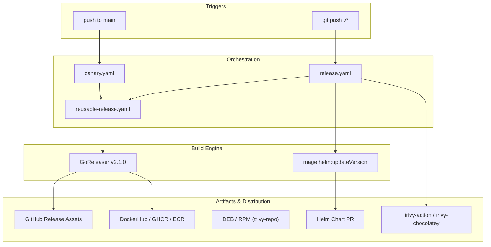

<!-- source: DeepWiki mcp.deepwiki.com · repo aquasecurity/trivy · page 9.3 Release Process and Distribution · fetched 2026-10-30 -->

# Release Process and Distribution

Relevant source files

The following files were used as context for generating this wiki page:

- [.dockerignore](.dockerignore)
- [.github/workflows/auto-close-issue.yaml](.github/workflows/auto-close-issue.yaml)
- [.github/workflows/auto-ready-for-review.yaml](.github/workflows/auto-ready-for-review.yaml)
- [.github/workflows/auto-update-labels.yaml](.github/workflows/auto-update-labels.yaml)
- [.github/workflows/backport.yaml](.github/workflows/backport.yaml)
- [.github/workflows/cache-test-assets.yaml](.github/workflows/cache-test-assets.yaml)
- [.github/workflows/canary.yaml](.github/workflows/canary.yaml)
- [.github/workflows/mkdocs-dev.yaml](.github/workflows/mkdocs-dev.yaml)
- [.github/workflows/mkdocs-latest.yaml](.github/workflows/mkdocs-latest.yaml)
- [.github/workflows/publish-chart.yaml](.github/workflows/publish-chart.yaml)
- [.github/workflows/release-please.yaml](.github/workflows/release-please.yaml)
- [.github/workflows/release.yaml](.github/workflows/release.yaml)
- [.github/workflows/reusable-release.yaml](.github/workflows/reusable-release.yaml)
- [.github/workflows/scan.yaml](.github/workflows/scan.yaml)
- [.github/workflows/spdx-cron.yaml](.github/workflows/spdx-cron.yaml)
- [.github/workflows/stale-issues.yaml](.github/workflows/stale-issues.yaml)
- [.github/workflows/test-docs.yaml](.github/workflows/test-docs.yaml)
- [.github/workflows/test.yaml](.github/workflows/test.yaml)
- [.github/workflows/triage.yaml](.github/workflows/triage.yaml)
- [Dockerfile](Dockerfile)
- [Dockerfile.canary](Dockerfile.canary)
- [ci/deploy-deb.sh](ci/deploy-deb.sh)
- [ci/deploy-rpm.sh](ci/deploy-rpm.sh)
- [contrib/Trivy.gitlab-ci.yml](contrib/Trivy.gitlab-ci.yml)
- [docs/community/maintainer/release-flow.md](docs/community/maintainer/release-flow.md)
- [docs/community/maintainer/triage.md](docs/community/maintainer/triage.md)
- [goreleaser-canary.yml](goreleaser-canary.yml)
- [goreleaser.yml](goreleaser.yml)

This document details Trivy's release process and distribution system, covering how releases are triggered, built with GoReleaser, signed with Cosign, and distributed across multiple platforms and package repositories. The process handles multi-architecture binary builds, native package generation (DEB/RPM), container image publishing, and automated downstream updates.

## Release Process Overview

Trivy's release process is triggered by pushing a Git tag matching the pattern `v*` (e.g., `v0.58.0`) [[.github/workflows/release.yaml:2-5]](). The workflow uses a reusable release definition to orchestrate GoReleaser, CycloneDX SBOM generation, and multi-registry container pushes [[.github/workflows/release.yaml:8-21]]().

### Release Workflow Architecture

**Sources:** [[.github/workflows/release.yaml:1-120]](), [[.github/workflows/reusable-release.yaml:1-156]](), [[.github/workflows/canary.yaml:1-28]]()

## GoReleaser Configuration

Trivy utilizes GoReleaser v2 to manage the build matrix and artifact generation [[goreleaser.yml:1]]().

### Build Matrix and Targets

The configuration defines four primary build IDs to handle different OS/Architecture constraints, specifically addressing limitations in the `modernc.org/sqlite` driver [[goreleaser.yml:39-41,73]]().

| Build ID | OS | Arch | Flags/Env |
| :--- | :--- | :--- | :--- |
| `build-linux` | linux | 386, arm, amd64, arm64, s390x, ppc64le | `CGO_ENABLED=0`, `GOEXPERIMENT=jsonv2` |
| `build-bsd` | freebsd | amd64 | `CGO_ENABLED=0` |
| `build-macos` | darwin | amd64, arm64 | `CGO_ENABLED=0` |
| `build-windows` | windows | amd64 | `CGO_ENABLED=0` |

All builds inject the version string into `github.com/aquasecurity/trivy/pkg/version/app.ver` using linker flags [[goreleaser.yml:11,32,49,66]]().

**Sources:** [[goreleaser.yml:4-76]]()

## Package Generation and Signing

### Native Packages (NFPM)
GoReleaser uses NFPM to generate `.deb` and `.rpm` packages [[goreleaser.yml:83-87]](). 
- **Templates:** Contrib templates are installed to `/usr/local/share/trivy/templates` [[goreleaser.yml:108-109]]().
- **RPM Signing:** Packages are signed using GPG keys provided via the `GPG_FILE` environment variable [[goreleaser.yml:111-112]]().

### Artifact Attestation and Provenance
The release pipeline integrates GitHub's artifact attestation to provide build provenance [[.github/workflows/reusable-release.yaml:138-143]]().
- **Cosign:** The `sigstore/cosign-installer` is used to set up signing capabilities [[.github/workflows/reusable-release.yaml:45-46]]().
- **Checksums:** Attestations are linked to the `checksums.txt` generated by GoReleaser [[.github/workflows/reusable-release.yaml:142]]().

**Sources:** [[goreleaser.yml:83-112]](), [[.github/workflows/reusable-release.yaml:138-143]]()

## Multi-Platform Distribution

### Container Registries
Trivy images are published to three major registries using Docker Buildx for multi-architecture support [[goreleaser.yml:160,185,210]]():
1. **Docker Hub:** `docker.io/aquasec/trivy` [[goreleaser.yml:154]]()
2. **GitHub Container Registry:** `ghcr.io/aquasecurity/trivy` [[goreleaser.yml:156]]()
3. **AWS ECR Public:** `public.ecr.aws/aquasecurity/trivy` [[goreleaser.yml:158]]()

### Homebrew
GoReleaser automatically updates the Homebrew formula in the `aquasecurity/homebrew-trivy` repository [[goreleaser.yml:141-145]](). It uses a custom `url_template` that points to `get.trivy.dev` [[goreleaser.yml:148]]().

### Native Repositories
After the main release job, the `deploy-packages` job triggers a workflow in the `trivy-repo` repository to update the APT and YUM repositories with the new version [[.github/workflows/release.yaml:23-35]]().

**Sources:** [[goreleaser.yml:141-210]](), [[.github/workflows/release.yaml:23-35]]()

## Post-Release Automation

Once a release is finalized, Trivy triggers several downstream automation tasks:

1.  **Helm Chart Update:** The `update-chart-version` job runs `mage helm:updateVersion`, which creates a PR in the Trivy repository to bump the chart's `appVersion` [[.github/workflows/release.yaml:38-64]]().
2.  **Downstream Triggers:** The `trigger-version-update` job dispatches workflows to update Trivy versions in:
    -   `trivy-telemetry` [[.github/workflows/release.yaml:71-81]]()
    -   `trivy-downloads` [[.github/workflows/release.yaml:83-95]]()
    -   `trivy-chocolatey` [[.github/workflows/release.yaml:96-106]]()
    -   `trivy-action` [[.github/workflows/release.yaml:108-120]]()

**Sources:** [[.github/workflows/release.yaml:38-120]]()

## Canary Builds

For every push to the `main` branch involving Go files or the Dockerfile, a "Canary" build is triggered [[.github/workflows/canary.yaml:1-11]]().

- **Configuration:** Uses `goreleaser-canary.yml` with the `--snapshot` flag to prevent a formal GitHub release [[.github/workflows/canary.yaml:18-19]]().
- **Docker Strategy:** Since GoReleaser Free does not push snapshot images, a custom `Dockerfile.canary` and `docker/build-push-action` are used to push images tagged as `:canary` [[.github/workflows/reusable-release.yaml:125-136]]().
- **Artifact Access:** Binaries are cached using a unique key based on `github.sha` and then uploaded as GitHub Action artifacts for manual testing [[.github/workflows/canary.yaml:36-70]]().

**Sources:** [[.github/workflows/canary.yaml:1-76]](), [[.github/workflows/reusable-release.yaml:122-137]](), [[Dockerfile.canary:1-12]]()

---

