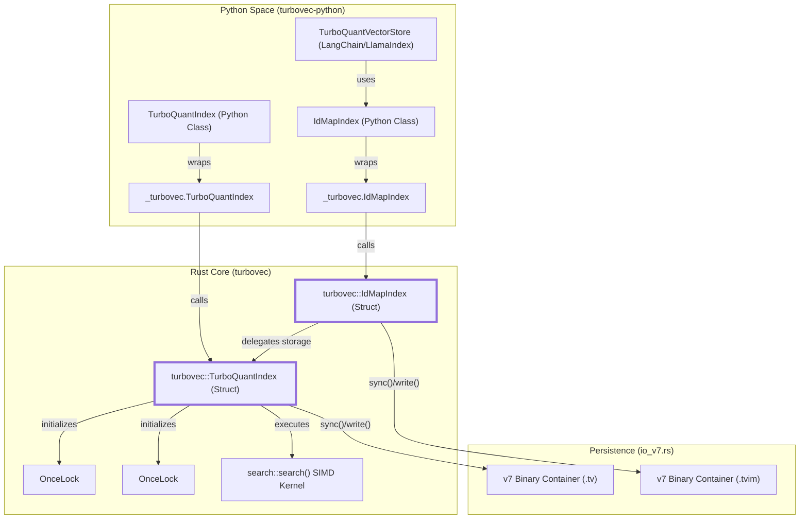
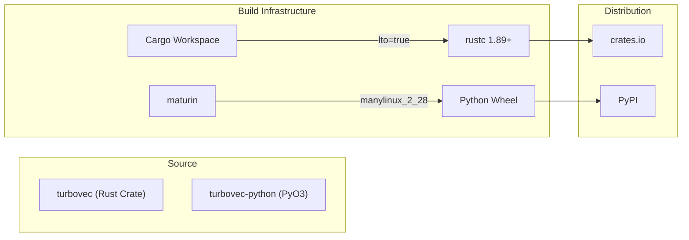

<!-- source: DeepWiki mcp.deepwiki.com · repo RyanCodrai/turbovec · page 1 Overview · fetched 2026-10-30 -->

# Overview

Relevant source files

The following files were used as context for generating this wiki page:

- [CHANGELOG.md](CHANGELOG.md)
- [README.md](README.md)
- [docs/api.md](docs/api.md)
- [docs/recall_d1536.svg](docs/recall_d1536.svg)
- [docs/recall_d3072.svg](docs/recall_d3072.svg)
- [docs/recall_glove.svg](docs/recall_glove.svg)
- [turbovec/src/id_map.rs](turbovec/src/id_map.rs)
- [turbovec/src/io.rs](turbovec/src/io.rs)
- [turbovec/src/lib.rs](turbovec/src/lib.rs)

`turbovec` is a high-performance Rust vector index designed for efficient similarity search using Google Research's **TurboQuant** algorithm. It provides a data-oblivious quantization scheme that achieves near-optimal distortion without requiring codebook training or multiple data passes [README.md:14-16]().

The project is designed to solve the memory and latency challenges of large-scale Retrieval-Augmented Generation (RAG) by offering up to 16x compression (e.g., shrinking 31 GB of FP32 vectors to 4 GB) while maintaining search speeds that beat FAISS IndexPQFastScan by an average of 3.4× at 4-bit width [README.md:14-19]().

## Design Goals

*   **Online Ingest:** Unlike Product Quantization (PQ), `turbovec` requires no data-dependent training step. Vectors are indexed immediately upon addition [README.md:18-18]().
*   **Hardware Acceleration:** Includes hand-written SIMD kernels for ARM (NEON SDOT/SMMLA) and x86 (AVX-512 VNNI, AVX2) to maximize throughput [README.md:19-19]().
*   **Crash-Safe Persistence:** The `sync()` method provides durable incremental saves, persisting only changed rows using an A/B dual-slot header protocol to remain crash-safe at any byte [README.md:20-20](), [CHANGELOG.md:31-34]().
*   **In-Kernel Filtering:** Search directly honors ID allowlists or slot bitmasks inside the SIMD kernels, short-circuiting blocks that do not match to avoid unnecessary scoring costs [README.md:21-21](), [README.md:86-86]().
*   **Pure Local:** Designed for air-gapped or privacy-sensitive environments where data must remain on-premise [README.md:22-22]().

## System Architecture

The following diagrams bridge the high-level conceptual components to the specific entities found in the codebase.

### Conceptual to Code Mapping

Sources: [turbovec/src/lib.rs:87-87](), [turbovec/src/id_map.rs:1-13](), [README.md:33-64](), [docs/api.md:5-9]()

### Build and Distribution Pipeline

Sources: [CHANGELOG.md:7-10](), [turbovec/src/lib.rs:54-61](), [README.md:101-105]()

## Repository Organization

The repository is organized as a Cargo workspace containing the core library, Python bindings, and extensive benchmarking tools.

| Component | Path | Description |
| :--- | :--- | :--- |
| **Core Library** | `turbovec/` | The primary Rust crate containing the quantization logic, SIMD kernels, and v7 I/O [turbovec/src/lib.rs:63-73](). |
| **Python Bindings** | `turbovec-python/` | PyO3-based extension module and Python utility layer including interruptible chunking [README.md:92-99](). |
| **Benchmarks** | `benchmarks/` | Suite for measuring recall and speed against FAISS, including the hillclimb optimization log [README.md:130-140](). |
| **Documentation** | `docs/` | SVG charts, integration guides for LangChain/LlamaIndex/Haystack/Agno, and API references [README.md:90-99](). |
| **Examples** | `examples/` | Smoke tests and utility scripts like `convert.rs` for migrating older file formats [CHANGELOG.md:25-29](). |

## Next Steps

For detailed technical information, please refer to the following child pages:

*   **[Getting Started](#1.1)**: Step-by-step guide for installing `turbovec` via pip or cargo, building from source, and basic index usage.
*   **[Repository Layout](#1.2)**: A detailed map of the directory structure, build configurations, and the two-crate workspace architecture.

For implementation details of the Rust core, SIMD kernels, or Python framework integrations, see the respective sections in the main Wiki table of contents.

---

