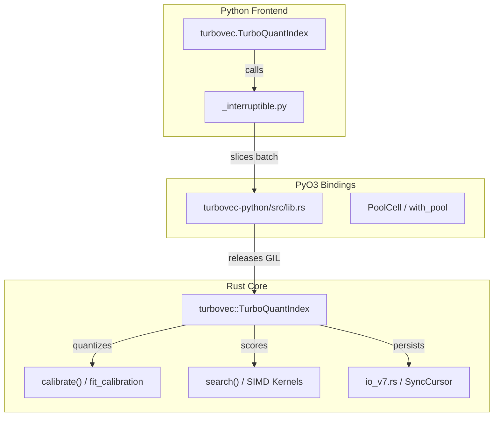
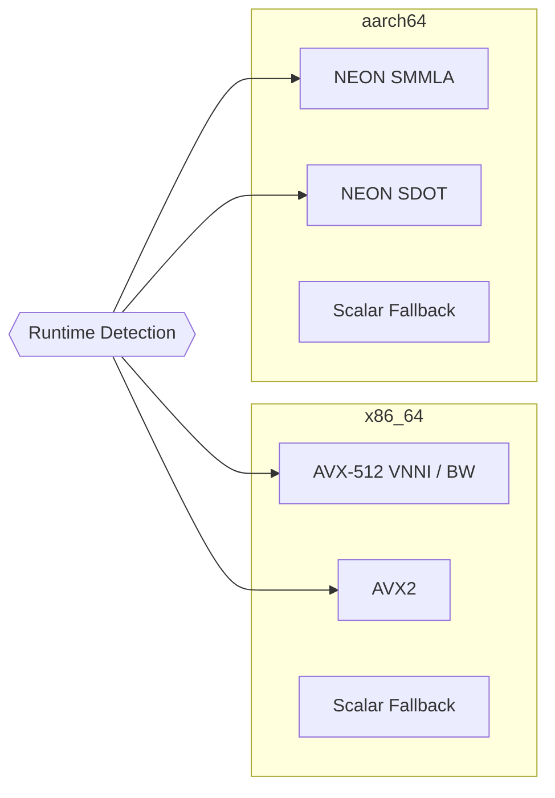

<!-- source: DeepWiki mcp.deepwiki.com · repo RyanCodrai/turbovec · page 1.1 Getting Started · fetched 2026-10-30 -->

# Getting Started

<details>
<summary>Relevant source files</summary>

The following files were used as context for generating this wiki page:

- [.github/CODEOWNERS](.github/CODEOWNERS)
- [.github/PULL_REQUEST_TEMPLATE.md](.github/PULL_REQUEST_TEMPLATE.md)
- [CONTRIBUTING.md](CONTRIBUTING.md)
- [Cargo.lock](Cargo.lock)
- [README.md](README.md)
- [docs/recall_d1536.svg](docs/recall_d1536.svg)
- [docs/recall_d3072.svg](docs/recall_d3072.svg)
- [docs/recall_glove.svg](docs/recall_glove.svg)
- [examples/downstream-smoke/Cargo.lock](examples/downstream-smoke/Cargo.lock)
- [turbovec-python/Cargo.toml](turbovec-python/Cargo.toml)
- [turbovec-python/pyproject.toml](turbovec-python/pyproject.toml)
- [turbovec-python/python/turbovec/__init__.py](turbovec-python/python/turbovec/__init__.py)
- [turbovec-python/python/turbovec/_interruptible.py](turbovec-python/python/turbovec/_interruptible.py)
- [turbovec-python/tests/test_interruptible.py](turbovec-python/tests/test_interruptible.py)
- [turbovec/Cargo.toml](turbovec/Cargo.toml)

</details>


`turbovec` is a high-performance vector index designed for memory-efficient similarity search using the **TurboQuant** algorithm. It achieves up to 16x compression (at 2-bit) with zero codebook training, while outperforming established libraries like FAISS IndexPQFastScan on ARM and matching/beating them on x86 architectures [README.md:14-22]().

## Installation

### Python
The Python package provides a high-level API and integrations for RAG frameworks. It requires Python >= 3.9 [turbovec-python/pyproject.toml:10]().

**Standard Installation:**
```bash
pip install turbovec
```
[README.md:28-30]()

**With Framework Support:**
```bash
# For LangChain, LlamaIndex, Haystack, or Agno users
pip install "turbovec[langchain]"
pip install "turbovec[llama-index]"
pip install "turbovec[haystack]"
pip install "turbovec[agno]"
```
[turbovec-python/pyproject.toml:53-57](), [README.md:96-99]()

### Rust
Add `turbovec` to your `Cargo.toml` or via the CLI. Note that `turbovec` requires **Rust 1.89+** to support stabilized AVX-512 intrinsics [turbovec/Cargo.toml:5-15](), [turbovec/Cargo.toml:76]().
```bash
cargo add turbovec
```

---

## Building from Source

Building from source requires a Rust toolchain (1.89+) and `maturin` for Python bindings [turbovec-python/Cargo.toml:10](), [turbovec-python/pyproject.toml:2-3]().

### Hardware Targets and SIMD
The build system is configured to optimize for modern SIMD instruction sets. The Rust core includes hand-written kernels for:
*   **x86_64:** AVX-512 VNNI, AVX-512BW (`vpermb`), and AVX2 [README.md:19](), [turbovec/Cargo.toml:7-11]().
*   **ARM (aarch64):** NEON SDOT and SMMLA [README.md:19]().

### Build Commands
To build the Python wheel and install it (uses `pyo3` with `abi3-py39` features) [turbovec-python/Cargo.toml:31]():
```bash
pip install maturin
cd turbovec-python
maturin build --release
pip install target/wheels/*.whl
```
[turbovec-python/pyproject.toml:59-63]()

To build the Rust library:
```bash
cargo build --release
```

---

## Minimal End-to-End Example

### Python Example
The Python API uses `numpy` for vector input. It includes an interruptible chunking layer controlled by `BATCH_CHUNK_SIZE` (default: 1000) which ensures long operations can be halted by `Ctrl-C` [turbovec-python/python/turbovec/_interruptible.py:10-15](), [turbovec-python/python/turbovec/_interruptible.py:90-94]().

```python
from turbovec import TurboQuantIndex, IdMapIndex
import numpy as np

# 1. Initialize (1536 dimensions, 4-bit quantization)
index = TurboQuantIndex(dim=1536, bit_width=4)

# 2. Add vectors (must be C-contiguous float32)
vectors = np.random.rand(1000, 1536).astype(np.float32)
index.add(vectors) 

# 3. Calibrate (optional: improves recall by fitting to data distribution)
# index.calibrate(vectors[:512])

# 4. Search
query = np.random.rand(1, 1536).astype(np.float32)
scores, indices = index.search(query, k=10)

# 5. Persist and Incremental Sync
index.write("index.tv")         # Full snapshot
index.sync("index.tv")          # Crash-safe incremental update
```
[README.md:32-45](), [turbovec-python/python/turbovec/_interruptible.py:124-131]()

### Rust Example
```rust
use turbovec::{TurboQuantIndex, IdMapIndex};

// 1. Initialize
let mut index = TurboQuantIndex::new(1536, 4).unwrap();

// 2. Add and Search
index.add(&vectors); // vectors is &[f32]
let results = index.search(&queries, 10);

// 3. Persist
index.write("index.tv").unwrap();
let loaded = TurboQuantIndex::load("index.tv").unwrap();
```
[README.md:107-115](), [README.md:120-128]()

---

## Implementation Overview

### Data Flow: Natural Language to Code Entities
The following diagram maps the high-level operational flow to the specific classes and functions in the codebase.

**End-to-End Search Pipeline**

Sources: [turbovec-python/python/turbovec/_interruptible.py:10-15](), [turbovec-python/Cargo.toml:12-14](), [README.md:18-20](), [turbovec-python/Cargo.toml:35-40]()

### Key Components

| Component | Role | Logic Pointer |
| :--- | :--- | :--- |
| `TurboQuantIndex` | Core index using 0-based internal slots. | [README.md:32-35]() |
| `IdMapIndex` | Wrapper for `TurboQuantIndex` providing stable `uint64` IDs and O(1) removals. | [README.md:49-59]() |
| `calibrate()` | Fits shift/scale parameters to improve recall (TQ+). | [README.md:140-143]() |
| `sync()` | Incremental persistence using the v7 file format; crash-safe at any byte. | [README.md:20]() |
| `BATCH_CHUNK_SIZE` | Default size (1000) for splitting large batches to allow signal processing in Python. | [turbovec-python/python/turbovec/_interruptible.py:90-94]() |

### SIMD Architecture Support
`turbovec` detects hardware features at runtime to select the most efficient search kernel.

**Kernel Selection Logic**

Sources: [README.md:19](), [turbovec/Cargo.toml:7-11]()

### Performance and Recall
*   **Recall:** TurboQuant (TQ+) typically beats FAISS `IndexPQ` at R@1 on high-dimensional datasets (d=1536, d=3072) [README.md:132-143]().
*   **Interruptibility:** For large `add` or `search` operations, `turbovec` slices batches on the Python side. While this adds ~1–10 µs per vector in overhead, it reduces `Ctrl-C` latency from seconds to milliseconds [turbovec-python/python/turbovec/_interruptible.py:21-28]().

Sources: [README.md:14-22](), [turbovec-python/python/turbovec/_interruptible.py:1-15]()

---

