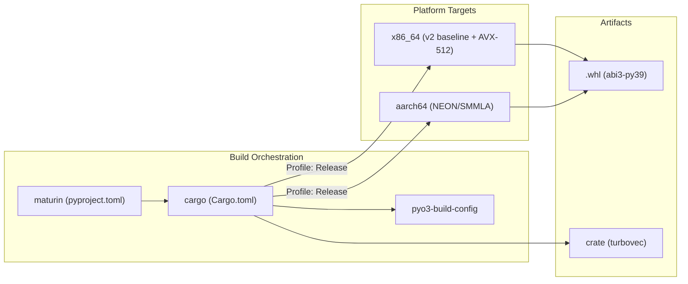

<!-- source: DeepWiki mcp.deepwiki.com · repo RyanCodrai/turbovec · page 1.2 Repository Layout · fetched 2026-10-30 -->

# Repository Layout

<details>
<summary>Relevant source files</summary>

The following files were used as context for generating this wiki page:

- [.cargo/config.toml](.cargo/config.toml)
- [.gitignore](.gitignore)
- [Cargo.lock](Cargo.lock)
- [Cargo.toml](Cargo.toml)
- [examples/downstream-smoke/Cargo.lock](examples/downstream-smoke/Cargo.lock)
- [examples/downstream-smoke/Cargo.toml](examples/downstream-smoke/Cargo.toml)
- [examples/downstream-smoke/src/main.rs](examples/downstream-smoke/src/main.rs)
- [turbovec-python/Cargo.toml](turbovec-python/Cargo.toml)
- [turbovec-python/build.rs](turbovec-python/build.rs)
- [turbovec-python/pyproject.toml](turbovec-python/pyproject.toml)
- [turbovec/Cargo.toml](turbovec/Cargo.toml)

</details>


This page provides a comprehensive map of the `turbovec` repository, detailing the organization of its core Rust components, Python bindings, benchmarking suite, and infrastructure configurations. The project is structured as a Cargo workspace to manage the high-performance Rust core and its high-level language interfaces efficiently.

## Workspace Overview

The repository is managed as a multi-crate Rust workspace, defined in the root `Cargo.toml`. This structure allows for shared compilation artifacts and unified dependency management across the core library and its bindings.

| Component | Path | Description |
| :--- | :--- | :--- |
| **Core Library** | `turbovec/` | The primary Rust implementation of the TurboQuant algorithm and SIMD search engine. Requires MSRV 1.89 for AVX-512. |
| **Python Bindings** | `turbovec-python/` | PyO3-based extension module (`_turbovec`) and the `turbovec` Python package. |
| **Benchmarks** | `benchmarks/` | Performance suite, hillclimb logs, and the SVG diagram generator. |
| **Documentation** | `docs/` | Static assets, including SVG performance charts and integration docs. |
| **Examples** | `examples/` | Downstream smoke tests and kernel verification tools. |
| **CI/CD** | `.github/` | GitHub Actions workflows for automated testing, @tq-bot, and PyPI/Crates.io releases. |

Sources: [Cargo.toml:1-3](), [turbovec/Cargo.toml:27-28](), [turbovec-python/Cargo.toml:1-13](), [turbovec-python/pyproject.toml:59-63]()

## Directory Structure and Data Flow

The following diagram illustrates the relationship between the major directories and how data flows from the Rust core through the Python bindings to the end-user integrations.

### System Entity Map: Repository to Code

```mermaid
graph TD
    subgraph "Workspace Root"
        RootConfig["Cargo.toml"]
        LockFile["Cargo.lock"]
        CargoEnv[".cargo/config.toml"]
    end

    subgraph "turbovec/ (Core Crate)"
        CoreLib["src/lib.rs"]
        TQIndex["TurboQuantIndex"]
        IdMap["IdMapIndex"]
        SIMD["src/simd/"]
        IO["src/io_v7.rs"]
    end

    subgraph "turbovec-python/ (Binding Crate)"
        PyLib["src/lib.rs (PyO3)"]
        PyWrapper["python/turbovec/"]
        Integrations["python/turbovec/langchain/ & llama_index/"]
        Interrupt["_interruptible.py"]
    end

    subgraph "benchmarks/"
        Suite["suite/"]
        Results["results/"]
        Hillclimb["hillclimb/"]
        Visualizer["create_diagrams.py"]
    end

    %% Data and Logic Flow
    CoreLib -->|Provides| TQIndex
    CoreLib -->|Provides| IdMap
    TQIndex -->|Exposed via| PyLib
    PyLib -->|Imported by| PyWrapper
    PyWrapper -->|Uses| Interrupt
    PyWrapper -->|Used in| Integrations
    TQIndex -->|Evaluated by| Suite
    Suite -->|Generates| Results
    Results -->|Visualized by| Visualizer
    Visualizer -->|Writes to| "docs/"
```
Sources: [Cargo.toml:1-3](), [turbovec-python/pyproject.toml:62-63](), [turbovec-python/Cargo.toml:30-31](), [turbovec/Cargo.toml:1-3]()

## Crate Descriptions

### 1. turbovec (Core)
The `turbovec` directory contains the standalone Rust crate. It is responsible for the heavy lifting of vector quantization and search.
*   **Implementation**: Utilizes `rayon` for thread-parallel search [turbovec/Cargo.toml:39](). It requires Rust 1.89+ to support stabilized AVX-512 intrinsics used in `search.rs` and `rotation.rs` [turbovec/Cargo.toml:5-11]().
*   **Persistence**: Implements the v7 binary format, using A/B dual-slot headers for crash-safety [turbovec/src/io_v7.rs]().
*   **Determinism**: Pins `rand_chacha` and `statrs` to exact versions to ensure encoded bit-stream stability across releases [turbovec/Cargo.toml:42-65]().

### 2. turbovec-python
This directory houses the logic for making the Rust core accessible to Python.
*   **`src/lib.rs`**: Contains the PyO3 bridge. It defines the `_turbovec` binary module and wraps the Rust `TurboQuantIndex` into a Python-compatible class [turbovec-python/Cargo.toml:12-14]().
*   **`python/turbovec/`**: A pure Python layer that wraps the binary module. This includes high-level integrations for LangChain, LlamaIndex, Haystack, and Agno [turbovec-python/pyproject.toml:53-57]().
*   **Build System**: Uses `maturin` as the build backend to compile the Rust code into a Python wheel [turbovec-python/pyproject.toml:1-3]().

Sources: [turbovec-python/pyproject.toml:59-63](), [turbovec-python/Cargo.toml:30-32]()

## Build and CI Configuration

### Compiler Optimization
The root `Cargo.toml` specifies aggressive optimization for release builds to ensure the SIMD kernels perform at peak efficiency.
*   **LTO (Link Time Optimization)**: Set to `true` to enable cross-crate optimizations [Cargo.toml:10]().
*   **Codegen Units**: Set to `1` to maximize the scope of the optimizer [Cargo.toml:11]().
*   **Target Baseline**: `.cargo/config.toml` sets `x86-64-v2` as the baseline for non-SIMD code to avoid `SIGILL` on older CPUs while allowing runtime dispatch to AVX2/AVX-512 kernels [.cargo/config.toml:1-22]().

### System Layout and Build Flow


Sources: [Cargo.toml:9-12](), [turbovec-python/pyproject.toml:1-3](), [.cargo/config.toml:21-22](), [turbovec-python/Cargo.toml:31]()

## Examples and Testing
*   **`examples/downstream-smoke/`**: A standalone crate (excluded from the workspace) that mimics a real user experience. It verifies that `turbovec` links and runs without requiring manual BLAS/LAPACK configuration [examples/downstream-smoke/Cargo.toml:1-15]().
*   **`tests/encode_fingerprint.rs`**: A critical test suite that ensures cross-platform determinism of the quantization pipeline [turbovec/Cargo.toml:63-64]().

Sources: [examples/downstream-smoke/src/main.rs:1-15](), [Cargo.toml:6]()

---

