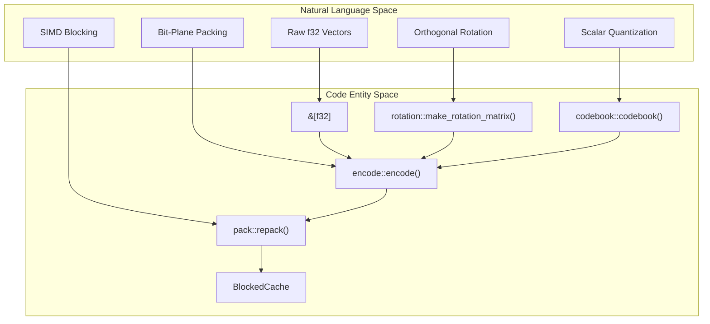
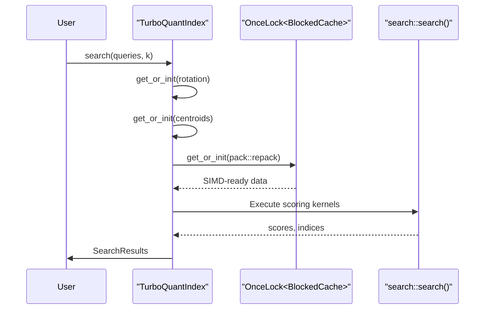

<!-- source: DeepWiki mcp.deepwiki.com · repo RyanCodrai/turbovec · page 2 Core Rust Library (turbovec) · fetched 2026-10-30 -->

# Core Rust Library (turbovec)

Relevant source files

The following files were used as context for generating this wiki page:

- [CHANGELOG.md](CHANGELOG.md)
- [docs/api.md](docs/api.md)
- [turbovec-python/tests/test_id_map.py](turbovec-python/tests/test_id_map.py)
- [turbovec-python/tests/test_index.py](turbovec-python/tests/test_index.py)
- [turbovec/src/error.rs](turbovec/src/error.rs)
- [turbovec/src/id_map.rs](turbovec/src/id_map.rs)
- [turbovec/src/io.rs](turbovec/src/io.rs)
- [turbovec/src/lib.rs](turbovec/src/lib.rs)
- [turbovec/tests/concurrent_search.rs](turbovec/tests/concurrent_search.rs)
- [turbovec/tests/filtering.rs](turbovec/tests/filtering.rs)
- [turbovec/tests/id_map.rs](turbovec/tests/id_map.rs)
- [turbovec/tests/lazy_init.rs](turbovec/tests/lazy_init.rs)

The `turbovec` crate is the core engine of the library, providing high-performance vector quantization and SIMD-accelerated search. It implements the **TurboQuant** algorithm, which compresses high-dimensional `f32` vectors into 2, 3, or 4 bits per coordinate while maintaining high recall. The library is designed to be "data-oblivious," meaning it does not require a training phase on the user's dataset to generate codebooks [turbovec/src/lib.rs:1-5]().

## System Architecture

The library is organized into several internal modules that handle the mathematical pipeline, data layout, and hardware-specific search kernels.

### Module Structure

| Module | Responsibility | Key Entities |
| :--- | :--- | :--- |
| `codebook` | Generates scalar quantization boundaries. | `codebook()` [turbovec/src/lib.rs:63]() |
| `encode` | Transforms and packs raw vectors into bit-codes. | `encode()` [turbovec/src/lib.rs:64]() |
| `rotation` | Generates the random orthogonal rotation matrix. | `make_rotation_matrix()` [turbovec/src/lib.rs:71]() |
| `pack` | Rearranges bit-codes into SIMD-friendly blocks. | `repack()`, `BlockedCache` [turbovec/src/lib.rs:70]() |
| `search` | Orchestrates query transformation and scoring. | `search()` [turbovec/src/lib.rs:72]() |
| `io_v7` | Handles persistence to the `v7` container format. | `write_full()`, `load()` [turbovec/src/lib.rs:69]() |
| `id_map` | Provides stable `u64` IDs over positional slots. | `IdMapIndex` [turbovec/src/lib.rs:66]() |

### Data Flow: From Vector to Search Results

The following diagram maps the natural language concepts of the quantization pipeline to the specific code entities and data structures used in the Rust implementation.

**TurboQuant Pipeline Mapping**

Sources: [turbovec/src/lib.rs:1-53](), [turbovec/src/pack.rs:1-50]()

---

## Core Components

### TurboQuantIndex and IdMapIndex — Public API and Lifecycle
`TurboQuantIndex` is the primary positional index. It manages the lifecycle of the vector store, including adding data, performing searches, and handling persistence. A key design feature is its **thread-safe lazy initialization**: while mutation requires `&mut self`, the `search` method takes `&self` and uses `std::sync::OnceLock` to safely initialize internal caches (rotation matrices and SIMD-blocked codes) across multiple threads [turbovec/src/lib.rs:22-36](). `IdMapIndex` wraps this to provide stable external `u64` IDs [turbovec/src/id_map.rs:1-13]().

For details on constructor constraints, thread-safety, and cache invalidation, see **[TurboQuantIndex and IdMapIndex — Public API and Lifecycle](#2.1)**.

### TurboQuant Algorithm — Rotation, Codebook, and Encoding
The quantization process involves rotating vectors into a space where their coordinates follow a known distribution, applying Lloyd-Max scalar quantization, and packing the resulting indices into bit-planes [turbovec/src/lib.rs:1-5](). This process is deterministic based on the vector dimension and a fixed seed [turbovec/src/rotation.rs:1-20]().

For a deep dive into the mathematical pipeline and bit-packing implementation, see **[TurboQuant Algorithm — Rotation, Codebook, and Encoding](#2.2)**.

### SIMD Search Engine — Repacking and Scoring Kernels
Search performance is achieved through a two-phase pipeline. First, `repack()` transforms bit-plane codes into a layout optimized for the host architecture (AVX-512, AVX2, or NEON) [turbovec/src/pack.rs:1-10](). Second, the `search()` function performs query rotation and uses high-speed kernels to compute asymmetric distances using Look-Up Tables (LUTs) [turbovec/src/search.rs:1-50]().

For details on SIMD-blocked layouts and architecture-specific scoring, see **[SIMD Search Engine — Repacking and Scoring Kernels](#2.3)**.

### Persistence — v7 File Format and Incremental Sync
The library implements the `v7` binary container format (`TV7\0` magic). It supports atomic-replace protocols and incremental `sync()`, which writes only the rows that changed since the last commit [CHANGELOG.md:31-34](), [turbovec/src/io.rs:14-27]().

For the full specification of the `v7` format and I/O operations, see **[Persistence — v7 File Format and Incremental Sync](#2.4)**.

---

## Code Entity Relationships

The following diagram illustrates how the `TurboQuantIndex` coordinates the various sub-systems during a search operation.

**Search Orchestration Diagram**

Sources: [turbovec/src/lib.rs:22-36](), [turbovec/tests/concurrent_search.rs:49-90]()

## Performance and Platform Safety
The crate is strictly 64-bit to ensure safety in SIMD and offset arithmetic [turbovec/src/lib.rs:54-61](). It enforces a `MAX_DIM` of 16,384 to prevent resource-exhaustion DoS from malformed files [turbovec/src/lib.rs:91-101]().

Sources: [turbovec/src/lib.rs:54-101](), [CHANGELOG.md:14-46]()

---

