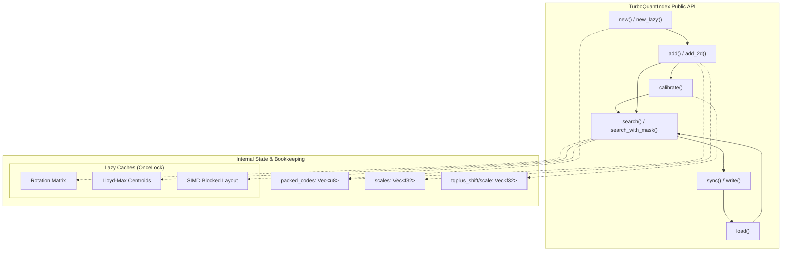
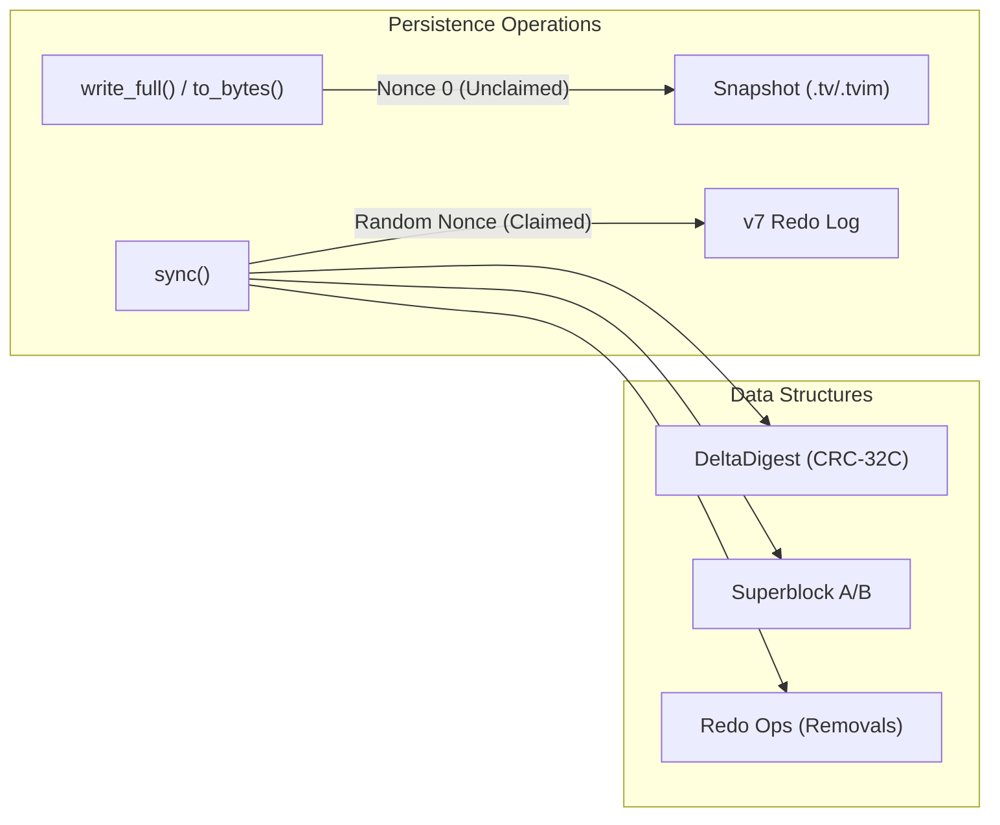

<!-- source: DeepWiki mcp.deepwiki.com · repo RyanCodrai/turbovec · page 2.1 TurboQuantIndex and IdMapIndex — Public API and Lifecycle · fetched 2026-10-30 -->

# TurboQuantIndex and IdMapIndex — Public API and Lifecycle

Relevant source files

The following files were used as context for generating this wiki page:

- [CHANGELOG.md](CHANGELOG.md)
- [docs/api.md](docs/api.md)
- [turbovec-python/tests/test_calibration.py](turbovec-python/tests/test_calibration.py)
- [turbovec-python/tests/test_id_map.py](turbovec-python/tests/test_id_map.py)
- [turbovec-python/tests/test_index.py](turbovec-python/tests/test_index.py)
- [turbovec/src/error.rs](turbovec/src/error.rs)
- [turbovec/src/id_map.rs](turbovec/src/id_map.rs)
- [turbovec/src/io.rs](turbovec/src/io.rs)
- [turbovec/src/lib.rs](turbovec/src/lib.rs)
- [turbovec/tests/concurrent_search.rs](turbovec/tests/concurrent_search.rs)
- [turbovec/tests/filtering.rs](turbovec/tests/filtering.rs)
- [turbovec/tests/id_map.rs](turbovec/tests/id_map.rs)
- [turbovec/tests/lazy_init.rs](turbovec/tests/lazy_init.rs)
- [turbovec/tests/tqplus_calibration.rs](turbovec/tests/tqplus_calibration.rs)

This page provides a detailed technical reference for the two primary index types in `turbovec`: `TurboQuantIndex` and `IdMapIndex`. It covers their constructor constraints, internal state management, thread-safety model via `OnceLock`, and the lifecycle of data from ingestion to persistence.

---

### TurboQuantIndex — Positional SIMD Index

`TurboQuantIndex` is the core engine of the library. It manages the compression of raw `f32` vectors into bit-packed codes and orchestrates SIMD-accelerated searches. It uses positional indexing: each vector is identified by its slot (`0..n`).

#### Struct Definition and Internal State
`TurboQuantIndex` maintains the compressed vector data and several internal caches required for high-performance search. It uses `std::sync::OnceLock` to ensure thread-safe, lazy initialization of heavy compute structures.

**Sources:** [turbovec/src/lib.rs:85-110](), [turbovec/src/lib.rs:22-52]()

#### Lifecycle and Constructors
The index supports both eager and lazy dimensionality commitment.

*   **`new(dim, bit_width)`**: Commits the index to a specific dimensionality immediately. `dim` must be a positive multiple of 8 and $\le$ `MAX_DIM` (16384). `bit_width` must be 2, 3, or 4 [turbovec/src/error.rs:164-175]().
*   **`new_lazy(bit_width)`**: Creates an index without a committed `dim`. The dimensionality is inferred and "locked" during the first call to `add_2d` [turbovec/src/lib.rs:104-107]().
*   **`add(vectors)`**: Appends vectors. On a lazy index, this must be `add_2d` to specify the dimension; otherwise, it panics [turbovec/tests/lazy_init.rs:105-111]().
*   **`prepare()`**: Eagerly builds the rotation matrix, centroids, and SIMD-blocked layout. This pays the one-time initialization cost up front so the first search is fast [turbovec/src/lib.rs:29-31]().

**Sources:** [turbovec/src/lib.rs:91-101](), [docs/api.md:42-54]()

#### Thread-Safety and Cache Invalidation
`TurboQuantIndex::search` takes `&self`, enabling lock-free concurrent searches.
*   **Safety Invariant**: "Whenever the index is reachable through `&self`, every populated cache describes exactly the `len()` rows the index currently holds" [turbovec/src/lib.rs:34-36]().
*   **Invalidation**: Any mutation (via `&mut self`) such as `add()` or `swap_remove()` invalidates the `blocked` layout cache by resetting the `OnceLock`. The rotation and centroids are functions of `dim` and `bit_width` only, so they never go stale [turbovec/src/lib.rs:38-45]().

**Sources:** [turbovec/src/lib.rs:22-52](), [turbovec/tests/concurrent_search.rs:142-175]()

---

### IdMapIndex — Stable External IDs

`IdMapIndex` provides a wrapper around `TurboQuantIndex` that maps stable `u64` IDs to internal positional slots. This is essential when deletions occur, as `TurboQuantIndex` uses `swap_remove` which changes slot indices.

#### ID Bookkeeping and Complexity
`IdMapIndex` maintains two primary maps: `id_to_slot` and `slot_to_id`.
*   **`add_with_ids(vectors, ids)`**: Ingests vectors and maps them to provided IDs. O(N) complexity for encoding plus hash map inserts [turbovec/src/id_map.rs:31-31]().
*   **`remove(id)`**: Performs O(1) removal. It identifies the slot of the ID, performs `swap_remove` on the inner index, and updates the maps so the ID previously at the "tail" of the index now points to the newly occupied slot [turbovec/src/id_map.rs:32-34]().
*   **Deferred ID Map**: Optimization for `load()`. To avoid O(N) hash map construction on startup, the ID table is stored sorted on disk. The index uses binary search on this sorted table until a mutation occurs, at which point the hash maps are materialized [turbovec/src/id_map.rs:133-166]().

**Sources:** [turbovec/src/id_map.rs:1-37](), [turbovec/src/id_map.rs:112-115]()

#### Search and Filtering
`IdMapIndex` supports an "allowlist" filter, which resolves external `u64` IDs to internal bitmasks for the SIMD engine.

| Feature | Description |
| :--- | :--- |
| **Search** | Returns `IdSearchResults`, translating internal `i64` slots back to external `u64` IDs [turbovec/src/id_map.rs:168-175](). |
| **Allowlist** | `search_with_allowlist` accepts a slice of `u64`. It performs binary searches against the ID maps to build a bitmask for the kernel [turbovec/src/id_map.rs:13-17](). |
| **`contains(id)`** | Checks if an ID exists in O(1) (via hash map) or O(log N) (via sorted table) [turbovec/src/id_map.rs:54-63](). |

**Sources:** [turbovec/src/id_map.rs:35-36](), [turbovec/tests/filtering.rs:10-11]()

---

### Persistence and Sync

The `turbovec` v7 format introduces incremental synchronization (`sync()`), allowing the index to persist only changed blocks rather than the entire file.

*   **Atomic Replace**: Writes go to a sibling `.tmp` file using `O_CREAT | O_EXCL` before an atomic rename to prevent corruption from concurrent writers or power loss [turbovec/src/io.rs:14-27]().
*   **Nonces**: `write()` produces a file with nonce `0` (unclaimed). `sync()` claims the file with a random nonce. A loader will refuse to `sync()` to a file replaced by another writer (nonce mismatch) [CHANGELOG.md:93-102]().
*   **Durability**: Users can choose `Durability::Durable` (fsync) or `Durability::Fast` (no fsync) [turbovec/src/io.rs:57-64]().

**Sources:** [turbovec/src/io.rs:1-46](), [CHANGELOG.md:31-34]()

---

### TQ+ Calibration Lifecycle

TQ+ provides per-coordinate shift and scale fitting. Unlike the quantization codebook, calibration is data-dependent and belongs to the index lifecycle.

*   **States**: There are only two states: `Uncalibrated` and `Calibrated` [turbovec/tests/tqplus_calibration.rs:3-4]().
*   **Transition**: Transition occurs via an explicit `calibrate(&[f32])` call. This calculates optimal shifts (means) and scales (Lloyd-Max fitting over the Beta distribution) [turbovec/tests/tqplus_calibration.rs:57-61]().
*   **Persistence**: Calibration is stored in the TQ+ trailer of the v7 file. An uncalibrated index round-trips as uncalibrated (storing empty arrays) [turbovec/tests/tqplus_calibration.rs:87-95]().

**Sources:** [turbovec/tests/tqplus_calibration.rs:1-12](), [docs/api.md:62-76]()

---

