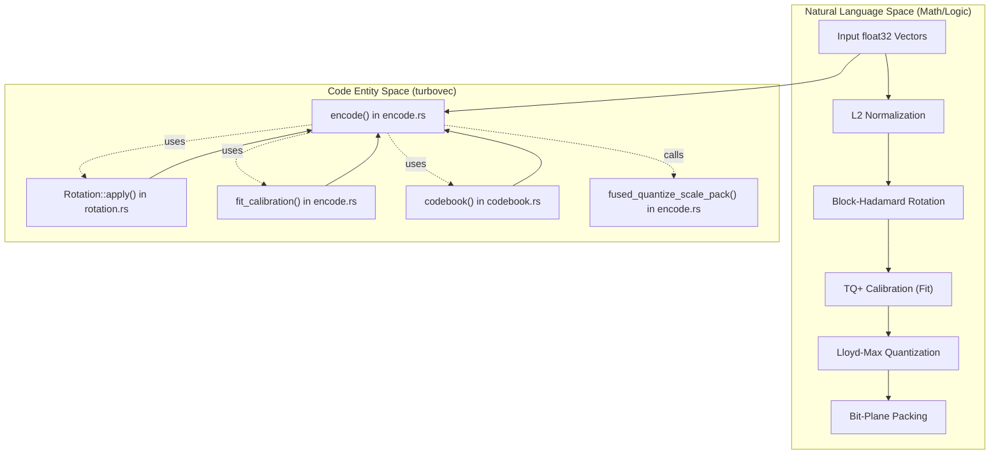

<!-- source: DeepWiki mcp.deepwiki.com · repo RyanCodrai/turbovec · page 2.2 TurboQuant Algorithm — Rotation, Codebook, and Encoding · fetched 2026-10-30 -->

# TurboQuant Algorithm — Rotation, Codebook, and Encoding

Relevant source files

The following files were used as context for generating this wiki page:

- [Cargo.lock](Cargo.lock)
- [examples/downstream-smoke/Cargo.lock](examples/downstream-smoke/Cargo.lock)
- [turbovec-python/Cargo.toml](turbovec-python/Cargo.toml)
- [turbovec-python/pyproject.toml](turbovec-python/pyproject.toml)
- [turbovec/Cargo.toml](turbovec/Cargo.toml)
- [turbovec/examples/encode_hash.rs](turbovec/examples/encode_hash.rs)
- [turbovec/src/codebook.rs](turbovec/src/codebook.rs)
- [turbovec/src/encode.rs](turbovec/src/encode.rs)
- [turbovec/src/kernel_tests.rs](turbovec/src/kernel_tests.rs)
- [turbovec/src/rotation.rs](turbovec/src/rotation.rs)
- [turbovec/src/search.rs](turbovec/src/search.rs)
- [turbovec/tests/codebook_determinism.rs](turbovec/tests/codebook_determinism.rs)
- [turbovec/tests/common/fingerprint.rs](turbovec/tests/common/fingerprint.rs)
- [turbovec/tests/encode_fingerprint.rs](turbovec/tests/encode_fingerprint.rs)
- [turbovec/tests/query_scale_invariance.rs](turbovec/tests/query_scale_invariance.rs)

The TurboQuant algorithm is the core compression pipeline of `turbovec`. It transforms high-dimensional `float32` vectors into compact, bit-packed representations (2, 3, or 4 bits per dimension) while preserving the angular relationships necessary for high-recall similarity search. This page details the mathematical and implementation steps: block-Hadamard rotation, Lloyd-Max quantization over the Beta distribution, TQ+ calibration, and bit-plane packing.

### Algorithm Pipeline Overview

The encoding process follows a deterministic pipeline to convert raw input vectors into a format optimized for SIMD-accelerated scoring. Unlike earlier versions, the current pipeline is strictly deterministic across architectures and platforms.

1.  **Validation**: Input vectors are scanned for `NaN`, `Inf`, or extreme magnitudes `[turbovec/src/encode.rs:58-74]()`.
2.  **Normalization**: Input vectors are converted to unit vectors (on the unit hypersphere $S^{d-1}$), and their original magnitudes (norms) are stored separately `[turbovec/src/encode.rs:160-163]()`.
3.  **Deterministic Orthogonal Rotation**: A block-Hadamard transform is applied. This decorrelates coordinates so each follows a predictable statistical distribution `[turbovec/src/rotation.rs:1-39]()`.
4.  **TQ+ Calibration**: Per-coordinate `shift` and `scale` parameters are fit to map empirical quantiles onto codebook centroids, correcting for residual anisotropy `[turbovec/src/encode.rs:10-29]()`.
5.  **Lloyd-Max Quantization**: Each rotated and calibrated coordinate is mapped to a discrete code based on optimal boundaries derived from the Beta distribution `[turbovec/src/codebook.rs:1-5]()`.
6.  **Bit-Plane Packing**: Codes are packed into bit-planes to facilitate fast bitwise operations during search `[turbovec/src/encode.rs:244-278]()`.

#### Data Flow and Code Entities

The following diagram maps the mathematical stages to the specific Rust functions and modules.

**TurboQuant Encoding Pipeline**

Sources: `[turbovec/src/encode.rs:1-30]()`, `[turbovec/src/rotation.rs:97-118]()`, `[turbovec/src/codebook.rs:35-50]()`

---

### Deterministic Rotation (`rotation.rs`)

`turbovec` uses a **Block-Hadamard Transform** instead of a dense Gaussian matrix to ensure bit-for-bit determinism across CPUs and operating systems `[turbovec/src/rotation.rs:6-18]()`.

#### The Transform Mechanism
The rotation is composed of `K=2` rounds `[turbovec/src/rotation.rs:69-70]()`. Each round consists of:
1.  **Global Permutation**: A Fisher-Yates shuffle across all `dim` coordinates, seeded by a fixed `ROTATION_SEED` (ChaCha8) `[turbovec/src/rotation.rs:33-34]()`.
2.  **Sign Flips**: Every coordinate is multiplied by ±1, also seeded by ChaCha8 `[turbovec/src/rotation.rs:35]()`.
3.  **Walsh-Hadamard Transform (WHT)**: Applied to contiguous blocks of size `B`, where `B` is the largest power-of-two divisor of `dim` `[turbovec/src/rotation.rs:36-37]()`.

This approach removes dependencies on BLAS or transcendental samplers that previously caused cross-platform divergence `[turbovec/src/rotation.rs:19-26]()`.

Sources: `[turbovec/src/rotation.rs:1-96]()`

---

### Lloyd-Max Scalar Quantization (`codebook.rs`)

Rotated coordinates follow a `Beta((d-1)/2, (d-1)/2)` distribution. The `codebook` module computes optimal boundaries and centroids for this distribution.

#### Lloyd-Max Implementation
The `lloyd_max` function iteratively minimizes Mean Squared Error (MSE) `[turbovec/src/codebook.rs:69-82]()`:
- **Memoization**: Results are cached in a process-global `MEMO` (a `Mutex<HashMap>`) using `try_lock` to avoid deadlocks during `fork()` `[turbovec/src/codebook.rs:11-33]()`.
- **Numerical Integration**: Conditional means are calculated using `adaptive_simpson` quadratures of the Beta PDF `[turbovec/src/codebook.rs:108-122]()`.
- **Determinism Guard**: Centroids are rounded to `f32` *before* computing midpoints (boundaries). This prevents tiny `f64` precision differences between `libm` implementations (e.g., glibc vs MSVC) from flipping the final `f32` boundary value `[turbovec/src/codebook.rs:137-160]()`.

Sources: `[turbovec/src/codebook.rs:1-165]()`

---

### TQ+ Calibration and Packing (`encode.rs`)

#### TQ+ Calibration
TQ+ introduces two free parameters per coordinate—`shift` and `scale`—to correct for anisotropic energy remaining after rotation `[turbovec/src/encode.rs:10-17]()`.
- **Fitting**: `fit_calibration` maps empirical quantiles of the data onto the codebook's outermost centroids `[turbovec/src/encode.rs:17-20]()`.
- **Anchor**: The probability level for the fit is derived from the codebook itself via `tqplus_anchor` `[turbovec/src/encode.rs:454-455]()`.

#### Fused Quantization and Packing
To maximize performance, `fused_quantize_scale_pack` performs quantization and bit-plane packing in a single pass `[turbovec/src/encode.rs:244-248]()`.

**Bit-Plane Layout**
Vectors are stored in blocks of 32. The layout is "vector-major" or "bit-plane" depending on the target SIMD architecture:
- **Sequential**: Standard layout for ARM NEON.
- **Perm0-Interleaved**: Layout for x86 AVX2/AVX-512 to match `vpshufb` requirements `[turbovec/src/search.rs:5-8]()`.

The `encode` function handles the final calculation of the RaBitQ-style scale: `||v|| / <u, x_hat>`, providing an unbiased estimator of the inner product during search `[turbovec/src/encode.rs:3-8]()`.

Sources: `[turbovec/src/encode.rs:1-30]()`, `[turbovec/src/encode.rs:244-278]()`, `[turbovec/src/search.rs:1-10]()`

---

### Determinism and Fingerprinting

`turbovec` enforces strict determinism via a "Golden Bytes" test suite.

- **Golden Bytes**: `tests/encode_fingerprint.rs` contains hardcoded FNV-1a hashes for every stage of the pipeline (boundaries, centroids, calibration, codes, scales) across various dimensions and bit widths `[turbovec/tests/encode_fingerprint.rs:1-92]()`.
- **Cross-OS Validation**: CI runs these tests on Linux, macOS, and Windows. Any change in `statrs` (Beta CDF) or reduction order that moves encoded bytes is caught as a format break `[turbovec/tests/encode_fingerprint.rs:47-58]()`.

Sources: `[turbovec/tests/encode_fingerprint.rs:1-130]()`, `[turbovec/tests/common/fingerprint.rs:1-15]()`

---

