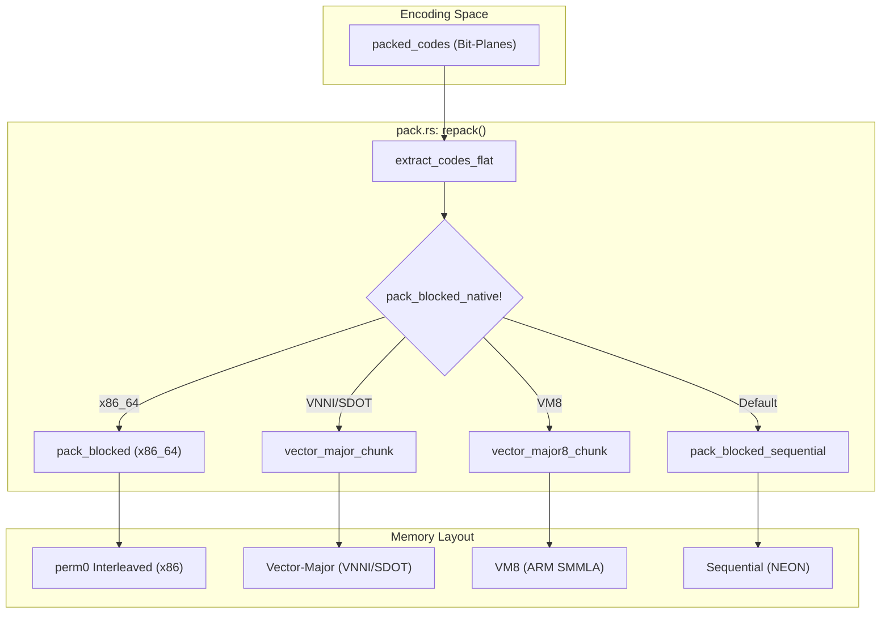
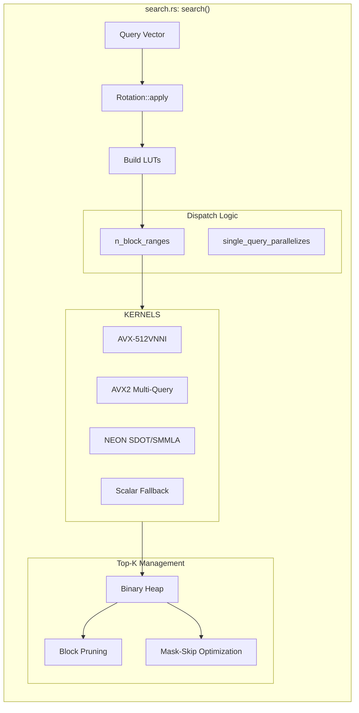

<!-- source: DeepWiki mcp.deepwiki.com · repo RyanCodrai/turbovec · page 2.3 SIMD Search Engine — Repacking and Scoring Kernels · fetched 2026-10-30 -->

# SIMD Search Engine — Repacking and Scoring Kernels

Relevant source files

The following files were used as context for generating this wiki page:

- [benchmarks/hillclimb/LOG.md](benchmarks/hillclimb/LOG.md)
- [benchmarks/results/hillclimb_baseline.json](benchmarks/results/hillclimb_baseline.json)
- [turbovec-python/tests/test_id_map.py](turbovec-python/tests/test_id_map.py)
- [turbovec-python/tests/test_index.py](turbovec-python/tests/test_index.py)
- [turbovec/src/encode.rs](turbovec/src/encode.rs)
- [turbovec/src/error.rs](turbovec/src/error.rs)
- [turbovec/src/kernel_tests.rs](turbovec/src/kernel_tests.rs)
- [turbovec/src/pack.rs](turbovec/src/pack.rs)
- [turbovec/src/rotation.rs](turbovec/src/rotation.rs)
- [turbovec/src/search.rs](turbovec/src/search.rs)
- [turbovec/tests/concurrent_search.rs](turbovec/tests/concurrent_search.rs)
- [turbovec/tests/filtering.rs](turbovec/tests/filtering.rs)
- [turbovec/tests/id_map.rs](turbovec/tests/id_map.rs)
- [turbovec/tests/kernel_correctness.rs](turbovec/tests/kernel_correctness.rs)
- [turbovec/tests/lazy_init.rs](turbovec/tests/lazy_init.rs)
- [turbovec/tests/swap_remove.rs](turbovec/tests/swap_remove.rs)

The `turbovec` search engine implements a high-performance, two-phase pipeline designed to maximize SIMD utilization across different CPU architectures. This page details the transformation of bit-plane encoded vectors into SIMD-friendly memory layouts and the subsequent scoring kernels that leverage architecture-specific instructions (AVX2, AVX-512, NEON) for ultra-fast similarity search.

## 1. Data Flow: From Bit-Planes to SIMD Blocks

The search pipeline begins with `repack()`, which reorganizes the bit-packed codes generated during encoding into a blocked layout. This layout allows SIMD registers to load data for multiple vectors simultaneously without complex shuffling during the hot scoring loop.

### 1.1. The Repacking Phase
The `repack` function [turbovec/src/pack.rs:59-74]() performs two primary steps:
1.  **Extraction**: It calls `extract_codes_flat` to convert bit-plane packed codes into a flat vector of nibble-sized values [turbovec/src/pack.rs:68]().
2.  **Layout Transformation**: It uses the `pack_blocked_native!` macro to arrange these values into architecture-optimized structures [turbovec/src/pack.rs:71-72]().

### 1.2. Platform-Specific Layouts
`turbovec` optimizes for three primary memory layouts based on the target instruction set and bit-width:

| Layout Type | Target Architecture | Description |
| :--- | :--- | :--- |
| **perm0-Interleaved** | x86_64 (AVX2/AVX-512) | Splits bytes into hi/lo nibbles, interleaving them through the `PERM0` constant to ensure cross-lane compatibility for AVX2 `_mm256_shuffle_epi8` [turbovec/src/pack.rs:76-102](). |
| **Vector-Major** | VNNI / SDOT | A layout optimized for dot-product instructions where codes are grouped to match vector register widths (e.g., `vector_major_chunk`) [turbovec/src/pack.rs:31-35](). |
| **VM8 (ARM SMMLA)** | ARM (aarch64) | A specialized "Vector-Major 8" layout used for ARM matrix-multiply instructions [turbovec/src/pack.rs:26-30](). |
| **Sequential** | NEON / Scalar | The default layout for non-x86 targets where codes are stored contiguously [turbovec/src/pack.rs:41-44](). |

### Data Transformation Topology
The following diagram illustrates how raw bit-planes are transformed into the `blocked_codes` used by the scoring kernels.

Sources: [turbovec/src/pack.rs:1-74](), [turbovec/src/pack.rs:19-47]()

---

## 2. Scoring Kernels and SIMD Implementation

The `search()` function orchestrates the construction of Look-Up Tables (LUTs) and dispatches execution to architecture-specific kernels. It supports single-query parallelization over blocks when the dataset size exceeds `SINGLE_QUERY_PARALLEL_MIN_BLOCKS` (1024 blocks) [turbovec/src/search.rs:30-86]().

### 2.1. LUT Construction and Query Rotation
Before scoring, the query is rotated using the `Rotation` object [turbovec/src/rotation.rs:97-141](). `turbovec` then constructs a LUT containing the pre-calculated contribution of every possible quantized value to the final dot product. This converts the dot product calculation into a series of SIMD table lookups.

### 2.2. Architecture-Specific Kernels
The engine selects the most efficient kernel at runtime using `is_x86_feature_detected!` or target-specific CFG flags [turbovec/src/search.rs:1-10]().

*   **AVX-512 (BW/VNNI/GFNI)**: The highest performance x86 path. Uses 512-bit ZMM registers for massive throughput.
*   **AVX2**: The standard x86 fallback. Uses a fused multi-query approach to process 4 queries against a block of vectors, maximizing cache reuse [turbovec/src/search.rs:134-149]().
*   **ARM NEON (SDOT/SMMLA)**: Leverages `sdot` for 4-way dot products or `smmla` for matrix-multiply-accumulate, significantly outperforming standard NEON lookups.
*   **Scalar Fallback**: Used for unsupported architectures. It handles `perm0` de-interleaving on x86 via `deinterleave_x86_code_byte` to ensure correctness [turbovec/src/pack.rs:125-135]().

### System Architecture: Search Pipeline
This diagram maps the logical search steps to the specific code entities in `search.rs` and `pack.rs`.

Sources: [turbovec/src/search.rs:1-144](), [turbovec/src/rotation.rs:121-141]()

---

## 3. Advanced Block Management

### 3.1. Block-Level Pruning and Masking
`turbovec` uses a block-based approach to minimize the work performed by the scoring kernels:
*   **Block Size**: Vectors are processed in fixed blocks of 32 (`BLOCK = 32`) [turbovec/src/pack.rs:7]().
*   **Mask-Skip**: If an allowlist mask is provided, the kernel uses `block_has_allowed` to skip entire blocks where no vectors are permitted [turbovec/src/search.rs:101-113]().
*   **Pruning**: For multi-query searches, if a block's maximum possible score is lower than the current heap minimum, the entire block is skipped.

### 3.2. Incremental Mutation (O(dim) Deletions)
Instead of repacking the entire index when a vector is removed, `turbovec` implements `move_lane` [turbovec/src/pack.rs:156-178]().
*   **`move_lane`**: When `swap_remove` occurs, this function copies the last vector's code bytes into the vacated lane in O(dim) time [turbovec/src/pack.rs:156]().
*   **`append_lanes`**: Efficiently adds new vectors to the blocked layout by filling the next available lanes in the final block [turbovec/src/pack.rs:205-224]().

### 3.3. Lazy Materialization
The index supports `new_lazy`, allowing it to defer dimension commitment until the first `add_2d` call [turbovec/src/error.rs:10-12](). The `blocked` layout is materialized lazily via `prepare()` or on the first `search()` call, utilizing `OnceLock` for thread-safe initialization [turbovec/tests/concurrent_search.rs:3-12]().

Sources: [turbovec/src/pack.rs:156-224](), [turbovec/src/search.rs:15-86](), [turbovec/src/error.rs:1-172](), [turbovec/tests/concurrent_search.rs:1-186]()

---

