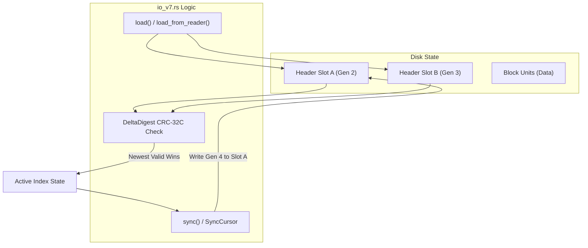
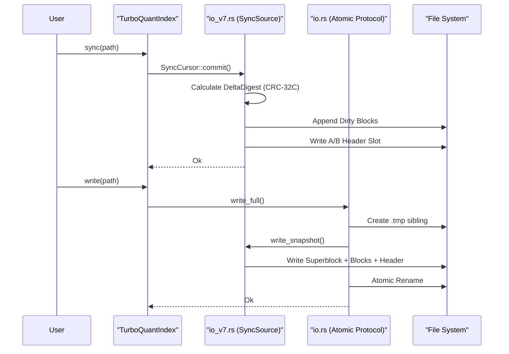

<!-- source: DeepWiki mcp.deepwiki.com · repo RyanCodrai/turbovec · page 2.4 Persistence — v7 File Format and Incremental Sync · fetched 2026-10-30 -->

# Persistence — v7 File Format and Incremental Sync

Relevant source files

The following files were used as context for generating this wiki page:

- [CHANGELOG.md](CHANGELOG.md)
- [docs/api.md](docs/api.md)
- [turbovec-python/tests/test_pickle_copy.py](turbovec-python/tests/test_pickle_copy.py)
- [turbovec/examples/convert.rs](turbovec/examples/convert.rs)
- [turbovec/src/convert.rs](turbovec/src/convert.rs)
- [turbovec/src/id_map.rs](turbovec/src/id_map.rs)
- [turbovec/src/io.rs](turbovec/src/io.rs)
- [turbovec/src/io_v7.rs](turbovec/src/io_v7.rs)
- [turbovec/src/lib.rs](turbovec/src/lib.rs)
- [turbovec/tests/adversarial_durability.rs](turbovec/tests/adversarial_durability.rs)
- [turbovec/tests/adversarial_durability_edges.rs](turbovec/tests/adversarial_durability_edges.rs)
- [turbovec/tests/adversarial_durability_fuzz.rs](turbovec/tests/adversarial_durability_fuzz.rs)
- [turbovec/tests/adversarial_durability_round2.rs](turbovec/tests/adversarial_durability_round2.rs)
- [turbovec/tests/adversarial_gen_reuse.rs](turbovec/tests/adversarial_gen_reuse.rs)
- [turbovec/tests/adversarial_load_memory.rs](turbovec/tests/adversarial_load_memory.rs)
- [turbovec/tests/bytes_io.rs](turbovec/tests/bytes_io.rs)
- [turbovec/tests/calibration_bounds.rs](turbovec/tests/calibration_bounds.rs)
- [turbovec/tests/convert_versions.rs](turbovec/tests/convert_versions.rs)
- [turbovec/tests/sync_v7.rs](turbovec/tests/sync_v7.rs)
- [turbovec/tests/v7_only.rs](turbovec/tests/v7_only.rs)

The `turbovec` library uses the **v7 binary container format** as its primary persistence layer. Starting with version 1.0.0, v7 is the only format supported for reading and writing [CHANGELOG.md:18-20](). It introduces **incremental synchronization** via the `sync()` method, allowing the index to persist only changed blocks rather than rewriting the entire file [CHANGELOG.md:31-32]().

### v7 Binary Layout

The v7 format is a headerized slot array designed for crash-safe updates and random-access loading [io_v7.rs:1-3](). It consists of a superblock, two alternating commit headers, and a sequence of data block units.

| Section | Content | Purpose |
| :--- | :--- | :--- |
| **Superblock** | `TV7\0` magic, version, bit-width, dimension, codebook, TQ+ calibration. | Global immutable geometry; carries a trailing CRC-32C [io_v7.rs:6-7](). |
| **Header A/B** | Generation, row count `n`, tail rows, redo ops, delta digest. | Dual-slot A/B protocol for atomic commits [io_v7.rs:8-9](). |
| **Block Units** | Sequential-blocked codes, 32 scales, 32 IDs. | One unit per 32-row block; stored in search-ready layout [io_v7.rs:10-12](). |

**Sources:** [io_v7.rs:1-13](), [io_v7.rs:89-100](), [CHANGELOG.md:18-35]()

---

### A/B Dual-Slot Header Protocol

To ensure crash safety without a separate write-ahead log, v7 uses two alternating header slots. Generation `g` is written to slot `g % 2`, overwriting only the slot from generation `g-1` [io_v7.rs:21-23]().

**Commit and Recovery Flow**

**Sources:** [io_v7.rs:21-48](), [io_v7.rs:73-83]()

---

### Incremental Sync and Redo Ops

Unlike a full `write()`, `sync()` identifies dirty blocks and appends them to the file. Removals are handled via **Redo Ops** stored in the commit header [io_v7.rs:50-51]().

1.  **Removals:** A `remove()` operation records a redo op ("slot X now holds these bytes") in the header rather than modifying the block unit immediately [io_v7.rs:52-56]().
2.  **Materialization:** Subsequent syncs materialize these ops into the data blocks on disk [io_v7.rs:56-59]().
3.  **DeltaDigest:** A CRC-32C "trick" covers all blocks written in a specific sync. During `load()`, the engine verifies the delta digest to ensure the data landed before the header commit [io_v7.rs:37-42]().

**Sources:** [io_v7.rs:50-70](), [io_v7.rs:102-114](), [adversarial_load_memory.rs:3-8]()

---

### Implementation Entities

| Component | Code Entity | Description |
| :--- | :--- | :--- |
| **Format Dispatch** | `io_v7.rs` | Core implementation of v7 serialization, CRC-32C, and header management [io_v7.rs:1-83](). |
| **File Lineage** | `nonce` | A random `u64` that binds a `SyncCursor` to a specific file. Prevents one index from syncing to a file replaced by another writer [CHANGELOG.md:93-102](). |
| **Atomic Replace** | `io.rs` | Implements the `.tmp.{pid}.{seq}.{rand}` sibling rename protocol for full `write()` calls [io.rs:14-27](). |
| **Migration** | `convert.rs` | Utility to migrate v5/v6 files to v7. It performs a re-containerization without re-quantizing [CHANGELOG.md:51-66](). |
| **In-Memory** | `to_bytes()` / `from_bytes()` | Serialization to/from `Vec<u8>`. Produces byte-identical images to the file writer but with a `0` (unclaimed) nonce [CHANGELOG.md:89-92](). |

**Sources:** [io.rs:14-45](), [io.rs:156-166](), [convert.rs:1-20](), [bytes_io.rs:7-16](), [v7_only.rs:123-132]()

---

### Data Lifecycle: Memory to Disk

This diagram maps the relationship between the high-level `TurboQuantIndex` API and the underlying persistence modules.

**Persistence Architecture Map**

**Sources:** [lib.rs:18-19](), [io.rs:57-64](), [io_v7.rs:31-48](), [v7_only.rs:148-163]()

### Migration and Compatibility

The `turbovec::convert` module provides tools to move indexes between versions [CHANGELOG.md:45-47]().
*   **v5/v6 to v7:** Decodes the legacy flat snapshot and wraps it in the v7 container. The rotation and quantized codes remain identical [CHANGELOG.md:62-66]().
*   **v7 to Legacy:** Possible for rollbacks, but loses incremental history and redo-op state [CHANGELOG.md:68-70]().
*   **Pre-v5:** Refused entirely due to the fundamental rotation change in v5; these must be rebuilt from source vectors [io.rs:94-97]().

**Sources:** [io.rs:81-119](), [convert.rs:1-40](), [CHANGELOG.md:51-60]()

---

