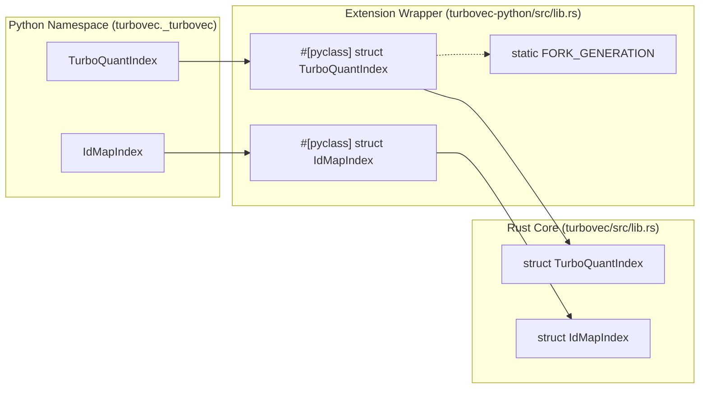
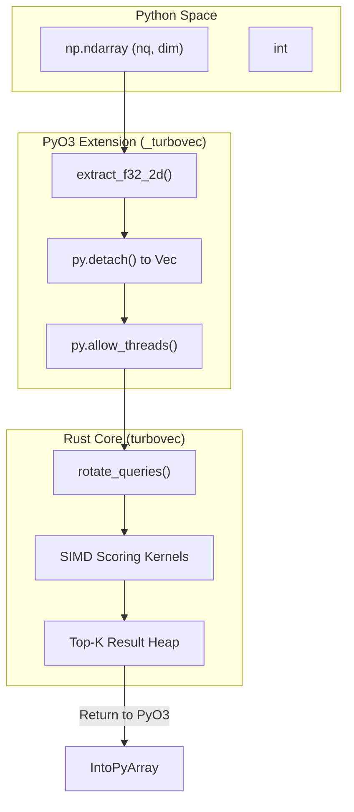

<!-- source: DeepWiki mcp.deepwiki.com · repo RyanCodrai/turbovec · page 3.1 PyO3 Extension Module (_turbovec) · fetched 2026-10-30 -->

# PyO3 Extension Module (_turbovec)

Relevant source files

The following files were used as context for generating this wiki page:

- [turbovec-python/src/lib.rs](turbovec-python/src/lib.rs)
- [turbovec-python/tests/test_fork_safety.py](turbovec-python/tests/test_fork_safety.py)
- [turbovec-python/tests/test_gil_release.py](turbovec-python/tests/test_gil_release.py)

The `_turbovec` module is the low-level C extension that bridges the Rust core engine with the Python runtime. It handles the translation of NumPy arrays into Rust slices, manages GIL (Global Interpreter Lock) release for heavy computation, ensures fork-safety for multiprocessing, and provides the Python-facing `TurboQuantIndex` and `IdMapIndex` classes.

## Overview and Thread Management

The extension is implemented in `turbovec-python/src/lib.rs` using the [PyO3](https://pyo3.rs/) framework. A critical aspect of its design is the **fork-safe thread pool**. Because Rayon's default thread pool does not survive a `fork()` call (common in Python `multiprocessing`), the module implements a custom `PoolCell` and `pthread_atfork` handler to rebuild the pool in child processes [turbovec-python/src/lib.rs:242-286]().

### GIL Release Discipline
To prevent blocking the Python interpreter during long-running vector operations, the module releases the GIL using `py.allow_threads()` (often wrapped in `with_write_gil_aware` for indices) [turbovec-python/src/lib.rs:360-366](). Input NumPy arrays are snapshotted into owned Rust `Vec`s before the GIL is released to prevent data corruption if the Python thread mutates the array during the Rust call [turbovec-python/tests/test_gil_release.py:6-9]().

**Entity Mapping: Python to Rust Symbols**

**Sources:** [turbovec-python/src/lib.rs:242-286](), [turbovec-python/src/lib.rs:315-320](), [turbovec-python/src/lib.rs:748-753]()

---

## Index Wrappers and Methods

The module exposes two primary classes: `TurboQuantIndex` (raw integer slots) and `IdMapIndex` (external `u64` ID mapping).

### Common Implementation Patterns
*   **NumPy Interop**: Uses `PyReadonlyArray2<f32>` for vectors and `PyReadonlyArray1<u64>` for IDs [turbovec-python/src/lib.rs:56-71]().
*   **Safety**: Validates C-contiguity of arrays and handles Python `bool` arrays by reading raw bytes to avoid undefined behavior with Rust `bool` [turbovec-python/src/lib.rs:87-130]().
*   **Deferred Warnings**: Uses `DeferCoreWarnings` to capture core engine warnings during computation and emit them as Python `UserWarning`s after the GIL is re-acquired [turbovec-python/src/lib.rs:290-312]().

### Method Reference

| Method | Wrapper Implementation | Core Delegation |
| :--- | :--- | :--- |
| `new` / `new_lazy` | Extracts `dim` and `bit_width` [turbovec-python/src/lib.rs:322-351]() | `TurboQuantIndex::new` |
| `add` | Snapshots NumPy to `Vec<f32>` [turbovec-python/src/lib.rs:388-406]() | `index.add()` |
| `add_with_ids` | Only in `IdMapIndex`; takes IDs array [turbovec-python/src/lib.rs:828-850]() | `index.add_with_ids()` |
| `search` | Returns `(scores, ids)` tuple [turbovec-python/src/lib.rs:434-486]() | `index.search()` |
| `calibrate` | Fits codebooks to sample data [turbovec-python/src/lib.rs:408-432]() | `index.calibrate()` |
| `sync` | Incremental persistence [turbovec-python/src/lib.rs:539-556]() | `index.sync()` |
| `remove` | Only in `IdMapIndex`; deletes by ID [turbovec-python/src/lib.rs:872-885]() | `index.remove()` |
| `snap` / `retain_snap` | Manages snapshot handles [turbovec-python/src/lib.rs:586-608]() | `index.snap()` |

**Sources:** [turbovec-python/src/lib.rs:322-608](), [turbovec-python/src/lib.rs:748-910]()

---

## Data Flow: Python to SIMD Core

The following diagram traces a search query from a Python NumPy array through the PyO3 layer into the SIMD kernels.

**Search Pipeline Data Flow**

**Sources:** [turbovec-python/src/lib.rs:434-486](), [turbovec-python/tests/test_gil_release.py:83-89]()

---

## Fork-Safety and Thread Pooling

To solve the "Rayon hangs after fork" issue (#147), `_turbovec` uses a process-local `FORK_GENERATION` counter.

1.  **Registration**: At module load, `pthread_atfork` is called to increment the generation in the child process [turbovec-python/src/lib.rs:1134-1144]().
2.  **Detection**: The `with_pool` helper checks if the current process generation matches the pool's generation [turbovec-python/src/lib.rs:265-274]().
3.  **Rebuild**: If a mismatch is detected (indicating a fork occurred), the old pool is discarded and a new Rayon pool is initialized [turbovec-python/src/lib.rs:276-282]().

This ensures that `multiprocessing` workers or `gunicorn` pre-forked workers do not hang when calling `index.search()` [turbovec-python/tests/test_fork_safety.py:1-25]().

**Sources:** [turbovec-python/src/lib.rs:242-286](), [turbovec-python/src/lib.rs:1134-1144](), [turbovec-python/tests/test_fork_safety.py:10-14]()

---

## Snapshot and Persistence Lifecycle

The extension supports the v7 incremental persistence format. The `sync()` method allows for low-latency updates by only writing deltas since the last sync [turbovec-python/src/lib.rs:539-556]().

For consistent backups, the `snap()` method returns a `SnapshotHandle`. This handle pins a specific version of the index in memory, allowing a `write()` operation to proceed on a background thread while the main index continues to receive new `add()` calls [turbovec-python/src/lib.rs:586-600](). The `retain_snap()` method is used to keep these handles alive across Python calls [turbovec-python/src/lib.rs:602-608]().

**Sources:** [turbovec-python/src/lib.rs:518-537](), [turbovec-python/src/lib.rs:586-608]()

---

