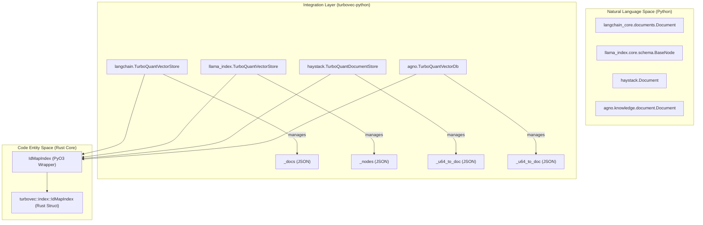
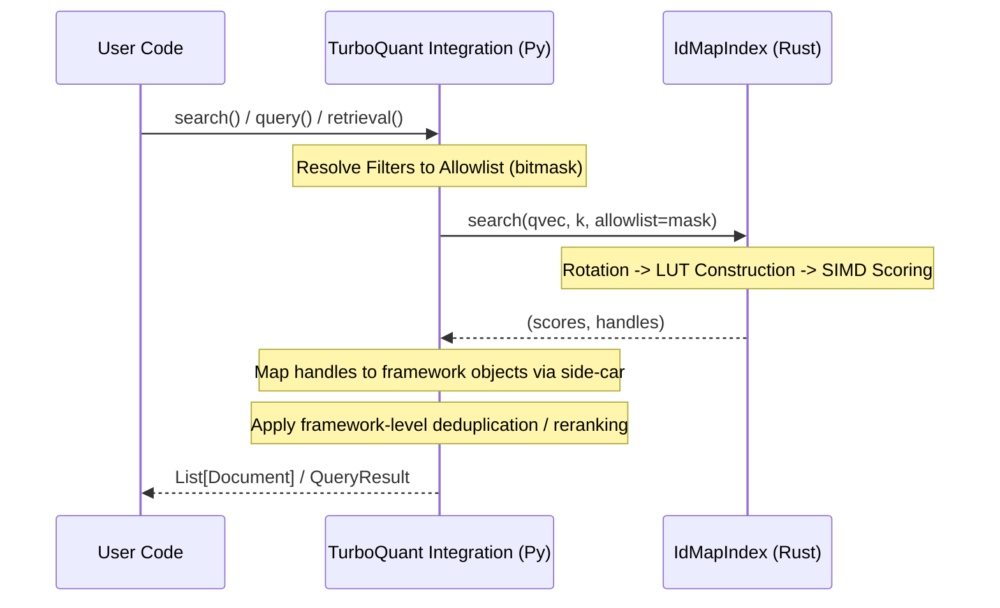

<!-- source: DeepWiki mcp.deepwiki.com · repo RyanCodrai/turbovec · page 4 Framework Integrations · fetched 2026-10-30 -->

# Framework Integrations

Relevant source files

The following files were used as context for generating this wiki page:

- [docs/integrations/agno.md](docs/integrations/agno.md)
- [docs/integrations/haystack.md](docs/integrations/haystack.md)
- [docs/integrations/langchain.md](docs/integrations/langchain.md)
- [docs/integrations/llama_index.md](docs/integrations/llama_index.md)
- [turbovec-python/python/turbovec/haystack.py](turbovec-python/python/turbovec/haystack.py)
- [turbovec-python/python/turbovec/langchain.py](turbovec-python/python/turbovec/langchain.py)
- [turbovec-python/python/turbovec/llama_index.py](turbovec-python/python/turbovec/llama_index.py)
- [turbovec-python/tests/test_haystack.py](turbovec-python/tests/test_haystack.py)
- [turbovec-python/tests/test_langchain.py](turbovec-python/tests/test_langchain.py)
- [turbovec-python/tests/test_llama_index.py](turbovec-python/tests/test_llama_index.py)
- [turbovec-python/tests/test_similarity_modes.py](turbovec-python/tests/test_similarity_modes.py)

`turbovec` provides first-class integrations for four major RAG (Retrieval-Augmented Generation) frameworks: **LangChain**, **LlamaIndex**, **Haystack**, and **Agno**. These integrations allow developers to swap standard vector stores for `turbovec` to benefit from SIMD-accelerated search and significant memory compression (2–4 bits per dimension) while maintaining compatibility with existing document and node abstractions.

### Shared Design Pattern

All four integrations follow a consistent "side-car" architecture. Because the core `IdMapIndex` [turbovec-python/python/turbovec/_turbovec.pyi:82]() stores only quantized numerical vectors and their integer handles, the Python wrappers maintain auxiliary data structures to map these handles back to framework-specific objects (like LangChain `Document` or Haystack `Document`).

| Feature | Implementation Detail |
| :--- | :--- |
| **Vector Index** | `IdMapIndex` (Rust core) provides O(1) removals and SIMD search [turbovec-python/python/turbovec/_turbovec.pyi:82](). |
| **Side-car Store** | JSON-based store (e.g., `docstore.json` or `.nodes.json`) for framework-specific metadata [turbovec-python/python/turbovec/langchain.py:56](). |
| **Persistence** | `atomic_save` ensures all-or-nothing writes to prevent "torn" stores between the index and side-car [turbovec-python/python/turbovec/_persist.py:65](). |
| **Thread Safety** | Concurrent reads (lock-free) and serialized writes via `threading.RLock` [turbovec-python/python/turbovec/langchain.py:140](). |
| **Similarity** | Fixed `cosine` or `dot_product` modes validated at construction [turbovec-python/python/turbovec/_similarity.py:38](). |

#### Integration Architecture

The following diagram illustrates how the framework-specific Python classes bridge the gap between Natural Language objects and the optimized Rust core.

**Framework Object Mapping**

Sources: [turbovec-python/python/turbovec/langchain.py:66-140](), [turbovec-python/python/turbovec/llama_index.py:180-250](), [turbovec-python/python/turbovec/haystack.py:48-151](), [turbovec-python/python/turbovec/agno.py:46-130]()

---

### LangChain Integration

The `turbovec.langchain.TurboQuantVectorStore` [turbovec-python/python/turbovec/langchain.py:66]() implements the standard `VectorStore` interface. It is a drop-in replacement for `InMemoryVectorStore`.

*   **Similarity Modes**: Supports `cosine` (default) and `dot_product`. Cosine mode L2-normalizes vectors at add-time [turbovec-python/python/turbovec/langchain.py:73-82]().
*   **Search**: Implements `similarity_search_with_score` and `similarity_search_by_vector` [turbovec-python/python/turbovec/langchain.py:320-360]().
*   **Async**: All operations have `a`-prefixed async variants using `asyncio.to_thread` for non-blocking I/O [turbovec-python/python/turbovec/langchain.py:8-18]().

For details, see [LangChain Integration](#4.1).

---

### LlamaIndex Integration

The `turbovec.llama_index.TurboQuantVectorStore` [turbovec-python/python/turbovec/llama_index.py:180]() inherits from `BasePydanticVectorStore`. It supports full-node fidelity by storing the `model_dump` of LlamaIndex nodes.

*   **Node Fidelity**: `_reconstruct_node` ensures that `TextNode` objects returned from search include original relationships and metadata [turbovec-python/python/turbovec/llama_index.py:146-178]().
*   **Metadata Filtering**: Supports complex `MetadataFilters` (EQ, GT, IN, etc.) resolved via `_filters_match` [turbovec-python/python/turbovec/llama_index.py:488-580]().
*   **Persistence**: Splits data into `{base}.tvim` (index) and `{base}.nodes.json` (side-car) [turbovec-python/python/turbovec/llama_index.py:69-75]().

For details, see [LlamaIndex Integration](#4.2).

---

### Haystack Integration

The `turbovec.haystack.TurboQuantDocumentStore` [turbovec-python/python/turbovec/haystack.py:48]() implements the Haystack 2.x `DocumentStore` protocol.

*   **Duplicate Policy**: Supports `FAIL`, `SKIP`, and `OVERWRITE` during `write_documents` [turbovec-python/python/turbovec/haystack.py:236-250]().
*   **Rich Data**: Preserves Haystack `ByteStream` (blobs) and `SparseEmbedding` fields through serialization [turbovec-python/python/turbovec/haystack.py:58-61]().
*   **Scoring**: Provides `scale_score` mapping (sigmoid for dot product, linear for cosine) to normalize results to `[0, 1]` [turbovec-python/python/turbovec/haystack.py:428-445]().

For details, see [Haystack Integration](#4.3).

---

### Agno Integration

The `turbovec.agno.TurboQuantVectorDb` [turbovec-python/python/turbovec/agno.py:46]() provides a high-performance backend for Agno agents, maintaining parity with the `LanceDb` integration.

*   **Content Deduplication**: Search results are automatically deduplicated by the MD5 hash of document content [turbovec-python/python/turbovec/agno.py:330-345]().
*   **Schema Versioning**: Includes `check_schema_version` to handle migrations between side-car formats [turbovec-python/python/turbovec/agno.py:170-185]().
*   **Existence Checks**: O(1) lookups for `name_exists`, `id_exists`, and `content_hash_exists` [turbovec-python/python/turbovec/agno.py:405-420]().

For details, see [Agno Integration](#4.4).

---

### Query Execution Flow

The following diagram traces a query from a framework call down to the Rust SIMD scoring kernels.

**Query Execution Flow**

Sources: [turbovec-python/python/turbovec/langchain.py:330-360](), [turbovec-python/python/turbovec/llama_index.py:380-420](), [turbovec-python/python/turbovec/haystack.py:380-410](), [turbovec-python/python/turbovec/agno.py:280-320]()

### Key Integration Rules
*   **Lazy Construction**: Most stores support no-arg constructors where `dim` is inferred from the first batch of vectors [turbovec-python/python/turbovec/langchain.py:126](), [turbovec-python/python/turbovec/llama_index.py:218]().
*   **Atomic Persistence**: Integrations use `atomic_save` to write a temporary file and rename it, preventing corruption if a process crashes during a save [turbovec-python/python/turbovec/_persist.py:65]().
*   **JSON Fidelity**: The `check_sidecar_keysets` utility ensures that the handles in the Rust index exactly match the keys in the JSON side-car after a reload [turbovec-python/python/turbovec/_persist.py:130]().

**Sources:**
* [turbovec-python/python/turbovec/langchain.py:1-140]()
* [turbovec-python/python/turbovec/llama_index.py:1-178]()
* [turbovec-python/python/turbovec/haystack.py:1-151]()
* [turbovec-python/python/turbovec/agno.py:1-130]()
* [turbovec-python/python/turbovec/_persist.py:65-140]()
* [turbovec-python/python/turbovec/_similarity.py:1-50]()

---

