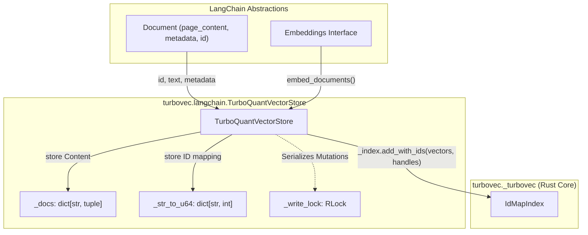
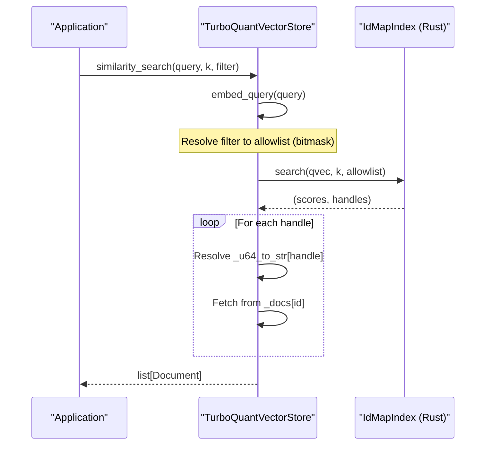

<!-- source: DeepWiki mcp.deepwiki.com · repo RyanCodrai/turbovec · page 4.1 LangChain Integration · fetched 2026-10-30 -->

# LangChain Integration

Relevant source files

The following files were used as context for generating this wiki page:

- [docs/integrations/agno.md](docs/integrations/agno.md)
- [docs/integrations/haystack.md](docs/integrations/haystack.md)
- [docs/integrations/langchain.md](docs/integrations/langchain.md)
- [docs/integrations/llama_index.md](docs/integrations/llama_index.md)
- [turbovec-python/python/turbovec/_persist.py](turbovec-python/python/turbovec/_persist.py)
- [turbovec-python/python/turbovec/haystack.py](turbovec-python/python/turbovec/haystack.py)
- [turbovec-python/python/turbovec/langchain.py](turbovec-python/python/turbovec/langchain.py)
- [turbovec-python/python/turbovec/llama_index.py](turbovec-python/python/turbovec/llama_index.py)
- [turbovec-python/tests/test_haystack.py](turbovec-python/tests/test_haystack.py)
- [turbovec-python/tests/test_langchain.py](turbovec-python/tests/test_langchain.py)
- [turbovec-python/tests/test_llama_index.py](turbovec-python/tests/test_llama_index.py)
- [turbovec-python/tests/test_persist.py](turbovec-python/tests/test_persist.py)
- [turbovec-python/tests/test_similarity_modes.py](turbovec-python/tests/test_similarity_modes.py)

The `turbovec.langchain` module provides a high-performance vector store implementation for the LangChain framework, utilizing the `IdMapIndex` for memory-efficient similarity searches and O(1) deletions. It implements the standard `VectorStore` interface, allowing it to be used as a drop-in replacement in RAG (Retrieval-Augmented Generation) pipelines [turbovec-python/python/turbovec/langchain.py:5-18]().

## Implementation Overview

The `TurboQuantVectorStore` class acts as a wrapper that synchronizes a low-level `IdMapIndex` (which stores quantized vectors and their U64 handles) with a side-car document store for text and metadata [turbovec-python/python/turbovec/langchain.py:66-96]().

### Data Architecture

The store manages four primary components:
1.  **`_index`**: An instance of `IdMapIndex` containing the compressed vector representations. It supports lazy construction, committing to a dimension on the first add [turbovec-python/python/turbovec/langchain.py:123-126]().
2.  **`_docs`**: A dictionary mapping LangChain string IDs to a tuple of `(page_content, metadata)` [turbovec-python/python/turbovec/langchain.py:127]().
3.  **`_str_to_u64`**: A mapping from LangChain string IDs to internal `u64` handles used by the Rust index [turbovec-python/python/turbovec/langchain.py:128]().
4.  **`_u64_to_str`**: A reverse map used to translate search result handles back to LangChain IDs [turbovec-python/python/turbovec/langchain.py:131-133]().

### LangChain to Code Entity Mapping

The following diagram illustrates how standard LangChain abstractions are mapped to specific `turbovec` code entities and their internal storage mechanisms.

**Vector Store Entity Mapping**

Sources: [turbovec-python/python/turbovec/langchain.py:121-140](), [turbovec-python/python/turbovec/langchain.py:202-230]()

## Similarity and Relevance

The store supports two similarity modes, fixed at construction [turbovec-python/python/turbovec/langchain.py:118-120]():
*   **`"cosine"` (Default)**: Vectors are L2-normalized during ingestion and search. Scores are in `[-1, 1]`. The relevance score function maps this to `[0, 1]` via `(sim + 1) / 2` [turbovec-python/python/turbovec/langchain.py:157-164]().
*   **`"dot_product"`**: Raw inner products are used. Ranking is magnitude-aware. Persistence of stores created before similarity modes existed defaults to this mode [turbovec-python/python/turbovec/langchain.py:79-82]().

## Key Functions and Factory Methods

### Factory: `from_texts()` / `afrom_texts()`
These methods initialize the store and immediately ingest data. They handle embedding generation and ID assignment (generating UUIDs if none are provided) [turbovec-python/python/turbovec/langchain.py:343-380]().

### Search Operations
The store implements both synchronous and asynchronous search. Async methods use `asyncio.to_thread` to prevent blocking the event loop during heavy Rust-side computation [turbovec-python/python/turbovec/langchain.py:8-12]().
*   `similarity_search()`: Returns `list[Document]` [turbovec-python/python/turbovec/langchain.py:270-281]().
*   `similarity_search_with_score()`: Returns `list[tuple[Document, float]]` [turbovec-python/python/turbovec/langchain.py:283-300]().
*   `similarity_search_by_vector()`: Core search implementation using pre-computed embeddings [turbovec-python/python/turbovec/langchain.py:302-323]().

**Search Execution Flow**

Sources: [turbovec-python/python/turbovec/langchain.py:302-323](), [turbovec-python/tests/test_langchain.py:93-99]()

## Persistence

Persistence uses `atomic_save` to write two files, ensuring the store is never left in a "torn" state where the index and side-car are out of sync [turbovec-python/python/turbovec/langchain.py:17-18]().
1.  **`index.tvim`**: The binary `IdMapIndex` [turbovec-python/python/turbovec/langchain.py:55]().
2.  **`docstore.json`**: A JSON side-car containing `_docs`, `_str_to_u64`, `_next_u64`, and metadata like `similarity` mode [turbovec-python/python/turbovec/langchain.py:56]().

`load()` performs consistency checks to ensure the `u64` handles in the JSON match those present in the binary index [turbovec-python/python/turbovec/_persist.py:10-14]().

## Limitations and Behaviors

*   **Deletions**: Supported via `delete(ids: List[str])`. It performs O(1) removal in the `IdMapIndex` and cleans up the side-car mappings [turbovec-python/python/turbovec/langchain.py:246-268]().
*   **Thread Safety**: A `threading.RLock` serializes all mutations (`add`, `delete`, `dump`). Readers are lock-free to allow scaling across threads [turbovec-python/python/turbovec/langchain.py:135-140]().
*   **Upsert**: Re-adding a document with an existing ID performs an upsert, replacing the previous vector and metadata [turbovec-python/tests/test_langchain.py:139-151]().

## Usage Patterns from Tests

| Scenario | Pattern |
| :--- | :--- |
| **Initialization** | `TurboQuantVectorStore.from_texts(texts, emb, bit_width=4)` [turbovec-python/tests/test_langchain.py:42-44]() |
| **Filtered Search** | `store.similarity_search(query, filter={"key": "val"})` or `filter=lambda doc: ...` [turbovec-python/tests/test_langchain.py:96-98]() |
| **Async Search** | `await store.asimilarity_search(query, k=1)` [turbovec-python/tests/test_langchain.py:131]() |
| **Persistence** | `store.dump(path)` followed by `TurboQuantVectorStore.load(path, emb)` [turbovec-python/python/turbovec/langchain.py:423-427]() |

Sources: [turbovec-python/python/turbovec/langchain.py:1-450](), [turbovec-python/tests/test_langchain.py:1-200]()

---

