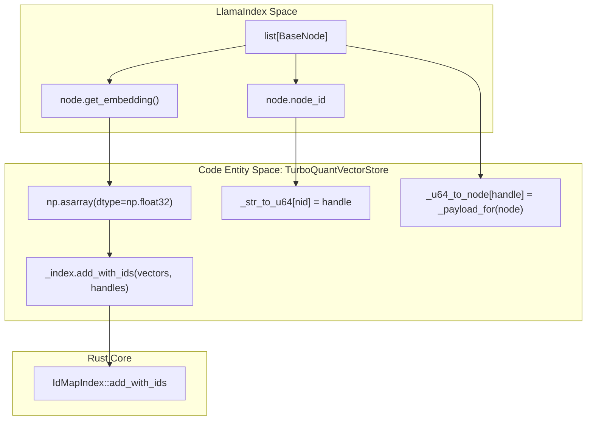
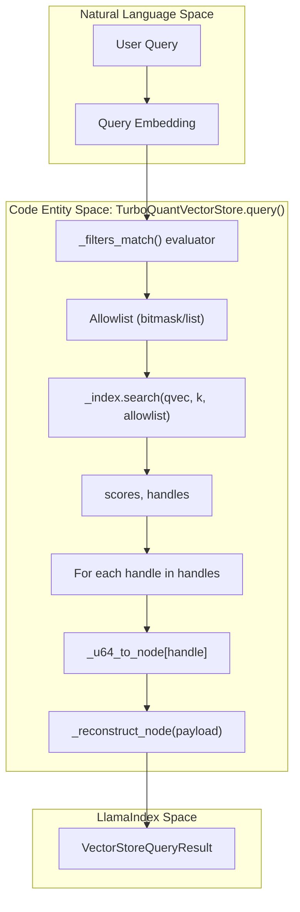

<!-- source: DeepWiki mcp.deepwiki.com · repo RyanCodrai/turbovec · page 4.2 LlamaIndex Integration · fetched 2026-10-30 -->

# LlamaIndex Integration

Relevant source files

The following files were used as context for generating this wiki page:

- [docs/integrations/agno.md](docs/integrations/agno.md)
- [docs/integrations/haystack.md](docs/integrations/haystack.md)
- [docs/integrations/langchain.md](docs/integrations/langchain.md)
- [docs/integrations/llama_index.md](docs/integrations/llama_index.md)
- [turbovec-python/python/turbovec/_persist.py](turbovec-python/python/turbovec/_persist.py)
- [turbovec-python/python/turbovec/haystack.py](turbovec-python/python/turbovec/haystack.py)
- [turbovec-python/python/turbovec/langchain.py](turbovec-python/python/turbovec/langchain.py)
- [turbovec-python/python/turbovec/llama_index.py](turbovec-python/python/turbovec/llama_index.py)
- [turbovec-python/tests/test_haystack.py](turbovec-python/tests/test_haystack.py)
- [turbovec-python/tests/test_langchain.py](turbovec-python/tests/test_langchain.py)
- [turbovec-python/tests/test_llama_index.py](turbovec-python/tests/test_llama_index.py)
- [turbovec-python/tests/test_persist.py](turbovec-python/tests/test_persist.py)
- [turbovec-python/tests/test_similarity_modes.py](turbovec-python/tests/test_similarity_modes.py)

The `turbovec.llama_index` module provides a high-performance vector store implementation for the LlamaIndex RAG framework. It leverages the `IdMapIndex` for memory-efficient vector storage (quantized to 2–4 bits) and ultra-fast SIMD-accelerated similarity searches, while maintaining full node fidelity through a JSON-based side-car store.

## Overview

The integration is centered around the `TurboQuantVectorStore` class [[turbovec-python/python/turbovec/llama_index.py:202-202]](). It implements the LlamaIndex `BasePydanticVectorStore` interface, allowing it to be used as a drop-in replacement for the framework's default `SimpleVectorStore`.

The implementation follows a "side-car" pattern:
1.  **Vector Store**: An `IdMapIndex` (Rust core) manages high-dimensional embeddings and performs similarity searches [[turbovec-python/python/turbovec/llama_index.py:246-246]]().
2.  **Node Store**: A Python dictionary (`_u64_to_node`) and a mapping (`_str_to_u64`) store the full LlamaIndex `BaseNode` content, metadata, and relationships [[turbovec-python/python/turbovec/llama_index.py:250-252]]().

### Data Flow: Node Ingestion

When nodes are added via `add()`, the store extracts embeddings and updates both the Rust index and the Python side-car.

**Node Ingestion Pipeline**

Sources: [[turbovec-python/python/turbovec/llama_index.py:103-143]](), [[turbovec-python/python/turbovec/llama_index.py:284-332]]()

## Class Reference: TurboQuantVectorStore

### Factory Methods
*   `from_params(dim: int | None, bit_width: int = 4, similarity: str = "cosine")`: Recommended way to initialize a new store. If `dim` is `None`, the index is created lazily and commits to a dimension on the first `add()` call [[turbovec-python/python/turbovec/llama_index.py:218-242]]().
*   `from_persist_path(persist_path: str, ...)`: Reconstructs a store from a local path. It expects two files: `{base}.tvim` (binary index) and `{base}.nodes.json` (metadata) [[turbovec-python/python/turbovec/llama_index.py:537-564]]().

### Key Operations
| Method | Description | Implementation Detail |
| :--- | :--- | :--- |
| `add(nodes)` | Ingests LlamaIndex nodes. | Extracts payload via `_payload_for` to ensure JSON consistency [[turbovec-python/python/turbovec/llama_index.py:284-332]](). |
| `query(query)` | Performs top-k similarity search. | Supports `MetadataFilters` and `node_ids`/`doc_ids` intersection [[turbovec-python/python/turbovec/llama_index.py:382-446]](). |
| `delete(ref_doc_id)` | Removes all nodes for a source. | O(1) removal per node via `IdMapIndex.remove` [[turbovec-python/python/turbovec/llama_index.py:334-345]](). |
| `delete_nodes(...)` | Removes specific nodes or filters. | Evaluates `_filters_match` for metadata-based deletion [[turbovec-python/python/turbovec/llama_index.py:347-380]](). |

Sources: [[turbovec-python/python/turbovec/llama_index.py:284-446]]()

## Query Execution and Filtering

The `query()` method transforms a `VectorStoreQuery` into a `VectorStoreQueryResult`. Filters are resolved to a handle allowlist **before** scoring, ensuring the kernel only considers valid candidates.

**Query and Reconstruction Flow**

Sources: [[turbovec-python/python/turbovec/llama_index.py:382-446]](), [[turbovec-python/python/turbovec/llama_index.py:651-766]]()

## Persistence and Consistency

The store uses `turbovec._persist.atomic_save` to ensure that the binary index and JSON side-car are written as an all-or-nothing operation, preventing "torn" stores where the index points to missing metadata [[turbovec-python/python/turbovec/llama_index.py:503-524]]().

### Consistency Checks
On load, `TurboQuantVectorStore` performs several checks via `turbovec._persist`:
*   **Handle Check**: Verifies that every handle in the binary index has a corresponding entry in the JSON side-car [[turbovec-python/python/turbovec/llama_index.py:594-599]]().
*   **Keyset Check**: Ensures the `_str_to_u64` and `_u64_to_node` maps are in sync [[turbovec-python/python/turbovec/llama_index.py:600-606]]().
*   **Schema Version**: Validates the `nodes.json` version against `_NODES_SCHEMA_COMPAT` (currently v1, v2, v3) [[turbovec-python/python/turbovec/llama_index.py:587-593]]().

Sources: [[turbovec-python/python/turbovec/llama_index.py:573-614]](), [[turbovec-python/python/turbovec/_persist.py:1-22]]()

## Known Limitations

*   **No MMR**: Maximal Marginal Relevance (MMR) is not implemented. `VectorStoreQueryMode.MMR` will raise a `NotImplementedError` [[turbovec-python/python/turbovec/llama_index.py:402-403]]().
*   **No fsspec**: `persist` and `from_persist_path` only support local file system paths. The integration does not support LlamaIndex's `fsspec` filesystem abstraction [[turbovec-python/python/turbovec/llama_index.py:488-490]]().
*   **Embedding-Only Queries**: The store requires a pre-computed `query_embedding`. It does not perform text embedding internally [[turbovec-python/python/turbovec/llama_index.py:393-397]]().
*   **JSON Serialization**: All node metadata must be JSON-serializable. Complex Python objects in metadata may cause `persist()` to fail [[turbovec-python/python/turbovec/llama_index.py:103-143]]().

Sources: [[turbovec-python/python/turbovec/llama_index.py:382-446]](), [[turbovec-python/python/turbovec/llama_index.py:487-501]]()

---

