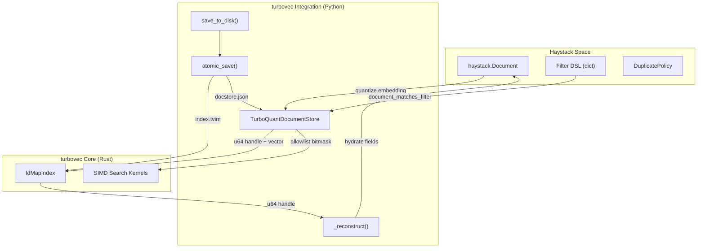
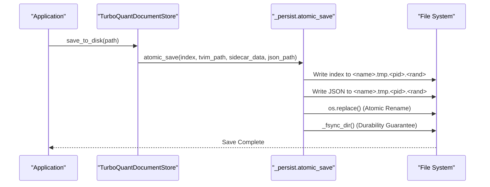

<!-- source: DeepWiki mcp.deepwiki.com · repo RyanCodrai/turbovec · page 4.3 Haystack Integration · fetched 2026-10-30 -->

# Haystack Integration

Relevant source files

The following files were used as context for generating this wiki page:

- [docs/integrations/agno.md](docs/integrations/agno.md)
- [docs/integrations/haystack.md](docs/integrations/haystack.md)
- [docs/integrations/langchain.md](docs/integrations/langchain.md)
- [docs/integrations/llama_index.md](docs/integrations/llama_index.md)
- [turbovec-python/python/turbovec/_persist.py](turbovec-python/python/turbovec/_persist.py)
- [turbovec-python/python/turbovec/haystack.py](turbovec-python/python/turbovec/haystack.py)
- [turbovec-python/python/turbovec/langchain.py](turbovec-python/python/turbovec/langchain.py)
- [turbovec-python/python/turbovec/llama_index.py](turbovec-python/python/turbovec/llama_index.py)
- [turbovec-python/tests/test_haystack.py](turbovec-python/tests/test_haystack.py)
- [turbovec-python/tests/test_langchain.py](turbovec-python/tests/test_langchain.py)
- [turbovec-python/tests/test_llama_index.py](turbovec-python/tests/test_llama_index.py)
- [turbovec-python/tests/test_persist.py](turbovec-python/tests/test_persist.py)
- [turbovec-python/tests/test_similarity_modes.py](turbovec-python/tests/test_similarity_modes.py)

The `turbovec.haystack.TurboQuantDocumentStore` provides a high-performance, memory-efficient implementation of the Haystack 2.x `DocumentStore` protocol. It utilizes `turbovec.IdMapIndex` for quantized vector search and a JSON-based side-car for document persistence.

This integration is designed as a drop-in replacement for Haystack's `InMemoryDocumentStore`, offering significantly lower memory usage (via 2, 3, or 4-bit quantization) and $O(1)$ deletions [turbovec-python/python/turbovec/haystack.py:1-14]().

## System Architecture and Data Flow

The integration bridges the Haystack `Document` abstraction with the underlying Rust `IdMapIndex`. Document metadata and content are managed in Python, while embeddings are compressed and searched in the Rust core.

### Natural Language to Code Entity Space

The following diagram illustrates how Haystack domain objects map to the `turbovec` implementation entities.

**Diagram: Haystack to TurboQuant Mapping**

Sources: [turbovec-python/python/turbovec/haystack.py:48-97](), [turbovec-python/python/turbovec/haystack.py:30-32](), [turbovec-python/python/turbovec/haystack.py:588-615]()

## Core Implementation

### Document Ingestion and Duplicate Policy
The `write_documents()` method handles ingestion according to the Haystack `DuplicatePolicy` [turbovec-python/python/turbovec/haystack.py:228-230]().

| Policy | Behavior | Implementation |
| :--- | :--- | :--- |
| `FAIL` | Raises `DuplicateDocumentError` on first collision. | Commits documents sequentially; previous documents in batch remain persisted [docs/integrations/haystack.md:71-72](). |
| `SKIP` | Silently ignores documents with existing IDs. | Checks `_str_to_u64` before processing [turbovec-python/python/turbovec/haystack.py:276-278](). |
| `OVERWRITE` | Removes existing entry before adding new version. | Calls `delete_documents([id])` then performs a standard add [turbovec-python/python/turbovec/haystack.py:281-283](). |

### Retrieval and Filtering
`embedding_retrieval()` is the primary search interface. It supports pre-filtering using Haystack's `document_matches_filter` DSL [turbovec-python/python/turbovec/haystack.py:456-465]().

1.  **Filter Resolution**: The store evaluates the `filters` against all documents in the side-car to produce a bitmask (allowlist) [turbovec-python/python/turbovec/haystack.py:488-490]().
2.  **Quantized Search**: The allowlist is passed to `IdMapIndex.search()`, ensuring that only valid candidates are considered for the top-k heap [turbovec-python/python/turbovec/haystack.py:503-510]().
3.  **Score Scaling**: If `scale_score=True`, the raw similarity is mapped to `[0, 1]` [turbovec-python/python/turbovec/haystack.py:512-516]().
    *   **Cosine**: `(score + 1) / 2` [docs/integrations/haystack.md:53-53]().
    *   **Dot Product**: `expit(score / 100)` sigmoid mapping [docs/integrations/haystack.md:54-54]().

### Field Fidelity and Reconstruction
Turbovec discards full-precision embeddings after quantization. However, other Haystack-specific fields like `ByteStream` (blobs) and `SparseEmbedding` are preserved in the side-car and restored via the `_reconstruct()` helper [turbovec-python/python/turbovec/haystack.py:648-669]().

Sources: [turbovec-python/python/turbovec/haystack.py:48-72](), [turbovec-python/python/turbovec/haystack.py:456-530](), [turbovec-python/tests/test_haystack.py:58-86]()

## Persistence and Serialization

The store persists data into a directory containing two primary files:
*   `index.tvim`: The binary `IdMapIndex` containing quantized vectors and ID mappings [docs/integrations/haystack.md:151-151]().
*   `docstore.json`: The JSON side-car containing document text, metadata, blobs, and sparse embeddings [docs/integrations/haystack.md:152-152]().

### Atomic Save Pattern
To prevent data corruption during crashes or concurrent writes, `TurboQuantDocumentStore` uses the `atomic_save` utility [turbovec-python/python/turbovec/_persist.py:45-64]().

**Diagram: Persistence Flow**

Sources: [turbovec-python/python/turbovec/haystack.py:588-615](), [turbovec-python/python/turbovec/_persist.py:120-160](), [turbovec-python/tests/test_persist.py:73-87]()

## Concurrency Model

`TurboQuantDocumentStore` implements a "Thread-Safe Writes, Lock-Free Reads" pattern:
*   **Write Lock**: An `RLock` (`self._write_lock`) serializes all mutations (`write_documents`, `delete_documents`, `save_to_disk`) [turbovec-python/python/turbovec/haystack.py:155-160]().
*   **Lock-Free Reads**: Retrieval and filtering methods do not acquire the lock. They rely on the thread-safety of the underlying Rust `IdMapIndex` and Python's GIL for dictionary access [turbovec-python/python/turbovec/haystack.py:73-84]().
*   **Async Execution**: The `*_async` methods delegate to a `ThreadPoolExecutor` [turbovec-python/python/turbovec/haystack.py:186-193](). This ensures the `asyncio` event loop remains responsive during heavy SIMD search operations [turbovec-python/python/turbovec/haystack.py:130-141]().

Sources: [turbovec-python/python/turbovec/haystack.py:73-84](), [turbovec-python/python/turbovec/haystack.py:155-160](), [turbovec-python/python/turbovec/haystack.py:186-218]()

---

