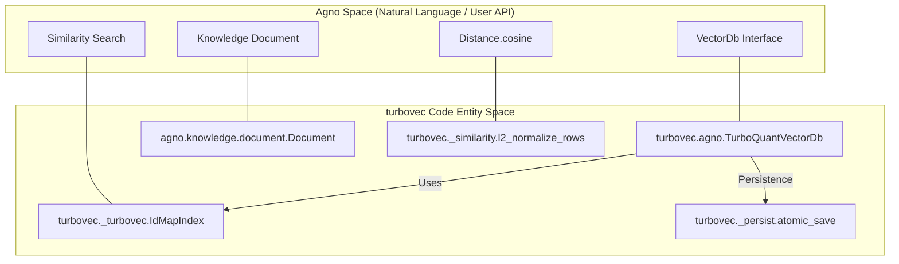
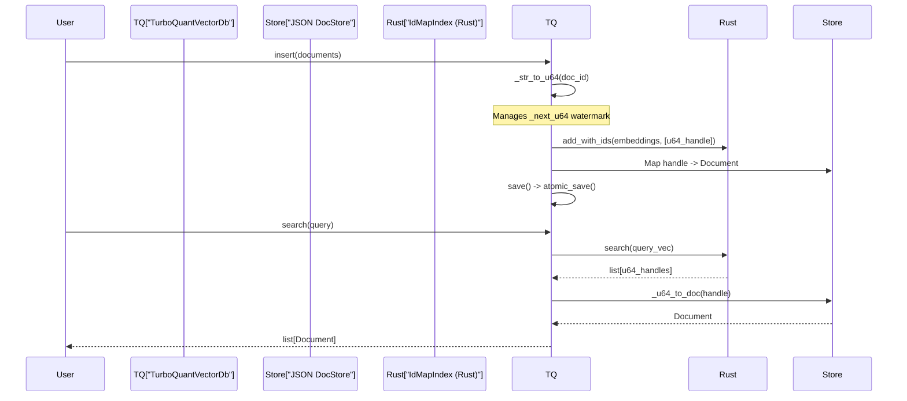

<!-- source: DeepWiki mcp.deepwiki.com · repo RyanCodrai/turbovec · page 4.4 Agno Integration · fetched 2026-10-30 -->

# Agno Integration

Relevant source files

The following files were used as context for generating this wiki page:

- [docs/integrations/agno.md](docs/integrations/agno.md)
- [docs/integrations/haystack.md](docs/integrations/haystack.md)
- [docs/integrations/langchain.md](docs/integrations/langchain.md)
- [docs/integrations/llama_index.md](docs/integrations/llama_index.md)
- [turbovec-python/python/turbovec/_persist.py](turbovec-python/python/turbovec/_persist.py)
- [turbovec-python/python/turbovec/agno.py](turbovec-python/python/turbovec/agno.py)
- [turbovec-python/tests/test_agno.py](turbovec-python/tests/test_agno.py)
- [turbovec-python/tests/test_persist.py](turbovec-python/tests/test_persist.py)
- [turbovec-python/tests/test_similarity_modes.py](turbovec-python/tests/test_similarity_modes.py)

`turbovec.agno.TurboQuantVectorDb` is a high-performance vector database implementation for the [Agno](https://github.com/agno-agi/agno) framework. It is backed by an `IdMapIndex` and implements the `VectorDb` interface, specifically designed as a drop-in replacement for `agno.vectordb.lancedb.LanceDb` in single-machine environments [turbovec-python/python/turbovec/agno.py:1-7]().

## Overview and Lifecycle

The integration manages a quantized vector index alongside a JSON side-car document store [turbovec-python/python/turbovec/agno.py:55-56](). It supports both synchronous and asynchronous operations, utilizing `asyncio.to_thread` for the `async_*` variants to ensure the event loop remains responsive during compute-intensive Rust kernel operations [turbovec-python/python/turbovec/agno.py:9-14]().

### Data Flow: Natural Language to Code Entities

The following diagram illustrates how Agno high-level concepts map to the `turbovec` implementation.

**Natural Language to Code Entity Space: Mapping**

Sources: [turbovec-python/python/turbovec/agno.py:41-47](), [turbovec-python/python/turbovec/agno.py:83-84](), [turbovec-python/python/turbovec/agno.py:37-39]().

### Constructor and Configuration

The constructor requires an `Embedder` and allows configuration of quantization and similarity behaviors [turbovec-python/python/turbovec/agno.py:143-156]().

| Parameter | Type | Default | Description |
| :--- | :--- | :--- | :--- |
| `embedder` | `Embedder` | **Required** | Source of truth for index dimensions via `embedder.dimensions`. |
| `bit_width` | `int` | `4` | Quantization bits per dimension (2, 3, or 4). |
| `distance` | `Distance` | `Distance.cosine` | Similarity metric (Cosine or Max Inner Product). |
| `path` | `str` | `None` | Optional directory for persistence. |

Sources: [turbovec-python/python/turbovec/agno.py:143-160](), [docs/integrations/agno.md:46-54]().

### Similarity Modes
*   **`Distance.cosine`**: Embeddings are L2-normalized at both insert and query time [turbovec-python/python/turbovec/agno.py:90-93](). The raw kernel score is cosine similarity in `[-1, 1]`.
*   **`Distance.max_inner_product`**: Vectors are stored and queried without normalization [turbovec-python/python/turbovec/agno.py:97-98]().
*   **Note**: `Distance.l2` is not supported and will raise a `ValueError` [turbovec-python/python/turbovec/agno.py:102]().

## Data Mutation and Search

### Ingestion (Insert/Upsert)
`TurboQuantVectorDb` implement both `insert` and `upsert` patterns. The internal `doc_id` is derived as `md5(f"{base_id}_{content_hash}")` [docs/integrations/agno.md:65](). If documents are provided without embeddings, they are automatically embedded using the configured `Embedder` before quantization [turbovec-python/python/turbovec/agno.py:382-386]().

### Search Implementation
The search engine utilizes `IdMapIndex.search` and handles metadata filtering at the kernel level.
1.  **Filter Resolution**: Metadata filters (AND-of-exact-equality) are resolved to an allowlist *before* scoring [turbovec-python/python/turbovec/agno.py:109-111]().
2.  **Deduplication**: Results are deduplicated based on `md5(doc.content)` [turbovec-python/python/turbovec/agno.py:112-114]().
3.  **Reranking**: If an Agno `Reranker` is provided, it is applied to the final result set [turbovec-python/python/turbovec/agno.py:456-458]().

### Deletion Methods
The implementation provides granular deletion control:
*   `delete_by_id(id)`: Removes entries by internal MD5 ID [turbovec-python/python/turbovec/agno.py:476]().
*   `delete_by_name(name)`: Removes entries matching `Document.name` [turbovec-python/python/turbovec/agno.py:494]().
*   `delete_by_metadata(metadata)`: Removes entries matching metadata predicates [turbovec-python/python/turbovec/agno.py:512]().
*   `drop()`: Clears the entire index and docstore [turbovec-python/python/turbovec/agno.py:553]().

Sources: [turbovec-python/python/turbovec/agno.py:470-560](), [docs/integrations/agno.md:105-116]().

## Handle Mapping Sub-system

The integration maintains a bijection between the Rust `u64` handles used in `IdMapIndex` and the Python `Document` objects.

**Internal Handle Lifecycle**

Sources: [turbovec-python/python/turbovec/agno.py:641-655](), [turbovec-python/python/turbovec/agno.py:221-224](), [turbovec-python/python/turbovec/_persist.py:3-9]().

### Key Components:
*   **`_next_u64`**: A watermark tracker that ensures monotonically increasing handles for the Rust core [turbovec-python/python/turbovec/agno.py:224]().
*   **`_id_to_u64`**: Map from the derived internal string ID to the index handle [turbovec-python/python/turbovec/agno.py:221]().
*   **`_u64_to_doc`**: Map from index handle back to the full `Document` payload [turbovec-python/python/turbovec/agno.py:222]().

## Persistence and Validation

Persistence is handled via `atomic_save`, which ensures that the binary index (`index.tvim`) and the JSON side-car (`docstore.json`) are written atomically to prevent torn states [turbovec-python/python/turbovec/agno.py:562-570]().

### Schema and Consistency
*   **Version Validation**: The docstore includes a `schema_version` (current version: 2). Loader compatibility is maintained for older versions (v1) by reconstructing missing fields like `distance` [turbovec-python/python/turbovec/agno.py:61-63]().
*   **`check_persisted_handles`**: At load time, the system verifies that the handle set in the JSON side-car exactly matches the handles present in the binary index [turbovec-python/python/turbovec/_persist.py:9-14]().
*   **Watermark Integrity**: Validates that `_next_u64` is greater than or equal to any handle present in the index to prevent handle reuse [turbovec-python/tests/test_persist.py:51-57]().

Sources: [turbovec-python/python/turbovec/agno.py:55-64](), [turbovec-python/python/turbovec/_persist.py:1-22]().

## Testing Patterns

Test coverage in `test_agno.py` focuses on parity with Agno's `LanceDb` behavior:
*   **Metadata Updates**: Verified that `update_metadata` applies to all documents sharing a `content_id` [turbovec-python/tests/test_agno.py:130-152]().
*   **Quantization Stability**: Ensuring `update_metadata` does not re-derive quantized codes [turbovec-python/tests/test_agno.py:154-169]().
*   **Empty Embeddings**: Testing that `insert` correctly triggers re-embedding if a document arrives with an empty list `[]` [turbovec-python/tests/test_agno.py:172-184]().
*   **Numpy Compatibility**: Support for `numpy.ndarray` embeddings in the `insert` path [turbovec-python/tests/test_agno.py:186-196]().

Sources: [turbovec-python/tests/test_agno.py:1-200]().

---

