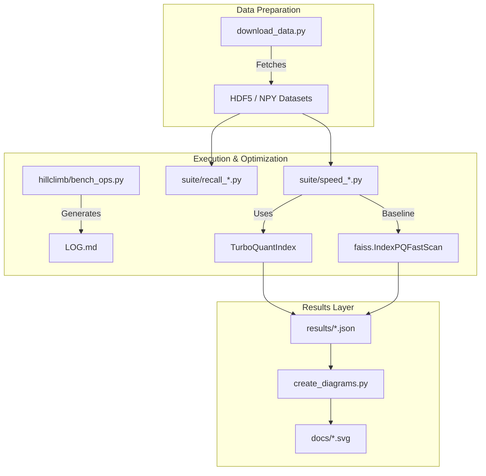
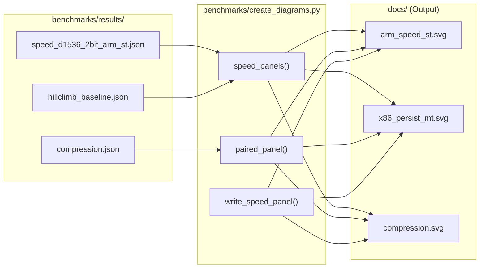

<!-- source: DeepWiki mcp.deepwiki.com · repo RyanCodrai/turbovec · page 5 Benchmarks · fetched 2026-10-30 -->

# Benchmarks

Relevant source files

The following files were used as context for generating this wiki page:

- [benchmarks/create_diagrams.py](benchmarks/create_diagrams.py)
- [benchmarks/hillclimb/LOG.md](benchmarks/hillclimb/LOG.md)
- [benchmarks/results/hillclimb_baseline.json](benchmarks/results/hillclimb_baseline.json)
- [docs/arm_persist_mt.svg](docs/arm_persist_mt.svg)
- [docs/arm_persist_st.svg](docs/arm_persist_st.svg)
- [docs/x86_persist_mt.svg](docs/x86_persist_mt.svg)
- [docs/x86_persist_st.svg](docs/x86_persist_st.svg)
- [turbovec/src/pack.rs](turbovec/src/pack.rs)

The `benchmarks/` directory contains a comprehensive suite for evaluating the performance, accuracy, and storage efficiency of `turbovec`. The primary goal of these benchmarks is to provide a reproducible comparison against industry-standard baselines, specifically **FAISS IndexPQFastScan**, across different hardware architectures (x86_64 and ARM64).

### Overview of Benchmark Components

The benchmarking infrastructure is split into data acquisition, execution scripts, a hillclimb optimization log, and a visualization layer. It measures three key metrics:
1.  **Search Latency**: Milliseconds per query (ms/query) for single-threaded and multi-threaded execution.
2.  **Recall**: The accuracy of the quantized search compared to a ground-truth brute-force search.
3.  **Persistence Performance**: Speed of `write()`, `load()`, and `sync()` operations, including "cold" start times.

### Data Flow and Architecture

The following diagram illustrates how raw datasets and optimization iterations are transformed into the performance visualizations found in the documentation.

**Benchmark Pipeline: From Data to Diagrams**

**Sources:** [benchmarks/download_data.py:1-7](), [benchmarks/create_diagrams.py:1-8](), [benchmarks/hillclimb/LOG.md:1-10]()

---

### Benchmark Suite and Hillclimb

The suite consists of Python scripts that utilize the `turbovec` Python bindings to perform search operations on standardized datasets.

*   **Data Loading**: The `download_data.py` script fetches GloVe vectors (via `ann-benchmarks`) and OpenAI text-embedding-3-large vectors (1536 and 3072 dimensions) from HuggingFace.
*   **Execution Environment**: Benchmarks are designed to be run in both single-threaded and multi-threaded modes. Multi-threading is controlled by the `RAYON_NUM_THREADS` environment variable [benchmarks/hillclimb/LOG.md:48-50]().
*   **Hillclimb Optimization**: The `benchmarks/hillclimb/` directory tracks systematic performance improvements. It uses a **Weighted Harmonic Mean (WHM)** scoring metric to evaluate changes across search, insert, delete, save, and load operations [benchmarks/hillclimb/LOG.md:3-5]().
*   **Baselines**: All speed and recall tests compare `TurboQuantIndex` against `faiss.IndexPQFastScan`.

For technical details on the individual scripts and dataset loading logic, see [Benchmark Suite](#5.1).

**Sources:** [benchmarks/download_data.py:48-52](), [benchmarks/create_diagrams.py:154-167](), [benchmarks/hillclimb/LOG.md:1-25]()

---

### Results and Visualization

Benchmark results are persisted as JSON files in `benchmarks/results/`. These files serve as the source of truth for the project's performance claims.

*   **JSON Schema**: Results include metrics such as `tq_ms_per_query`, `faiss_ms_per_query`, and detailed persistence timings like `speed_insert_st` and `speed_remove_st` [benchmarks/results/hillclimb_baseline.json:1-26]().
*   **SVG Generation**: The `create_diagrams.py` script processes these JSON files to generate high-quality SVG charts using a custom "turboquant-wasm" aesthetic [benchmarks/create_diagrams.py:21-42]().
*   **Key Findings**:
    *   **Speed**: `turbovec` demonstrates significant speedups, particularly on ARM64 (e.g., Google Axion) where it often outperforms FAISS in search latency [docs/arm_persist_st.svg:16-17]().
    *   **Efficiency**: The O(1) removal primitive via lane operations significantly reduces the cost of mutations compared to FAISS [benchmarks/hillclimb/LOG.md:120-130]().
    *   **Persistence**: "Load $\to$ first search" metrics capture the time to open a cold `.tv` file and return results, highlighting the efficiency of the lazy materialization strategy [docs/x86_persist_mt.svg:69-80]().

For a deep dive into the JSON schemas and generated charts, see [Results and Visualization](#5.2).

**System Mapping: Results to Visualization**

**Sources:** [benchmarks/results/hillclimb_baseline.json:1-26](), [benchmarks/create_diagrams.py:107-140](), [docs/arm_persist_st.svg:31-55]()

---

