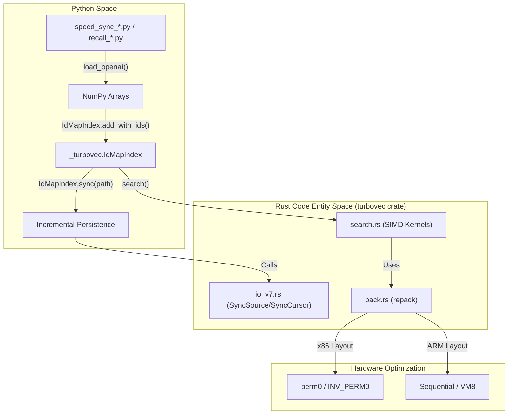
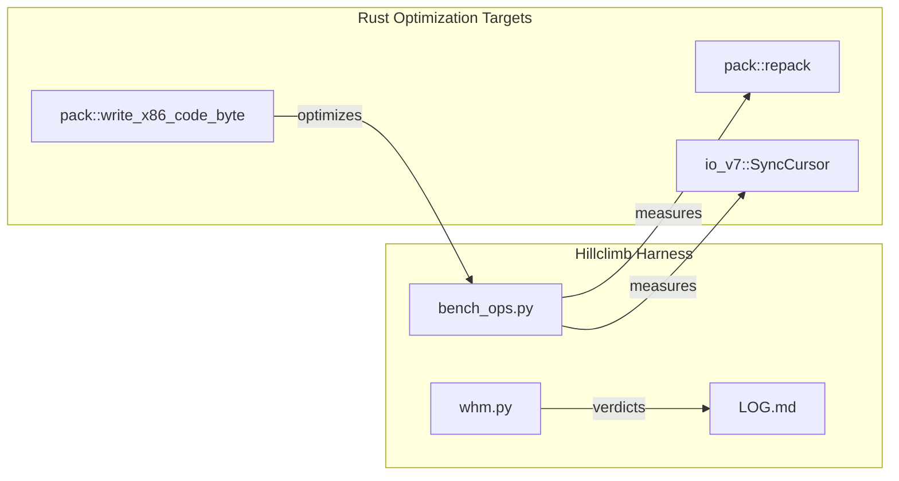

<!-- source: DeepWiki mcp.deepwiki.com · repo RyanCodrai/turbovec · page 5.1 Benchmark Suite · fetched 2026-10-30 -->

# Benchmark Suite

Relevant source files

The following files were used as context for generating this wiki page:

- [benchmarks/download_data.py](benchmarks/download_data.py)
- [benchmarks/hillclimb/LOG.md](benchmarks/hillclimb/LOG.md)
- [benchmarks/hillclimb/LOG_sync.md](benchmarks/hillclimb/LOG_sync.md)
- [benchmarks/hillclimb/bench_ops.py](benchmarks/hillclimb/bench_ops.py)
- [benchmarks/hillclimb/bench_sync.py](benchmarks/hillclimb/bench_sync.py)
- [benchmarks/hillclimb/whm_sync.py](benchmarks/hillclimb/whm_sync.py)
- [benchmarks/results/hillclimb_baseline.json](benchmarks/results/hillclimb_baseline.json)
- [benchmarks/results/sync_baseline.json](benchmarks/results/sync_baseline.json)
- [benchmarks/suite/recall_d1536_2bit.py](benchmarks/suite/recall_d1536_2bit.py)
- [benchmarks/suite/recall_d1536_4bit.py](benchmarks/suite/recall_d1536_4bit.py)
- [benchmarks/suite/recall_d3072_2bit.py](benchmarks/suite/recall_d3072_2bit.py)
- [benchmarks/suite/speed_sync_d1536_2bit_arm_mt.py](benchmarks/suite/speed_sync_d1536_2bit_arm_mt.py)
- [benchmarks/suite/speed_sync_d1536_2bit_arm_st.py](benchmarks/suite/speed_sync_d1536_2bit_arm_st.py)
- [benchmarks/suite/speed_sync_d1536_2bit_x86_mt.py](benchmarks/suite/speed_sync_d1536_2bit_x86_mt.py)
- [benchmarks/suite/speed_sync_d1536_2bit_x86_st.py](benchmarks/suite/speed_sync_d1536_2bit_x86_st.py)
- [benchmarks/whm.py](benchmarks/whm.py)
- [turbovec/src/pack.rs](turbovec/src/pack.rs)

The `turbovec` benchmark suite is designed to evaluate the performance, accuracy, and efficiency of the TurboQuant algorithm against industry-standard baselines. The suite measures four primary metrics: search latency (speed), recall accuracy, memory compression ratios, and incremental persistence performance. It provides automated scripts for data acquisition, execution of single- and multi-threaded benchmarks, and comparison against the `FAISS` `IndexPQ` implementation.

## Data Acquisition and Management

The suite relies on high-dimensional datasets to simulate real-world RAG (Retrieval-Augmented Generation) workloads. Data management is handled by `benchmarks/download_data.py`, which fetches and processes datasets into a local directory (defaulting to `~/data/py-turboquant`) [benchmarks/download_data.py:1-65]().

### Supported Datasets
- **GloVe**: The `glove-200-angular.hdf5` dataset (200 dimensions) is fetched from `ann-benchmarks.com` [benchmarks/download_data.py:16-17]().
- **OpenAI Embeddings**: Large-scale embeddings are pulled from Hugging Face (`Qdrant/dbpedia-entities-openai3-text-embedding-3-large`) in both 1536 and 3072 dimensions [benchmarks/download_data.py:30-45]().

### Data Loading Pattern
Benchmark scripts utilize standardized loading functions to ensure consistency across runs:
- **`load_openai`**: Loads `.npy` files, shuffles the vectors using a fixed seed, and extracts a database (typically 100,000 vectors) and a query set (1,000 vectors). All vectors are normalized to unit length [benchmarks/suite/recall_d3072_2bit.py:16-25](), [benchmarks/suite/speed_sync_d1536_2bit_arm_st.py:13-21]().
- **`load_glove`**: Processes HDF5 files, selecting a subset of the training data for the database and using the standard test set for queries.

Sources: [benchmarks/download_data.py:1-65](), [benchmarks/suite/recall_d3072_2bit.py:16-25](), [benchmarks/suite/speed_sync_d1536_2bit_arm_st.py:13-21]()

## Execution Environment and Configuration

The suite is designed to test performance across different hardware architectures (x86 and ARM) and threading models.

### Threading Control
Threading behavior is controlled via environment variables:
- **Single-threaded (ST)**: Scripts set `os.environ["RAYON_NUM_THREADS"] = "1"` to restrict the Rust `rayon` thread pool to a single worker [benchmarks/suite/speed_sync_d1536_2bit_arm_st.py:2](), [benchmarks/hillclimb/bench_ops.py:27-28]().
- **Multi-threaded (MT)**: Defaults to the system's available logical cores unless restricted by the environment.

### Comparison Baseline: FAISS IndexPQ
`turbovec` is benchmarked against `faiss.IndexPQ`. To ensure a fair comparison at specific bit-widths:
- **Recall Benchmarks**: FAISS is configured with `nbits=8` (256 codewords per sub-quantizer). For 2-bit TQ, FAISS uses `m = dim / 4` (4 coordinates per sub-quantizer). For 4-bit TQ, it uses `m = dim / 2` (2 coordinates per sub-quantizer) [benchmarks/suite/recall_d1536_2bit.py:3-7, 39-40](), [benchmarks/suite/recall_d1536_4bit.py:3-7, 39-40]().

Sources: [benchmarks/suite/speed_sync_d1536_2bit_arm_st.py:2](), [benchmarks/hillclimb/bench_ops.py:27-28](), [benchmarks/suite/recall_d1536_2bit.py:3-40]()

## Benchmark Scripts

### Speed and Sync Benchmarks (`speed_sync_*.py`)
These scripts measure the latency of incremental persistence operations introduced in the v7 file format. They measure:
- **`tq_sync_first_ms`**: The cost of the initial full write (v6 to v7 conversion) [benchmarks/suite/speed_sync_d1536_2bit_arm_st.py:50-63]().
- **`tq_sync_append_ms`**: The cost of syncing a small append (e.g., 32 rows) [benchmarks/suite/speed_sync_d1536_2bit_arm_st.py:67-77]().
- **`tq_sync_remove_ms`**: The cost of committing removals to the header [benchmarks/suite/speed_sync_d1536_2bit_arm_st.py:79-103]().
- **`tq_sync_settle_ms`**: The cost of materializing removals into their block units [benchmarks/suite/speed_sync_d1536_2bit_arm_st.py:104-109]().

### Recall Benchmarks (`recall_*.py`)
Recall is measured as "Recall@1@K", calculating how often the true brute-force top-1 result appears within the top K results returned by `TurboQuantIndex` or `FAISS` [benchmarks/suite/recall_d1536_2bit.py:33-34](). These scripts compare standard TQ, TQ+ (calibrated), and FAISS [benchmarks/suite/recall_d1536_2bit.py:45-70]().

### System Data Flow: Benchmark Execution
The following diagram illustrates how a benchmark script interacts with the `turbovec` Python wrapper and the underlying Rust engine.

**Benchmark Logic Flow**

Sources: [benchmarks/suite/speed_sync_d1536_2bit_arm_st.py:40-109](), [turbovec/src/pack.rs:59-74](), [turbovec/src/pack.rs:108-109]()

## Hillclimb Optimization Suite

The `benchmarks/hillclimb/` directory contains tools for iterative performance optimization.

### Scoring Metric: WHM (Weighted Harmonic Mean)
Optimization wins are determined by the Weighted Harmonic Mean of speedups across multiple "cells" (combinations of operation and architecture).
- **Weights**: `search` (3.0), `insert` (2.0), `delete` (2.0), `save` (1.0), `load` (1.0) [benchmarks/whm.py:25-32]().
- **Sync Weights**: `sync_append` (1.0), `sync_remove` (1.0) [benchmarks/hillclimb/whm_sync.py:40-41]().
- **Noise Tolerance**: Non-target cells may regress by at most 3% [benchmarks/whm.py:34](), [benchmarks/hillclimb/whm_sync.py:43]().

### Optimization Journal (`LOG.md`)
The `LOG.md` and `LOG_sync.md` files serve as journals for every optimization hypothesis tested. Notable entries include:
- **H1 (Ops)**: Parallelizing `seq_to_packed` using `rayon`, resulting in a ~10x speedup for ARM inserts [benchmarks/hillclimb/LOG.md:25-41]().
- **H6 (Ops)**: Implementing O(dim) `swap_remove` using lane-level bit manipulation in `pack.rs`, avoiding full block repacks [benchmarks/hillclimb/LOG.md:120-135](), [turbovec/src/pack.rs:142-153]().
- **H1 (Sync)**: Eliminating redundant re-verification of the last commit in `cursor_state`, providing a ~3.2x speedup for `sync_remove` [benchmarks/hillclimb/LOG_sync.md:78-130]().

### Benchmark Harnesses
- **`bench_ops.py`**: Measures the core six operations: `search`, `save`, `load`, `insert`, `delete`, and `load_search` [benchmarks/hillclimb/bench_ops.py:4-10]().
- **`bench_sync.py`**: Specifically targets the v7 incremental sync protocol performance.

**Code Entity Mapping: Optimization**

Sources: [benchmarks/hillclimb/bench_ops.py:89-155](), [benchmarks/whm.py:51-91](), [turbovec/src/pack.rs:142-153](), [benchmarks/hillclimb/LOG.md:120-135]()

Sources: [benchmarks/whm.py:20-48](), [benchmarks/hillclimb/whm_sync.py:36-68](), [benchmarks/hillclimb/LOG.md:1-135](), [benchmarks/hillclimb/LOG_sync.md:1-130]()

---

