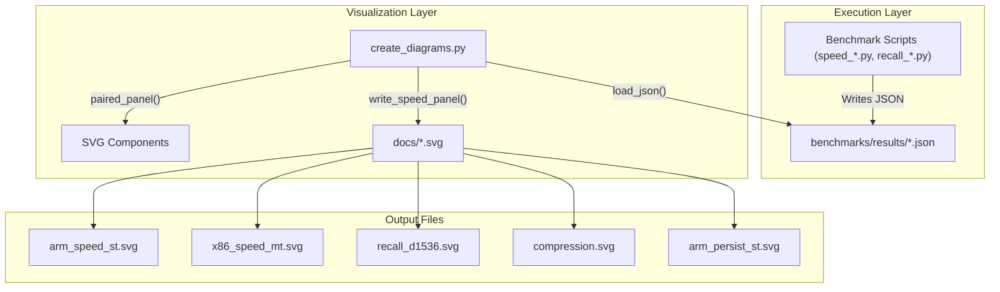
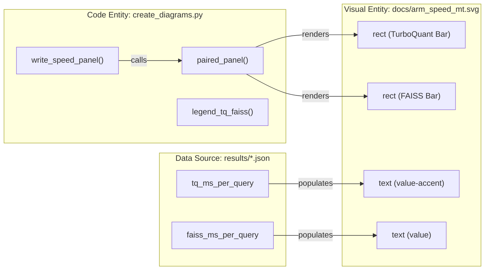

<!-- source: DeepWiki mcp.deepwiki.com · repo RyanCodrai/turbovec · page 5.2 Results and Visualization · fetched 2026-10-30 -->

# Results and Visualization

Relevant source files

The following files were used as context for generating this wiki page:

- [benchmarks/create_diagrams.py](benchmarks/create_diagrams.py)
- [benchmarks/results/compression.json](benchmarks/results/compression.json)
- [benchmarks/results/recall_d1536_4bit.json](benchmarks/results/recall_d1536_4bit.json)
- [benchmarks/results/recall_d3072_4bit.json](benchmarks/results/recall_d3072_4bit.json)
- [benchmarks/results/recall_glove_4bit.json](benchmarks/results/recall_glove_4bit.json)
- [docs/arm_persist_mt.svg](docs/arm_persist_mt.svg)
- [docs/arm_persist_st.svg](docs/arm_persist_st.svg)
- [docs/arm_speed_mt.svg](docs/arm_speed_mt.svg)
- [docs/arm_speed_st.svg](docs/arm_speed_st.svg)
- [docs/x86_persist_mt.svg](docs/x86_persist_mt.svg)
- [docs/x86_persist_st.svg](docs/x86_persist_st.svg)
- [docs/x86_speed_mt.svg](docs/x86_speed_mt.svg)
- [docs/x86_speed_st.svg](docs/x86_speed_st.svg)

The **turbovec** project includes a comprehensive benchmarking and visualization pipeline designed to validate performance claims across different hardware architectures (ARM and x86) and quantization levels (2-bit and 4-bit). This page details the data schema used for results, the SVG generation logic, and a summary of the key performance findings, including speedups, compression ratios, and removal efficiency.

## Benchmark Results Schema

Benchmark results are stored as JSON files within the `benchmarks/results/` directory [benchmarks/create_diagrams.py:18](). These files provide a standardized interface between the execution scripts (e.g., `speed_*.py`, `recall_*.py`) and the visualization tools.

### JSON Structure
Each result file contains hardware metadata and performance metrics for both `TurboQuant` and the `FAISS` baseline [benchmarks/results/recall_d3072_4bit.json:1-35]().

| Key | Description |
| :--- | :--- |
| `dim` | Vector dimensionality (e.g., 1536, 3072) [benchmarks/results/recall_d3072_4bit.json:3](). |
| `bit_width` | Quantization level (2 or 4) [benchmarks/results/recall_d3072_4bit.json:4](). |
| `tq_ms_per_query` | Median latency for TurboQuant in milliseconds [benchmarks/create_diagrams.py:167](). |
| `faiss_ms_per_query` | Median latency for FAISS `IndexPQFastScan` baseline [benchmarks/create_diagrams.py:168](). |
| `tq_recalls` | Dictionary of recall@1@k values for TurboQuant [benchmarks/results/recall_d3072_4bit.json:7-15](). |
| `tqplus_recalls` | Recall values for TQ+ (per-coordinate calibration) [benchmarks/results/recall_d3072_4bit.json:16-24](). |
| `faiss_recalls` | Recall values for FAISS baseline [benchmarks/results/recall_d3072_4bit.json:26-34](). |
| `speed_insert_*` | Metrics for online insertion speed. |
| `speed_remove_*` | Metrics for online removal speed. |
| `sync_*` | Metrics for incremental synchronization performance. |

**Sources:**
- `benchmarks/results/recall_d3072_4bit.json`
- `benchmarks/create_diagrams.py`

## Visualization Pipeline

The visualization system uses a custom Python script, `create_diagrams.py`, to transform JSON results into high-quality SVG charts published to the `docs/` directory [benchmarks/create_diagrams.py:1-12]().

### Diagram Generation Logic
The script implements a "turboquant-wasm" aesthetic using a specific color palette and typography [benchmarks/create_diagrams.py:21-42]().

1.  **Data Loading**: The `load_json` function reads files from the results directory [benchmarks/create_diagrams.py:153-155]().
2.  **Scaling**: A `nice_ceil` utility ensures Y-axis ticks are rounded to human-readable intervals (1.0, 1.5, 2.0, 5.0) [benchmarks/create_diagrams.py:55-70]().
3.  **Component Rendering**:
    *   `grid_lines`: Renders background ticks and axis labels [benchmarks/create_diagrams.py:90-104]().
    *   `paired_panel`: Generates side-by-side bar comparisons for latency and persistence benchmarks [benchmarks/create_diagrams.py:107-140]().
    *   `legend_tq_faiss`: Creates the color-coded key for chart interpretation [benchmarks/create_diagrams.py:143-150]().

### System Data Flow: Results to Visuals

**Sources:**
- `benchmarks/create_diagrams.py`
- `benchmarks/results/recall_d1536_4bit.json`

## Key Findings and Charts

The benchmarks compare `turbovec` against `FAISS` (using `IndexPQFastScan`) across several dimensions.

### 1. Search Latency (Speed)
TurboQuant demonstrates a significant performance advantage on ARM architectures, specifically leveraging Google Axion (ARM) and Apple Silicon.

*   **ARM Performance**: On ARM (GCP Axion), TurboQuant achieves a **12–20% speedup** over FAISS [docs/arm_speed_mt.svg:2-35](). For example, at `d=3072` and 4-bit, TurboQuant records **0.285 ms/query** compared to FAISS's **0.987 ms/query** in multi-threaded mode [docs/arm_speed_mt.svg:52-53]().
*   **x86 Performance**: On Intel Sapphire Rapids, TurboQuant remains highly competitive. At `d=3072` and 4-bit, TurboQuant records **0.346 ms/query** vs FAISS **1.177 ms/query** [docs/x86_speed_mt.svg:52-53]().

### 2. Recall Accuracy
Recall is measured as `recall@1@k`, tracking how often the true top-1 nearest neighbor appears within the top-k results [benchmarks/results/recall_glove_4bit.json:7-15]().

*   **High Fidelity**: On the `openai-3072` dataset at 4-bit, TurboQuant achieves a recall@1@1 of **0.972**, matching FAISS exactly [benchmarks/results/recall_d3072_4bit.json:8, 27]().
*   **TQ+ Advantage**: TQ+ (per-coordinate calibration) often provides a boost, reaching **0.981** recall@1@1 on the same dataset [benchmarks/results/recall_d3072_4bit.json:17]().

### 3. Compression and Persistence
TurboQuant significantly reduces memory footprint and optimizes cold-start search times.

*   **Compression**: TurboQuant achieves approximately **16× compression** at 2-bit quantization compared to standard `float32` [benchmarks/create_diagrams.py:11]().
*   **Load Performance**: TurboQuant excels in "Load → first search" latency. On ARM, for `d=3072` 2-bit, TurboQuant completes the first search in **3.0 ms** compared to FAISS **17.4 ms** [docs/arm_persist_mt.svg:83-85]().
*   **Removal Efficiency**: TurboQuant implements **O(1) removal** via `swap_remove` and lazy materialization, avoiding the **O(N) repacking** overhead typically required by FAISS [benchmarks/create_diagrams.py:7]().

### Latency Comparison Diagram (Code Entity Mapping)

This diagram maps the visual representation of a "Panel" in the SVG to the specific logic and data points in the benchmark results.

**Sources:**
- `benchmarks/create_diagrams.py`
- `docs/x86_speed_mt.svg`
- `docs/arm_speed_mt.svg`
- `docs/arm_persist_mt.svg`
- `benchmarks/results/recall_d3072_4bit.json`

---

