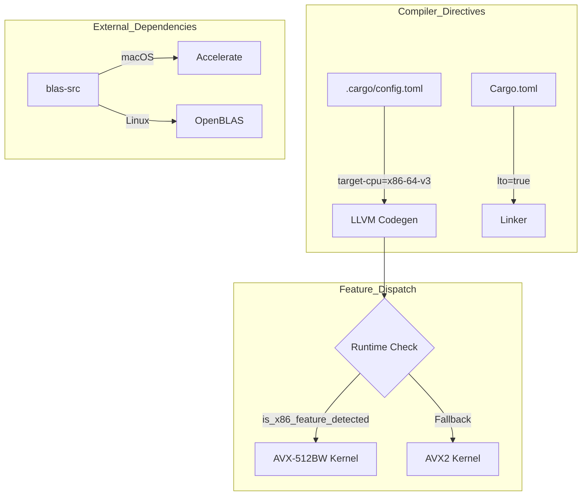
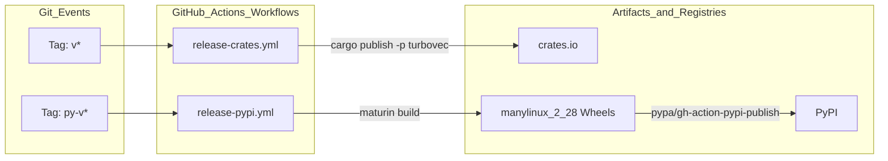
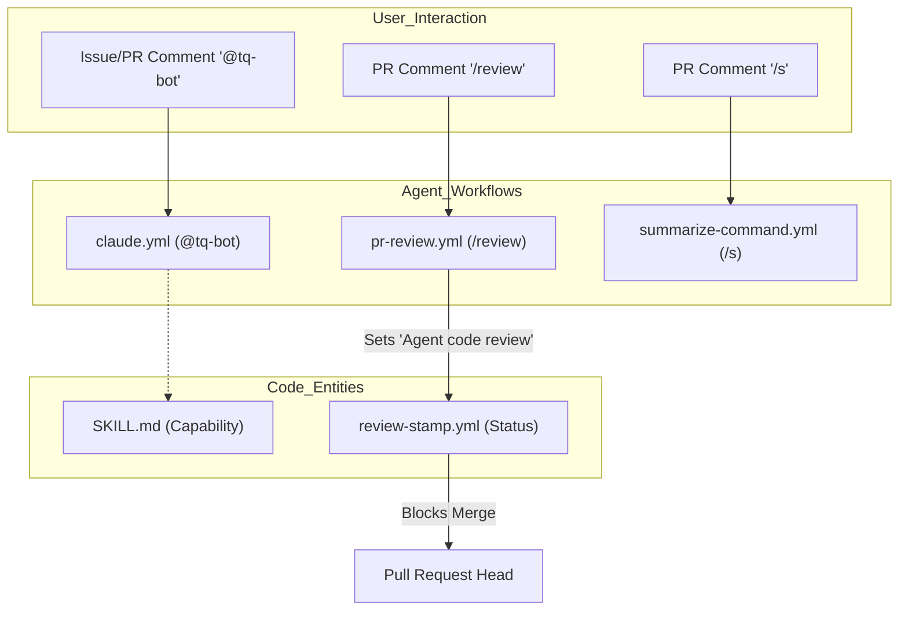

<!-- source: DeepWiki mcp.deepwiki.com · repo RyanCodrai/turbovec · page 6 Build, CI/CD, and Release · fetched 2026-10-30 -->

# Build, CI/CD, and Release

Relevant source files

The following files were used as context for generating this wiki page:

- [.claude/skills/s/SKILL.md](.claude/skills/s/SKILL.md)
- [.github/workflows/ci.yml](.github/workflows/ci.yml)
- [.github/workflows/claude.yml](.github/workflows/claude.yml)
- [.github/workflows/intake.yml](.github/workflows/intake.yml)
- [.github/workflows/pr-review.yml](.github/workflows/pr-review.yml)
- [.github/workflows/release-crates.yml](.github/workflows/release-crates.yml)
- [.github/workflows/release-pypi.yml](.github/workflows/release-pypi.yml)
- [.github/workflows/review-stamp.yml](.github/workflows/review-stamp.yml)
- [.github/workflows/security-audit.yml](.github/workflows/security-audit.yml)
- [.github/workflows/summarize-command.yml](.github/workflows/summarize-command.yml)
- [.github/workflows/supply-chain.yml](.github/workflows/supply-chain.yml)

This page provides a high-level overview of the `turbovec` build system, compiler optimizations, and the automated pipelines used to distribute the project to the Rust and Python ecosystems. The project utilizes a polyglot workspace strategy to manage both the core SIMD engine and its high-level bindings, alongside an agentic automation layer for development.

## Build System Architecture

The `turbovec` repository is organized as a Cargo workspace containing two primary members: the core Rust library and the Python extension module. The build system is designed to maximize SIMD throughput by enforcing specific instruction set baselines while maintaining runtime flexibility for advanced features like AVX-512.

### Workspace Structure
The root `Cargo.toml` manages the relationship between the core engine and the Python wrapper. It defines shared release profiles that prioritize execution speed through Link Time Optimization (LTO) and reduced codegen units.

| Component | Path | Responsibility |
| :--- | :--- | :--- |
| **Workspace Root** | `Cargo.toml` | Defines members and release profiles [Cargo.toml:1-9](). |
| **Core Library** | `turbovec/` | The primary Rust crate containing SIMD kernels and quantization logic. |
| **Python Bindings** | `turbovec-python/` | PyO3-based extension module and Python package metadata. |

### Compiler Configuration
To ensure the high-performance search kernels are not bottlenecked by generic code, the project enforces an `x86-64-v3` microarchitecture baseline for all x86_64 builds. This allows the compiler to emit AVX2 and FMA instructions globally without requiring manual intrinsics for every loop. The Minimum Supported Rust Version (MSRV) is pinned to **1.89** to support stabilized AVX-512 intrinsics.

For details on microarchitecture levels, MSRV, and BLAS backend selection (Accelerate on macOS, OpenBLAS on Linux), see [Cargo Workspace and Compiler Configuration](#6.1).

**Build Configuration Flow**

Sources: [.cargo/config.toml:1-21](), [Cargo.toml:1-9](), [turbovec/Cargo.toml:1-40]()

---

## CI/CD and Release Pipelines

Automated pipelines handle testing, security auditing, and publishing of `turbovec` to **crates.io** and **PyPI**.

### CI and Security
The `ci.yml` workflow enforces strict quality gates, including `TURBOVEC_REQUIRE_SIMD=avx2` to ensure kernels actually execute in the runner environment [.github/workflows/ci.yml:42-45](). Supply chain security is managed via `cargo-deny` and `pip-audit` [.github/workflows/supply-chain.yml:1-6](), while workflow integrity is verified by `zizmor` [.github/workflows/security-audit.yml:34-36]().

### Release Workflows
- **Rust Crate**: `release-crates.yml` publishes `turbovec` to crates.io on `v*` tags [.github/workflows/release-crates.yml:1-6](). It validates that the git tag matches the `Cargo.toml` version before proceeding [.github/workflows/release-crates.yml:32-46]().
- **Python Wheels**: `release-pypi.yml` builds `manylinux_2_28` wheels for `x86_64` and `aarch64` using `maturin-action` [.github/workflows/release-pypi.yml:58-64](). It includes a "smoke test" that installs the built wheel on Python 3.9 through 3.14 to catch linkage regressions [.github/workflows/release-pypi.yml:98-126]().

For details on CI jobs and the release matrix, see [GitHub Actions — CI and Release Pipelines](#6.2).

**Release Pipeline Mapping**

Sources: [.github/workflows/release-crates.yml:1-61](), [.github/workflows/release-pypi.yml:1-132](), [.github/workflows/ci.yml:1-109]()

---

## AI-Assisted Development

`turbovec` integrates an agentic automation layer powered by Anthropic's Claude to assist with maintenance and code quality.

### @tq-bot and PR Review
The repository uses `@tq-bot` (invoked via `claude.yml`) to handle complex tasks like branch creation and testing [.github/workflows/claude.yml:1-34](). A separate `pr-review.yml` workflow acts as a blocking merge gate; it uses a multi-agent "finder+validator" pattern to post a `REVIEW_VERDICT` (GO/NO-GO) as a commit status on the PR head SHA [.github/workflows/pr-review.yml:1-12]().

### Utility Commands
- **/s or /summary**: Triggers `summarize-command.yml` to provide plain-English explanations of diffs or threads [.github/workflows/summarize-command.yml:1-15]().
- **Issue Intake**: `intake.yml` provides automated triage and classification of new issues [.github/workflows/intake.yml:1-6]().

For details on bot capabilities and review protocols, see [AI-Assisted Development — @tq-bot and PR Review](#6.3).

**Agentic Workflow Topology**

Sources: [.github/workflows/claude.yml:1-101](), [.github/workflows/pr-review.yml:1-100](), [.github/workflows/summarize-command.yml:1-40](), [.claude/skills/s/SKILL.md:1-27]()

---

## Child Pages

*   **[Cargo Workspace and Compiler Configuration](#6.1)**: Deep dive into `lto`, `codegen-units`, the `x86-64-v3` baseline, and conditional BLAS linking (Accelerate vs OpenBLAS).
*   **[GitHub Actions — CI and Release Pipelines](#6.2)**: Technical details of the `maturin` build matrix, `manylinux` compatibility, security auditing (`zizmor`, `cargo-deny`), and the automated publishing steps.
*   **[AI-Assisted Development — @tq-bot and PR Review](#6.3)**: Documents the agentic layer, including the `REVIEW_VERDICT` protocol, the multi-agent review pattern, and the `s` skill for diff summarization.

---

