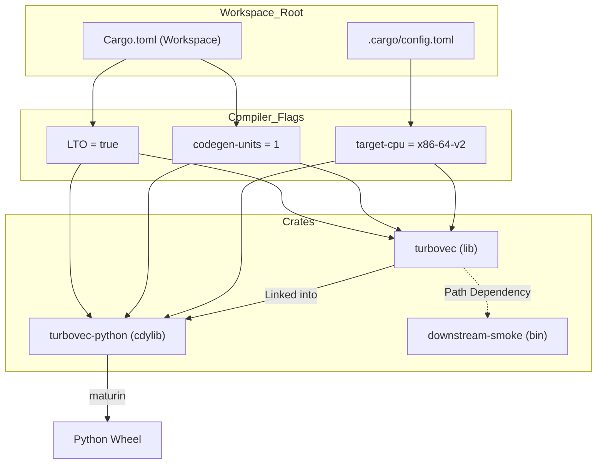
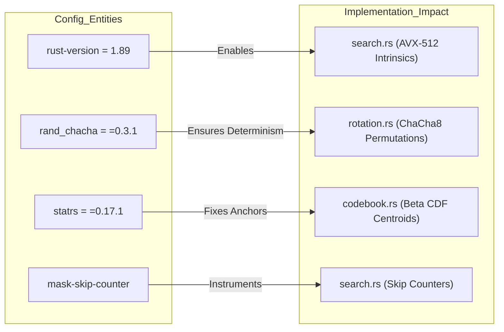

<!-- source: DeepWiki mcp.deepwiki.com · repo RyanCodrai/turbovec · page 6.1 Cargo Workspace and Compiler Configuration · fetched 2026-10-30 -->

# Cargo Workspace and Compiler Configuration

Relevant source files

The following files were used as context for generating this wiki page:

- [.cargo/config.toml](.cargo/config.toml)
- [.gitignore](.gitignore)
- [Cargo.lock](Cargo.lock)
- [Cargo.toml](Cargo.toml)
- [examples/downstream-smoke/Cargo.lock](examples/downstream-smoke/Cargo.lock)
- [examples/downstream-smoke/Cargo.toml](examples/downstream-smoke/Cargo.toml)
- [examples/downstream-smoke/src/main.rs](examples/downstream-smoke/src/main.rs)
- [turbovec-python/Cargo.toml](turbovec-python/Cargo.toml)
- [turbovec-python/build.rs](turbovec-python/build.rs)
- [turbovec-python/pyproject.toml](turbovec-python/pyproject.toml)
- [turbovec/Cargo.toml](turbovec/Cargo.toml)

This page documents the build system, compiler optimizations, and dependency management used by `turbovec`. The project is structured as a Cargo workspace to manage the core Rust engine and its Python bindings as separate but coupled entities. The configuration emphasizes aggressive Link Time Optimization (LTO) and specific instruction set baselines to achieve high-performance vector search while maintaining broad hardware compatibility.

## Workspace Structure

The `turbovec` repository is organized as a Cargo workspace containing two primary members. This structure allows the core library to remain a pure Rust crate while the Python extension manages its own PyO3-specific dependencies and build lifecycle.

| Member | Path | Role |
| :--- | :--- | :--- |
| `turbovec` | `turbovec/` | Core SIMD-accelerated quantization and search engine. |
| `turbovec-python` | `turbovec-python/` | PyO3 bindings (`_turbovec`) and high-level Python wrappers. |

The root `Cargo.toml` defines the workspace members and excludes the `downstream-smoke` example to ensure it remains a standalone test of the external user experience.

Sources: `[Cargo.toml:1-7]()`

## Release Profile and Optimization

To maximize search performance, `turbovec` utilizes a highly optimized release profile. These settings ensure that the compiler can perform cross-crate optimizations and minimize overhead in the hot search loops.

*   **LTO (Link Time Optimization)**: Set to `true` `[Cargo.toml:10-10]()`. This enables global optimizations across the entire dependency graph, which is critical for inlining functions between the core engine and its dependencies.
*   **Codegen Units**: Set to `1` `[Cargo.toml:11-11]()`. While this increases compilation time, it allows LLVM to perform better optimization by processing the entire crate as a single unit, preventing optimization barriers between modules.
*   **Optimization Level**: Set to `3` `[Cargo.toml:12-12]()` for maximum speed.

Sources: `[Cargo.toml:9-12]()`

## Minimum Supported Rust Version (MSRV)

The project enforces a Minimum Supported Rust Version of **1.89** `[turbovec/Cargo.toml:27-27]()`. This specific version is required because the AVX-512 search kernels in `search.rs` and the rotation logic in `rotation.rs` rely on `_mm512_*` intrinsics that were stabilized in Rust 1.89 `[turbovec/Cargo.toml:5-11]()`. 

Versions prior to 1.89 fail to compile on `x86_64` targets due to unstable feature requirements and signature changes in stabilized intrinsics like `_mm512_loadu_si512` `[turbovec/Cargo.toml:10-15]()`.

Sources: `[turbovec/Cargo.toml:5-27]()`, `[turbovec-python/Cargo.toml:10-10]()`

## Target Architecture and SIMD Strategy

The `.cargo/config.toml` file defines the baseline instruction set for `x86_64` builds. The project targets the **x86-64-v2** microarchitecture level `[.cargo/config.toml:22-22]()`.

### x86-64-v2 Baseline
The `x86-64-v2` level (Nehalem-era) includes SSE3, SSSE3, SSE4.1, SSE4.2, and POPCNT `[.cargo/config.toml:3-3]()`. This is the baseline for all "plain" Rust code, including the dispatch prologue and scalar fallbacks.

### Runtime Dispatch and SIGILL Prevention
Unlike earlier versions, the project deliberately does **not** set the baseline to `x86-64-v3` (AVX2) or `v4` (AVX-512) `[.cargo/config.toml:11-13]()`. 
1.  **Compatibility**: A `v3` baseline would cause standard Rust code to emit AVX2 instructions, leading to a `SIGILL` crash on older CPUs before the runtime dispatch logic in `search.rs` can even execute `[.cargo/config.toml:14-17]()`.
2.  **Runtime Selection**: High-performance kernels are marked with `#[target_feature(enable = "...")]` and selected at runtime via `is_x86_feature_detected!` `[.cargo/config.toml:13-14]()`.

Sources: `[.cargo/config.toml:1-22]()`

## Dependency Panning and Features

### Pinned Mathematical Dependencies
Certain dependencies are pinned to exact versions to ensure index consistency and deterministic encoding:
*   **`rand_chacha = "=0.3.1"`**: The ChaCha8 stream drives block-Hadamard sign flips. Any change in the stream would invalidate existing v5+ indexes `[turbovec/Cargo.toml:42-47]()`.
*   **`statrs = "=0.17.1"`**: Used for `Beta::cdf` to determine Lloyd-Max centroids and TQ+ calibration anchors. Small changes in upstream math would silently shift encoded bits `[turbovec/Cargo.toml:48-65]()`.

### Feature Flags
*   **`mask-skip-counter`**: An optional feature for telemetry that counts 32-vector blocks short-circuited by slot-masking. It is off by default to avoid atomic RMW serialization on the search hot path `[turbovec/Cargo.toml:67-71]()`.
*   **`extension-module`**: A `turbovec-python` feature that controls linking against `libpython`. It is enabled by default for `maturin` builds but disabled during CI unit tests to allow linking against the test runner `[turbovec-python/Cargo.toml:16-27]()`.

Sources: `[turbovec/Cargo.toml:36-72]()`, `[turbovec-python/Cargo.toml:16-41]()`

## Integration Testing: Downstream Smoke

The `examples/downstream-smoke` crate serves as a final integration gate. It is excluded from the workspace `[Cargo.toml:6-6]()` to mimic a real-world user adding `turbovec` via a path or registry dependency. It verifies:
1.  **Linkability**: Confirms the crate links without requiring manual BLAS ceremony (e.g., `extern crate blas_src`) `[examples/downstream-smoke/src/main.rs:5-8]()`.
2.  **Public API Integrity**: Ensures that types like `SearchResults` maintain `Debug`, `Send`, and `Sync` traits from the perspective of an external crate `[examples/downstream-smoke/src/main.rs:51-81]()`.

Sources: `[examples/downstream-smoke/Cargo.toml:1-21]()`, `[examples/downstream-smoke/src/main.rs:1-81]()`

## Build Configuration Logic

The following diagram illustrates how the compiler configuration and workspace members interact to produce optimized artifacts.

### Build Data Flow

Sources: `[Cargo.toml:1-12]()`, `[.cargo/config.toml:21-22]()`, `[examples/downstream-smoke/Cargo.toml:18-19]()`

## Code Entity Association

This diagram maps configuration entities to their specific impacts on the Rust implementation.

### Configuration to Implementation Mapping

Sources: `[turbovec/Cargo.toml:5-71]()`, `[turbovec-python/Cargo.toml:5-10]()`

---

